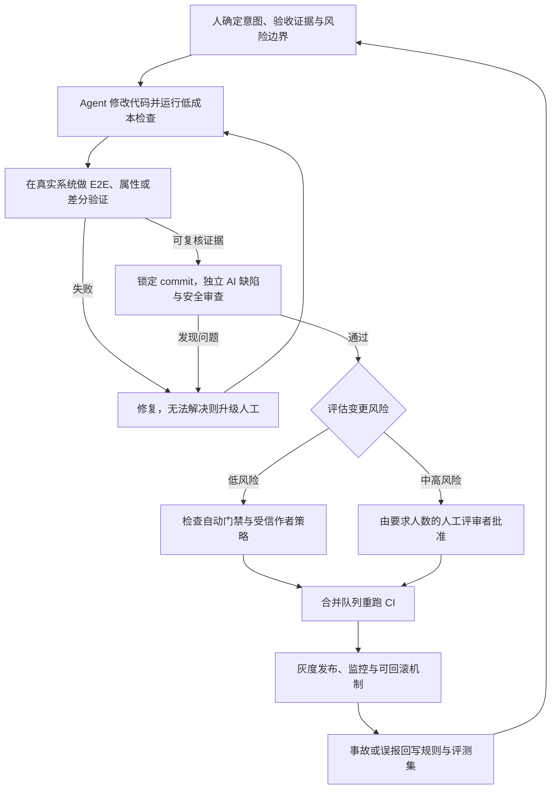

# Coding Agent 验证与代码评审 / Verification vs Code Review for Coding Agents

## 一句话定义

**验证（verification）**通过运行与测试提供某次变更的行为证据；**代码评审（code review）**综合目标、差异、安全与剩余风险，决定是否可合并、由谁批准及如何回滚。两者相互依赖但不能相互替代。

## 英文缩写速查

| 缩写 | 英文全称 | 简要说明 |
| --- | --- | --- |
| E2E | End-to-End | 跨组件验证真实用户或服务流程 |
| PR | Pull Request | 绑定变更、审查意见与合并决策的请求 |
| CI | Continuous Integration | 提交后自动构建、测试及质量检查 |
| CDP | Chrome DevTools Protocol | 浏览器端到端操作与可观察证据接口 |
| QA | Quality Assurance | 面向质量和使用场景的验收工作 |

## 为什么重要

两篇 Claude Code 官方博客分别发表于 **2026-10-15**（代码评审）和 **2026-11-16**（验证），并非两份互相替代的操作手册。只要求 agent 报告“单测已过”，会遗漏真实用户路径、边界和失败恢复；只让 AI reviewer 阅读 diff，也不能保证服务或 UI 真正按目标运行。

Anthropic 团队报告：2026 年 6–9 月其 Claude Code 仓库合并 PR 数量超过翻倍、需回滚的 PR 占比下降超过 40%。这是**团队自述的历史相关性**，不能归因于单一门禁，亦不可直接外推到机器人控制或其他组织。

## 核心原理

| 决策问题 | 验证（2026-11-16） | 评审（2026-10-15） |
| --- | --- | --- |
| 核心问题 | 改动有没有在真实条件下按预期工作？ | 改动是否值得合并、遗漏了什么风险？ |
| 首要输入 | 可启动系统、明确预期、测试数据、旧行为 | 固定提交的 diff、PR 意图、仓库规则与测试证据 |
| 主要手段 | E2E、属性测试、差分测试、可重复 smoke test | AI 缺陷与安全审查、按风险要求人审、CI/合并队列 |
| 证据输出 | 运行记录、trace、截图、反例和失败步骤 | 文件/行级发现、风险级别、审批、回滚计划 |
| 迭代方式 | 测试失败修复；三轮未解升级人工 | 约束评审轮数，后续聚焦增量 diff；漏报进评测集 |
| 风险盲点 | 通过的测试不能覆盖未定义的安全与产品决策 | 静态审查无法证明真实设备或服务端到端行为 |

### 共同工作流（依据两篇官方博客综合）

此图是**两篇文章内容的整理与衔接**，不是 Claude Code 内部未公开服务的源码调用时序。原文中的低/中/高风险对应内部审批策略：低风险在合规前提下可零额外人工批准，中风险通常一人，高风险两人；敏感路径及非受信作者有额外要求，**不得移植为其他仓库的默认门槛**。

### 两个验证器也需要防作弊和防噪声

- **检查的独立性：** 评审使用 base/default 分支的 `REVIEW.md`，避免被评审 PR 修改自己的评分规则；评审结论仅对特定 commit 有效。
- **校准的独立性：** 用历史事故、回滚与稳定变更评测 reviewer；分别观察原始发现、验证后发现及最终评审的召回与误报。
- **审查要收敛：** 评审文章报告有 PR 陷入 50 多轮审查；后续限制轮次、后几轮只检查新 diff。验证文章也规定反复失败三轮时引入人工。

## 工程实践

### 最小验收记录

1. **目标和风险：** 写清此次变更解决什么、不能破坏什么、是否触及权限/部署/硬件安全。
2. **验证证据：** 记录实际执行命令、退出状态、端到端路径、trace/截图、边界反例、未覆盖项；不以“已验证”一句话代替。
3. **评审证据：** 用固定 commit 检查 diff；针对具体文件及行为给出可复核发现；安全问题独立检查，误报写明依据。
4. **合并与发布：** 由仓库自己的规则决定必要的人审、合并队列和回滚手段；变更后新提交需重验受影响的证据。
5. **复盘与门禁改进：** 用事故、revert 和后续失效实例校正规则，避免无期限扩张 lint / skill 文件。

### 机器人控制代码的额外门禁（工程迁移建议）

机器人场景可沿用“先证据、再风险”的框架，但必须**另设**仿真回放、控制周期和延迟、接触与限位、通信中断、急停和人工上机审批。软件 E2E 或 AI reviewer 的通过结果，均不构成真机安全认证。这些是面向机器人领域的工程映射，**不是两篇博客声称已经实施的机器人测试流程**。

## 局限与风险

- 两篇均属团队工程实践报告，未提供整套内部 CI / 评审系统源码或可独立复现的评测数据；本文不推断内部系统实现。
- 验证结果可能遗漏真实世界失效，评审结果可能出现误报或漏报；需同时保留能复现的失败证据和人工升级路径。
- “低风险零人审”依赖风险分类、受信作者、自动审查及回滚条件，不应在缺乏配套治理时照搬。
- 团队关于约 90% Claude 写码、review finding 16%→54% 等数字只描述其内部场景，不能当成质量或安全提升的独立实验结论。

## 关联页面

- [Coding Agent 验证闭环](../methods/coding-agent-verification-loops.md) — E2E、属性和差分测试的细节及运行证据。
- [Agentic Coding 时代的软件工程基础](../concepts/agentic-coding-software-fundamentals.md) — 人如何描述取舍与可靠性约束。
- [多 Agent 编码管理与认知把关](../concepts/coding-agent-orchestration-and-cognitive-oversight.md) — 任务分配、审查能力和人的责任。
- [AI Agent 评测](../concepts/ai-agent-evaluation.md) — 如何避免评测器偏差。
- [Open Code Review](../entities/open-code-review.md) — 可审计的第三方 diff 评审工具，与 Anthropic 内部流程不同。

## 参考来源

- [How the Claude Code team thinks about verification（2026-11-16，官方原文归档）](../../sources/blogs/claude_dev_verification_addy_osmani_2026-11-16.md)
- [How the Claude Code team does code review（2026-10-15，官方原文归档）](../../sources/blogs/anthropic_claude_code_review_2026-10-15.md)

## 推荐继续阅读

- [How the Claude Code team thinks about verification](https://claude.dev/blog/how-the-claude-code-team-thinks-about-verification/)
- [How the Claude Code team does code review](https://claude.dev/blog/solving-code-review-at-anthropic/)
