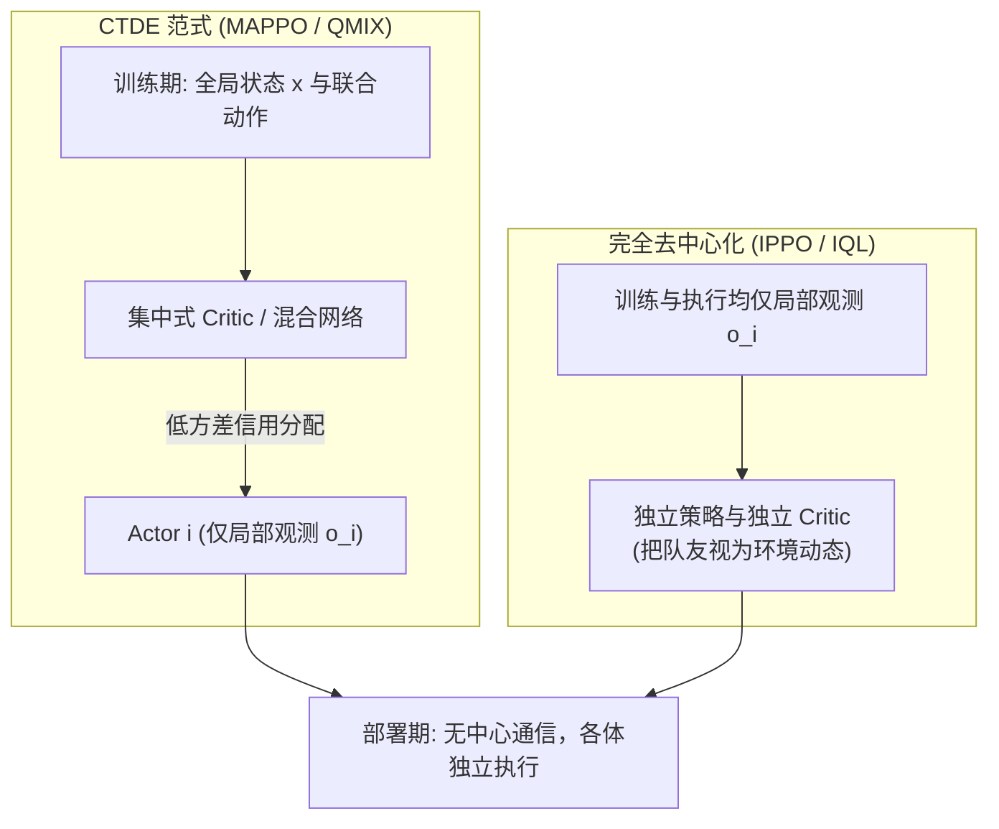

# CTDE vs 完全去中心化 MARL

在 [多智能体强化学习（MARL）](../methods/marl.md) 里，多个机器人在同一空间协作或竞争（多臂流水线、机器人足球、集群导航）。两个核心难点是 **非平稳性**（别人的策略在变，环境转移也在变）与 **联合动作空间维度爆炸**。围绕「训练时能看到多少信息」这条轴，MARL 分成两大范式：**CTDE** 与 **完全去中心化**。

## 一句话定义

**CTDE vs 完全去中心化 MARL**：集中式训练、分布式执行（CTDE，如 MAPPO、QMIX、MADDPG）利用训练期全局状态缓解多智能体环境非平稳性与信用分配难题，而执行期仍各看局部观测；完全去中心化（如 IPPO、IQL）在训练与执行期均仅使用局部信息，以换取大规模集群的无边界扩展性。

## 英文缩写速查

| 缩写 | 英文全称 | 简要说明 |
|------|----------|----------|
| MARL | Multi-Agent Reinforcement Learning | 多智能体协作或竞争中的强化学习 |
| CTDE | Centralized Training, Decentralized Execution | 训练可利用集中信息，执行按各体可用观测决策 |
| PPO | Proximal Policy Optimization | MAPPO 与 IPPO 使用的策略优化方法 |
| RLCR | Reinforcement Learning from Collective Rewards | 用集体回报训练共享策略的软件 Agent 方法 |

## 为什么重要

- **决定多机仿真扩展上限与收敛稳定性**：在机器人足球、多臂装配或集群导航中，体数在 2–12 左右且能从仿真获得完整状态时，跳过 CTDE 强行采用完全去中心化极易因队友策略同时改变而引发振荡不收敛。
- **明确“无通信执行”与“集体推理回报”的边界**：不要把训练期用了集中式 Critic 误认为真实部署就需要集中基站通信；同时需区分机器人物理协同 MARL 与软件 Agent 按共享 wall-clock 回报训练的 RLCR 机制。

## 核心对比

| 维度 | CTDE（集中式训练，分布式执行） | 完全去中心化 |
|------|-------------------------------|-------------|
| **训练期信息** | 可访问全局状态 / 所有体观测与动作 | 各体只见自身局部观测 |
| **执行期信息** | 仅局部观测（与去中心化一致） | 仅局部观测 |
| **非平稳性缓解** | ✅ 集中式 critic 看全局，缓解信用分配 | ❌ 把他体当环境的一部分，非平稳严重 |
| **可扩展性** | 受集中式 critic 输入维度限制 | 体数增长更平滑（各体独立） |
| **部署耦合度** | 低（执行期不需通信） | 低（天然分布式） |
| **代表算法** | MAPPO、MADDPG、QMIX | 独立 PPO/Q-learning（IPPO/IQL） |

## 核心原理

依据 MAPPO（arXiv:2103.01955）、QMIX（arXiv:1803.11485）与 MADDPG（arXiv:1706.02275）原始理论：完全去中心化将他体折叠进单个智能体的转移概率 $P(s'|s,a_i)$，因他体策略随训练更新使该环境变非平稳；CTDE 则引入观测全局信息 $x$（与联合动作）的集中式值网络 $V(x)$ / 混合超网络 $Q_{\text{tot}}$，在保证个体执行策略 $\pi_i(a_i|o_i)$（或满足 IGM 单调性条件）仅依赖本地观测前提下，提供无偏或低方差优势估计。

## CTDE（Centralized Training, Decentralized Execution）

训练时用一个能看到 **全局信息** 的集中式 critic 估计价值，缓解信用分配与非平稳性；部署时每个机器人只凭 **局部观测** 决策，因此执行期无需体间通信。MAPPO 是把 PPO 套进 CTDE 框架的常见基线。

**适合**：体数中等、训练在仿真里能拿到全局状态、希望部署时各体独立运行的协作任务。

**瓶颈**：集中式 critic 的输入随体数增长，超大集群下维度与训练成本上升。

## 完全去中心化

每个机器人把 **其他机器人视为环境的一部分**，各自跑独立的单体 RL（IPPO/IQL）。实现简单、扩展平滑，但因为他体策略在变，单体看到的环境是 **非平稳** 的，收敛性与稳定性更差。

**适合**：体数很大、无法获取全局状态、或只需弱协作的场景。

**瓶颈**：非平稳性导致训练不稳，复杂协作任务上常不如 CTDE。

## 与生成式世界模型的交叉

传统 MARL 在 **解析或网格仿真** 里学联合策略；[Gamma-World](../entities/paper-gamma-world-multi-agent.md) 走另一条路：先学 **多体动作条件的像素 rollout**（共享世界 + 各体独立可控），再作为 MARL / 规划的 **想象环境**。二者互补——前者给策略梯度，后者给高保真可交互观测；是否带来闭环任务增益仍需单独验证。

## 选型小结

| 场景 | 推荐范式 | 原因 |
|------|---------|------|
| 中等体数、仿真有全局状态 | CTDE（MAPPO） | 集中式 critic 缓解非平稳与信用分配 |
| 大规模集群、无全局状态 | 完全去中心化 | 各体独立，扩展平滑 |
| 需部署时各体独立运行 | 两者皆可（执行期都只用局部观测） | 关键差异在训练期信息 |
| 强协作、信用分配难 | CTDE | 去中心化非平稳性放大协作难度 |

## 工程实践

- **工程起步优先 MAPPO 基线**：除非机群规模达百架且仿真状态维数爆表，多机器人任务应按 MAPPO 论文实践先做集中式全局特征筛选（避免在 Critic 中盲目堆叠冗余个体局部特征）与适度裁剪/epoch 配置，待基线跑通再比较是否退回完全去中心化或耦合共享通讯通道。

## 与 RLCR 集体推理时扩展的选型边界

[RLCR：集体推理时扩展](../methods/rlcr-collective-inference-time-scaling.md) 讨论共享策略的软件 Agent 如何借集体回报、通信与 wall-clock 截止时间学习协作。**训练/执行的信息范围**和**奖励/时延激励**是不同选型轴；不能仅因 RLCR 使用共享回报，就把它归成集中式 critic 的 CTDE 实现。

| 要解决的问题 | 先核对什么 | 评估方式 |
|---|---|---|
| 机器人各体在局部观测下协作 | 训练是否可访问全局状态、执行允许哪些观测与通信 | 对齐任务、体数、观测和通信预算比较 CTDE 与独立学习基线 |
| 软件 Agent 能否在限定时间内交付更多工作 | 环境能否在任意截断点给可信进度回报 | 比较单 Agent、匹配 token 的长思考、独立并行尝试和可通信集体 |
| 判断 RLCR 的通信是否值得 | 任务是否真的需要交接、消息是否挤占执行时间 | 同时报告回报随时间曲线、达到同分的耗时、token 和通信量 |

这里的 RLCR 对照依据 [General Reasoning 官方博客归档](../../sources/blogs/gr_how_to_train_a_swarm_2026_11_02.md)。Avalon-M1 的截止时间方案不会给截止前同分但更快的 rollout 额外奖励；其软件任务观察也没有验证机器人通信、安全或群控收益。

## 局限与风险

- **CTDE 维度爆炸与特征过拟合**：当智能体数量持续增加时，固定拼装全局状态的 Critic 网络面临输入维度膨胀、体间置换不变性缺失以及仿真观测特权过拟合真机难以获取的问题。

## 参考来源

- [How to Train a Swarm 官方博客归档](../../sources/blogs/gr_how_to_train_a_swarm_2026_11_02.md) — RLCR 的奖励、通信、时间约束及软件任务证据边界
- Vinyals, O., et al. (2019). *Grandmaster level in StarCraft II using multi-agent reinforcement learning*.
- [sources/papers/survey_papers.md](../../sources/papers/survey_papers.md) — MARL 综述与范式分类
- [sources/papers/gamma_world_arxiv_2605_28816.md](../../sources/papers/gamma_world_arxiv_2605_28816.md) — 多智能体生成式交互世界模型

- [../../sources/papers/ctde_marl_primary_refs.md](../../sources/papers/ctde_marl_primary_refs.md)

## 推荐继续阅读

- 核心一手论文索引：[CTDE MARL 论文（MAPPO / QMIX / MADDPG）](../../sources/papers/ctde_marl_primary_refs.md)
- 领域总方法：[多智能体强化学习（MARL）](../methods/marl.md)

## 关联页面

- [RLCR：集体推理时扩展](../methods/rlcr-collective-inference-time-scaling.md) — 共享回报与时延激励的实践对照，不等同于训练/执行信息结构的分类
- [Multi-Agent Reinforcement Learning (MARL)](../methods/marl.md) — 范式、挑战与分类总览
- [Reinforcement Learning](../methods/reinforcement-learning.md) — 单体 RL 基础
- [Whole-body Coordination](../concepts/whole-body-coordination.md) — 单体内部多自由度协调，与多体协调相对照
- [Gamma-World](../entities/paper-gamma-world-multi-agent.md) — 多智能体生成式交互世界模型（arXiv:2605.28816）
