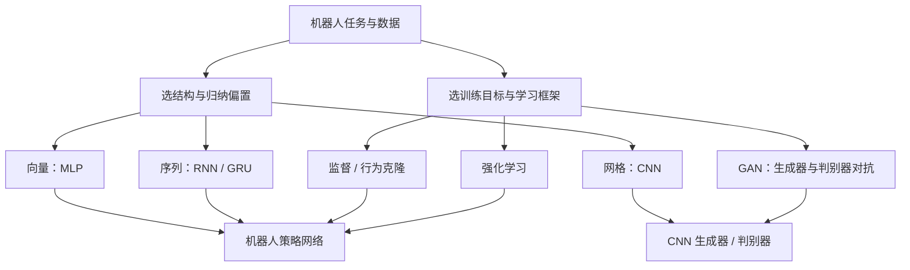

# DNN、CNN、RNN 与 GAN：结构轴和训练轴如何区分（Architecture vs Training）

## 一句话定义

**DNN（深层神经网络）是上位概念，不是特指 MLP；CNN/RNN 是具有空间或时间结构偏置的网络族；GAN 则定义生成器与判别器的对抗训练框架，而非一种固定的层连接方式。**

## 英文缩写速查

| 缩写 | 英文全称 | 简要说明 |
|------|----------|----------|
| DNN | Deep Neural Network | 泛指具有多个计算层的神经网络 |
| MLP | Multi-Layer Perceptron | 多层全连接前馈结构，是常见 DNN 示例 |
| CNN | Convolutional Neural Network | 卷积局部连接与跨空间参数共享 |
| RNN | Recurrent Neural Network | 跨时间递推隐状态与共享参数 |
| GAN | Generative Adversarial Network | 生成器–判别器对抗学习框架 |
| BPTT | Backpropagation Through Time | 按时间展开 RNN 的梯度反传 |
| AMP | Adversarial Motion Prior | 利用判别信号学习运动先验，非原始图像 GAN |

## 为什么重要

- 避免把「CNN vs GAN」当成同轴替代方案：**CNN 指计算骨干；GAN 指训练系统**，两者可组合（如 DCGAN）。
- 在机器人策略栈里分别回答三个问题：**如何编码观察**（MLP/CNN/RNN 等）、**输出什么**（类别/动作/分布）、**用什么监督或目标训练**（BC/RL/对抗等）。
- 理解归纳偏置（局部性、权值共享、隐状态）与对抗目标（分布匹配）不在同一层，才能解释组合式模型。

## 核心原理：两个正交的选择轴

| 名称 | 分类维度 | 核心机制 | 适合的输入/任务 | 局限 |
|------|----------|----------|----------------|------|
| DNN | 上位范畴 | 多层可训练非线性映射；MLP 是其一类 | 泛用表示学习 | 单独说 DNN 不够说明拓扑 |
| MLP（全连接实例） | 网络结构 | 每层仿射变换 + 激活，连接稠密 | 表格、机器人本体向量策略 | 图像/序列的偏置较弱，参数效率可能低 |
| CNN | 网络结构 | 局部感受野 + 空间权值共享 | 图像、特征网格、频谱 | 纯局部核对远距关系需要多层/全局模块 |
| RNN（含 LSTM / GRU） | 网络结构 | `h_t=f(x_t,h_{t-1})`；时间参数共享 | IMU/接触历史、在线预测、序列 | BPTT 难并行，隐状态压缩长历史 |
| GAN | 训练框架 | `G(z)` 造样本，`D(x)` 辨真假，以对抗目标优化 | 隐式分布生成、外观迁移等 | 训练稳定性/模式覆盖风险 |

### 1. DNN ≠ 全连接 MLP

- 深度表示「多层」，不指定每层必须全连接。CNN、深层 RNN 等也可属于 DNN。
- MLP 的基本单元是 `h=\sigma(Wx+b)`；链式法则计算梯度，优化器更新参数。万能逼近定理是**表示存在性**，不是训练可达性的保证。
- 原文的量级例子：`224\times224\times3=150{,}528` 个输入，接 1000 个全连接单元有 **150,528,000** 个权重（不含偏置）。

### 2. CNN：空间结构偏置

- 一个标准 `3\times3` 卷积从 3 通道映射到 64 通道，参数量是 `3\times3\times3\times64+64=1{,}792`（含输出偏置）。
- 与全连接示例相比参数少很多，但**两种层的空间输出、任务与计算成本不同，不能当作同精度基准**。
- 标准卷积通常满足**平移等变**（输入平移 → 特征图随之平移），不自动等于分类**平移不变**（最终类别不随平移变化）；池化可选，并非每个 CNN 都必需。

### 3. RNN：时间状态偏置

- 隐状态把历史压缩成固定大小的摘要；训练通过 BPTT 传梯度，长链会出现梯度消失与爆炸。
- LSTM 通过遗忘/输入/输出门与细胞状态维持信息，GRU 使用更新/重置门；门控减轻而非彻底消除长程问题。
- 递推限制时间步训练并行度，却可支持流式在线推理。

### 4. GAN：对抗目标和双网络框架

原始 GAN 的经典目标：

\[
\min_G\max_D\ \mathbb{E}_{x\sim p_{\mathrm{data}}}\log D(x)
+\mathbb{E}_{z\sim p_z}\log(1-D(G(z))).
\]

- **骨干可组合**：CNN + GAN → DCGAN；条件输入 + GAN → cGAN；G/D 也可使用 MLP 或适用于任务的序列骨干。
- 理想条件下 `p_g=p_{\mathrm{data}}` 且最优判别器 `D^*(x)=1/2`；训练过程不保证必然达到均衡。
- 核查模式覆盖、分布偏移与训练震荡；对抗训练不等于「只骗过一个固定的分类器」。

## 流程总览：先定轴，再组合

> 此图是**概念选择流程**，不是某个具体软件的真实运行时序图。GAN 的两个网络必须共同定义，MLP/CNN/RNN 不能直接等价于 GAN。

## 工程实践：映射到机器人

| 机器人问题 | 优先辨别 | 选型示例 |
|------------|----------|----------|
| 高频关节控制、状态向量输入 | 骨干 + 延迟预算 | 小 [MLP](../concepts/mlp.md) 策略（和训练目标独立） |
| 多相机视觉感知 | 空间结构与吞吐 | [CNN](../concepts/convolutional-neural-network.md) 或 ViT 编码器 |
| 需要根据触觉/IMU 历史决策 | 是否需要内部状态 | [GRU / RNN](../concepts/recurrent-neural-network.md) + 动作头 |
| 视觉仿真域外观差异 | 生成与匹配分布 | GAN 域迁移需核查是否篡改任务相关几何 |
| 要模仿真实运动风格 | 对抗判别信号 | [AMP](../methods/amp-reward.md) 判别器约束运动分布；**不等于**原始图像 GAN |

**读新论文时的三问：** ① 改的是骨干/连接，还是监督目标/训练流程？② 加了什么归纳偏置？③ 换来的时延、稳定性、算力或多样性代价是什么？

## 局限与风险

- 科普文章把 DNN、CNN、RNN、GAN 描述成「层级演进」有教学价值，但它们**不是严格按时间依次取代的四代架构**。
- 「展平会抹掉空间信息」应理解为**没有显式保留局部空间偏置**，而不是像素数值或位置从数学上被抹掉。
- 「RNN 已淘汰 / GAN 已退场」属于场景依赖的市场叙事，不能代替具体任务评测。
- 文章来源是**用户提供的完整文字稿**：公众号链接目前无法直接访问、图像未核验；技术表述另用经典原始论文与教材交叉核查。
- 本页是跨主题**对比整理**，不是单篇论文的独立实体节点，不虚构代码仓库或源码运行时序。

## 关联页面

- [MLP（多层感知机）](../concepts/mlp.md)
- [卷积神经网络 CNN](../concepts/convolutional-neural-network.md)
- [循环神经网络 RNN](../concepts/recurrent-neural-network.md)
- [生成对抗网络 GAN](../concepts/generative-adversarial-network.md)
- [深度学习基础](../concepts/deep-learning-foundations.md)
- [AI 架构地图](../overview/ai-architecture-map.md)
- [模型架构纵深路线 Stage 1](../../roadmap/depth-model-architecture.md)
- [CNN→Transformer→VLA/WAM：技术演进证据与叙事](./ai-paradigm-evolution-evidence-vs-narrative.md) — 将结构/训练两个轴扩展到多模态、缩放与具身证据审查

## 参考来源

- [深蓝AI 科普全文核对与纠偏记录](../../sources/blogs/deepblue-ai-dnn-cnn-rnn-gan-2026-11-20.md)
- [LeCun 1998（CNN 一手论文）](../../sources/papers/lecun_gradient_based_learning_1998.md)
- [Hochreiter 1997（LSTM 一手论文）](../../sources/papers/hochreiter_lstm_1997.md)
- [Goodfellow 2014（GAN 一手论文）](../../sources/papers/goodfellow_gan_arxiv_1406_2661.md)

## 推荐继续阅读

- [Deep Learning Book（Goodfellow, Bengio & Courville）](https://www.deeplearningbook.org/)
- [模型架构纵深路线](../../roadmap/depth-model-architecture.md)
