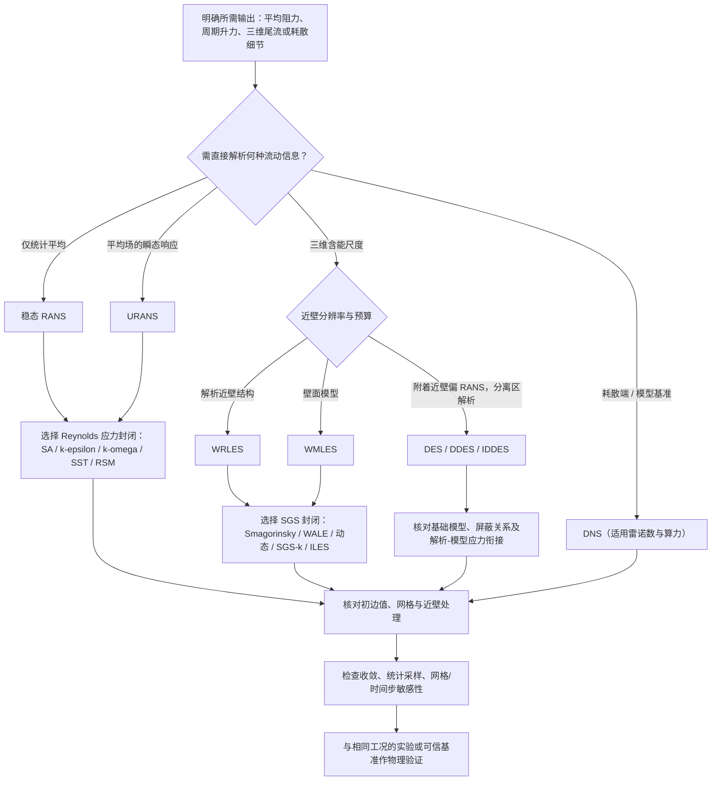

# DNS、LES 与 RANS/URANS：湍流求解及封闭模型选型（Choosing Turbulence Resolution and Closure Models）

## 一句话定义

**先根据工程目标决定直接求“瞬时全部尺度、统计平均场、随时间变化的平均场，还是空间过滤后的大尺度运动”，再为未解析尺度选择封闭关系，才是 DNS、RANS/URANS、LES 与 DES 家族的正确选型顺序。**

## 英文缩写速查

| 缩写 | 英文全称 | 简要说明 |
|---|---|---|
| NS | Navier–Stokes | 速度与压力的连续介质流动控制方程 |
| DNS | Direct Numerical Simulation | 直接解析从含能运动到耗散尺度的湍流 |
| RANS | Reynolds-Averaged Navier–Stokes | 对瞬时方程作 Reynolds 统计平均，求平均流场 |
| URANS | Unsteady Reynolds-Averaged Navier–Stokes | 保留统计平均场的物理时间变化 |
| LES | Large-Eddy Simulation | 解析过滤后较大尺度运动，建模亚网格影响 |
| SGS | Subgrid-Scale | LES 滤波下未解析尺度的应力或动能 |
| SST | Shear Stress Transport | 近壁与外区兼顾的常用两方程涡黏模型 |
| SA | Spalart–Allmaras | 用一个工作变量输运方程估计涡黏度 |
| RSM | Reynolds Stress Model | 直接输运 Reynolds 应力分量的模型路线 |
| DES | Detached-Eddy Simulation | RANS–LES 混合模拟，常重点解析分离尾流 |
| DDES | Delayed Detached-Eddy Simulation | 通过屏蔽减少附着边界层过早转为 LES 的风险 |
| IDDES | Improved Delayed Detached-Eddy Simulation | 包含近壁建模 LES 分支的混合方案 |
| WRLES | Wall-Resolved Large-Eddy Simulation | 解析近壁主要含能结构的 LES |
| WMLES | Wall-Modeled Large-Eddy Simulation | 用壁面模型承担近壁未解析运动的 LES |
| ILES | Implicit Large-Eddy Simulation | 利用经设计和验证的离散耗散承担部分 SGS 作用 |

## 为什么重要

同一套不可压缩 NS 方程描述层流与湍流；计算瓶颈来自高雷诺数下跨越巨大范围的湍流尺度。**求解方法决定留下什么信息，封闭模型决定丢掉的运动怎样反作用于已求解流场**。两者不是同一层的选项。

对于 [HydroGym 流控学习](../entities/paper-hydrogym.md)、[流体–机器人多物理仿真](../entities/paper-unified-fluid-robot-multiphysics-swimming.md) 或 CFD 工程自动化，平均阻力、瞬态载荷与宽频压力谱的需求完全不同：用不足以表达目标信息的模型，即使迭代残差很小，也未必得到有效的工程答案。

## 核心原理

### 1. 求解对象：统计平均与空间过滤并不等价

| 路线 | 直接求出的流动信息 | 对未解析运动的处理 | 典型用途与边界 |
|---|---|---|---|
| **DNS** | 瞬时速度、压力及相关湍流尺度，直到耗散端 | 不使用湍流封闭模型；仍须验证数值分辨率 | 基准数据、耗散细节；计算成本高 |
| **稳态 RANS** | 统计定常平均速度、平均压力 | Reynolds 应力封闭 | 平均载荷、平均流场；不提供涡的完整时间历程 |
| **URANS** | **平均场**及模型变量随时间的变化 | 与 RANS 同类的 Reynolds 应力封闭 | 启动过程、部分相干周期载荷；减小步长不会自动变成 LES |
| **LES** | 空间过滤后的三维大尺度瞬态运动 | SGS 应力模型或经验证的数值封闭 | 大尺度尾流、三维结构、谱；近壁处理和入口脉动关键 |
| **DES / DDES / IDDES** | 单一全域速度场，近壁常为 RANS 行为、合适外区为 LES 行为 | 基础湍流模型与网格关联尺度/屏蔽关系耦合 | 分离流、尾流；必须避免模型应力下降与解析脉动不足形成的应力缺口 |

RANS 中 `u_i=U_i+u'_i`，对非线性乘积求平均出现 `<u'_i u'_j>`；LES 中 `τᵢⱼ = overline(uᵢuⱼ) − ūᵢūⱼ`。两者都来自“先乘后平均不等于先平均后乘”，但**Reynolds 系综平均**与**空间过滤**不同，不能混淆其应力含义。

### 2. 封闭对象：模型不等于求解方法

| 求解路线 | 封闭方式 | 额外湍流输运量（典型） | 关键限制 |
|---|---|---|---|
| RANS / URANS | 混合长度与 Boussinesq 涡黏关系 | 无独立输运量 | 混合长度需由流动类型/壁面关系提供 |
| RANS / URANS | SA | 1 个工作变量 | 不直接给出独立湍动能 k |
| RANS / URANS | k–ε、k–ω、SST | k 与 ε 或 ω，共 2 个 | 近壁条件、自由流敏感性与**模型版本**必须匹配 |
| RANS / URANS | RSM | 6 个独立应力分量 + 典型尺度方程 | 仍需对压力–应变、扩散、耗散等项封闭 |
| LES | 固定/动态 Smagorinsky、WALE | 典型代数形式不加输运方程 | 由滤波速度梯度与模型系数计算 SGS 涡黏度 |
| LES | SGS-k | 1 个亚网格动能 | SGS 动能与 RANS 的统计脉动动能不是同一范围 |
| LES | ILES | 通常无 | 数值耗散是封闭方案的一部分，关闭 SGS 模型本身不等于完成 ILES |

以线性涡黏关系为例，RANS 通过应变率与涡黏度近似 Reynolds **偏应力**，而 LES 同类关系估计 SGS **偏应力**。两者的各向同性部分都可在对应的不可压缩方程中并入修正压力；因此须注意输出是修正压力还是可直接用于载荷的物理压力。对于 WALE，原文强调速度梯度构造及近壁自然衰减；动态 Smagorinsky 的“动态”是系数根据两级过滤数据更新，并非新增时间输运方程。

### 3. 选型流程图

### 4. 近壁与计算量

- **DNS**：需要同时覆盖大尺度与耗散端；原文按 Kolmogorov 尺度分析其计算代价，**1e9 单元**仅是特定空间尺度比的示例。
- **WRLES**：近壁主要含能结构仍需解析，流向、展向、壁面法向间距及时间步要一并检查。
- **WMLES**：外区解析较大涡，内层由壁面模型或混合关系补足。
- **DES 家族**：典型 DDES 在附着边界层维持 RANS，分离剪切层与尾流达到足够分辨率时呈 LES 行为；IDDES 还允许壁面建模分支。**附着区保持 RANS 行为不代表稳态计算。**

## 工程实践

以原文贯穿的圆柱绕流为例：

1. **设定目标输出。** 仅看平均阻力可从 RANS 起步；关心脱涡频率与周期升力可从 URANS 起步；关心三维尾流及宽频压力谱则评估 LES 或混合方法。均需核对雷诺数、转捩、分离与结构运动。
2. **定义求解变量。** 例如 URANS + SST 联立三个平均速度分量、修正压力、k、ω；涡黏度由这些当前变量经 SST 关系计算，**不是第七个独立输运场**。
3. **配置计算域与初边值。** 入口平均速度和湍流量、出口/回流、固壁与展向边界须相容；LES/DES 若期望解析湍流，需提供或发展相应三维已解析脉动，仅给 k、ω 不等于提供瞬时湍流。
4. **选择近壁网格。** 用壁面无量纲距离 `y+` 和沿壁面分辨率匹配壁面函数、低雷诺数模型、WRLES 或 WMLES，求解后检查壁面剪切与网格敏感性。
5. **求解并提取载荷。** 在圆柱表面积分压力与黏性剪应力得到升/阻力；周期升力的主导频率可换算 Strouhal 数 `St = fD/U∞`，但须注明统计区间及条件。
6. **分开做 verification 与 validation。** 前者检查离散、残差、守恒、网格/步长及统计采样；后者检查模型是否能重现实验或可信基准的平均阻力、升力幅值、频谱/尾流。LES/DES 还须观察解析与模型应力及能量收支。

## 局限与风险

- **不是统一精度排序：** DNS、RANS、LES 所求的物理信息不同；强分离、曲率或各向异性下，同一封闭模型的有效性需单独验证。
- **URANS 不能仅靠减小时间步变为 LES：** 两者平均算子与被建模的运动范围不同；URANS 的 k、ω 也不能还原全部宽频载荷。
- **二维非定常不等于真实三维 LES：** 还需检查展向结构、入口扰动与空间/时间分辨率。
- **模型版本不能随意拼接：** 原文明确区分 Wilcox 1988、SST-2003、标准 SA 等具体形式；系数、壁面条件与辅助函数必须成套采用。
- **来源性质：** 2026-11-13 的自由度 FreeDof 文章是教学综述，不是新实验或求解器实现；原文 92–94 页列有 26 条参考资料，但本次未逐条独立核验。不存在与该文章绑定的官方可运行源码，因此**源码运行时序图不适用**；本页给出原文方法的决策流程图而非伪造执行调用栈。

## 关联页面

- [CAE / CFD 代理工具与技能项目总览](../overview/cae-cfd-agent-skills-landscape.md) — 将求解模型的物理选型与自动建模/网格/校验工具分开
- [HydroGym：流体动力学强化学习平台](../entities/paper-hydrogym.md) — 依赖 CFD 求解器的主动流控与 RL 任务
- [统一流体–机器人多物理仿真](../entities/paper-unified-fluid-robot-multiphysics-swimming.md) — NS 与机器人动力学耦合的另一类仿真问题

## 参考来源

- [自由度 FreeDof，《从 DNS 到 RANS：湍流求解的不同方法，其实在做同一道选择题》（2026-11-13）归档](../../sources/blogs/freedof_dns_les_rans_turbulence_2026-11-13.md) — 根据用户提供的 94 页 PDF 提炼
- [文章原始页面](https://mp.weixin.qq.com/s/bB03r_WZvOjFNpkhWeAQVQ) — 以原作者发布内容为准
- 原文 PDF 第 92–94 页列有 NASA TMR（SST / SA / k–ω）、OpenFOAM 及 WALE、动态模型等 26 条参考资料；本次未对这些一手资料作独立通读

## 推荐继续阅读

- [NASA Turbulence Modeling Resource](https://turbmodels.larc.nasa.gov/) — 交叉核对具体封闭模型方程、版本及验证算例的权威参考入口
