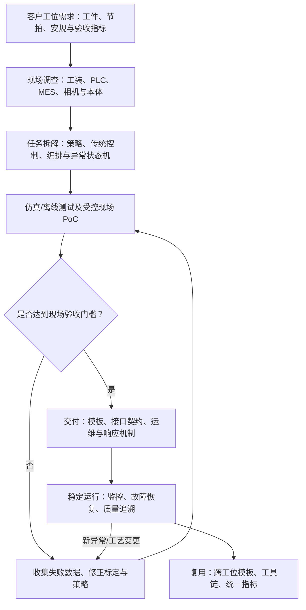

# 具身机器人 FDE：部署能力、交付链与商业模式（2026）

## 一句话定义

**FDE（Forward-Deployed Engineer，前线部署工程师）**在具身场景中连接模型研发与客户现场，把机器人能力变成可验收的工艺流程；商业模式的核心分野是**一次性驻场定制**，还是能把标定、接口、模型适配、故障恢复与运维沉淀成可复用的产品/服务。

## 英文缩写速查

| 缩写 | 英文全称 | 简要说明 |
|---|---|---|
| FDE | Forward-Deployed Engineer | 深入客户业务现场、负责需求到交付反馈的工程角色 |
| PLC | Programmable Logic Controller | 设备/产线工控逻辑接口 |
| MES | Manufacturing Execution System | 制造执行与工单/追溯系统 |
| API | Application Programming Interface | 模型或编排能力的软件调用接口 |
| MaaS | Model as a Service | 按服务访问模型、后训练、推理等能力 |
| FaaS | Fine-tuning as a Service | 托管模型微调服务（Dream Labs 用语） |
| RaaS | Robot as a Service | 以租赁/按期服务覆盖硬件、部署和运维等方式 |
| PoC | Proof of Concept | 上线前现场可行性验证 |
| SLA | Service Level Agreement | 可用性、故障响应等服务承诺 |

## 为什么重要

工业机器人需要完成的是**有节拍、有上下游接口、有异常分支且可长时间稳定运行**的业务任务，而不只是单次抓取。模型成功率不等于工位吞吐量；“某场景 14 天完成验证”也不等于行业交付周期恒定。比较 FDE 方案时，先区分 **控制/模型能力**、**现场工艺集成**、**系统运营与商业责任** 三层。

## 核心原理

### 交付主体与商业路径（截至 2026-11-19）

| 路径 | 代表性一手案例 | 提供什么 | 购买方仍需承担什么 | 证据/阶段 |
|---|---|---|---|---|
| 本体厂商全栈部署 | 智元 Genie Studio 2.0 | Flywheel 模型闭环 + Agent 任务编排 + Monitor 运维；PLC/MES/AGV 接入与模板复用 | 产线改造、工艺验收和协作边界 | 厂商发布常州 6 CNC、14 天到**验证** |
| 本体厂商分阶段商用 | Agility Digit CAP | 技术验证 → 现场 PoC → 商业 RaaS；部署/维护体系 | CAP 项目投入、后续商用决策 | SEC 披露 CAP 约 50 万美元**项目费**，不能当售价 |
| 开放策略调用接口 | PokeBot RoboAPI | 机器人图像/状态/指令 → Poke-Aurora 动作；本地运行程序 + 云 API | 本体接入、运动安全、实机测试、运维 | 开发者技术预览，不是全套工业交付 |
| MaaS + 后训练 | Dexmal MaaS | DM0.5 托管推理，SFT/DAgger/RECAP，DexOS Lite 对接本体 | 数据质量、现场验收、末端执行安全 | 平台服务；部分模型/训练资产另行公开 |
| 托管微调与推理 | Physical Intelligence Pi API beta | 上传数据 → 微调 → 托管推理，可形成迭代闭环 | 采集/评测、网络可靠性、现场系统与责任 | beta 伙伴案例；厂商明确有联网挑战 |
| 公共模型 API + FaaS | Dream Labs Dream-1 | 双臂操作研究 beta API、演示后训练 | IK/本体映射、安全隔离、任务验收 | 研究 beta；12 台微调样本中 10 台指标改善（厂商评测） |
| 第三方全托管 RaaS | Formic | 固定月费 + 安装/训练/监控/按需遥操作/维护 | 工艺定义、产线配合、验收结果 | 人形试点一任务/工位/班次，**仍为窄场景试点** |

> **注意口径：** 上述是不同服务边界的横向归类，不是性能排行榜。原行业文章还提到原力无限 Deployment Scaling、Tesla 工厂、NCS/华智天成与擎天租；其细节尚未在本次找到完整独立的一手证明，故不把这些案例当成已完成的规模交付样本。

### 从现场部署到可复制服务

*此图为基于上述官方部署资料抽象出的工程归纳，不是任何一家厂商公布的统一软件架构，也不对应未检查的源码执行时序。*

### 如何判断是“模型服务”还是“交付服务”

- **API/MaaS/FaaS** 售卖或开放模型推理与任务适配能力，但不自动覆盖本体运动安全、工厂网络、PLC/MES 工艺交互、现场维保。
- **集成/FDE 项目制** 对现场需求、任务编排、接口、试运行负责；若每次重复调试，收入可能与人天绑定。注意：**盈利模型和成本曲线未有公开数据证实**。
- **RaaS/Full Service** 把硬件资产、部署、监控及维护更深入地捆绑在服务方；厂商承诺的范围和 SLA 仍需逐项签约核对。
- **从试点到复制** 依赖软件和现场资产的版本化：技能节点、夹具/相机标定、PLC/MES 接口契约、异常状态机、验收脚本、运维 SOP、失败数据再训练。

## 工程实践

### 以工位为单位的交付验收单（建议，而非文章中所有厂商已公开的事实）

| 维度 | 建议记录的证据 | 反面误判 |
|---|---|---|
| 产能与节拍 | 连续运行周期的周期时间分布、产出/班次、停机记录 | 单次最快视频替代持续节拍 |
| 质量与鲁棒 | 成功/失败明确定义、按 SKU/夹具/光照分组、误抓损伤与回退次数 | 单一平均成功率掩盖 OOD 失败 |
| 系统集成 | PLC/MES 握手、工单生命周期、E-stop/互锁与异常注入测试 | API 可调用就宣称工业投产 |
| 模型部署 | 端侧/云端延迟、网络断连策略、恢复时间、版本回滚 | 云端 demo 等同产线 SLA |
| 运维与商务 | MTTR、远程介入率、备件、巡检计划、责任划分、单位合格产出总成本 | 试点费或模型调用单价当作全部交付成本 |
| 复制性 | 第二工位新增人天、改动接口数、是否无需重训、配置模板覆盖率 | 单项目 14 天就推断任何现场都是 14 天 |

**可追踪指标示例：** 有效产出率 = 合格件数 / 计划生产时长；任务成功率 = 符合验收定义的成功次数 / 总尝试次数。测量窗口、样本数、工艺条件必须一同记录；不在此虚构统一阈值。

### 一手案例的正确用法

- **智元：** 常州案例的“14 天”指需求梳理至产线**验证**；发布文还描述将流程与接口模板复用，但跨客户复制成本并未公开。
- **Agility：** SEC 所述九个客户设施是“已部署**或承诺部署**”；CAP 约 50 万美元是项目参与费，不等同整机、长期订阅的报价。
- **Formic：** 60–90 天试点 + 30–60 天后续部署为公司公开**预计周期**，不可当作其他项目的保证。
- **Dream Labs：** 官网既给 5 分钟演示后训练样例，也披露一些本体需要 77–98 分钟；并提示研究 beta 不应在安全关键场景直接使用。

## 局限与风险

1. **来源层级：** 行业文章是二手综述；表内已区分厂商自述、SEC 公开披露与开发者文档；未查到合同、发票或同口径第三方实测的数据，不能推断行业毛利/成功率。
2. **技术责任：** 机器人涉及物理风险。云模型/后训练 API 不等于功能安全系统；急停、互锁、动作限幅、故障安全和隔离验证应独立设计。
3. **统计偏差：** 展示样例、beta 伙伴和付费 PoC 各自代表不同部署成熟度；“已承诺部署”与“已投产”不能混写。
4. **信息时效：** 企业功能和开放状态按 2026-11-19 资料核查，后续需依官方产品/文档重新确认。
5. **源码运行时序图：** 本页是商业/系统交付对照，不是独立可运行软件项目；**不适用**。上方 Mermaid 为交付工作流归纳。

## 关联页面

- [FDE 工程实践参考书](../entities/fde-guidance-book.md) — 通用 FDE 职责与客户价值交付流程。
- [Genie Studio Agent](../entities/genie-studio-agent.md) — 任务编排与现场部署平台层。
- [Dream-1](../entities/dreamlabs-dream-1.md) — 托管模型 API 与 FaaS 的实例。
- [VLA](../methods/vla.md) — 区分模型能力与工厂系统交付。
- [Sim2Real](../concepts/sim2real.md) — 策略从仿真到真实设备的可靠性验证。
- [智元应用编排与交付](../overview/agibot-release-category-06-application-delivery.md) — 现有项目交付专题入口。

## 参考来源

- [《FDE 火了，具身模型的交付会是一门什么样的生意？》原文阅读归档](../../sources/blogs/wechat_embodied_ai_heart_robot_fde_delivery_20261119.md)
- [厂商官网与 SEC 一手证据核对](../../sources/sites/robot-fde-delivery-primary-evidence-20261119.md)

## 推荐继续阅读

- [智元 Genie Studio 2.0 官方发布](https://www.agibot.com/news/newsroom/post-130)
- [Physical Intelligence Pi API beta 官方发布](https://www.pi.website/blog/api-beta)
- [Dream Labs Dream-1 / FaaS 官方技术说明](https://dreamlabs.ai/research/dream-1/)
- [Formic 人形机器人 Full Service 官方说明](https://formic.co/solutions/humanoids)
- [Agility CAP / Digit 公开申报文件](https://www.sec.gov/Archives/edgar/data/2074973/000121390026118037/ea0311221-s1_agility.htm)
