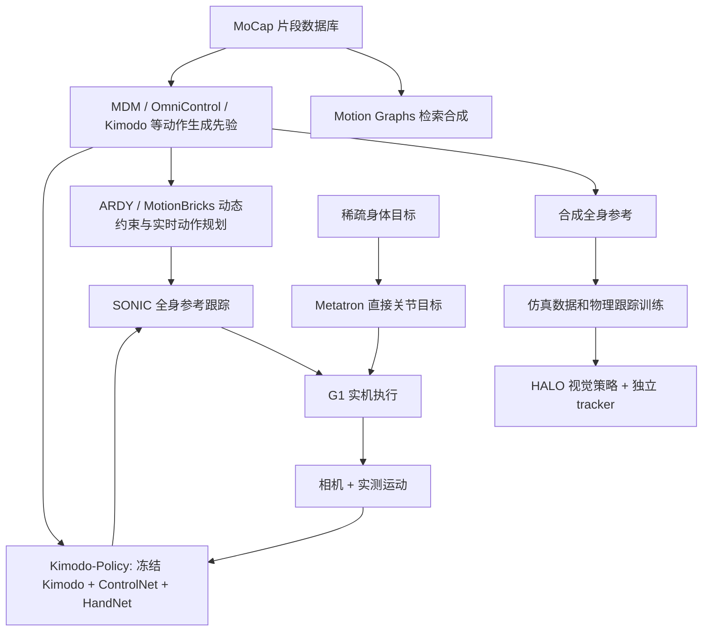

# 从生成全身动作到人形闭环：研究对照与接口关系

## 一句话定义

这是跨论文的**系统关系与证据对比**，不是学习 roadmap：一段全身运动可以作为训练参考、在线运动规划结果或闭环策略输出，但各层的观测、物理反馈和控制职责不可互换。

## 英文缩写速查

| 缩写 | 英文全称 | 简要说明 |
|---|---|---|
| KAM | Kinematic Action Model | Kimodo-Policy 提出的动作生成主干路线 |
| WBC | Whole-Body Control | 机器人执行层的全身控制 |
| HOI | Human-Object Interaction | 交互任务类别 |
| G1 | Unitree G1 | 相关真机评测平台 |
| MoCap | Motion Capture | 动作片段与生成器的训练数据 |

## 为什么重要

**生成出合理动作不等于机器人完成任务**。可以追溯出三种互不相同的闭环：ARDY 把历史生成段和变更后的在线约束反馈给生成器；Kimodo-Policy 把真机新图像及已执行运动历史反馈给动作生成器；Metatron 根据部分身体目标和本体状态直接输出关节目标，不再串联“完整动作生成器 → SONIC”。HALO 用运动生成器生产合成监督，但机器人在线执行器是另一套已训练的视觉生成器和跟踪器。

## 核心原理

### 研究实体对照：已有节点复用、新项目单独编译

| 层次 | 项目节点 | 输入 → 输出 | 注意边界 |
|---|---|---|---|
| 动捕检索 | [Motion Graphs](../entities/paper-motion-graphs.md) | 动捕片段 + 路径 → 转场图游走 | 非扩散、非真机 |
| 扩散生成 | [MDM](../entities/paper-mdm-human-motion-diffusion.md) | 文本/动作条件 → 整段动作 | 运动学离线合成 |
| 稀疏约束 | [OmniControl](../entities/paper-notebook-omnicontrol-control-any-joint-at-any-time-for-hu.md) | 文本 + 任意关节时刻位置 → 受控动作 | 采样引导有延迟 |
| 自回归实时 | [A-MDM](../entities/paper-a-mdm-interactive-character-control.md)、[AAMDM](../entities/paper-aamdm-accelerated-motion-diffusion.md) | 运动历史/交互控制 → 连续角色姿态 | 两项是不同论文 |
| 仿真反馈 | [CLoSD](../entities/paper-bfm-39-closd.md) | DiP 规划 + 仿真控制反馈 | 非视觉 G1 真机 |
| 离线可控骨干 | [Kimodo](../entities/kimodo.md) | 文本 + 轨迹/关键姿态 → 全身参考 | 可产合成示范 |
| 在线可控规划 | [ARDY](../entities/ardy.md) | 历史动作 + 动态路点/关键帧 → 下一段动作 | 33 ms 是生成延迟 |
| 实时动作续写 | [MotionBricks](../entities/paper-motionbricks.md) | 摇杆/关键动作 → 连续生成 | 与 ARDY 约束机制不同 |
| 跟踪执行 | [SONIC](../methods/sonic-motion-tracking.md) | 全身参考 + 机器人状态 → 关节控制 | 50 Hz 并非生成速率 |
| 视觉闭环策略 | [Kimodo-Policy](../entities/paper-kimodo-policy.md) | RGB + 语言 + 实测历史 → root/body/hand 块 | 预测 1.67 s，执行 0.5 s |
| 合成数据学视觉 | [HALO](../entities/paper-halo-perceptive-humanoid-motion-sim.md) | Kimodo 示范 + 虚拟房间 → 视觉策略和跟踪器 | 不直接采用 SONIC 作为跟踪器 |
| 测试时目标引导 | [BeyondMimic](../methods/beyondmimic.md) | 运动先验 + 到达/避障代价 → 可跟踪动作 | 真机目标与障碍有动捕依赖 |
| 稀疏目标直控 | [Metatron](../entities/paper-metatron-promptable-whole-body-execution.md) | 腕/足/速度目标 + 本体状态 → 关节目标 | 直接控制而非 ARDY→SONIC |

### 五层接口关系图

上图是**接口关系而非训练代码依赖图**：箭头表示相邻可组合任务及文中明确公开的实际组合；不要把所有生成模型都视作 HALO 或 Kimodo-Policy 的训练依赖。

### 对比关键数字（口径保留）

| 系统 | 数字 | 成立条件/含义 |
|---|---|---|
| ARDY | **33 ms（4 step）/ 63 ms（10 step）** | RTX 4090 交互生成约 2 s 的动作，不包括整机控制周期 |
| Kimodo-Policy | **1.67 s 预测，仅执行前 0.5 s** | 每轮使用实测历史和新观测重规划；SONIC 负责 50 Hz 跟踪 |
| Kimodo-Policy | **419 h** | 机器人交互数据用于适配层/手部模块预训练；不同于 Kimodo 原始 motion pretrain |
| Kimodo-Policy | **72.14%** | HumanoidArena 七任务多任务联合训练平均；三项 HOI 消融 18.33/31.67/51.67% 不与之直接对比 |
| Kimodo-Policy | **36/80 → 48/80** | 八项真机任务，比较交互预训练消融（45%→60%） |
| HALO | **91%** | 六项 G1 真机单任务共 360 次尝试；训练语义视觉策略及 tracker 使用合成数据 |
| Metatron | **83% vs 39%** | 作者的 G1 MuJoCo 手腕到达测试，与 ARDY+SONIC 对照；不能概括所有任务 |

## 工程实践

- **要批量生成示范**：检查 [Kimodo](../entities/kimodo.md) 的运动骨架与导出格式，辅以 [ProtoMotions](../entities/protomotions.md) 的物理跟踪训练。
- **要在交互中修改未来路点/手脚目标**：参考 [ARDY](../entities/ardy.md) 实时生成；跟踪与驱动仍由 [SONIC](../methods/sonic-motion-tracking.md) 等控制器完成。
- **要图像驱动真机搬运/推车**：参考 [Kimodo-Policy](../entities/paper-kimodo-policy.md) 及 [HumanoidArena](../entities/paper-humanoidarena.md) / [SIMPLE](../entities/paper-loco-manip-161-075-simple.md) 评测，重点检查历史状态、执行前缀和 hand 指令同步。
- **要无真实视觉数据的系统训练**：参考 [HALO](../entities/paper-halo-perceptive-humanoid-motion-sim.md)，并核查 [BONES-SEED](../entities/bones-seed.md) / [SOMA Retargeter](../entities/soma-retargeter.md) 对应的数据或骨架转换作用，不把它们当同一个 HALO 官方执行链。
- **要直接接受末端目标**：参考 [Metatron](../entities/paper-metatron-promptable-whole-body-execution.md)，与 [BeyondMimic](../methods/beyondmimic.md) 的去噪代价引导区分。
- **开放训练/执行基础设施**：[SONIC](../methods/sonic-motion-tracking.md)、[ProtoMotions](../entities/protomotions.md)、[HumanoidArena](../entities/paper-humanoidarena.md)；各自有独立环境、许可和控制频率。

## 局限与风险

1. 以上项目的论文主结果跨动画、仿真和 G1 真机，不能按单一“生成速度”或“成功率”排名。
2. 0.5 秒执行前缀不能直接套用到 ARDY；HALO 的跟踪器也不能随意等同 SONIC。
3. 新增五份论文原始归档的全部正文、附录和源码仍需完整复核；本关联页保留 draft，不把跨系统的解释写成论文直接验证过的因果关系。

## 关联页面

- [Motion Graphs](../entities/paper-motion-graphs.md)
- [MDM](../entities/paper-mdm-human-motion-diffusion.md)
- [OmniControl](../entities/paper-notebook-omnicontrol-control-any-joint-at-any-time-for-hu.md)
- [A-MDM](../entities/paper-a-mdm-interactive-character-control.md)
- [AAMDM](../entities/paper-aamdm-accelerated-motion-diffusion.md)
- [CLoSD](../entities/paper-bfm-39-closd.md)
- [Kimodo](../entities/kimodo.md)
- [ARDY](../entities/ardy.md)
- [MotionBricks](../entities/paper-motionbricks.md)
- [SONIC](../methods/sonic-motion-tracking.md)
- [Kimodo-Policy](../entities/paper-kimodo-policy.md)
- [HALO](../entities/paper-halo-perceptive-humanoid-motion-sim.md)
- [BeyondMimic](../methods/beyondmimic.md)
- [Metatron](../entities/paper-metatron-promptable-whole-body-execution.md)
- [HumanoidArena](../entities/paper-humanoidarena.md)
- [BONES-SEED](../entities/bones-seed.md)
- [ProtoMotions](../entities/protomotions.md)
- [SOMA Retargeter](../entities/soma-retargeter.md)
- [SIMPLE](../entities/paper-loco-manip-161-075-simple.md)
- [Unitree G1](../entities/unitree-g1.md)

## 参考来源

- [Kimodo-Policy 原始论文](../../sources/papers/kimodo_policy_primary.md)
- [A-MDM 原始论文](../../sources/papers/a_mdm_interactive_character_control_primary.md)
- [AAMDM 原始论文](../../sources/papers/aamdm_accelerated_motion_diffusion_primary.md)
- [MDM 原始论文](../../sources/papers/mdm_human_motion_diffusion_primary.md)
- [Motion Graphs 原始论文](../../sources/papers/motion_graphs_primary.md)
- [HALO 现有论文归档](../../sources/papers/halo_perceptive_humanoid_motion_sim_arxiv_2611_06908.md)
- [ARDY 现有论文归档](../../sources/papers/ardy_siggraph_2026.md)
- [Metatron 现有论文归档](../../sources/papers/metatron_2610_38027.md)

## 推荐继续阅读

- [Kimodo-Policy 官方论文](https://arxiv.org/html/2611.11554v1)
- [ARDY NVIDIA 官方项目](https://research.nvidia.com/labs/sil/projects/ardy/)
- [Apple HALO 官方论文](https://arxiv.org/abs/2611.06908)
- [Metatron NVIDIA 官方项目](https://research.nvidia.com/labs/par/projects/metatron/)
