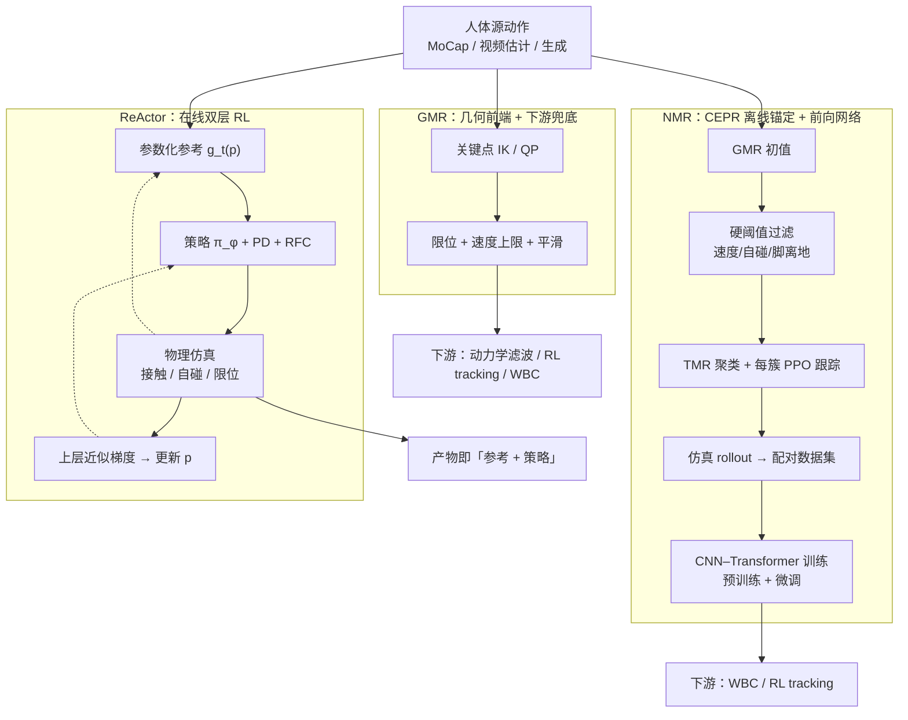

# GMR vs NMR vs ReActor：动作重定向方法谱系对比

**背景**：当源动作（动捕、视频估计、生成模型）要喂给目标人形 / 异构机器人时，重定向是必须穿过的一道闸。围绕「**像不像**」与「**能不能跟得上**」两条评价线，社区涌现了三类代表性路线——以 **GMR** 为代表的**运动学优化**、以 **NMR** 为代表的**学习式整段映射**、以 **ReActor** 为代表的**物理感知 RL 双层优化**。三者并非互斥，工程上常组合使用，但在「数据来自哪里、误差在哪里修、推理预算多大」三个维度上的取舍泾渭分明。

> **一句话区分**：GMR 是「**先几何对齐、物理留给下游**」；NMR 是「**离线用 RL 把几何参考拉进可行流形，再训前向网络批量推断**」；ReActor 是「**在线把参考形变与跟踪策略放进同一个仿真双层优化里联合更新**」。

---

## 一句话定义

| 方法 | 一句话 | 论文 / 仓库 |
|------|--------|-------------|
| **GMR**（General Motion Retargeting） | 关键刚体匹配 + 非均匀局部缩放 + 两阶段 Mink 微分 IK（每步一个小 QP），在运动学层做骨架对齐与限位，逐帧输出关节轨迹；根平移用统一缩放以免脚滑。 | [arXiv:2510.02252](https://arxiv.org/abs/2510.02252) ；[YanjieZe/GMR](https://github.com/YanjieZe/GMR)（README 另挂 TWIST 的 arXiv:2505.02833 徽章） |
| **NMR**（Neural Motion Retargeting） | 用 CEPR 数据管线（GMR 初值 → 聚类 → 每簇 PPO 专家跟踪 → 仿真 rollout）造**物理一致的人机配对**，训练 CNN–Transformer 做非自回归整段重定向。 | [arXiv:2603.22201](https://arxiv.org/abs/2603.22201) |
| **ReActor** | 把**参数化参考** \(\mathbf{p}\) 与**单一跟踪策略** \(\pi_\phi\) 写进双层目标，在物理仿真内交替更新；上层用结构化近似梯度，避免 Hessian 求逆。 | [arXiv:2605.06593](https://arxiv.org/abs/2605.06593) |

## 英文缩写速查

| 缩写 | 英文全称 | 简要说明 |
|------|----------|----------|
| GMR | General Motion Retargeting | 把人体/视频动作重定向为机器人可执行参考 |
| QP | Quadratic Programming | 将 WBC/控制问题写成二次规划的标准求解形式 |
| IK | Inverse Kinematics | 满足末端/姿态约束求解关节角的运动学逆解 |
| RL | Reinforcement Learning | 通过与环境交互最大化长期回报来学习策略的范式 |
| Retargeting | Motion Retargeting | 将人体/动物动作映射到目标机器人骨架 |
| CPU | Central Processing Unit | 中央处理器 |
| PPO | Proximal Policy Optimization | 人形/足式 locomotion 中最常用的 on-policy 策略梯度算法 |
| CNN | Convolutional Neural Network | 卷积神经网络，处理图像/深度感知 |
| MoCap | Motion Capture | 动作捕捉，参考动作与演示数据的主要来源 |
| SMPL | Skinned Multi-Person Linear Model | 常见人体参数化模型与重定向源 |
| GPU | Graphics Processing Unit | 图形处理器，大规模并行仿真训练的算力基础 |
| URDF | Unified Robot Description Format | 统一机器人描述格式 |
| MJCF | MuJoCo XML Format | MuJoCo 的模型与场景描述格式 |
| G1 | Unitree G1 Humanoid | 宇树入门级教育科研人形平台 |
| IL | Imitation Learning | 从专家演示学习策略，奖励难定义时的主路线 |
| SysID | System Identification | 系统辨识，估计物理/动力学参数 |
| WBC | Whole-Body Control | 协调全身关节满足多任务/约束的控制基础设施 |
| MPC | Model Predictive Control | 滚动时域内优化控制序列的预测控制 |
| Sim2Real | Simulation to Real | 把仿真中学到的策略迁移落地真机的工程主线 |

## 为什么重要

- **重定向是人形模仿学习的闸门**：GMR 论文的受控实验表明，多数动作都能被跟踪，但地面穿透、自穿透、关节值突变这三类伪影会显著降低策略鲁棒性（受控条件：BeyondMimic 几乎不调奖励，LAFAN1 21 段，Unitree G1）。
- **三条路线的修补点不同**：GMR 在运动学前端修补；NMR 把修补挪到离线数据构造；ReActor 把修补放进在线双层闭环。选错路线，等于在错误的位置付出算力或工程成本。
- **下游收益有数字可查**：NMR 的参考使下游跟踪的成功率与误差更优（表 IV）；ReActor 在过滤后 AMASS 全集上的下游成功率高于 GMR / OmniRetarget（见下文工程实践的数值表）。

---

## 核心原理：核心维度对比

| 维度 | **GMR**（运动学优化） | **NMR**（监督学习 + 仿真锚定） | **ReActor**（物理感知 RL 双层优化） |
|------|----------------------|--------------------------------|------------------------------------|
| **范式定位** | 单次几何 IK / QP 优化 | 离线构造配对数据 + 学习式整段映射 | 在线双层优化（参考 + 策略协同） |
| **典型输入** | MoCap / SMPL / 视频估计单帧或滑窗 | 整段 SMPL 序列 | 源动捕序列 + 稀疏语义刚体对应 + 根对应 |
| **输出形态** | 机器人关节轨迹 \(q_t\) | 机器人全身参考序列（整段并行） | 仿真内可执行参考 \(\mathbf{g}_t(\mathbf{p})\) + 跟踪策略 \(\pi_\phi\) |
| **物理一致性** | ❌ 仅运动学，下游须补动力学 | ✅ 数据级锚定到 RL 仿真可行流形 | ✅ 仿真内闭环，接触/自碰内生化 |
| **接触/自碰处理** | 不显式建模接触；靠根统一缩放抑制脚滑，关节限位 + 可选速度上限，序列末做高度修正 | 通过 RL 专家的奖励内化（辅以硬阈值过滤自相交 >5% 帧等） | 仿真接触求解器 + RFC 根残差力 |
| **训练成本** | 无（即开即用 IK） | 高：每簇 PPO 专家 + 网络两阶段训练（预训练 500 epoch + 微调 50 epoch） | 单 GPU 约 6 h（20k 迭代，4096 环境）训练，AMASS 全集重定向约 6.5 h |
| **推理速度** | README 称实时；ReActor 论文报告 CPU 上重定向整个过滤后 AMASS 约 5 h | 非自回归整段前向、无需物理仿真器；论文未给耗时数字 | 重定向策略在交互动画中 88.3 Hz；机器人部署需另训跟踪策略 |
| **跨形态能力** | 重新配置骨架/关键点；README 列出 ID 0–18 的机器人已有数据格式支持 | 机型特定：换平台须重新生成 CEPR 数据（原文局限） | 通过有界 \(\mathbf{p}\) 参数化，已在 G1 / Lima / ANYmal D 报告 |
| **对源噪声敏感性** | 高（逐帧处理，源抖动被原样传递——NMR Fig.6；脚滑/漂移被放大，见 ExoActor 反例） | 中（训练前物理过滤，抖动被视作分布外，网络输出连续序列；双向注意力利用前后帧） | 中–低（仿真闭环吸收，但受 \(\alpha\) 近似假设制约） |
| **核心假设** | 模型骨架与源骨架可在 IK 误差容忍内对齐；默认权重适用于大多数动作（原文：个别动作需再调权重） | RL 专家覆盖动作分布；TMR/聚类语义合理 | 最优轨迹对参考的灵敏度 \(\partial_g s^*=\alpha I,\ \alpha\in[0,1]\)，得 \(\tilde d_p\ell=(1-\alpha)\partial_g\ell\,d_pg\) |
| **是否需大网络/算力** | 否 | 是（1D-ResNet + LLaMA 式 Transformer + 多专家训练） | 否（MLP 3×512，但需 GPU 上的 RL 训练） |
| **典型代码产物** | `motion_retargeting.py` + URDF/MJCF 配置 | 预训练 + 微调 checkpoint + 推理脚本 | 训练得到的 \(\mathbf{p}^\*\) 参考 + 跟踪策略权重 |

---

## 数据流对比（Mermaid）

把三条路线放在同一张「**人体源动作 → 机器人参考 → 下游跟踪**」的坐标里，差异主要在**误差修补发生的位置**：



要点：
- **GMR** 的误差修补点在**下游**（动力学滤波 / RL tracking）；
- **NMR** 把误差修补集中到**离线数据构造阶段**（仿真锚定为「物理真值」），换得推理侧的快速前向；
- **ReActor** 把误差修补放进**在线双层闭环**，参考与策略相互塑形。

---

## 工程实践：适用场景

### 选 GMR 的场景

1. **源动作干净**（专业 MoCap / 标定良好的遥操作），人机骨架比例差异不大；
2. **需要 CPU 实时 / 低延迟**（在线遥操作、教师演示流式生成）；
3. **下游已有强 tracking**（如 BeyondMimic / SONIC），GMR 仅作前端覆盖；
4. **工程预算紧**：无需训练管线（"几小时即可在新机型上跑通"属经验说法，推测；README 说明新机型需要机器人描述文件（xml/urdf/meshes）并配置 IK，细节见其 DOC.md，本次未读）；
5. **作为更大流水线的零件**：NMR 自身仍依赖 GMR 做 CEPR 初值。

> **避坑**：源动作来自视频估计 / 生成模型时，GMR 的「刚性几何对齐」会放大全局漂移与脚滑——见 [ExoActor](../methods/exoactor.md) 中「跳过重定向直接喂 SONIC」的消融。

### 选 NMR 的场景

1. **存在大规模 SMPL / 同源人体库**（≥ 数千段），值得一次性把数据「拉进可行流形」；
2. **部署阶段需要毫秒级整段映射**（实时生成式控制、视频→人形流水线）；
3. **目标机型相对固定**（如论文以 Unitree G1 为主），可承担 CEPR + 网络训练沉没成本；
4. **下游策略希望吃到「时序一致、低伪影」的参考**以加速 IL/RL 收敛。

> **避坑**：CEPR 的「物理真值」由 RL 奖励与专家分簇决定，**分布外动作**（如非典型杂技、灵巧手细操作）仍可能被映射到簇心附近（推测，论文未专门评测分布外动作）；上肢精细 / 手部任务需单独评估。原文明确的局限是 CEPR **机型特定**——换平台要重新生成整套数据管线。

### 选 ReActor 的场景

1. **强异构形态**（人形 ↔ 四足、不同肢长比例）下需要**统一**的参考生成框架；
2. **想把「参考形变」本身当作可优化对象**长期联合训练，而非「先做几何、再修动力学」的分阶段管道；
3. **接触/自碰约束希望内生化**而不是靠下游 QP 兜底；
4. **不需要前向重定向网络**——可以接受「训练态产物 = 参考 + 跟踪策略」一同部署。

> **避坑**：**RFC 根残差力**降低跨形态训练难度，但与「零辅助力、纯物理可复现」不是同一目标——阅读实验时需区分*参考质量*与*是否完全物理一致*；论文还指出外力惩罚权重是**最敏感的超参数**（加大更物理、极端动作失败更多），且 ReActor 的脚滑 / 悬空并不为零（不严格强制接触匹配）；形态差距越大越需要细致调奖励（ANYmal 会为减少外力而放弃跟踪）。上层近似梯度依赖 \(\alpha\) 标量化策略响应，对分布外形态或奖励重塑需评估稳定性。

### 原文数值速查（同机型 / 同基准下才可横向比较）

| 论文 | 评测设定 | 关键数字 |
|------|----------|----------|
| GMR（Araujo 等） | LAFAN1 21 段，G1，BeyondMimic 单轨迹策略；开源基线 PHC / ProtoMotions + Unitree 闭源数据 | 11 段所有方法成功率 >98%；伪影集中在 PHC 的地面穿透（最高 60 cm）、ProtoMotions 的腿部相交、GMR 的 Dance 5 腰部突跳（<2% 数据） |
| NMR（Zhao 等） | AMASS 82 段共 119K 帧，G1，基线 GMR / PHUMA | 关节跳变 0；自碰撞帧比 GMR 少 54%；关节极限帧 16.80%（GMR 43.21%） |
| ReActor（Müller 等） | PHC 过滤的 AMASS 全集，G1 / Lima，基线 GMR / OmniRetarget | G1 下游 RL 成功率 GMR 89.93%、OmniRetarget 95.51%、ReActor 97.45%；Lima 91.23% / 79.85% / 95.07% |

> 三篇论文的基准、机型与指标各不相同，**不能直接把数字拼成一张"排行榜"**；唯一同基线的交叉点是 NMR 与 ReActor 都把 GMR 当对照，且都报告 GMR 对初始化 / 局部极小敏感。

---

## 局限与常见误判

1. **「NMR 取代 GMR」**：错。NMR 的 **CEPR 管线**显式以 GMR 输出为运动学初值，再用仿真 RL 做物理修补——是**叠加增强**而非替代关系。
2. **「ReActor 比 NMR 更先进」**：维度不同。ReActor 强调**在线双层优化**的算法贡献与跨形态适用性；NMR 强调**离线大规模配对 + 快速前向推断**。部署端是否需要毫秒级前向网络，往往是首要分水岭。
3. **「GMR 不物理一致 = 没用」**：GMR 在 MoCap → 机器人这种「源动作干净」的链路上仍是**收益项**，且是 NMR / SPIDER 等学习/采样路线的关键前端；其「非物理性」是分工问题，不是路线缺陷。
4. **「物理一致 = 上真机就稳」**：NMR / ReActor 的物理一致性是**仿真内**的，sim-to-real gap 仍会传导。真机部署仍需域随机化、SysID 校正与下游 WBC / RL tracking 的鲁棒性补强。
5. **「三者只能三选一」**：实际系统常**串联**：GMR 出运动学初值 → CEPR/ReActor 式仿真修补 → 下游 RL tracking。三条路线在「**误差修补位置**」这条轴上是连续谱，而非二元对立。

---

## 决策矩阵

```
你的主要约束是什么？
│
├── 源动作干净 + 部署要 CPU 实时 → GMR（必要时下游接动力学滤波）
├── 已有大规模 SMPL 库 + 部署要毫秒级前向 → NMR（CEPR + 神经网络）
├── 跨形态（人形/四足）联合参考生成 + 接触约束内生化 → ReActor
├── 工程预算紧 / 没有 GPU 集群 → GMR（再视下游 tracking 选型）
├── 想把「参考」当可微/可优化对象长期迭代 → ReActor
├── 源动作来自视频估计或生成模型，且有明显漂移 → 先评估「跳过重定向直接 tracking」（参考 ExoActor / SONIC 路线）
└── 灵巧手 / 接触歧义重的操作数据 → 考虑 SPIDER 类「采样优化 + 虚拟接触」前端
```

---

## 与其它对比页的区别

- 本页关注**三种重定向算法的谱系对比**（监督优化 / 学习式 / 物理感知 RL）；
- [RL vs IL](./rl-vs-il.md) 在**策略学习范式**层面对比，重定向只是数据预处理；
- [MPC vs RL](./mpc-vs-rl.md) 在**控制范式**层面对比，与重定向不在同一抽象层；
- [Sim2Real 方法横向对比](./sim2real-approaches.md) 关注的是「仿真→真机」的差距弥合，与本页「人体→机器人参考」是上下游关系。

---

## 参考来源

- [GMR 论文 Retargeting Matters 通读归档](../../sources/papers/gmr_retargeting_matters_arxiv_2510_02252.md) — Araujo, Ze, Xu, Wu, Liu，[arXiv:2510.02252](https://arxiv.org/abs/2510.02252)；代码 [YanjieZe/GMR](https://github.com/YanjieZe/GMR)（MIT）。
- [NMR 论文通读归档](../../sources/papers/neural_motion_retargeting_nmr.md) — Zhao 等，[arXiv:2603.22201](https://arxiv.org/abs/2603.22201)；项目页 <https://nju3dv-humanoidgroup.github.io/nmr.github.io/>。
- [ReActor 论文通读归档](../../sources/papers/reactor_rl_physics_aware_motion_retargeting.md) — Müller 等，ACM Trans. Graph. 45(4), Article 97（SIGGRAPH 2026），[arXiv:2605.06593](https://arxiv.org/abs/2605.06593)。
- [sources/papers/motion_control_projects.md](../../sources/papers/motion_control_projects.md) — 飞书公开文档《开源运动控制项目》对 GMR 的工程定位与局限点评（二手资料，未列入 original）。

---

## 关联页面

- [Motion Retargeting（动作重定向）](../concepts/motion-retargeting.md) — 任务定义与坐标系。
- [Motion Retargeting Pipeline（动作重定向流水线）](../concepts/motion-retargeting-pipeline.md) — 把三种方法放进同一条 8 阶段端到端管线的工程视角。
- [Motion Retargeting Objective（动作重定向目标函数形式化）](../formalizations/motion-retargeting-objective.md) — GMR / NMR / ReActor 在统一目标函数下的退化形态对照。
- [GMR（通用动作重定向）](../methods/motion-retargeting-gmr.md) — 几何前端方法细节。
- [NMR（神经运动重定向与人形全身控制）](../methods/neural-motion-retargeting-nmr.md) — CEPR 管线与网络结构。
- [ReActor（物理感知 RL 运动重定向）](../methods/reactor-physics-aware-motion-retargeting.md) — 双层优化与近似梯度。
- [SPIDER（物理感知采样式灵巧重定向）](../methods/spider-physics-informed-dexterous-retargeting.md) — 另一条「采样优化 + 虚拟接触」的物理感知前端。
- [UMR（学习点云对应）](../entities/paper-umr-unified-motion-retargeting.md) — 相邻第四条：T-pose 表面对应 + 运动学 QP，不改写本页三路线主表。
- [SONIC（规模化运动跟踪）](../methods/sonic-motion-tracking.md) — 与「跳过重定向直接 tracking」路线对照。
- [ExoActor（视频生成驱动的人形控制）](../methods/exoactor.md) — 在估计/生成源动作上「何时跳过 GMR」的反例。

---

## 推荐继续阅读

- Peng X. B., et al. *DeepMimic: Example-Guided Deep Reinforcement Learning of Physics-Based Character Skills* — 角色动画侧「跟踪固定参考」的经典 RL 设定，与 ReActor「先造参考」对照（ReActor 论文也明确区分重定向与 DeepMimic 式模仿）。
- Müller D., et al. *ReActor: Reinforcement Learning for Physics-Aware Motion Retargeting*（ACM TOG 45(4), 2026）：<https://arxiv.org/abs/2605.06593> — 双层优化与跨形态报告。
- Araujo J. P., et al. *Retargeting Matters: General Motion Retargeting for Humanoid Motion Tracking*：<https://arxiv.org/abs/2510.02252>。
- He T., et al. *Learning Human-to-Humanoid Real-Time Whole-Body Teleoperation*（H2O / OmniH2O 系列） — 与 GMR + RL tracking 流水线衔接的工程参考。

---

## 一句话记忆

> **GMR 几何**、**NMR 监督**、**ReActor 物理**——三者按「误差修补发生在下游 / 离线 / 在线」分占谱系三端，工程系统往往不是三选一而是按需串联。
