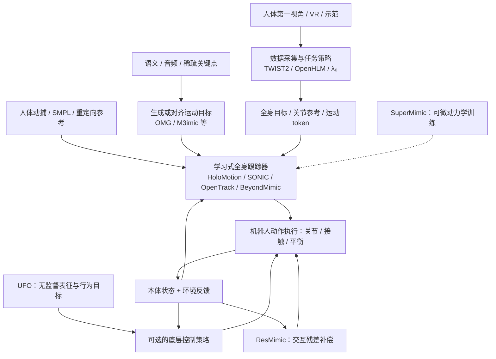

# 2026 人形机器人 WBC 开源 12 项：从通用跟踪到移动操作 / 12 Open-Source Humanoid Whole-Body Control Systems in 2026

## 一句话定义

**2026 年学习式人形 WBC 的关键演进，是把运动参考跟踪器变成可以被多模态生成器、遥操作与全身 VLA 复用的低层执行能力。** 本页以 [深蓝具身智能 2026-11-23 综述](../../sources/blogs/wechat-shenlan-humanoid-wbc-12-20261123.md) 的 12 项为索引，对照 [12 个官方仓库 README](../../sources/repos/humanoid-wbc-12-official-readme-audit-20261123.md)，复用已存在的独立节点而不复制 12 篇论文详情。

**术语边界：** 经典 [WBC](../concepts/whole-body-control.md) 通常强调全身动力学约束、接触力与 QP/HQP；本文这 12 项的“WBC”是更宽的**学习式全身运动控制生态**，涵盖 low-level motion tracker、策略训练基础设施、生成式运动规划以及 VLA 的数据/执行接口。不可把高层生成模型等同于低层物理控制器。

## 英文缩写速查

| 缩写 | 英文全称 | 简要说明 |
|---|---|---|
| WBC | Whole-Body Control | 全身协调运动与任务执行的广义控制范畴；在经典方法中通常为带约束优化 |
| WBT | Whole-Body Tracking | 对人体或机器人参考运动进行全身闭环跟踪 |
| BFM | Behavior Foundation Model | 以大量动作或目标预训练的可复用身体行为策略 |
| RL | Reinforcement Learning | 通过仿真交互训练全身运动策略 |
| VLA | Vision-Language-Action | 将视觉与指令映射为机器人动作的高层策略 |
| FB | Forward–Backward Representation | UFO 采用的无监督行为目标/表征路线 |
| DAgger | Dataset Aggregation | OpenTrack 多教师向通用学生蒸馏的交互式模仿训练方法 |
| ONNX | Open Neural Network Exchange | 多个项目的低层策略推理或真机部署模型格式 |
| Sim2Real | Simulation to Real | 从仿真训练迁移到真实机器人，需要执行器、接触与延迟对齐 |

## 为什么重要

- **动作来源多元**：MoCap、人体 SMPL、稀疏关键点、VR、音频、语言与第一视角视频，不应要求所有输入都预先变成同一种完整关节轨迹。
- **训练瓶颈分化**：动作库规模化（SONIC）、专家→学生（OpenTrack）、可微动力学与反向传播（SuperMimic）、无监督行为表征（UFO），目标函数、资源和泛化含义不同。
- **执行任务复杂化**：高动态空中/多接触动作与搬运时的外部载荷并不等价；单纯跟踪误差低，不足以代表操作成功与接触安全。
- **工程复用**：低层 tracker 可以做“执行接口”，但生成动作、遥操作、示范采集和 VLA 仍须分别验证与之兼容的状态/动作空间。

## 核心原理

### 三条技术线的模块与数据流

**图的严格解释：** 图为各官方项目所揭示的**可组合架构族谱**，不是这 12 个仓库彼此调用的实际源码时序。M3imic 也能直接训练自己的 tracker，并非必须依赖图中所列其他基座；OMG 官方实现是「生成参考 → HoloMotion」。ResMimic 是在自身基础控制器上增加交互残差，图中的接入箭头不是其真实软件依赖声明。项目内部细节参见原有实体页。

### A. 通用运动跟踪与训练扩展（5 项）

| 项目与已存在的独立节点 | 核心增量 | 官方 README 已开放的部分 | 与其他项的边界 |
|---|---|---|---|
| [HoloMotion](../entities/holomotion.md) | HoloSMPL / HoloRetarget → 运动跟踪 → 评估，v2 支持稀疏指令到全身 | 预训练 checkpoint、ONNX/config、重定向/训练/评测文档 | 更偏工程一体化数据→控制工作流；不能只看单一动作成功率 |
| [SONIC / GR00T-WBC](../entities/gr00t-wholebodycontrol.md) · [SONIC 独立节点](../entities/nvidia-sonic.md) | 大规模 motion tracking 预训练 + 运动 token 接口服务遥操与高层模型 | SONIC 权重、训练代码、C++/ONNX 部署、VR 接口 | README 的模型下载/部署与全量从头训练成本不同（fine-tune 文档建议 64+ GPU） |
| [OpenTrack / Any2Track](../entities/paper-opentrack.md) | 专家动作控制器 → DAgger 通用学生 → 适配器 | MuJoCo JAX 跟踪、DAgger、adapter、评估/真机部署入口 | 专家覆盖范围和蒸馏数据决定通用学生边界 |
| [BeyondMimic](../methods/beyondmimic.md) | 高动态跟踪、失败率采样与接触切换；论文还研究潜空间生成/引导 | 官方 `whole_body_tracking` 含 Isaac Lab 跟踪任务、动作处理及训练/评估；后续 mjlab 跟踪另有入口 | 翻滚/跳跃运动跟踪成功不自动说明能够稳定搬运未知物体 |
| [SuperMimic](../entities/paper-supermimic.md) | 可微动力学世界模型 + 短时想象/BPTT 优化，重点减少训练计算 | 官方 `supermimic` README 给出 mjlab 的 `train.py`、`play.py` | 其动力学模型不是未来视频生成模型；公开训练脚本不等于全量论文资产、真机部署均完整 |

### B. 多模态条件、无监督技能与运动生成（3 项）

| 项目与独立节点 | 核心增量 | 官方实现可核对入口 | 最重要的边界 |
|---|---|---|---|
| [M3imic / MultiModalWBC](../entities/paper-loco-manip-06-m3imic.md) | 机器人关节 / SMPL-X / 末端关键点条件经共享表征驱动跟踪 | Isaac Lab + RSL-RL：`scripts/tools/list_envs.py` 与 `scripts/rsl_rl/train.py` | 多模态**命令统一**，不是把任意语言变成全身动作；官方 mjlab 版仍在 TODO |
| [UFO](../entities/roboparty-ufo.md) | 无监督 FB/TeCH 行为表征，可做 motion、reward、goal 条件推理 | mjlab G1 / RP1.3：`./run_train.sh`、`./run_inference.sh` | 不需要针对每个动作塑形奖励 ≠ 完全不需要目标定义/数据/任务评测 |
| [OMG](../entities/paper-omg-omni-modal-humanoid-control.md) | 语言/音频/人体条件 → 扩散运动生成器 → HoloMotion tracker | 训练、ONNX 导出、生成 + 跟踪、benchmark 与 deploy 说明 | 生成视觉上合理的动作不代表符合机器人关节/接触约束；需真实 tracker 执行 |

### C. 遥操作、残差移动操作与 VLA（4 项）

| 项目与独立节点 | 系统角色 | 官方公开链路 | 最重要的边界 |
|---|---|---|---|
| [TWIST2](../entities/paper-twist2.md) | 全身遥操作 + 示范数据采集 | Unitree SDK2 / Redis / IsaacGym 的训练部署与 teleop pipeline；仓库提供 ONNX checkpoint | README 自述板载 streaming/inference 文档仍在整理；不宜当开箱即用产品承诺 |
| [ResMimic](../entities/paper-resmimic.md) | 通用跟踪器上的任务/载荷相关**残差控制** | `./train.sh` 与 `./eval.sh` 训练评估代码 | 论文展示的特定载荷不能外推到任意物体重量、接触形态或机器人 |
| [OpenHLM](../entities/paper-loco-manip-161-154-openhlm.md) | 全身原生视觉语言动作策略，不只双臂末端任务 | Robot/HuMI 数据采集 + OpenPI 训练 + policy server/robot client 与 GR00T WBC 执行模块 | 上层 VLA 与低层 WBC 是不同频率/接口，需核对全身目标表示与实时安全 |
| [OpenLambda / λ₀](../entities/paper-lambda0-egocentric-human-pretraining.md) | 人类第一视角行为数据预训练 + 动作/视觉对齐 + 全身执行 | 人类/机器人采集、λ₀ 训练/推理、动作对齐；另发布 OnboardMimic | 人类视角→机器人视角与运动重定向并非无损；WBC 稳定执行不等于开放任务成功 |

**查重原则：** 上表对应 12 个已在本知识库存在的实体/方法节点；不创建第二套同名 project 或论文节点。现有 [SONIC 与 BeyondMimic 四路线对照](./sonic-vs-beyondmimic-vs-sdamp-vs-heracles.md) 聚焦 WBT 方法内部差异，本页则聚焦 12 个项目在整个数据→低层→任务闭环中的分工。

## 工程实践

### 选型按任务缺口，不按视频表现排名

| 你当前缺什么 | 优先阅读/复现入口 | 首次验收的指标 |
|---|---|---|
| 动作重定向→全身 policy→Sim2Sim 闭环 | HoloMotion、OpenTrack、BeyondMimic | retarget 后的接触可行性、关节误差、跌倒率、接触切换与部署周期 |
| 已有 tracking，想训练更高效 | SuperMimic 或 OpenTrack DAgger | GPU 时长、仿真交互步数、动作覆盖率、同测试集上的成功率 |
| 不想为每个动作手写奖励 | UFO FB / TeCH | 可达目标多样性、隐空间可控性、未见动作/目标表现 |
| 想将语音/文本/稀疏点变成全身动作 | OMG 生成+跟踪，或 M3imic 条件跟踪 | 条件遵循、动作平滑度、tracker 失败率、响应时延 |
| 想采集全身移动操作示范 | TWIST2、OpenHLM | 人类指令→机器人执行的同步、示范质量、端到端操作者负担 |
| 有基础 tracker，但操作时失稳 | ResMimic | 有/无载荷跟踪误差、物体稳定性、接触安全与成功率 |
| 想用人类第一视角数据训练完整任务策略 | OpenLambda / λ₀、OpenHLM | 视角/动作对齐质量、任务成功率、异常恢复能力 |

### 端到端验证路径

1. **分清执行分层：** 上层运动生成/规划或 VLA 输出轨迹/参考，下层 RL tracker 或经典 WBC 输出可执行关节命令，驱动器继续运行更高频的关节环。不同项目的控制频率不能默认一致。
2. **先审查开源资源：** README 是否具备模型权重、数据与运动重定向格式、训练入口、ONNX/C++ 接口、仿真回放与真实部署指南；不要把“仓库公开”当作“所有论文实验可一键复现”。
3. **统一评估：** 相同机器人 DoF/执行器模型、参考动作/目标集和扰动条件；同时记录每类动作成功率、CoM/基座稳定、关节/末端误差、接触力/滑移、动作延迟与碰撞/失效。
4. **负载和未知环境单独验收：** 抓取载荷下的接触补偿、分布外动作恢复与感知滞后，不能仅凭空手舞蹈跟踪准确证明。

## 局限与风险

- **证据强弱不同：** 对 12 个 README 均已通读，但没有逐篇重新通读 12 个项目的全部论文、运行全部仓库、复现实验或审计每一个源文件；项目的论文指标和研究边界详见对应既有节点。综述原文的定量说法（如「RTX 5090 30 分钟 80%」和「5.5 kg」）**不作为本页独立确认的实测结果**。
- **技术名词混用：** learned WBT 的目标通常是动作参考的物理跟踪，经典优化式 WBC 强调显式动力学/接触约束，两者不应在技术选型中完全互换。
- **从仿真到机器人：** 新接触点、负载分布、外部物体、执行器发热/饱和、信号丢包和人工安全接管都是额外约束；评测视频不能替代部署安全验证。
- **源码与权重边界：** 当前 README 所列公开部分不代表完整论文数据、所有 checkpoints、真机硬件工程文件均可得到；源码执行时序应参考各独立实体页的实际入口，不用本页示意图冒充运行时序。

## 关联页面

- [Whole-Body Control 概念：经典优化与学习式全身控制](../concepts/whole-body-control.md)
- [Whole-Body Tracking Pipeline](../concepts/whole-body-tracking-pipeline.md)
- [BFM 概念与行为预训练](../concepts/behavior-foundation-model.md)
- [SONIC / BeyondMimic / SD-AMP / Heracles 细粒度比较](./sonic-vs-beyondmimic-vs-sdamp-vs-heracles.md)
- [Loco-Manipulation 任务](../tasks/loco-manipulation.md)
- [Teleoperation 任务](../tasks/teleoperation.md)
- [BFM 纵深路线](../../roadmap/depth-bfm.md)
- [Loco-Manipulation 纵深路线](../../roadmap/depth-loco-manipulation.md)

## 参考来源

- [深蓝具身智能 2026-11-23 完整用户提供原文：12 项策展索引](../../sources/blogs/wechat-shenlan-humanoid-wbc-12-20261123.md)
- [12 个官方仓库 README 实际核对范围与命令入口](../../sources/repos/humanoid-wbc-12-official-readme-audit-20261123.md)

## 推荐继续阅读

- [HoloMotion 官方工作流](https://github.com/HorizonRobotics/HoloMotion)
- [GR00T Whole-Body Control / SONIC](https://github.com/NVlabs/GR00T-WholeBodyControl)
- [SuperMimic：可微动力学策略训练](https://github.com/HybridRobotics/supermimic)
- [OpenHLM：完整机器人数据→VLA→WBC 链路](https://github.com/OpenHLM-project/OpenHLM)
