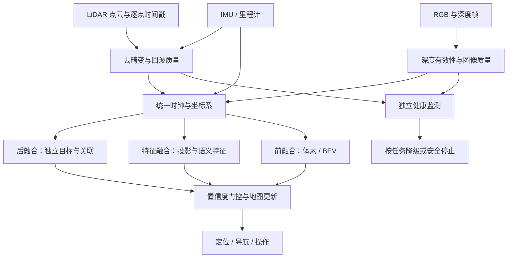

# 激光雷达与深度相机选型及融合（LiDAR vs. Depth Camera: Selection and Fusion）

## 一句话定义

LiDAR 擅长较大范围的度量几何，深度相机擅长视场内的稠密近场观测；是否组合应由任务覆盖、误差预算、共同失效与降级要求决定，而不是由传感器数量决定。

## 英文缩写速查

| 缩写 | 英文全称 | 简要说明 |
|---|---|---|
| LiDAR | Light Detection and Ranging | 激光测距与扫描 |
| RGB-D | Red Green Blue + Depth | 彩色与深度联合观测 |
| ToF | Time of Flight | 飞行时间测距，含直接与间接实现 |
| FOV | Field of View | 安装后的有效视场 |
| IMU | Inertial Measurement Unit | 运动补偿与短时状态传播 |
| SLAM | Simultaneous Localization and Mapping | 定位与建图 |
| BEV | Bird's-Eye View | 俯视空间表征 |
| PTP | Precision Time Protocol | 网络时钟同步 |
| PPS | Pulse Per Second | 秒脉冲同步信号 |
| RMSE | Root Mean Square Error | 均方根误差，须注明测试条件 |
| AGV | Automated Guided Vehicle | 自动导引车 |
| BOM | Bill of Materials | 物料清单与硬件成本 |
| ROI | Region of Interest | 感兴趣区域 |
| ROS 2 | Robot Operating System 2 | 机器人软件通信中间件 |
| USB | Universal Serial Bus | 相机数据接口 |

## 为什么重要

人形或移动操作平台需要远距离通道几何、脚前低矮障碍和腕部操作目标；这些任务的距离、视场及失效代价不同。增加第二路只能补足经验证的覆盖差距，不能默认替代独立安全通道。选型先定义任务工作域与最低可接受覆盖，再计算物料、功耗和处理延迟。

## 核心原理

### 测距物理与误差

| 技术 | 测距关系 | 优势与边界 |
|---|---|---|
| 脉冲 LiDAR | d = c Δt / 2 | 1 cm 距离差对应约 66.7 ps 往返时间差；实际测距精度还受信噪比、估计器与标定影响 |
| 主动/被动双目 | Z = fB/d；σZ ≈ Z²σd/(fB) | 纹理匹配；主动投影改善弱纹理，强光下投影对比度下降 |
| 结构光 | 编码图案与三角测量 | 近场形状采样，受投射距离、遮挡、表面及光照约束 |
| 间接 ToF | d = cφ/(4πfmod)，单频无模糊量程 c/(2fmod) | 100 MHz 对应约 1.5 m；多频可解模糊，多径及背景光仍影响精度 |

双目示例（原文假设 f=700 px、B=0.05 m、σd=0.2 px）：1/2/3/5/10 m 处深度标准差分别约 0.57/2.29/5.14/14.29/57.14 cm。只描述视差噪声的一阶传播，不代表任何商用相机保证值；系统偏差、有效匹配率还需单测。LiDAR 可按方位角和俯仰角将距离转换为空间点；回波强度受距离、入射角、材质和设备处理影响，不能直接测硬度。

### 采样覆盖与失效

| 工况 | LiDAR | 深度相机 |
|---|---|---|
| 暗光、白墙 | 不依赖可见纹理，但长直走廊仍可能几何退化 | 被动双目弱纹理/暗光退化，主动模式可能补偿 |
| 强日照 | 受背景光与反射率影响 | 主动投影对比度下降，被动双目可视纹理而定 |
| 玻璃、镜面、黑色材料 | 透射、虚点、弱回波 | 无效像素或虚假深度，同样可能漏检 |
| 雨雾粉尘、污染 | 散射与衰减 | 对比度、回波与成像退化 |
| 远距、侧后方 | 视型号及安装位置可覆盖更广 | 量程、视锥与遮挡限制 |
| 近场、细物体、抓取 | 盲区、采样间隔限制 | 稠密像素有利，仍受最小深度、遮挡和纹理约束 |

无有效回波不等于自由空间；无效深度不得默认清除障碍。RGB 语义是检测模型或人工解释的结果，并非深度图本身提供类别。

### 融合层次与数据流

三条融合支路是可选架构，不要求同时运行。后融合易隔离故障，但受独立检测的漏检与关联约束；特征融合保留跨模态几何语义关联，对投影和同步敏感；前融合在数据表征层合并，通常资源需求更高，不保证优于其他架构。状态估计可独立采用滤波或因子图，不应与检测融合混为一谈。

## 工程实践

### 时空对齐误差预算

外参旋转误差 Δθ（弧度）的横向误差约为 Z tan(Δθ)，小角度近似 ZΔθ。10 m、1° 时约 17.5 cm；30 m、0.1° 时约 5.2 cm；30 m 仅分配 10 cm 给角误差时要求约 0.19°。还应预留平移外参、测距和同步误差预算。

运动错位一阶估计：平移 vΔt，旋转 ωZΔt（目标方向与旋转轴垂直的近似上界）。1.5 m/s、1 ms 对应 1.5 mm；300°/s、10 m、1/10 ms 对应约 5.24/52.36 cm。由任务允许误差反推时间预算，而非把任意固定毫秒或厘米阈值当成通用标准。

出厂靶标标定、现场对齐检查、必要时在线估计；移动关节上的相机通过关节状态更新变换。同步优先采用受支持的 PTP、PPS、硬件触发或共同时钟；记录采样时刻而不是仅记录到达主机时刻；旋转扫描做点级运动补偿，检查刚度、温漂与清洁可维护性。

### 两款设备的官方规格实例

| 项目 | Livox MID-360 | Orbbec Gemini 335 |
|---|---|---|
| 距离 | 100 klx 下 40 m@10% / 70 m@80% 反射率 | 标称 0.10–20 m+，最佳 0.26–3 m |
| FOV | 水平 360°，垂直 −7°~52° | 水平 90°，垂直 65° |
| 名义输出 | 首回波 200,000 点/s，典型 10 Hz | 1280×800@30 fps 深度，最高 1920×1080@30 fps 彩色 |
| 接口 | 100BASE-TX Ethernet | USB 3（厂商规格） |
| 防护 | IP67 | IP5X，不代表防水 |

0.1 s 雷达积累约 20,000 点；相机单帧约 102.4 万像素，30 fps 为 3072 万像素/s，均不等同于有效观测数。以视场角乘积粗算名义每帧密度约 0.94 与 175 点/平方度，不代表实际均匀扫描或立体角密度。

原始数据吞吐算例：16 位深度约 61.44 MB/s；三通道 8 位 RGB 约 186.62 MB/s；合计 248.06 MB/s（十进制单位，未含协议开销）。按每点 16 字节，20 万点/s 为 3.2 MB/s；真实带宽取决于像素格式、点字段、压缩与协议。检查共享 USB 控制器、录包与推理同时运行的峰值，而非只看接口理论速率。

### 选型和验收

| 任务 | 首选验证方向 |
|---|---|
| 结构化平地 AGV | 2D LiDAR + 里程计；低矮/悬空物、对接或复杂几何需要额外传感覆盖 |
| 固定近距机械臂 | 合适工作距离的 RGB-D / 双目；有透明反光物时补充专用测量或工装 |
| 人形、移动操作、混合巡检 | 按全局定位、脚前地形和腕部工作空间分别确定覆盖；两类传感器是候选方案，不是强制 |
| 人机共处 | 按风险评估、安全功能、停止距离、诊断覆盖与共因失效设计，经验证的安全通道独立于普通感知精度 |

验收顺序：定义工作域及障碍最小尺寸 → 测试难材质和照明 → 核对 ROS 2 LaserScan/PointCloud2/图像与时间戳 → 标定与运动对齐 → 峰值功耗带宽/延迟 → 丢帧及失效注入 → 安全停车或其他经验证的降级。记录有效深度覆盖率、漏检率、时延分位数和对齐残差；不把点数当作安全指标。

## 局限与风险

- 原文的部分绝对判断需要条件化：不同波段、扫描方式、镜头与算法会改变失效边界；不存在依据该文章即可断言两路失效独立的依据。
- 供电、时钟、支架、标定、计算和污染是共享失效源。消费级 LiDAR 或 RGB-D 不因异构配置而自动成为安全级传感器。
- 价格、实际算力和量程均需按型号、运行模式及目标环境测试；本文没有新的台架实验或可运行官方实现，不提供源码运行时序图。
- 不将固定 2 cm 静态对齐阈值当成通用融合门槛；依据距离、目标尺寸、速度和下游容差分配预算。

## 关联页面

- [LiDAR 传感](../concepts/lidar-sensing.md)
- [Intel RealSense 深度相机](../entities/intel-realsense.md)
- [传感器融合](../concepts/sensor-fusion.md)
- [机器人传感器接入与标定](../methods/robot-sensor-integration.md) — 多传感器内外参标定、PTP/PPS 同步与健康降级流水线
- [LiDAR / LIO / VIO 选型](../comparisons/lidar-slam-lio-vio-selection.md)
- [机器人感知栈选型闭环](../queries/robot-perception-stack-selection-loop.md)
- [导航纵深](../../roadmap/depth-navigation.md)、[感知越障纵深](../../roadmap/depth-perceptive-locomotion.md)、[整机硬件纵深](../../roadmap/depth-humanoid-hardware-design.md)

## 参考来源

- [Zane Hub 2026-11-24 原文归档及核对](../../sources/blogs/wechat_zane_hub_lidar_depth_camera_2026-11-24.md)
- [Livox MID-360 官方规格](https://www.livoxtech.com/mid-360/specs)
- [Orbbec Gemini 335 官方规格](https://www.orbbec.com/products/stereo-vision-camera/gemini-335/)

## 推荐继续阅读

- [Nav2 Obstacle Layer](https://docs.nav2.org/configuration/packages/costmap-plugins/obstacle.html)：障碍源、清除与标记的工程配置入口。
