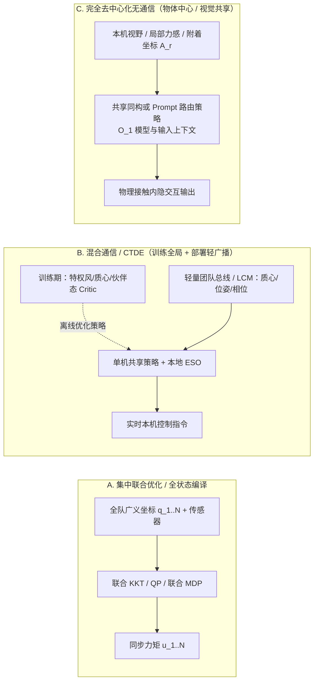

# 多机器人协同架构对比（集中式 vs 通信混合 vs 纯去中心化）

设计多机器人协作系统时，架构决策的核心不是单纯选择集中式或去中心化，而是厘清哪些量（状态估测、特权监督信号、力分配还是实时执行动作）应当集中、走轻量化总线共享还是完全留在单机本地闭环。

## 一句话定义

**多机器人协同架构在“全系统精确闭链力学一致性（集中求解）”“训练全局监督＋轻量广播（CTDE/总线混合）”与“恒定复杂度零通信扩展（纯去中心化）”三者之间做可扩展性、通信脆弱性与同步精度的系统权衡。**

## 英文缩写速查

| 缩写 | 英文全称 | 简要说明 |
|------|----------|----------|
| CTDE | Centralized Training, Decentralized Execution | 训练期全局特权 Critic、部署期仅依赖局部或轻量共享观测的混合学习范式 |
| VLA | Vision-Language-Action | 视觉–语言–动作大模型；拼接全队多机图像可能破坏其单机预训练视觉对应 |
| ESO | Extended State Observer | 单机扩展状态观测器；常用于混合架构本地补偿扰动 |
| KKT | Karush-Kuhn-Tucker | 受约束多体系统拉格朗日乘子方程，多用于集中式可组合全身控制 |

## 为什么重要

- **集中式在理论信息最多时却常输给去中心化 VLA：** 直觉上拥有全局全队观测的集中式策略应当作为性能上限，但 [CHORUS](../entities/paper-chorus.md) 实机实验表明，把为单机四视角预训练的 `π₀.₅` 强行拼接两台异构机器人的多视角图像反而导致分布剧烈偏移（图书交接成功率 `0.611` 明显低于去中心化权重共享的 `0.833`）。
- **完全忽略队友状态则会在强耦合步态中立即失稳：** 与学习策略不同，[RoboCompiler-Humanoids](../entities/paper-robocompiler-humanoids-composable-dynamics.md) 证明在五人形手拉手侧步切足时，仅凭单机各自模型而不计算跨机组合约简会导致第 1 个周期内（4.7 s）全体摔倒。
- **工程项目必须对齐物理场景选型：** 把高频强内力闭链硬塞给无通信视觉反应策略，或把十机室外搬箱硬塞给联合状态拼接集中 PPO，都会在可行性或扩展性边界外失效。

## 核心机制

### 三类主流协作架构结构对比

### 多维度工程权衡总表

| 对比维度 | 集中联合架构（如 RoboCompiler / 集中 QP） | 分级通信与 CTDE 混合（如 Rhythm / CALM / Khatib 主从） | 纯本地零通信去中心化（如 decMHT / SAI / CHORUS） |
|------|------|------|------|
| **计算/网络通信代价** | 状态与雅可比随机数 $N$ 增长（两级约简降至 ms 级）；需低抖动全队时钟与总线同步 | 部署无需全维状态，仅广播低维向量（位姿/相位/负载质量标量），抗部分丢包 | 参数量与上下文窗口与团队规模完全无关 $O(1)$，无任何显式机间传输债 |
| **团队规模与异构扩展性** | 构型/机数变化需重编译连接/支撑表；4 机集中 RL 联合动作空间即难收敛 | 依赖固定团队总线协议或同构图拓扑结构；扩员需重配共识环或观测排序 | 物体附着抽象 `decMHT` 实测单/双机训后零样本扩至 `N=10`；`CHORUS` 用 ID prompt 兼容异构多机 |
| **瞬时同步与接触内力精度** | **最高**：可显式分配挤压内力至 `0%` 不可行步，并在切步期无缝保平衡 | **中高**：靠相位软同步或前馈抑制偏航与漂移，承受一定通信延迟容差 | **受限**：靠视觉看到队友或物理牵扯反力感知，不保证微秒级双爪同瞬动作同步 |
| **主要失效触发点** | 单点时钟/总线断线、局部计算超时、预定义切换表遭遇非计划摔倒 | 先验建图失效（如野外无参考地图 LiDAR）、团队总线长时中断导致前馈失准 | 负载彻底遮挡队友视野、要求纯无接触盲目同步配合 |

## 工程实践

- **什么时候选集中可组合控制：** 多机刚性牵手/抬举且需要极低轨迹跟踪误差（毫米级）、主动分担高频内力或脚底支撑频繁切换且现场部署在局域低延迟共享网络内。
- **什么时候选 CTDE / 轻量总线混合：** 动态物理交互（如双人形拥抱共舞、三架带臂无人机户外扛篮抗风），部署期允许传递 `10–100 Hz` 的低带宽位姿/相位/总重量标量，训练期又需要仿真特权场（真实风速、队友隐状态）稳住策略收敛。
- **什么时候选纯本地零通信去中心化：** 团队规模动态变化（随时增减机器人数 `1..10`）、异构品牌移动操作臂混编、跨通信盲区作业，或手头已有强大单机 VLA 骨干且目标在于保留其开放世界视觉先验。
- **混用模式往往最优：** 在系统架构上可以把“低层单机/主从高频力控安全环”做成本地或有线紧耦合，而把“任务交接触发器与长期分工策略”放在低频去中心化视觉层（参见 [Robot Control Architecture](../methods/robot-control-architecture.md)）。

## 局限与风险

- **不可把“局部视觉”等同于“无需全局设计”：** 纯去中心化系统之所以在真实世界能对齐协作，前提仍是任务定义中存在共享物理载体或共同坐标参照系（如 `decMHT` 依赖局部附着坐标，`SAI` 依赖三阶段分布演化训练数据集）。
- **CTDE 的实际隐藏耦合债务：** 部分标榜“去中心化执行”的 CTDE 系统在实机部署阶段仍悄悄接入了共享总线或动捕参考（如 CALM 指出自己尚非完全分布式，团队总线若出现长延时仍影响前馈增益），审稿与工程落地时必须核查论文的 Information Pattern 小节。
- **集中式策略对传感器/频率一致性的刚性要求：** 如 CHORUS 实验中将 `30 Hz` YAM 与 `15 Hz` Kinova 强行统一重采样后送入集中 VLA 会同时损失双方的动态语义对齐能力。

## 关联页面

- [多机器人协作（Multi-Robot Collaboration）](../concepts/multi-robot-collaboration.md) — 上层概念枢纽
- [协同物体搬运（Collaborative Object Transport）](../concepts/collaborative-object-transport.md) — 力学分解与载荷分担机理
- [CTDE vs 去中心化 MARL](./ctde-vs-decentralized-marl.md) — 从 RL 训练算法视角切入对比 CTDE 与完全去中心化学习
- [ROS 2 vs LCM](../comparisons/ros2-vs-lcm.md) 与 [时钟同步算法](../concepts/clock-synchronization-algorithms.md) — 混合与集中式架构的底层通信基石
- [CHORUS](../entities/paper-chorus.md) · [Rhythm](../entities/paper-rhythm-dual-humanoid-interaction.md) · [CALM](../entities/paper-calm-decentralized-aerial-manipulation.md) · [RoboCompiler-Humanoids](../entities/paper-robocompiler-humanoids-composable-dynamics.md)
- [多机器人协作纵深路线](../../roadmap/depth-multi-robot-collaboration.md) — Stage 0 与 Stage 3–4 架构选型交叉页

## 参考来源

- Khatib et al., *Coordination and Decentralized Cooperation of Multiple Mobile Manipulators*, JRS 1996 — [`khatib_1996_multiple_mobile_manipulators.md`](../../sources/papers/khatib_1996_multiple_mobile_manipulators.md)
- Doshi et al., *CHORUS: Decentralized Multi-Embodiment Collaboration with One VLA Policy*, arXiv:2606.12352 — [`chorus_arxiv_2606_12352.md`](../../sources/papers/chorus_arxiv_2606_12352.md)
- Duan et al., *Learning Multi-Humanoid Pickup and Transport via Decentralized Object-Centric Control*, arXiv:2609.17824 — [`decentralized-multi-humanoid-pickup_arxiv_2609_17824.md`](../../sources/papers/decentralized-multi-humanoid-pickup_arxiv_2609_17824.md)
- Chen et al., *Rhythm: Learning Interactive Whole-Body Control for Dual Humanoids*, arXiv:2603.02856 — [`rhythm_arxiv_2603_02856.md`](../../sources/papers/rhythm_arxiv_2603_02856.md)
- Huo et al., *CALM: Decentralized Control of Cooperative Aerial Manipulation with MARL*, arXiv:2610.18425 — [`calm_arxiv_2610_18425.md`](../../sources/papers/calm_arxiv_2610_18425.md)
- Heydari Shahna & Mattila, *Composable Dynamics for Cooperative Humanoids*, arXiv:2610.14237 — [`robocompiler_humanoids_composable_dynamics_arxiv_2610_14237.md`](../../sources/papers/robocompiler_humanoids_composable_dynamics_arxiv_2610_14237.md)

## 推荐继续阅读

- [多机器人协作纵深路线](../../roadmap/depth-multi-robot-collaboration.md)
- [CTDE 与完全去中心化 MARL](./ctde-vs-decentralized-marl.md)
- [CHORUS（单一 VLA 去中心化多本体协作）](../entities/paper-chorus.md)
