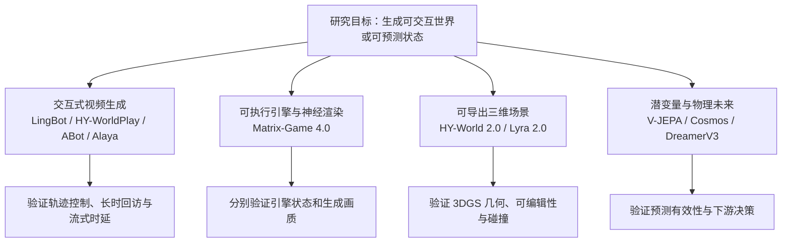

# 2026 开源世界模型：11 项技术路线、源码与机器人落地对照

## 一句话定义

**把 11 项世界模型按「生成什么、如何控制、怎样记忆、是否能复现、能否服务机器人」对齐，而不是把可玩视频、3D 资产、latent 规划混成同一指标。**

## 英文缩写速查

| 缩写 | 英文全称 | 简要说明 |
|---|---|---|
| WM | World Model | 对环境后续状态或观测建模 |
| WAM | World Action Model | 将世界预测与策略动作耦合 |
| 3DGS | 3D Gaussian Splatting | 可导出、渲染的三维场景表示 |
| JEPA | Joint-Embedding Predictive Architecture | 在表征空间预测而非逐像素重建 |
| RSSM | Recurrent State-Space Model | DreamerV3 的潜状态动力学基础 |
| FPS | Frames Per Second | 分清合成视频帧率、模型吞吐与实际显示 |

## 为什么重要

文章 [《2026 开源世界模型，绕不开这 11 个项目》](../../sources/blogs/wechat_shenlan_world_models_11_2026_11_20.md) 提供选题入口，但“2026 年值得关注”不等于首次发表于 2026，也不意味着所有项目训练数据/权重完全开放。研究选型应按**交互控制、空间持久性、动态真实性、硬件成本与策略闭环**分开比较。

## 核心原理

| 项目 | 技术路线 | 可复核的贡献/入口 | 主要边界 |
|---|---|---|---|
| [LingBot-World Infinity](./../entities/paper-sa-2607-07534-infinite-worlds-with-versatile-interactions-ling.md) | 实时生成 | 14B/1.3B · 因果预训练、agentic harness | 非商业模型许可 |
| [HY-WorldPlay（HY-World 1.5）](../entities/hy-worldplay-1-5.md) | 实时生成 | 上下文重建 · 相机轨迹 · 4 步蒸馏 | 一款 RL+distill 权重尚待发 |
| [Matrix-Game 4.0](../entities/paper-matrix-game-4.md) | 引擎+视频渲染 | 可执行引擎管理规则 · DiT 神经渲染 | FPS 多为模型侧 |
| [SANA-WM](../entities/paper-sa-2605-15178-sana-wm-efficient-minute-scale-world-modeling-wi.md) | 高效视频生成 | 混合线性注意力 · 6DoF 相机 | 长视频 ≠ 真机动力学 |
| [ABot-World-0](../entities/paper-abot-world-0.md) | 单卡交互 | 5B · LongForcing · RTX 5090 | 教师、数据部分未发 |
| [HY-World 2.0](../entities/paper-sa-2604-14268-hy-world-2-0-a-multi-modal-world-model-for-recon.md) | 显式 3D | 全景生成、扩展、3DGS 重建 | 3D 几何质量须独立评测 |
| [Lyra 2.0](../entities/paper-lyra-2.md) | 显式 3D | 历史几何检索/抗漂移 · VIPE+DA3→3DGS | 重建主要针对静态场景 |
| [V-JEPA 2 / 2.1](../entities/paper-vjepa2.md) | latent 表征 | 视频自监督和动作条件预测；2.1 强化 dense features | 2.1 单独论文节点 |
| [NVIDIA Cosmos Predict2.5](../entities/paper-sa-2511-00062-world-simulation-with-video-foundation-models-fo.md) | 物理视频生成 | Text/Image/Video2World、机器人/多视角 | Predict2.5 已有限维护 |
| [AlayaWorld](../entities/paper-alayaworld.md) | 实时生成与记忆 | sink + 时序/几何记忆、prompt switching | 受门控依赖与多阶段权重 |
| [DreamerV3](../entities/paper-shenlan-wm-13-dreamerv3.md) | 模型式强化学习 | RSSM 想象 rollout 训练策略 | 研究起点 2023 / 论文 Nature 2025 |

V-JEPA 2.1 已有独立 [论文节点](../entities/paper-sa-2603-14482-v-jepa-2-1-unlocking-dense-features-in-video-sel.md)；LingBot-World Infinity 对应 [2607.07534](../entities/paper-sa-2607-07534-infinite-worlds-with-versatile-interactions-ling.md)。本表采用**每项现有唯一主节点**，不再创建重复实体。

### 四类实现形态

其中 SANA-WM 侧重**高效分钟级视频生成与可控相机**，属于交互视频的基础模型技术，而非天然具备完整游戏引擎。

## 工程实践

### 按目标选项目

1. **要在桌面 GPU 上体验键盘生成世界**：先按 [ABot-World-0](../entities/paper-abot-world-0.md) 核对 5B checkpoint 与 19 GiB 级显存，再核实具体运行环境，不要把 5090 演示视作通用 8GB 显存能力。
2. **要做低延迟可执行游戏场景**：读 [Matrix-Game 4.0](../entities/paper-matrix-game-4.md) 的 `matrix-game render/serve` 路径，物理和互动规则由游戏引擎确保。
3. **要生成机器人仿真资产**：读 [HY-World 2.0](../entities/paper-sa-2604-14268-hy-world-2-0-a-multi-modal-world-model-for-recon.md) 与 [Lyra 2.0](../entities/paper-lyra-2.md)；视频升格为 3DGS 后还需考虑碰撞几何、物理属性及 Isaac Sim 导入验证。
4. **要预测动作后果/训练策略**：区分 [V-JEPA 2-AC](../entities/paper-vjepa2.md) 的 latent 候选动作规划、[Cosmos Predict](../entities/paper-sa-2511-00062-world-simulation-with-video-foundation-models-fo.md) 的条件视频和 [DreamerV3](../entities/paper-shenlan-wm-13-dreamerv3.md) 的想象式策略训练。
5. **要研究长时记忆**：对照 [HY-WorldPlay](../entities/hy-worldplay-1-5.md)、[AlayaWorld](../entities/paper-alayaworld.md) 与 [Lyra 2.0](../entities/paper-lyra-2.md) 的历史重构、压缩特征缓存和逐帧几何检索。

### 评测时避免错误比较

| 问题 | 优先度量 | 不应拿来替代 |
|---|---|---|
| 实时交互 | action→可见帧延迟、稳态 FPS、显存 | 生成视频标注的 24/60 FPS |
| 长程一致性 | 回访同一视角的几何/语义保持、累计 drift | 一段最佳演示视频 |
| 3D 世界 | 多视角一致、重建几何、导出可用率 | 单视角视觉美观 |
| 下游机器人 | 动作后果误差、规划成功率、Sim2Real | FVD/视频清晰度 |
| 开源复现 | 训练/推理脚本、checkpoint、数据、许可逐项矩阵 | 仅 GitHub 有 README |

## 局限与风险

- **年份纠偏：** DreamerV3 是 2023 年 arXiv / 2025 年 Nature；V-JEPA 2 2025、2.1 2026；HY-WorldPlay 对外报告名为 HY-World 1.5（2025）。文章题名的“2026”是盘点时间。
- **维护状态：** Cosmos-Predict2.5 README 已提示迁移至 Cosmos 3，不代表 2.5 的开源资料失去复现价值。
- **宣传数字：** 原文“3 年 17 倍、2523 篇”未独立复核 arXiv 关键词和日期口径，不作为本对照的经验事实。
- **闭环边界：** 视觉生成不自动保证可执行碰撞、接触、动力学；几何重建不自动产生摩擦、质量和真实控制反馈。
- **开源许可证：** Lyra 2.0 源码 Apache-2.0 而权重许可限科研；HY-WorldPlay 和 LingBot 亦有特定许可；应按组件单独核验。

## 关联页面

- [Generative World Models](../methods/generative-world-models.md)
- [Video as Simulation](../concepts/video-as-simulation.md)
- [Latent Imagination](../concepts/latent-imagination.md)
- [WAM 纵深路线](../../roadmap/depth-wam.md)
- [世界模型基础路线](../overview/embodied-wm-route-model-building.md)

## 参考来源

- [深蓝具身智能原文索引与事实边界](../../sources/blogs/wechat_shenlan_world_models_11_2026_11_20.md)
- [HY-WorldPlay / HY-World 1.5 官方代码归档](../../sources/repos/hy-worldplay-1-5.md)
- [Matrix-Game 4.0 官方代码归档](../../sources/repos/matrix-game-4.md)
- [Lyra 2.0 官方代码归档](../../sources/repos/lyra-2.md)
- [AlayaWorld 官方代码归档](../../sources/repos/alayaworld.md)
- 其余 7 项的一手资源与代码入口见表内既有详情节点的「参考来源」。

## 推荐继续阅读

- [HY-WorldPlay README](https://github.com/Tencent-Hunyuan/HY-WorldPlay)
- [Matrix-Game 4.0 技术报告](https://arxiv.org/abs/2610.27999)
- [Lyra 2.0 技术报告](https://arxiv.org/abs/2604.13036)
- [AlayaWorld 完整技术报告](https://arxiv.org/abs/2607.18367)
