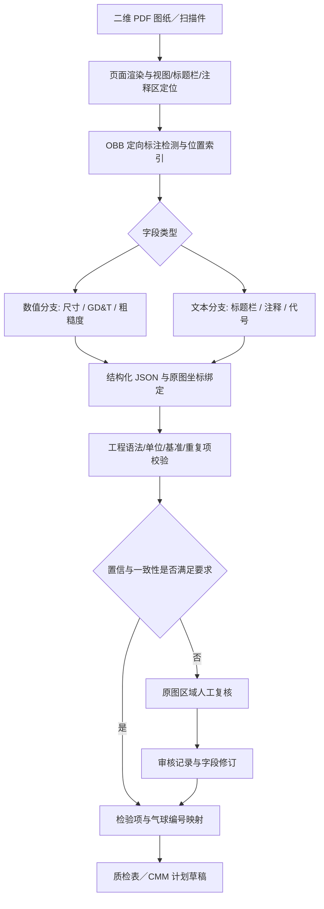

# PDF 图纸 PMI 提取：OCR 与 VLM 可靠性比较 | Reliable PMI Extraction from PDF Engineering Drawings: OCR vs VLM

## 一句话定义

**PDF 图纸 PMI 自动提取**是把二维工程图中分散的尺寸、公差、几何形位公差、粗糙度及技术注释定位、识别、语义归一化，并与原图位置绑定，生成可审计的质量检验项目；不能将通用 VLM 的文档问答高分当作尺寸检验的可靠性保证。

## 英文缩写速查

| 缩写 | 英文全称 | 简要说明 |
|---|---|---|
| PMI | Product and Manufacturing Information | 产品与制造信息，覆盖尺寸、形位公差与加工要求 |
| OCR | Optical Character Recognition | 光学字符识别，识别图纸中的文字、数字和符号 |
| VLM | Vision-Language Model | 视觉语言模型，结合视觉与语言信息生成结构化文本 |
| GD&T | Geometric Dimensioning and Tolerancing | 几何尺寸与公差标注 |
| OBB | Oriented Bounding Box | 旋转边界框，用于定位倾斜的图纸标注 |
| CER / WER | Character / Word Error Rate | 字符 / 单词错误率，不直接衡量工程语义完整性 |
| CMM | Coordinate Measuring Machine | 三坐标测量机，可能消费自动生成的测量计划 |
| F1 | Harmonic Mean of Precision and Recall | 精确率与召回率的调和平均，依赖定义的匹配规则 |

## 为什么重要

- **图纸与质检割裂：** PDF/扫描图纸的尺寸、基准与形位公差通常未以可直接消费的结构化字段提供，需要气球编号与逐条整理。
- **领域差异大：** 常规发票/合同 OCR 面对密集引线、旋转字串、直径/位置度符号和跨视图关联时，识别与语义均可能退化。
- **质量风险不均匀：** 把“±0.05”误成“±0.5”、漏掉基准 A 或将模糊零件代号改写成常见词，可能只改变少量字符，却改变检验判据。
- **机器人关联：** 关节法兰、减速器座孔、轴承配合面与末端工装的尺寸/形位要求，是机器人结构设计、加工交付与质量控制之间的重要桥梁；见[公差仿真工具链](../concepts/structure-tolerance-simulation-toolchain.md)。

## 核心原理：分层抽取，而不是“单个 VLM 包办”

[From Drawings to Decisions](https://arxiv.org/abs/2506.17374) 和 [多视图框架](https://arxiv.org/abs/2510.21862) 提供了两种可核实的研究方案：前者使用 YOLOv11-OBB 先检测定向标注，再由微调的 Donut 或 Florence-2 解析；后者先用 YOLOv11-det 定位视图、标题栏和注释，再用 YOLOv11-obb 切片，分别由数值和文本 Donut 型 VLM 解析。

以下图示是**结合两项研究与质检工程要求整理的建议系统流程**，不是声称已有公开项目实现了整套生产闭环：

上述“工程语法校验—人工审核—CMM 计划”是**部署建议**；论文案例展示了 JSON 对下游工艺/检测的映射，但不等于任意输入图纸均可未经审核直接执行。

**原文已核的分支差异：** [三阶段混合研究](../entities/paper-multistage-engineering-drawing-vlm-pmi.md)的 Alphabetical VLM **未微调、zero-shot 解析文本**，Numerical VLM **经微调解析数值/符号**；不能把两者 F1 差异完全归因于字段天然难度。

## 研究证据与适用边界

| 资料 / 任务 | 已核实数据 | 能说明什么；不能说明什么 |
|---|---|---|
| [From Drawings to Decisions（期刊）](https://doi.org/10.1016/j.rcim.2025.103186)，机械图纸标注解析 | 1,367 图、9 类；Donut F1 约 94%、幻觉率 10.8% | 支撑特定训练集和混合框架的效果，不能宣称零误读；[arXiv 初版](https://arxiv.org/abs/2506.17374)摘要为 F1 93.5%、幻觉率 11.5% |
| [Multi-Stage Hybrid Framework](../entities/paper-multistage-engineering-drawing-vlm-pmi.md)，多视图图纸 | 数值 VLM（fine-tuned）F1 0.963；文本 VLM（zero-shot）F1 0.672；粗糙度**OBB 检测对角项 0.54** | 已通读 arXiv:2510.21862v2 全文/表 1；分支训练不同，且粗糙度解析 F1=1.0 **不代表端到端 100% 正确** |
| [MechVQA](https://proceedings.mlr.press/v306/kou26c.html)，机械图问答 | 约 3.3K 图、21K QA、10 任务 | 通用多模态模型在高密度工程图纸上的理解仍脆弱；是 QA 基准而非 PMI 逐字段识别 |
| [EC3 / FELD](https://arxiv.org/abs/2607.18997)，工程图布局检测 | RF-DETR mAP50 0.949；DocLayout-YOLO 0.675 | 属于“找框”的检测性能，不是框内文字的正确率 |
| [AECV-Bench](https://arxiv.org/abs/2601.04819)，AEC 图纸理解 | 文本任务上限约 0.95；符号计数常约 0.40–0.55 | 建筑图纸不同于机械图纸；说明图纸空间/符号能力与文本能力不等价 |
| [Berrutti 历史档案 OCR 对比](https://arxiv.org/abs/2607.24077) | Qwen 3.6 推理模式 CER 中位 1.72%，均值 11.17% | 分布尾部存在严重错误，**非 PMI 数据集**，仅作为可靠性风险证据 |
| [FaithC4](https://arxiv.org/abs/2607.21617) | 1,455 份扰动文档、15 个系统；短词改写比例最高约 10% | 说明生成模型可改写而非忠实照录；不代表特定 PMI 字符串已测到同一发生率 |
| [Qianfan-OCR](https://huggingface.co/baidu/Qianfan-OCR) | OmniDocBench v1.5 总分 93.12 | 是通用文档解析基准，不能与机械图纸 PMI F1 对比或替代工业验收 |
| [部署经济性研究](https://arxiv.org/abs/2609.01575) | 35B 总/3B 激活 MoE VLM；文档成本相对人工基线降逾 80%（作者报告） | 不代表 PMI 部署也能获得相同成本收益 |

**版本提醒：** [From Drawings to Decisions](https://arxiv.org/abs/2506.17374) 预印本摘要与[期刊版](https://doi.org/10.1016/j.rcim.2025.103186)报告的精确率、F1、幻觉率数值不完全一致；[FaithC4](https://arxiv.org/abs/2607.21617) 不同版本材料对扰动退化幅度亦有差别。指标引用必须附版本与测试条件。

## OCR、专用 VLM 与通用 VLM 如何比较

| 方案 | 强项 | 主要风险 | 更适合的角色 |
|---|---|---|---|
| 传统 OCR + 几何规则 | 保留可溯源字符，局部纠错行为较可控 | 旋转文本、拥挤引线和复杂符号易定位失败 | 复核通道、清晰文本识别、字符级一致性基线 |
| OBB 检测 + 领域微调 VLM | 对不同方向与标注类型单独定位解析，结构化输出方便 | 依赖训练分布与标注类别，仍有幻觉和漏检 | 当前研究中有实证支撑的主解析路径 |
| 整页通用 VLM | 灵活自然语言交互、跨字段问答 | 可能改写短代号、遗漏符号；不同页面错误差异巨大 | 辅助解释与候选生成，避免单独担任检验放行器 |

表格是根据多项不同基准综合的工程定位，**不是在统一 PMI 数据集上完成的三路 A/B 测试**。

## 工程实践：从图纸到检验表

推荐先生成可复核的中间 JSON，而非只生成没有原图出处的 Excel。一个合格记录至少应保存：

| 字段 | 目的 | 示例（仅示意，非实际测量结果） |
|---|---|---|
| drawing_id / revision | 图号与版次 | PART-001 / Rev A |
| page / view / bbox | 来源页、视图与标注区域 | p1 / FRONT / x,y,w,h |
| characteristic_id | 检验项与气球编号 | 001 |
| raw_text | 忠实原文，保留符号 | Ø28 ±0.05 |
| parsed_value / unit | 机器可用的数值与单位 | 28 / mm |
| tolerance / datum | 上下偏差、特征控制框与基准 | ±0.05 / A-B-C（视原图而定） |
| confidence / model_version | 评估与排错 | 模型分数、版本 |
| review_status / reviewer | 是否人工核验及修订痕迹 | pending / reviewed |

建议实施顺序：① PDF 页面与视图分割；② 按类别定位旋转框；③ 数值/文本分治解析；④ 保存原始字符串和 bbox；⑤ 校验单位、孔/轴符号、GD&T 格式与关联基准；⑥ 对低置信、冲突、关键安全尺寸强制复核；⑦ 审核通过后才输出检验表或 CMM 程序草稿。针对公司图纸需自建包含困难样例的评测集，按**检验项漏失率、关键字段严格匹配、幻觉率、人工复核成本**验收，而不是只看 OCRBench 分数。

## 局限与风险

- **证据阅读范围：** 核心多视图机械 PMI 论文 arXiv:2510.21862v2 已完整阅读 10 页正文、Fig.1–4 和 Table 1，另已阅读 FaithC4、Berrutti OCR 的公开 HTML 正文；用于比较的其余论文按题录/公开结果限定使用，不冒充均已完成逐篇精读。二手公众号原文的插图无法取得，保留在 sources 中标明未通读，**不作为本页健康度的“已通读原始论文”身份依据**。
- **当前证据不等于“可放心全自动放行”：** 数值 F1 0.963 仍意味着有错误；少数关键误读能导致较大制造质量损失。
- **比较不可混算：** 不同论文任务、标注粒度、数据集、模型规模与测试协议不同；不支持“VLM 在整体指标上全面优于传统 OCR”的笼统判断。
- **二手综述受限：** 微信文章原图及完整参考文献列表仍未取得；但主框架的文本/数值分项和幻觉率已通过已通读的 arXiv:2510.21862v2 Table 1 逐行核验。其他论文未全文核对的细节不得扩大解释。
- **源码运行时序图：** 不适用；本页是多项研究比较与工程部署建议，不代表一个存在公开可运行入口的单一项目。
- **现场制约：** PDF 渲染清晰度、扫描噪声、标题栏版式、图纸标准（ISO/ASME）、企业图号体系及保密要求都可能影响部署，需要现场复验。

## 关联页面

- [三阶段工程图纸 PMI 解析论文（全文核读）](../entities/paper-multistage-engineering-drawing-vlm-pmi.md)：核对视图布局、旋转框、双 Donut 训练差异及全指标。
- [结构公差仿真工具链](../concepts/structure-tolerance-simulation-toolchain.md)：提取后如何进入尺寸链与公差预算。
- [YOLO26 + PP-OCRv6 文档 OCR](../methods/yolo26-ocr-document-parsing.md)：检测 + 识别的另一条工程路线（非 PMI 对照试验）。
- [Text-to-CAD](../concepts/text-to-cad.md)：面向制造设计的上游 CAD 数据路径。

## 参考来源

- [三阶段混合 PMI 解析论文全文归档](../../sources/papers/multistage_engineering_drawing_vlm_pmi_2510_21862.md)（已完整通读 PDF 与 Fig.1–4、Table 1）
- [泊松比：《基于 PDF 图纸读取 PMI 数据》来源归档](../../sources/blogs/wechat_poisson_ratio_pdf_pmi_vlm_ocr_2026-11-19.md)（二手综述；原文插图与文献列表未完全核验）
- [From Drawings to Decisions（期刊 DOI）](https://doi.org/10.1016/j.rcim.2025.103186)
- [A Multi-Stage Hybrid Framework](https://arxiv.org/abs/2510.21862)
- [MechVQA（ICML 2026）](https://proceedings.mlr.press/v306/kou26c.html)
- [FaithC4 论文](https://arxiv.org/abs/2607.21617)
- [When Low CER is Not Enough](https://arxiv.org/abs/2607.24077)

## 推荐继续阅读

- [MechVQA 官方项目及数据](https://xiaofengshi.github.io/MechVQA/)
- [FaithC4 官方评测代码](https://github.com/gwanglee/DoVLMsRead)
- [AECV-Bench](https://arxiv.org/abs/2601.04819)
