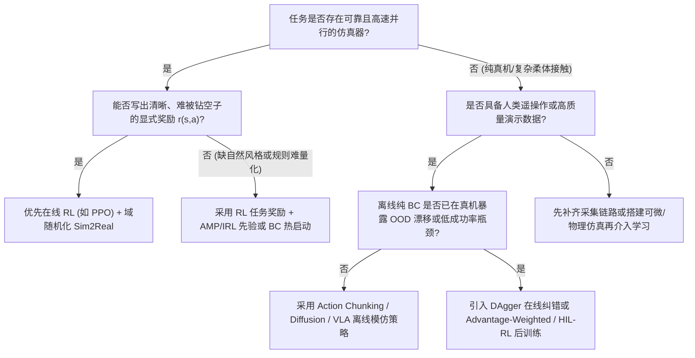

# 强化学习 vs 模仿学习（RL vs IL vs IRL）

## 一句话定义

**[强化学习（RL）](../methods/reinforcement-learning.md)** 通过环境试错最大化显式奖励函数、**[模仿学习（IL）](../methods/imitation-learning.md)** 通过监督或交互演示直接对齐专家策略行为、而 **[逆强化学习（IRL）](../methods/inverse-reinforcement-learning.md)** 先从专家演示反推潜在奖励函数再交由 RL 求解，三者构成机器人策略学习中「试错优化—专家对齐—目标反演」的核心范式三角。

## 英文缩写速查

| 缩写 | 英文全称 | 简要说明 |
|---|---|---|
| RL | Reinforcement Learning | 基于环境交互与标量奖励最大化长期折扣回报的决策学习范式 |
| IL | Imitation Learning | 从专家示教轨迹学习策略分布而不依赖显式奖励函数的学习范式 |
| IRL | Inverse Reinforcement Learning | 从专家行为反推潜在奖励函数再用于策略优化的桥梁方法 |
| BC | Behavior Cloning | 将状态到动作拟合为监督学习问题的离线模仿学习基线 |
| DAgger | Dataset Aggregation | 在策略执行过程中迭代请求专家纠正并聚合新数据的交互式 IL |
| GAIL | Generative Adversarial Imitation Learning | 用对抗判别器匹配专家与策略占用测度的模仿学习方法 |
| PPO | Proximal Policy Optimization | 以裁剪代理目标稳定策略更新的同策略 RL 代表算法 |
| AWR | Advantage-Weighted Regression | 通过优势加权回归统一离线 RL 与高质量样本筛选的后训练方法 |
| Sim2Real | Simulation to Real | 将仿真中训练得到的策略通过域随机化与系统辨识迁移至真机 |

## 为什么重要

在具体机器人系统立项阶段，研发者面临的第一个结构性决策往往不是网络结构，而是 **监督信号从哪里来**：

- **决定研发瓶颈所在**：选纯 RL 意味着瓶颈落在[奖励设计](../concepts/reward-design.md)、并行仿真吞吐与 [Sim2Real](../concepts/sim2real.md) 差距；选纯 IL 意味着瓶颈落在真机遥操作数据规模、多模态动作分布拟合以及[分布外泛化](../concepts/out-of-distribution-generalization.md)。
- **避免范式误用与重复踩坑**：在奖励极难定义（如叠衣、精密插拔）的[机器人操作](../tasks/manipulation.md)任务上硬写手工奖励极易诱发 reward hacking；反之在有高保真刚体仿真（如高动态步态恢复）的场景只做纯离线 BC，则难以自主探索出优于示教器的恢复动作。
- **支撑混合技术栈落地**：现代具身策略很少非此即彼，而是以「IL 预训练 + RL / 优势加权微调」或「任务奖励 RL + 对抗运动先验（AMP / IRL）」协同发挥各自优势。

## 核心原理

### 1. 核心机制三维对比

| 维度 | 强化学习（RL） | 模仿学习（IL：BC / 交互式 IL） | 逆强化学习（IRL / 对抗 IL） |
|---|---|---|---|
| **监督信号来源** | 显式设计的标量奖励 $r(s,a)$ | 专家示教状态-动作对 $(s,a)\sim\mathcal{D}_E$ | 先从 $\mathcal{D}_E$ 学奖励/判别信号，再驱动 RL 更新 |
| **数学目标** | 最大化折扣累积回报 $\mathbb{E}_\pi[\sum_t \gamma^t r_t]$（[MDP](../formalizations/mdp.md)） | 最小化行为散度（如 $\mathcal{L}_{\mathrm{BC}}$，见[BC 损失](../formalizations/behavior-cloning-loss.md)） | 匹配特征期望或轨迹占用测度 $\rho_\pi(s,a)\approx\rho_E(s,a)$ |
| **仿真/真机交互** | 极高（同策略算法通常需大量并行仿真试错） | 低至中（BC 纯离线零交互；DAgger 需在线查询专家） | 高（内循环仍需通过策略与环境交互采样） |
| **超越专家上限** | **可能**（可在规则范围内自主发现更优解） | **通常受限**（行为分布被示教质量与模态上界封顶） | **有限可能**（取决于推断奖励是否准确捕捉任务本质） |
| **核心工程难度** | 奖励塑形、探索效率与 Sim2Real 迁移 | 数据采集成本、多模态崩溃与复合误差 | 训练稳定性（双层/对抗博弈）、算力与样本双重开销 |

### 2. 典型失败模式对比

- **RL 的失败模式**：
  - **Reward Hacking（奖励黑客）**：策略利用物理仿真或奖励公式漏洞刷高得分（例如原地高频抖腿刷速度奖励或夹爪卡在物体边缘刷接触分），而非完成人类预期任务。
  - **探索停滞与稀疏回报困境**：在长视野多阶段操作中，随机探索几乎无法撞见最终成功状态，价值函数长期全零。
  - **Sim2Real 物理偏差**：仿真中被利用的接触刚度或延迟假设在真机失真，导致策略在现实中振荡失稳。
- **IL 的失败模式**：
  - **复合误差与状态分布偏移（Covariate Shift）**：纯 BC 只要单步动作偏离示教流形，下一步进入未见状态后误差随时间步 $T$ 呈超线性放大；这是脱离分布后缺少自恢复轨迹的典型表现。
  - **多模态平均（Mode Averaging）**：当人类专家面对障碍物既有“左绕”也有“右绕”演示时，单峰 MSE 回归输出正中间“撞墙”动作（需 [Diffusion Policy](../methods/diffusion-policy.md) 或 [Action Chunking](../methods/action-chunking.md) 等多峰建模缓解）。
  - **因果混淆（Causal Confusion）**：策略学到与真因高度相关的伪线索（如机械臂静止参考帧背景而非目标物体位置）。
- **IRL 的失败模式**：
  - **奖励退化性与不唯一**：无穷多组经过势能塑形或常数平移的奖励都能解释同一组专家轨迹，判别器容易记忆视觉或时间步伪特征而非真正任务目标。
  - **双重脆弱性**：既要承受类似 IL 的专家数据偏置，又要叠加对抗训练震荡与内循环 RL 的大量环境交互成本。

### 3. 代表方法纵向谱系

| 方法族 | 具体算法 | 核心定位与机制 | 主要代偿与工程条件 |
|---|---|---|---|
| **纯离线模仿** | [Behavior Cloning](../methods/behavior-cloning.md) / [Action Chunking](../methods/action-chunking.md) / [Diffusion Policy](../methods/diffusion-policy.md) | 离线拟合动作块或条件动作分布 | 零交互门槛低；但极度依赖数据覆盖度与恢复演示 |
| **交互/游乐模仿** | [DAgger](../methods/dagger.md) / [Play-LMP](../methods/learning-from-play-lmp.md) | 通过专家在线纠错或无任务游乐数据拓宽状态流形 | 显著抑制 OOD 漂移；DAgger 需高成本人类在环实时标注 |
| **在线/同策略 RL** | [策略优化](../methods/policy-optimization.md)（PPO 等） | 并行仿真试错学习最优闭环反馈策略 | 可突破人类动作极限；依赖 GPU 并行仿真与精心奖励塑形 |
| **对抗与运动先验** | [GAIL / AIRL](../methods/inverse-reinforcement-learning.md) / [AMP](../methods/amp-reward.md) | 把专家风格或占用测度转化为可微辅助奖励 | 兼顾任务目标与类人自然度；调参敏感且需交互仿真器 |
| **混合后训练范式** | [AWR](../methods/awr.md) / [HIL 混合模仿学习](../methods/hil-hybrid-imitation-learning.md) / RL 微调 VLA | 以 BC 策略作初始化，再以真机人工纠错或优势加权精调 | 避免零起步探索且显著提升成功率上限；工程管线较重 |

### 4. 决策选型流程

## 工程实践

在现代机器人工程中，范式选择往往随着任务物理特性收敛出稳定组合：

1. **人形与四足[运动控制](../tasks/humanoid-locomotion.md)：以 RL 为主、IL/AMP 为辅**
   - 步态稳定、抗冲击、摔倒恢复对物理接触响应极敏感，且运动学/动力学在刚体仿真器（如 Isaac Gym / Isaac Lab / MuJoCo）中易于大规模并行。
   - 标准方案通常采用基于特权信息（Privileged State）的 PPO + 域随机化 + 教师-学生蒸馏，并引入 [AMP](../methods/amp-reward.md) 判别器或动作追踪模仿约束，确保步态既抗扰又具备类人自然运动风格。
2. **桌面灵巧与双臂[机器人操作](../tasks/manipulation.md)：以 IL 为底座、RL/纠错作精调**
   - 柔性物体（布料、线缆）、长程视觉语义组合（开抽屉→抓物→放回）很难在仿真中精确对齐摩擦与变形参数，往往首选真机遥操作采集 + 生成式模仿策略（ACT / Diffusion Policy / VLA）。
   - 当离线策略受限于示教覆盖不足或微米级接触失败时，再叠加两类工程手段增强鲁棒性：一是像 [DAgger](../methods/dagger.md) 或人类干预学习那样在线补充恢复边界轨迹；二是结合值函数/阶段进度估计进行优势加权行为克隆（AWBC）或真机在线强化学习（如 [HIL 混合模仿学习](../methods/hil-hybrid-imitation-learning.md)）。
3. **混合管线的实用切换阈值**：工程上切忌在缺乏稳定策略初始化时直接从零启动真机 RL，也切忌在仅剩最后 5%–10% 长尾物理稳定性差距时无限堆叠冗余同质演示；先把基线 BC 做到可复现失败边界，再用交互纠错或优势加权/在线 RL 定点消除长尾故障，通常性价比最高。

## 局限与风险

- **单纯模仿学习（IL）的天花板风险**：纯离线 BC 无法自主发现演示集中未曾出现的高效恢复动作，且不同操作员混采的低质量或矛盾轨迹会在监督拟合阶段互相抵消，导致策略在真机[分布外泛化](../concepts/out-of-distribution-generalization.md)场景下脆弱。
- **单纯强化学习（RL）的样本与建模成本**：高动态真机试错成本极高且存在硬件损坏风险，因此依赖高保真仿真器与严谨的系统辨识；视觉端到端策略在真机闭环中的端到端前向耗时也受制于视觉主干规模与控制总线频率匹配，需借助异步推理或动作分块工程化适配。
- **混合架构的系统复杂度风险**：把 BC、DAgger、值函数微调与对抗判别器串进同一训练管线会成倍放大超参耦合（例如优势裁剪阈值、正则系数与数据配比失衡），若缺乏标准化评测与消融基线，极易陷入“多模块互相掩盖缺陷”的调参泥潭。

## 与其他页面的关联

- 核心方法枢纽：[强化学习](../methods/reinforcement-learning.md)、[模仿学习](../methods/imitation-learning.md)、[逆强化学习](../methods/inverse-reinforcement-learning.md)
- IL 关键分支：[Behavior Cloning](../methods/behavior-cloning.md)、[DAgger](../methods/dagger.md)、[Learning from Play (Play-LMP)](../methods/learning-from-play-lmp.md)
- RL 与混合后训练：[策略优化](../methods/policy-optimization.md)、[AMP](../methods/amp-reward.md)、[AWR](../methods/awr.md)、[HIL 混合模仿学习](../methods/hil-hybrid-imitation-learning.md)
- 核心问题与概念：[奖励设计](../concepts/reward-design.md)、[分布外泛化](../concepts/out-of-distribution-generalization.md)、[Sim2Real](../concepts/sim2real.md)、[MDP](../formalizations/mdp.md)
- 纵深学习路线：[模仿学习纵深路线](../../roadmap/depth-imitation-learning.md)

## 参考来源

- [模仿学习基础与经典论文归档](../../sources/papers/imitation_learning.md) — 梳理 BC、DAgger 复合误差理论（Ross et al.）与模仿学习范式分类。
- [策略优化综述归档](../../sources/papers/policy_optimization.md) — 对照策略梯度、TRPO / PPO 信任域优化与方差控制原理。
- [Ho & Ermon (2016) GAIL 原文通读归档](../../sources/papers/gail_reading_arxiv_1606_03476.md) — 核对占用测度匹配与连接 IRL/RL 的对抗训练机理。
- [Play-LMP (Lynch et al., 2019) 原文通读归档](../../sources/papers/learning_latent_plans_from_play_arxiv_1903_01973.md) — 核对无任务游乐数据、潜计划空间与 BC 覆盖度、恢复能力对比数据（arXiv:1903.01973）。
- [逆强化学习一手论文索引](../../sources/papers/inverse_reinforcement_learning_primary_refs.md) — 对比显式奖励反推与学徒学习定位（含 Ng & Russell 2000 与 Ziebart 2008 全文核对摘录）。

## 推荐继续阅读

- **夯实纯模仿下界**：[Behavior Cloning](../methods/behavior-cloning.md) → [DAgger](../methods/dagger.md) — 理解状态偏移与复合误差的数学来源，再看如何通过在线纠错消除漂移。
- **打通奖励反推桥梁**：[逆强化学习](../methods/inverse-reinforcement-learning.md) → [AMP](../methods/amp-reward.md) — 看专家演示如何转换成不手写稠密方程的 RL 判别奖励。
- **走向真机混合落地**：[HIL 混合模仿学习](../methods/hil-hybrid-imitation-learning.md) — 了解从真机 BC 过渡到人工干预+强化学习精调的实操方案。
