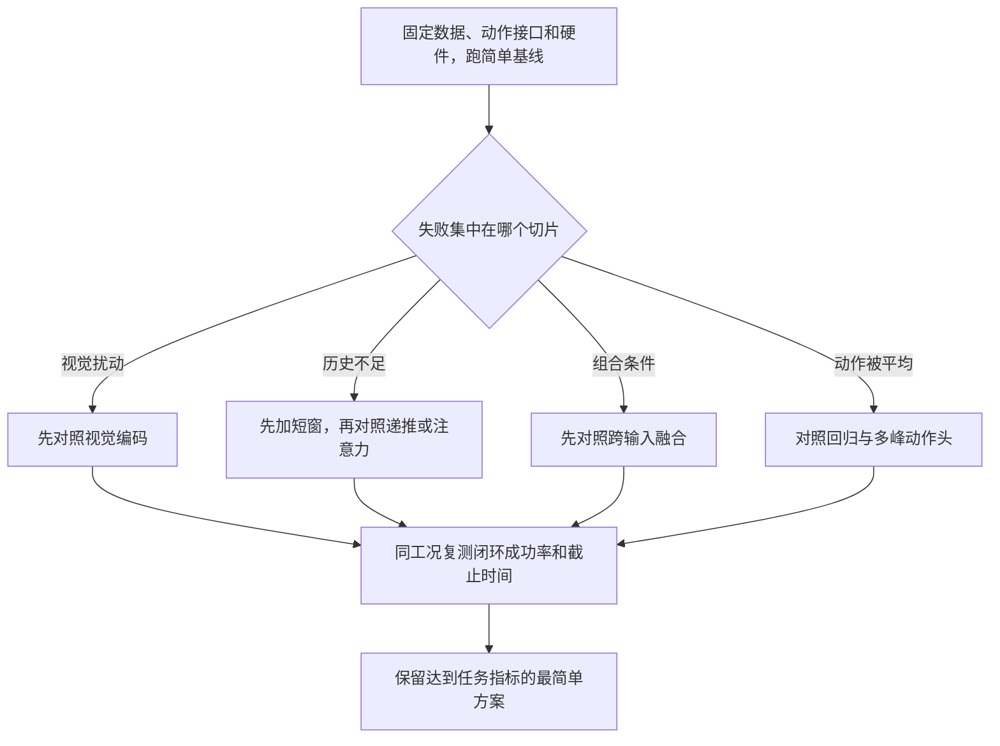

# 机器人策略骨干选型：从 MLP 基线到 Transformer / Robot Policy Backbone Selection

## 一句话定义

先定位策略缺的是观测信息、历史信息、跨输入关联，还是动作分布表达；以固定输入的 MLP 作基线，再针对失败的环节比较卷积、递推、注意力或状态空间模块。

## 英文缩写速查

| 缩写 | 英文全称 | 简要说明 |
|------|----------|----------|
| MLP | Multi-Layer Perceptron | 固定向量反馈基线，也可接固定历史窗 |
| RNN | Recurrent Neural Network | 隐状态递推序列模型 |
| CNN | Convolutional Neural Network | 局部核视觉/时序模型 |
| MHA | Multi-Head Attention | Transformer 核心 |
| SSM | State Space Model | 连续/离散状态空间 |
| Mamba | Mamba | 选择性 SSM 架构 |

## 为什么重要

- 课程 7.1.1：进入 Mamba 前先统一「旧结构优劣」叙事。
- 机器人既有图像骨干也有历史观测序列，架构选择影响延迟与记忆长度。

## 核心原理（对比）

| 维度 | RNN（含 [GRU](../concepts/gru.md)/LSTM） | CNN | Transformer | Mamba |
|------|-----|-----|-------------|-------|
| 跨时间的信息路径 | 逐步压入隐藏状态 | 由核宽、深度、扩张率决定感受野 | 密集注意力层可直接访问未遮蔽的位置 | 选择性更新的状态压缩历史 |
| 训练并行 | 差 | 好 | 好 | 好（扫描实现） |
| 随序列长度变化的计算量 | 固定宽度整段递推随长度线性 | 固定核与通道整段随长度线性 | 全序列密集注意力项平方增长；带 KV 缓存时单个新 token 的注意力项随可见历史线性增长 | 固定状态维度整段近线性，流式更新不必重扫历史 |
| 归纳偏置 | 时间因果 | 局部性 | 弱 | 选择性记忆 |

固定窗口的 [MLP](../concepts/mlp.md) 也能读历史：显式拼接最近几帧，但窗口之外没有可学习的递推状态。全连接层不会天然利用像素邻接；[MLP-Mixer](https://arxiv.org/abs/2105.01601) 则显式组织图块与通道，不能类比成把原图直接展平。Transformer 的前馈 MLP 与注意力子层分工，不能把两者当作互斥的整机架构。

## 工程实践

### 用失败样本决定只改哪一层

| 观察到的失败 | 最小对照 | 不要一起改 |
|---|---|---|
| 只在光照、遮挡或视角改变时漏掉目标 | 固定下游结构和训练预算，对照当前编码与轻量 CNN 或预训练视觉特征；若特征接口不同，用同等预算训练投影及下游头，再按视觉扰动切片回放 | 历史窗、控制周期 |
| 瞬时状态相似，但有滑移、接触或外扰时动作常选错 | 相同观测字段下比较单帧 MLP、短窗 MLP 与 GRU；把窗口外仍需分辨的接触阶段单列 | 动作参数化、训练数据与终止条件 |
| 单一条件都对，语言属性、指代或多视角一组合就选错 | 保持视觉骨干与动作头，比较拼接融合与受限 token 窗口的注意力融合 | 预训练数据、相机与动作频率 |
| 视觉与目标均正确，但左右两条有效路径被平均成中间动作 | 锁定感知与条件，比较单点回归和可表达多峰分布的动作块；看闭环是否稳定选择一条可行动作 | 不要把改动作分布误算为换骨干的收益 |

### 比较上机成本，而不是只测模型耗时

- 先固定训练数据或训练预算、相同动作接口与测试初始条件；记录各失败切片试验数、成功数，并在同等调参预算下比较。测试只换一个模块，才知道它是否解决了失效原因。
- 对端侧策略分别统计观测采样到动作可执行的端到端 P50/P95/P99、截止时间违约率及最长连续超时；同步记录输入传输、预处理、模型、后处理和后台负载。比如 100 Hz 策略每 10 ms 更新，不代表模型独占 10 ms；更快的电机内环是另一个频率，不能混作模型预算。
- 以 [Diffusion Policy](../methods/diffusion-policy.md) 为例：时序 CNN 和 Transformer 都可做动作去噪，文中视觉编码另设；跟踪去噪迭代数、预测窗口及实际执行几步才重规划。单次前向快，不保证整块动作及时可用。

## 局限与风险

整段复杂度不是 batch=1 单控制步的时延；算子支持、缓存管理和内存带宽都随目标硬件而变。RNN/SSM 的状态压缩也可能丢失精确的远期线索；部署时要规定回合结束、急停、重连时怎样重置或重建状态。对比表给的是机制与测试假设，不是架构排行榜。

## 关联页面

- [模型架构纵深路线](../../roadmap/depth-model-architecture.md) — Stage 1 骨干族谱的学习入口
- [AI 架构地图](../overview/ai-architecture-map.md)
- [GRU](../concepts/gru.md)
- [Mamba](../concepts/mamba.md)
- [RNN / LSTM / GRU](../concepts/recurrent-neural-network.md)
- [TCN](../concepts/temporal-convolutional-network.md)
- [SSM](../concepts/state-space-model-ssm.md)
- [Transformer](../concepts/transformer.md)
- [Vision Mamba](../entities/vision-mamba-vim.md)
- [Transformer CV 课程策展](../entities/transformer-cv-curriculum.md)
- [BC + Transformer](../methods/bc-with-transformer.md) — 本页结论在机器人侧的落地口径：动作块长度只是序列的一部分；同时计入视觉、语言和历史 token，再以目标硬件延迟决定是否要压缩上下文或改用状态空间模块

## 参考来源

- [深蓝具身智能原文归档与一手资料核对](../../sources/blogs/deepblue-ai-robot-policy-backbone-selection-2026-11-26.md)
- [Transformer 视觉应用课程大纲](../../sources/courses/transformer_cv_applications_syllabus.md)
- [AI 架构地图一手论文簇](../../sources/papers/ai_architecture_foundations.md)
- [Mamba（arXiv:2312.00752）](../../sources/papers/gu_mamba_arxiv_2312_00752.md)

## 推荐继续阅读

- [Mamba: Linear-Time Sequence Modeling (arXiv:2312.00752)](https://arxiv.org/abs/2312.00752)
