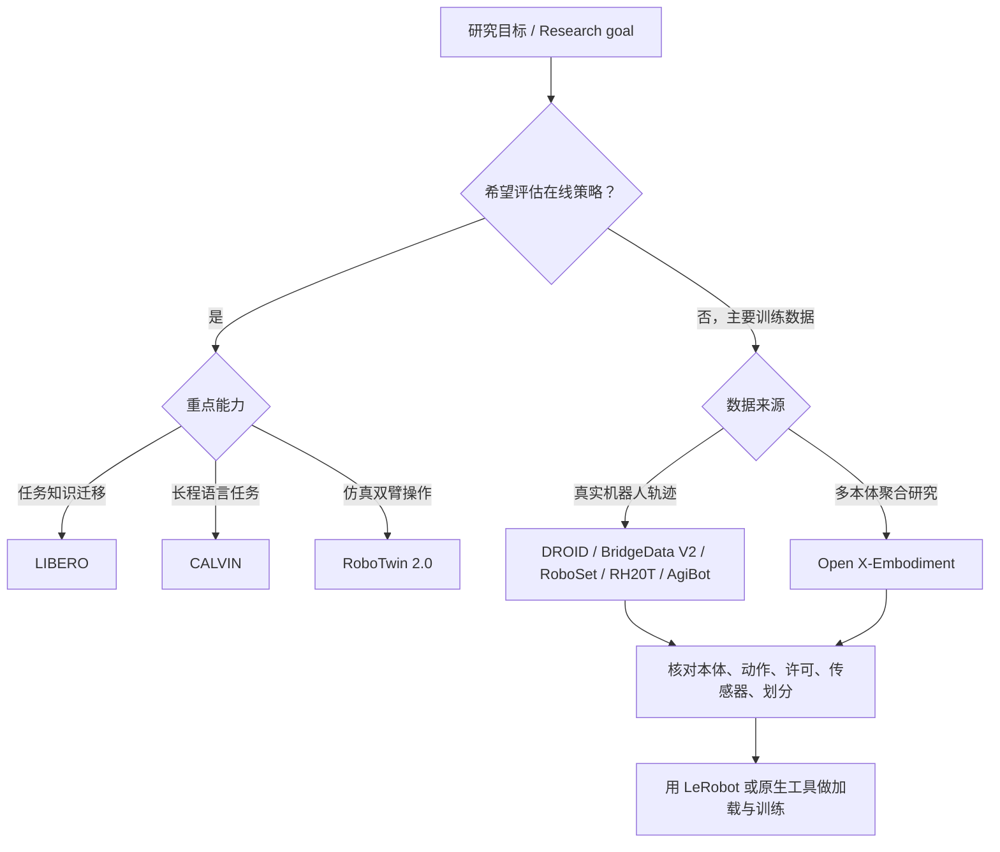

# 机器人操作数据集与基准选型 / Robot Manipulation Dataset and Benchmark Selection

## 一句话定义

这是一份以 **18 个官方仓库、数据卡及项目/论文入口** 为依据的**数据与评测层级对照**：在选择用于 VLA/模仿学习的资源前，先区分**仿真任务基准**、**真实机器人轨迹**、**跨本体数据集合**与**训练工具链**。

## 英文缩写速查

| 缩写 | 英文全称 | 简要说明 |
|---|---|---|
| VLA | Vision-Language-Action | 以视觉和语言为条件输出机器动作的策略 |
| OXE | Open X-Embodiment | 多机构跨本体机器人数据集合 |
| IL | Imitation Learning | 从机器人动作演示学习策略 |
| HDF5 | Hierarchical Data Format version 5 | LIBERO / RoboSet 等使用的轨迹文件格式 |
| RGB-D | Red Green Blue and Depth | 彩色图与深度数据模态；不同来源的标定须另核 |

## 为什么重要

同样被称为「robotics dataset」的资源有不同的角色：**LIBERO/CALVIN** 还提供可重放的评测任务，**DROID/BridgeData/RH20T/RoboSet** 重点是采集到的真实轨迹，**OXE** 是跨数据集聚合，**LeRobot** 则提供采集、数据格式与训练/评测等工具。把它们当作同一层级的排行榜会产生错误结论。

## 核心原理

### 10 个项目的任务与获取边界

| 项目 / Project | 主要定位 | 官方材料可证实的差异 | 现有实体 |
|---|---|---|---|
| **LIBERO** | 仿真操作与终身学习评测 | 任务套件包含 Spatial / Object / Goal 与 90/10 划分；HDF5 演示可下载，HF 预览不可用 | [LIBERO](../entities/libero-benchmark.md) |
| **RoboTwin 2.0** | 仿真双臂、专家轨迹生成与评测 | 代码 `main` 对应 2.0；预采集 HF 数据卡存在，但卡片 README 为空且 Viewer 报错 | [RoboTwin](../entities/robotwin.md) |
| **CALVIN** | 语言条件长程操作评测 | 强调连续完成语言指令下的多步任务，而不只是单步抓取 | [CALVIN](../entities/calvin-benchmark.md) |
| **Open X-Embodiment** | 跨数据集、跨本体集合 | 提供数据与 RT-X 的研究入口；不同机器人动作语义仍需逐个对齐 | [OXE](../entities/paper-open-x-embodiment.md) |
| **DROID** | 多场景真实机器人操作演示 | 官方项目页报告 76k 条轨迹、350h、564 场景、86 任务，并列训练/硬件代码 | [DROID](../entities/paper-rcl-ref-aa9c28fbf4242ea03696-droid-a-large-scale-in-the-wild-robot-manipulati.md) |
| **BridgeData V2** | 多环境真实操作学习 | 官方页统计 60,096 条轨迹、24 环境、13 技能；含遥操作与脚本 rollout | [BridgeData V2](../entities/painode-085-bridgedatav2.md) |
| **RoboSet** | 真实厨房多任务操作演示 | 官方页统计 28,500 条轨迹、四机位；示范 HDF5 读取 | [RoboSet](../entities/roboset-dataset.md) |
| **RH20T** | 力、视觉、音频等多模态真实操作数据 | 超过 110k 操作序列，部分配置含触觉；下载体量大且有隐私提示 | [RH20T](../entities/painode-092-rh20t.md) |
| **AgiBot World Alpha/Beta** | 多任务真实双臂/移动操作大规模数据 | Alpha 更新至 36 任务、595.31h；Beta 数据卡称 100 万+ 条、2976.4h；**均需门控协议** | [Colosseo](../entities/paper-sa-2503-06669-agibot-world-colosseo-a-large-scale-manipulation.md) |
| **LeRobot** | 机器人学习库/工具链而非单一数据集 | GitHub PyTorch 生态提供数据、模型和训练/部署工具，格式/版本与上述数据集需逐一适配 | [LeRobot](../entities/lerobot.md) |

> 表中规模按官方页的不同统计口径列示，**不能比较为相同定义的有效训练轨迹数**。AgiBot World Colosseo 2025 的 Alpha/Beta 与 2026 另行发布的 [AGIBOT WORLD 2026](../entities/agibot-world-2026.md) 不混为同一版本。

### 选型流程总览

此图是**选型决策**，不是某个项目的源码运行时序图；箭头代表用户选型逻辑，不宣称不同项目间存在直接调用。

## 工程实践

1. **明确目标**：学迁移/抗遗忘选 LIBERO；语言长程操作考虑 CALVIN；双臂仿真与数据生成考虑 RoboTwin 2.0。
2. **明确监督信号**：真机数据需检查是否具有 RGB/RGB-D、关节状态、末端位姿、力/扭矩、触觉、语言；不同来源未必全部具备。
3. **核验动作接口**：joint-space 和 end-effector-space、绝对/相对动作、时间频率、左右手顺序不可直接混为一个维度。
4. **记录发布状态**：项目页、源码仓库、HF 数据卡是三种不同证据；可见卡片不保证 Viewer 正常，也不代表免协议下载。
5. **训练与评估隔离**：同一轨迹和场景如果进入训练与测试，应在结果中披露协议，不把数据规模当成功率。

## 局限与风险

- 本次确实打开了全部 18 个指定入口，但**没有逐篇通读所有主论文 PDF、附录和代码运行入口**；因此本页暂为 `draft`，不得将此比较表视为已完成全文深读。
- 依赖/许可证/数据版本可能变化，尤其 **AgiBot Alpha/Beta 需同意门控协议**；RoboTwin 2.0 HF 当前数据预览服务报错。
- 数据格式的同名字段不保证单位或坐标系相同；跨机器人合并训练必须在读实际样本后做 schema 校验。
- 本次没有运行基准，因此不提供未经核验的模型成功率或横向排名。

## 关联页面

- [LIBERO](../entities/libero-benchmark.md) · [RoboTwin 2.0](../entities/robotwin.md) · [CALVIN](../entities/calvin-benchmark.md)
- [Open X-Embodiment](../entities/paper-open-x-embodiment.md) · [DROID](../entities/paper-rcl-ref-aa9c28fbf4242ea03696-droid-a-large-scale-in-the-wild-robot-manipulati.md)
- [BridgeData V2](../entities/painode-085-bridgedatav2.md) · [RoboSet](../entities/roboset-dataset.md) · [RH20T](../entities/painode-092-rh20t.md)
- [AgiBot World Colosseo](../entities/paper-sa-2503-06669-agibot-world-colosseo-a-large-scale-manipulation.md) · [LeRobot](../entities/lerobot.md)

## 参考来源

- [18 个官方链接的核验记录及逐项来源](../../sources/datasets/robot-manipulation-primary-sources-2026-11-07.md)
- [RoboSet 官方原文通读归档](../../sources/sites/roboset-dataset.md)
- [Open X-Embodiment 官方项目](https://robotics-transformer-x.github.io/) · [DROID 官方页](https://droid-dataset.github.io/) · [BridgeData V2 官方页](https://rail-berkeley.github.io/bridgedata/)
- [AgiBot World Alpha](https://huggingface.co/datasets/agibot-world/AgiBotWorld-Alpha) · [Beta](https://huggingface.co/datasets/agibot-world/AgiBotWorld-Beta) · [Colosseo 技术报告](https://arxiv.org/abs/2503.06669)

## 推荐继续阅读

- [LIBERO](https://github.com/Lifelong-Robot-Learning/LIBERO) / [RoboTwin 2.0](https://github.com/RoboTwin-Platform/RoboTwin) / [CALVIN](https://github.com/mees/calvin)：仿真评测入口
- [RH20T](https://rh20t.github.io/) / [RoboSet](https://robopen.github.io/roboset/)：多模态数据入口
- [LeRobot 官方仓库](https://github.com/huggingface/lerobot)：数据处理和策略训练工具入口
