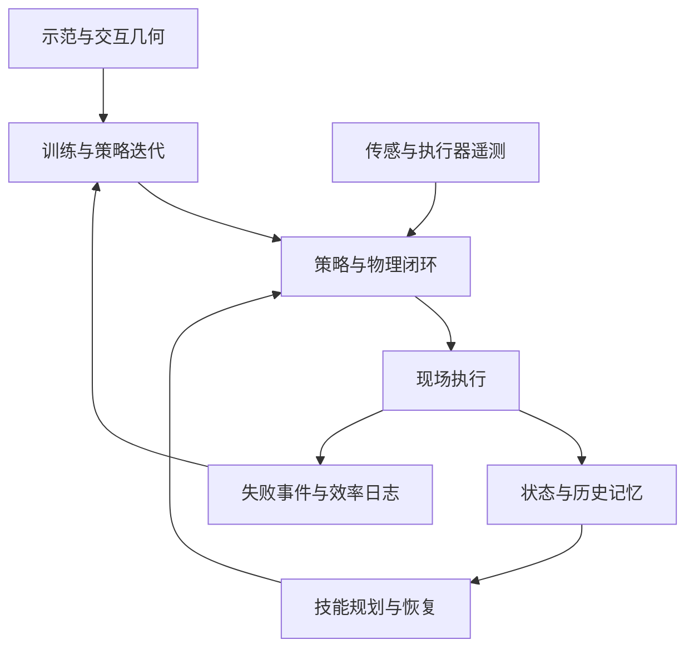

# 2026 Robotics Conference Award Papers: Five Paths to General Robot Capability（2026 机器人顶会论文：通用能力五条技术路径）

## 一句话定义

训练和推理效率、示范数据的交互保持、物理闭环、长程状态、失败恢复是通用机器人的五类互补能力；先定位工程瓶颈，再选择对应研究，而非把十二篇不同协议的论文排成一个性能榜。

## 英文缩写速查

| 缩写 | 英文全称 | 简要说明 |
|---|---|---|
| RL | Reinforcement Learning | 用交互与奖励训练反馈控制策略 |
| SAC | Soft Actor-Critic | FlashSAC 的离策略算法基础 |
| VLA | Vision-Language-Action | 从感知和语言生成机器人动作 |
| TTT | Test-Time Training | RoboTTT 使用快权重维护部署期历史 |
| CAD | Computer-Aided Design | 已知零件几何与预设抓取点的输入 |
| KPI | Key Performance Indicator | 连续作业的验收指标 |

## 为什么重要

展会演示与连续现场运行之间的差距，可能来自训练覆盖、参考动作失真、控制扰动、状态遗忘或失败后无法继续。不同问题需要不同解决层；论文结果只是各自协议内的证据。此页是基于既有一手阅读归档的跨论文综合，不代表本次重新逐篇通读，也不创建重复论文实体。

## 核心原理

### 五路径系统视角

下图是工程综合框架，不是十二篇论文已经联合验证的真实系统。

### 十二篇研究的能力分工

| 路径 | 独立论文节点 | 机制、证据与工程边界 |
|---|---|---|
| 训练效率 | [FlashSAC](../entities/paper-flashsac.md) | 高吞吐 replay 与低更新频率、范数约束；1024 env、10M transitions、2.5M 参数网络；测墙钟与回报，不只测环境步数。 |
| 训练效率 | [SuperMimic](../entities/paper-supermimic.md) | 共享可微动力学、短想象 rollout 与策略梯度；单 H100 三小时超过 SONIC 发布模型归一化回报，训练动作覆盖不等于未见动作泛化。 |
| 训练效率 | [Muninn](../entities/paper-muninn-trajectory-diffusion-acceleration.md) | 轻量 probe、采样器灵敏度和标定偏差预算决定是否复用去噪器缓存；最高 4.6 倍墙钟加速，偏差证书不等于闭环安全证明。 |
| 动作数据 | [OmniRetarget](../entities/paper-hrl-stack-03-omniretarget.md) | 交互网格与硬运动学约束保留人、物、环境关系；对物体和地形重解优化产生增广参考；下游反馈策略承担动力学稳定。 |
| 物理交互 | [NeuralActuator](../entities/paper-neuralactuator-neural-actuation-modeling.md) | 历史执行器遥测与外力监督估计接触、外力及动力学替代量；用于轨迹传播的 torque surrogate 不能直接视为已标定力矩。 |
| 物理交互 | [SteadyTray](../entities/paper-notebook-steadytray.md) | 底层行走策略与托盘稳定残差分工；测试变速、外力扰动与换物，不能将单物体实验外推到任意多物体载荷。 |
| 物理交互 | [Do You Know Where Your Camera Is?](../entities/paper-know-your-camera.md) | 将内外参转为逐像素 Plücker 射线并与视觉特征融合；关注视角迁移及背景捷径，标定误差仍需验证。 |
| 长程任务 | [SymSkill](../entities/paper-symskill.md) | 无分段示范学习谓词、算子与技能；RoboCasa 单步平均 85%，去监控 65%；执行时检查条件并恢复。 |
| 长程任务 | [LT-Mem](../entities/paper-lt-mem.md) | 跨会话对象关联，Live/Delta/Meta 分别维护当前状态、变化与波动统计；评测是场景问答，不等同于操作成功率。 |
| 长程任务 | [RoboTTT](../entities/paper-robottt-test-time-training-vla-context.md) | 动作头快权重递推压缩历史；8K 预训练上下文，三项装配平均完成分约 79% 对 42%，不是完整任务成功率。 |
| 真实任务 | [Picking Bins Empty](../entities/paper-picking-bins-empty.md) | CAD 主路径、无模型候选与探索回退，夹爪反馈更新 Wilson 排序；实验清空率 50.9% 到 100%，仍须计入节拍与适用零件范围。 |
| 真实任务 | [VL-Nav](../entities/paper-vl-nav.md) | 神经符号任务分解、场景记忆、语义与探索候选评分；论文实机成功率 86.3%、最长 483 m；包含设备与远端计算协同，不能称纯板端运行。 |

### 状态管理不是同一种机制

SymSkill 使用显式谓词与算子判断可执行条件；LT-Mem 按对象及时间维护可查询外部记忆；RoboTTT 用可更新快权重表达过去观测与动作。三者分别面对符号规划、长期场景状态和策略工作记忆，不能互换。工程上可考虑让显式任务状态负责审计与恢复，策略隐状态负责动作适应；这一组合是设计建议，并非论文已验证的集成结果。

## 工程实践

| 现场瓶颈 | 优先阅读 | 推荐验收指标 |
|---|---|---|
| 训练与推理时间不足 | FlashSAC / SuperMimic / Muninn | 固定硬件和目标回报的训练时长；推理延迟分位数、闭环成功和扰动测试 |
| 示范跨本体或换物失效 | OmniRetarget | 穿透、足滑、关节限位、接触保持率、下游真机成功率 |
| 托盘抖动、接触误判、相机移位 | NeuralActuator / SteadyTray / Camera Conditioning | 外力估计误差、接触误报、载荷稳定、标定扰动敏感度 |
| 多阶段任务中断 | SymSkill / LT-Mem / RoboTTT | 完整任务成功率、阶段完成分、恢复成功率、记忆错误率 |
| 抓取死锁或导航迷失 | Picking Bins Empty / VL-Nav | 完整清空率、单位时间有效件数、人工介入、导航成功率与路径代价 |

### 从演示到交付的验收建议

1. 固定机器人、任务分布、环境扰动和重置协议，先录基线。
2. 对每次失败记录阶段、观测、触发条件、回退动作及最终结果。
3. 同时报完整任务成功率、单步成功率、连续运行时长、介入次数和节拍分布；安全停止与恢复成功单独计数。
4. 引入优化后重复相同协议，并对新物体、新视角、载荷和长时运行做独立测试。
5. 用实际运行成本和风险决定是否集成；不因获奖或单篇论文的最高指标直接上线。

## 局限与风险

- 会议奖项和五路径分类只是阅读入口；奖项类别以官方公告为准。
- 不同机器人、数据集、硬件、评价分母不可直接比较。RoboTTT 完成分不是完整任务成功率；SuperMimic 的训练动作覆盖不是未见动作泛化。
- Muninn 的轨迹偏差证书不替代碰撞及执行约束检查；NeuralActuator 的替代量不替代独立标定或安全级力传感器。
- VL-Nav 的远端推理与板端导航应分开计延迟和通信故障；混合抓取回退的探索成本必须计入节拍。
- 代码开放范围和复现条件以各实体页已有核查及源码时序图为准；本页不声称重新复现。
- 2027 年可能的协同方向属于作者观点与工程推论，尚无统一系统对照验证。

## 关联页面

- [具身模型测评纵深路线](../../roadmap/depth-embodied-eval.md) — Stage 3 的任务成功与过程指标。
- [IROS 2026 九篇论文地图](../overview/iros-2026-awards-9-papers-technology-map.md)
- [动作重定向纵深路线](../../roadmap/depth-motion-retargeting.md)
- [导航纵深路线](../../roadmap/depth-navigation.md)
- [机器人强化学习](../methods/reinforcement-learning.md)
- [移动操作](../tasks/loco-manipulation.md)

## 参考来源

- [Lumina 公众号文章归档](../../sources/blogs/wechat_lumina_robotics_awards_five_paths_2026_11_23.md) — 五方向分类与应用问题。
- [FlashSAC 原文阅读归档](../../sources/papers/flashsac_arxiv_2604_04539.md)
- [SuperMimic 原文阅读归档](../../sources/papers/supermimic_arxiv_2610_28480.md)
- [Muninn 原文阅读归档](../../sources/papers/muninn_arxiv_2605_09999.md)
- [OmniRetarget 原文阅读归档](../../sources/papers/omniretarget_reading_arxiv_2509_26633_or3.md)
- [NeuralActuator 原文阅读归档](../../sources/papers/neuralactuator_arxiv_2607_11734.md)
- [SteadyTray 原文阅读归档](../../sources/papers/steadytray_arxiv_2603_10306.md)
- [Do You Know Where Your Camera Is? 原文阅读归档](../../sources/papers/know-your-camera_arxiv_2510_02268.md)
- [SymSkill 原文阅读归档](../../sources/papers/symskill_arxiv_2510_01661.md)
- [LT-Mem 原文阅读归档](../../sources/papers/lt_mem_arxiv_2608_19059.md)
- [RoboTTT 原文阅读归档](../../sources/papers/robottt_arxiv_2607_15275.md)
- [Picking Bins Empty 原文阅读归档](../../sources/papers/picking-bins-empty_arxiv_2608_28175.md)
- [VL-Nav 原文阅读归档](../../sources/papers/vl-nav_arxiv_2502_00931.md)

## 推荐继续阅读

- [ICRA 2026 奖项候选页](https://2026.ieee-icra.org/awards/)
- [OmniRetarget 项目](https://omniretarget.github.io/) 与 [SuperMimic 项目](https://supermimic.github.io/)
- [RoboTTT 原文](https://arxiv.org/abs/2607.15275) 与 [VL-Nav 原文](https://arxiv.org/abs/2502.00931)
