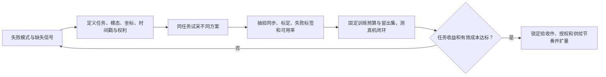

# 机器人训练数据市场与采购：2027 展望 / The State of Robotics Data in 2027

## 一句话定义

把 Sam Padilla 的行业观察当作**找供应商和设计试采的线索**，再用传感器实际记录的信号、与目标机器人的对齐程度、可验收成本和闭环任务增益来选数据，而不是用标称采集小时数比较。

## 英文缩写速查

| 缩写 | 英文全称 | 含义 |
|---|---|---|
| UMI | Universal Manipulation Interface | 手持示教夹爪及相应动作采集接口；需核对与目标机器人的映射 |
| QA | Quality Assurance | 验收时间同步、校准、标签、内容与许可等 |
| VLA | Vision-Language-Action | 使用视觉、指令和动作数据训练的策略 |
| IK | Inverse Kinematics | 检查记录的位姿能否由目标机器人的关节实现 |

## 为什么重要

低价单目视频可提供场景与动作先验，但不直接测量目标机器人的动作或接触力。更昂贵的数据也不一定更有用：例如触觉信号与传感器安装、采样、校准和动作同步绑定，换手后不一定能直接消费。采购前先问下游模型缺什么信号，而不是先定总小时数。

## 核心原理与对比

| 采集方式 | 可直接观测 | 采购前要实测 |
|---|---|---|
| 单目第一视角 | 单视点画面及场景语义 | 遮挡、动作可见率、目标域覆盖；估计手位姿不是力或机器人真值 |
| 双目第一视角 | 成对图像，可借标定、同步和匹配估计深度 | 基线与内外参、时间同步、尺度误差、遮挡和弱纹理 |
| 腕视角 / UMI / 全身动捕 | 手边图像、夹爪动作或人体运动学，依设备而异 | 记录的是哪个坐标系、夹爪/手型映射、下游 IK 可达性与动作有效率 |
| 真机遥操作 | 本体观测、状态与控制指令 | 硬件与控制协议一致性、时间对齐、失败是否保留，以及台架吞吐 |
| 触觉同步采集 | 接触形变、压力或力信号，取决于传感器 | 标定与温漂、单位和坐标、动作同步、磨损、跨传感器转移是否有效 |

**证据分层。** 作者自述 46 天 180 场交流、筛查 47 家供应商。其样本两家有双目现货，合计约 1,750 小时，这是 2026 年下半年的供给观察，不是全球库存。单价来自访谈和调研，某次触觉询价上沿不等于成交或统一报价。对 2027 年需求、软硬件壁垒的判断是作者展望，不是已发生结果。

**技术案例。** [T-Rex](../entities/paper-trex-tactile-reactive-dexterous-manipulation.md) 论文 v2 在约 2.29 万小时人类第一视角视频预训练之后，用 100 小时同步触觉的双手真机遥操作数据做中训，再按目标技能补示教。这是特定本体、任务和训练阶段的技术证据，不等于采购指南，也不证明触觉越多越好或不同传感器可互换。

## 工程实践：先验收，再扩量

1. **对齐验收件。** 固定任务分布和留出场景；写清原始数据与派生字段、设备代际、时钟/坐标、动作接口、质检阈值、复采处理和训练使用权。使用独家权前分清期限、地区、衍生模型和可再分发权。
2. **算有效成本而非报价。** 用 `含硬件摊销、人员、处理、返工的总成本 ÷ 最终验收小时数`。例如试采全成本每录制小时 30 美元、验收通过率 60%，则平均是每验收小时 50 美元。这只是算例，不是市场估价；采购合同已按验收小时计价时不要重复除以通过率。
3. **测有没有学到。** 在相同目标任务、训练预算和测试环境下，对比加与不加新数据；第一视角先检跨场景泛化，触觉优先测接触失败和恢复。补齐留出场景，避免只在采集同源场景评测。

## 局限与常见误区

- **不把采访当普查。** By Crux 连接买家与卖家，入样受作者网络、地域与自选提交偏差影响；无法从这篇文章估计全市场价格分布、所有公司需求或供货缺口。
- **不把收入当利润。** 原文用若干小时价格假设推算达到目标营业额的销售时数，没有扣掉拒收、折旧、交付、标注和取得订单的成本。两种模态的同一个“小时”也不等价。
- **不把采集与仿真配比混为一谈。** 原文主要讨论商业采集供给，并未按统一任务比较合成数据或标定后真机数据的训练效率。
- **无源码时序图。** 本页是市场文章和采购验收方法，不是软件发布；流程图是本库归纳，不等于作者实测流程。

## 结论

先用市场观察筛候选供应商，用小批次核验可用信号和许可，再以有效成本与留出任务收益决定扩量。保留按模态和任务记录的失败样本，才有条件判断下一笔预算补什么。

## 关联页面

- [The Robotics Map](../entities/robotics-map.md) 与 [人形机器人数据采集产业地图](../queries/humanoid-robot-data-collection-landscape.md)：找供应商及采集路线
- [EgoScale](../methods/egoscale.md) 与 [遥操作](../tasks/teleoperation.md)：分别对照第一视角预训练和真机采集接口
- [机器人数据监督信号](../concepts/robot-data-supervision-signal-types.md) 与 [数据清洗](../concepts/embodied-data-cleaning.md)：确定观测、动作与质检字段
- [触觉 Scaling 与跨传感器数据](../comparisons/tactile-scaling-data-infrastructure-2026.md)：校准、坐标与接触信号的可迁移性
- [具身数据纵深路线](../../roadmap/depth-embodied-data.md)：Stage 1 采集装置选型，Stage 2 验收清洗

## 参考来源

- [Sam Padilla 原文归档、首发和同 ID 可读镜像](../../sources/blogs/sam-padilla-state-of-robotics-data-2027.md)
- [By Crux：作者采集指南](https://bycrux.com/resources/robot-training-data)
- [T-Rex 作者版论文 v2，§3、§4.3](https://arxiv.org/html/2606.17055v2)

## 推荐继续阅读

- [操作任务演示数据收集指南](../queries/demo-data-collection-guide.md)：列第一轮试采的记录项
- [数据手套与视觉遥操作对比](data-gloves-vs-vision-teleop.md)：按精度、成本和遮挡拆解选型
