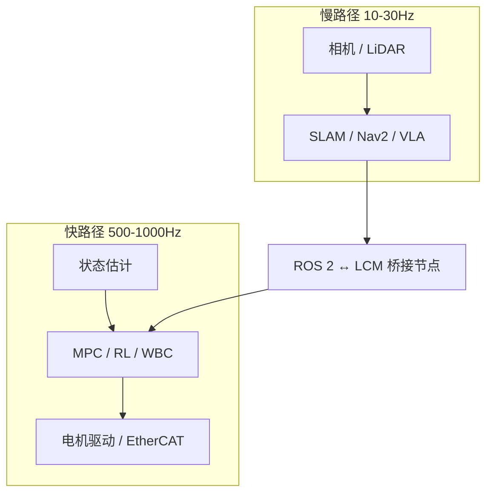

# ROS 2 vs LCM (机器人中间件选型)

## 一句话定义

**一句话选型结论：** 需要驱动、导航、规划、可视化和 QoS 工具链时，优先评估 **ROS 2**；需要轻量、尽力而为的跨进程/跨主机最新状态广播时，可评估 **LCM**。同机高频硬环优先考察进程内调用或共享内存；两者也可分层桥接。**没有由“500 Hz / 1 kHz”自动决定胜负的通用阈值**，应按目标硬件实测时延分布。

本页对比的是**应用中间件与进程间消息通道**，而不是硬实时调度器或电机现场总线；结论基于 [ROS 2 官方 Concepts 通读归档](../../sources/sites/docs_ros2_concepts_reading_humble.md)、[RMW 设计文档](../../sources/sites/ros2-design-rmw-interface.md) 与 [LCM IROS 2010 原论文通读](../../sources/papers/lcm_reading_iros2010_rtcontrol_middleware_reading_a7.md)，其中 LCM 原论文性能实验针对当时版本与硬件，不能直接当作现代 ROS 2 的基准测试。

## 英文缩写速查

| 缩写 | 英文全称 | 简要说明 |
|------|----------|----------|
| ROS 2 | Robot Operating System 2 | 系统集成与生态中间件栈 |
| LCM | Lightweight Communications and Marshalling | 轻量 UDP 组播通信与编解码 |
| DDS | Data Distribution Service | ROS 2 默认底层通信标准 |
| QoS | Quality of Service | 可靠性与时效等策略 |
| RMW | ROS Middleware | ROS 与具体中间件实现的适配层 |
| IPC | Inter-Process Communication | 进程间通信 |
| UDP | User Datagram Protocol | LCM 默认传输 |
| EtherCAT | Ethernet for Control Automation Technology | 关节级工业以太网总线 |

## 为什么重要

真机策略表现受**消息时延、调度抖动、消息队列积压与数据时效性**共同影响；仅比较通信库的平均吞吐无法解释控制周期是否超时。另一方面，SLAM/Nav2/MoveIt 2 等集成需求也不能只靠通信协议解决。选型应将**应用生态、传输语义、时延预算、网络条件**分开核对。

## 核心原理与特性对比

| 维度 | ROS 2（DDS / RMW） | LCM |
|------|---------------------|-----|
| **官方定位** | 机器人应用库与工具的 meta OS | 高带宽低延迟实时系统的消息 + marshalling |
| **底层** | 通过 RMW 对接中间件；常见实现为 DDS（[Fast DDS](../entities/fast-dds.md) / [Cyclone](../entities/cyclone-dds.md) 等），也存在非 DDS 的 RMW 实现 | 默认 UDP Multicast |
| **拓扑** | 去中心发现；无 ROS 1 Master | 无 hub、无 daemon，对等直连 |
| **高频行为** | 取决于 RMW、QoS、执行器、调度与负载；不能仅以频率断言抖动 | 尽力而为、倾向及时传递新消息；不等于低尾延迟或硬实时保证 |
| **工具 / 生态** | RViz、rosbag2、tf2、Nav2、MoveIt… | spy / logger / logplayer 等基础工具 |
| **QoS / 可靠** | 丰富策略 | 默认尽力而为，假设「新数据最重要」 |
| **依赖** | 重；常用发行版安装 | 少依赖；LGPL-2.1 开源库 |
| **上游入口** | [github.com/ros2](https://github.com/ros2)、[ros2/ros2](https://github.com/ros2/ros2) | [lcm-proj/lcm](https://github.com/lcm-proj/lcm)、[文档站](https://lcm-proj.github.io/lcm/) |

概念展开：[ROS 2 基础](../concepts/ros2-basics.md)、[LCM 基础](../concepts/lcm-basics.md)、[DDS](../concepts/dds-communication.md)。

## 适用场景

### 用 LCM：底层高频运控

部分双足/四足系统采用 **500–1000 Hz** 级状态估计或关节控制周期：对于可丢弃过期样本的**状态广播**，LCM 的无中心 UDP 组播与尽力而为机制很契合；但**安全停机、参数提交、关键命令**不能直接假设丢包可接受。原始 LCM 论文强调低延迟与放弃重传的取舍，**没有证明 LCM 在现代 ROS 2 之上普遍更快，也未测 1 kHz 硬实时闭环**。同机硬环优先评估进程内/共享内存；跨机组播须核验实际网络。细节：[实时运控中间件配置指南](../queries/real-time-control-middleware-guide.md)。

### 用 ROS 2：中高层感知与规划

SLAM、导航、点云/图像管线、MoveIt 2、多传感器 `tf2` 与现有驱动复用通常优先评估 ROS 2：其节点、话题、服务、动作、QoS 和调试工具是系统集成能力，不只是数据传输协议。ROS 2 的实时表现取决于具体执行器、RMW 和配置，不能据此认定所有 ROS 2 通信都比 LCM 慢。

## 混合架构

以下频率**仅为示意**，不是 ROS 2 / LCM 的协议上限或必选架构。

- **大脑**：IPC / Jetson 上 ROS 2 输出路径或足端参考。
- **小脑/脊髓**：PREEMPT_RT 进程内推理 + **LCM**（或 EtherCAT 到驱动）。
- **桥接**：降频与类型转换，校验时间戳和数据过期阈值，避免旧指令滞留；控制环需要独立的超时与安全回退。
- **控制边界**：通信层（ROS 2/LCM）、进程调度（如 PREEMPT_RT）与现场总线（CAN/EtherCAT）是不同问题，必须分别验证。

框架级实例：[DimOS](../entities/dimensionalos-dimos.md) 以 Module/Blueprint 为应用层，默认 **LCMTransport**，并支持切换 SHM / DDS / ROS 2。

## 工程实践

| 决策 | 建议 |
|------|------|
| 同机 1 kHz 状态 | 先测进程内/共享内存，再在同等负载下对比 LCM 与配置后的 ROS 2；不预设固定性能排序 |
| 跨板最新状态 | 可试 LCM 组播；先验证 IGMP/路由/网络策略和丢包率，再与所选 ROS 2 RMW 对照 |
| 导航 / 机械臂规划 | ROS 2 + 生态栈 |
| 可靠一次性命令 | 根据请求/响应或长任务语义选择 ROS 2 Service/Action；可靠传输不等于执行器安全确认 |
| 关节总线 | CAN / EtherCAT；不要与中间件混为一谈 |

### 同条件验证清单

1. **定义负载**：相同消息结构和字节数、频率、发布订阅数量、进程亲和性与网络拓扑；固定 ROS 2 发行版、RMW、QoS 与 LCM 配置。
2. **测量端到端时效性**：时间戳对齐后记录 P50/P95/P99、最大延迟、周期抖动、丢包/迟到、队列积压；`ros2 topic hz` 反映接收频率，**不能单独证明端到端时延**。
3. **故障注入**：断网/网络拥塞/收端重启/数据过期情况下，验证命令超时、限幅、急停与安全回退；不要只看正常工况下的均值。
4. **决策**：若性能与生态冲突，先尝试调 RMW/QoS、分离进程与数据通道，再决定是否引入 LCM 桥；测量原始日志并保存复现参数。

## 局限与风险

- **以“能跑 1 kHz”证明实时性**：频率达标不代表最坏延迟有界，应同时检查 P99、峰值、调度与错过 deadline 次数。
- **以“LCM 低延迟”推断必优于 ROS 2**：LCM 原论文与 ROS 1 的历史对比不能直接外推到现代 DDS/RMW；需在目标系统做对照实验。单靠 LCM 也不提供 ROS 2 的驱动、标定与规划生态。
- **组播网络未验证**：交换机 IGMP、Wi-Fi、跨网段组播路由或防火墙可能引发收包异常，必须核实部署网络。
- **只比协议不比进程调度**：运行线程、优先级、CPU 亲和性和系统负载会改变时延分布；换中间件不能替代调度测试。

## 关联页面

- [ROS 2 基础](../concepts/ros2-basics.md)
- [LCM 基础](../concepts/lcm-basics.md)
- [DDS 通信机制](../concepts/dds-communication.md)
- [Fast DDS](../entities/fast-dds.md) · [Cyclone DDS](../entities/cyclone-dds.md)
- [实时运控中间件配置指南](../queries/real-time-control-middleware-guide.md)
- [机器人软件系统集成](../methods/robot-software-integration.md) — 跨进程中间件、QoS/超时契约与确定性集成流程
- [Locomotion 任务](../tasks/locomotion.md)
- [UDP 组播动力学](../formalizations/udp-multicast-dynamics.md)
- [技术地图：ROS 2](../../tech-map/modules/system/ros2.md)

## 参考来源

- [LCM 官方文档](../../sources/sites/lcm-proj-github-io.md) · [lcm-proj/lcm](../../sources/repos/lcm.md)
- [ROS 2 GitHub 组织](../../sources/sites/ros2-github-org.md) · [ros2/ros2 元仓](../../sources/repos/ros2.md)
- [ROS 2 官方文档（Humble）](../../sources/sites/ros2-official-documentation.md) · [Concepts 七页通读](../../sources/sites/docs_ros2_concepts_reading_humble.md) · [RMW 官方设计原文](../../sources/sites/ros2-design-rmw-interface.md)
- [LCM: Lightweight Communications and Marshalling（IROS 2010，全文通读）](../../sources/papers/lcm_reading_iros2010_rtcontrol_middleware_reading_a7.md)
- [OMG DDS / RTPS](../../sources/sites/omg-dds-spec.md) · [Fast DDS](../../sources/repos/fast-dds.md) · [Cyclone](../../sources/repos/cyclonedds.md)

## 推荐继续阅读

- LCM Overview（IROS 2010 PDF，文档站 Publications）
- ROS 2 Design：https://design.ros2.org/
- LCM UDP Multicast Protocol：https://lcm-proj.github.io/lcm/content/lcm-udp-multicast-protocol-description.html
