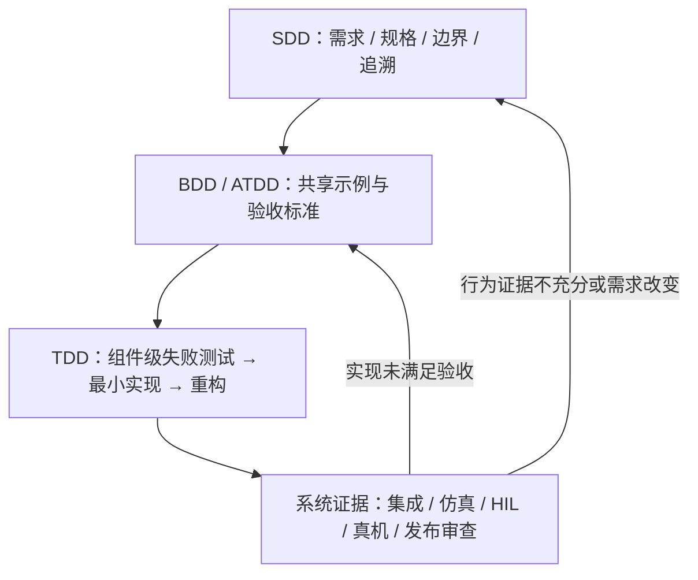

# SDD、TDD、BDD 与 ATDD：外层规格和内层反馈如何组合

**SDD（规格驱动）、TDD（测试驱动）、BDD（行为驱动）和 ATDD（验收测试驱动）解决的是不同层次的问题：SDD 让规格跨计划与实现保持可追溯，BDD / ATDD 让跨角色对行为和完成条件达成共识，TDD 用快速测试循环驱动组件实现与局部设计。**

## 英文缩写速查

| 缩写 | 英文全称 | 简要说明 |
|------|----------|----------|
| SDD | Specification-Driven Development | 需求/规格驱动工作流，名称也写作 Spec-Driven Development |
| TDD | Test-Driven Development | 以失败测试 → 最小实现 → 重构驱动编码 |
| BDD | Behavior-Driven Development | 用共享领域语言和例子描述系统行为 |
| ATDD | Acceptance Test-Driven Development | 实现前协作定义验收测试与完成标准 |
| CI | Continuous Integration | 自动化检查合入代码或构建变化 |
| HIL | Hardware-in-the-Loop | 将控制器接入真实硬件接口或硬件仿真的验证方式 |

## 快速对照

| 方法 | 主要范围 | 核心问题 | 首要工件 | 常见反馈节拍 | 常见参与者 |
|---|---|---|---|---|---|
| **SDD** | 功能 / 系统 / 多任务切片 | 做什么、为何、约束是什么、怎么证明交付 | 可追溯规格、计划、任务、验证映射 | 需求变化或阶段评审时更新，贯穿实现 | 产品/需求负责人、工程师、coding agent |
| **BDD** | 用户可观察行为与协作分析 | 某场景下系统应该做什么？ | 领域语言、故事、具体例子/行为规格 | 例子讨论 → 自动/人工验证 → 修订 | 业务/客户、产品、开发、测试 |
| **ATDD** | 功能验收与 Definition of Done | 各方如何判断这项需求完成？ | 验收条件、验收测试 | 实现前协作，随后持续运行/复查 | 客户/产品、开发、测试 |
| **TDD** | 组件 / 模块 / 函数的编码内环 | 下一小步实现如何满足可观察行为？ | 当前一个失败测试 + 生产代码 | 秒到分钟级 Red-Green-Refactor | 主要是开发者；测试设计可结对 |

### 它们更像套叠层级，不是四选一

箭头表示常见层次，不规定每个团队只能按固定瀑布顺序执行。小改动可以只运行 TDD 内环；高风险功能才需要完整需求追溯、跨角色验收和系统级验证。

## 用一个机器人功能看组合方式

以“Unitree G1 推动椅子到目标区”为例：

1. **SDD 先定边界：** 目标区、椅子状态、可用观测/动作、碰撞安全边界、允许的底盘/手臂策略、仿真与真机适用范围、非目标事项。
2. **BDD / ATDD 定可观察完成条件：** 在特定初始位姿下，机器人收到任务后将椅子推入区域；若检测到人员进入保护区，应停止并保持安全状态。团队对容差、超时、失败处理与验收记录达成一致。
3. **TDD 驱动可快速反馈的代码：** 对目标区判定、坐标转换、速度限幅、安全状态机和异常输入写小型失败测试，再实现并重构。
4. **系统验证补单元测试覆盖不到的风险：** 在仿真中改变摩擦、质量、初始位姿和遮挡，之后用 HIL/真机验证时序、传感延迟和安全停机。测试通过只证明已检查的场景，不能外推到所有物理状态。

## 选择与组合规则

- **需求歧义大或多人协作：** 先用 BDD/ATDD 的具体示例澄清，再写入 SDD 规格。
- **复杂、多任务、高风险或由 agent 执行：** SDD 维护需求—计划—任务—证据关系；不要只留在聊天记录。
- **确定的小范围逻辑改动：** TDD 通常足够，不必为了流程完整新建整套长文档。
- **自动化验收成本高：** 保留人工/仿真步骤和记录格式；不要为了“可执行”把所有检查都塞进脆弱 E2E。
- **持续变化的需求：** 让规格、验收例子和测试一起演进；否则“规格驱动”会退化为旧文档先行、新代码自顾自变更。

## 结论

**默认把它们按风险叠加：SDD 管边界与追溯，BDD / ATDD 管多角色需求共识，TDD 管实现内环，系统验收负责真实运行证据；小项目可省略重型外层，但关键行为与安全边界仍要有验证。**

1. **不要把 SDD 当成 TDD 的替代品：** 一个定义系统目标和追踪方式，一个控制小步编码反馈。
2. **BDD 与 ATDD 有重叠但焦点不同：** 前者着重行为建模/共享语言，后者着重参与者协作与验收测试。
3. **区分测试层：** 单元/组件测试应快，端到端/仿真/真机测试成本高但覆盖系统交互和物理效应。
4. **把要求连到证据：** 关键规格至少链接一个验收条件、测试、仿真场景或审阅证据。
5. **避免形式主义：** 每层只保留能减少歧义、发现缺陷或帮助审计的工件；新增文档也要有维护责任。

## 关联页面

- [规格驱动开发（SDD）](../concepts/specification-driven-development.md)
- [测试驱动开发（TDD）](../concepts/test-driven-development.md)
- [行为驱动与验收测试驱动开发（BDD / ATDD）](../concepts/behavior-and-acceptance-driven-development.md)
- [Spec-Driven Development with Coding Agents 短课](../entities/course-spec-driven-development-coding-agents.md)
- [Agentic Coding 软件工程基础](../concepts/agentic-coding-software-fundamentals.md)

## 参考来源

- [SDD 预印本](../../sources/papers/spec-driven-development-arxiv-2602-00180.md)
- [GitHub Spec Kit](../../sources/repos/github-spec-kit.md)
- [Kent Beck：Canon TDD](../../sources/blogs/kent-beck-canon-tdd.md)
- [Dan North：Introducing BDD](../../sources/blogs/dan-north-introducing-bdd.md)
- [Cucumber BDD 文档](../../sources/sites/cucumber-bdd-docs.md)
- [Agile Alliance：ATDD](../../sources/sites/agile-alliance-atdd.md)

## 推荐继续阅读

- [GitHub Spec Kit 方法论](https://github.github.io/spec-kit/)
- [Kent Beck：Canon TDD](https://newsletter.kentbeck.com/p/canon-tdd)
- [Dan North：Introducing BDD](https://dannorth.net/blog/introducing-bdd/)
- [Cucumber：BDD](https://cucumber.io/docs/bdd/)
