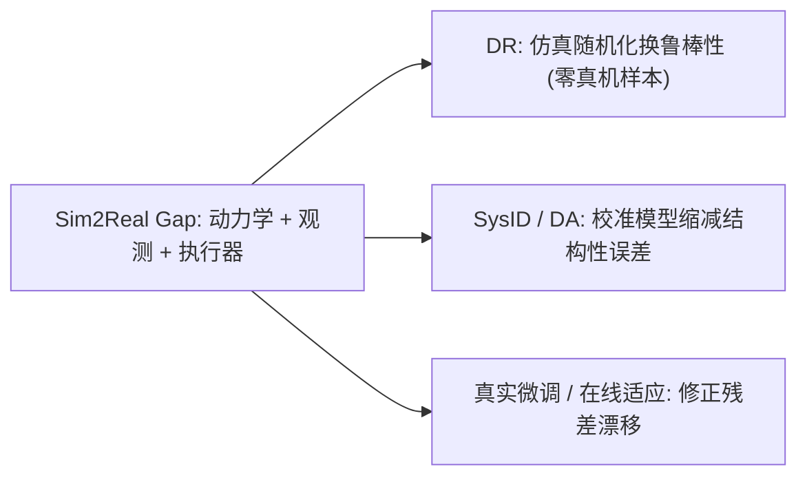

# Sim2Real 方法横向对比

## 一句话定义

**Sim2Real 方法横向对比** 将迁移策略划分为 **域随机化（DR）**、**领域自适应（DA / SysID）** 与 **真实环境微调** 三大范式，并按真机数据预算、建模完备度与策略可更新性给出组合选型规则。

## 英文缩写速查

| 缩写 | 英文全称 | 简要说明 |
|------|----------|----------|
| DR | Domain Randomization | 在仿真中大范围随机物理/视觉参数覆盖真机分布 |
| DA | Domain Adaptation | 用少量真机数据对齐仿真与真实状态/视觉分布 |
| SysID | System Identification | 从激励轨迹逆向辨识质量/摩擦/PD 等物理参数 |
| RMA | Rapid Motor Adaptation | 在线潜变量适应模块实时估计环境外在向量 |

## 为什么重要

单纯堆叠宽范围 DR 往往导致策略极度保守甚至在边缘配置上不可解，而直接真机微调又成本高昂；厘清三大路线的边界，有助于在低真机样本下用最小工程成本跨越现实鸿沟。

## 核心原理



Sim2Real gap 的应对策略有三大类：**Domain Randomization（仿真端随机化）**、**Domain Adaptation（领域自适应）**、**Real-World Fine-tuning（真实环境微调）**。三者可单独使用也可组合，选择取决于 gap 大小、真实数据成本和任务类型。

> **更细的辨识立场对比**（系统辨识 / DR / 在线适应 / 残差学习、分层组合与症状查表）见 [四条路线：可辨识性视角](./sim2real-four-routes-identifiability.md)。

## 核心对比

| 维度 | Domain Randomization | Domain Adaptation | Real Fine-tuning |
|------|---------------------|------------------|-----------------|
| **核心思想** | 随机化仿真参数覆盖真实分布 | 让仿真和真实分布对齐 | 在真实环境中直接微调 |
| **真实数据需求** | ❌ 不需要 | ✅ 少量（用于对齐） | ✅ 较多（用于训练） |
| **仿真质量要求** | 中（宽泛随机即可） | 高（需要对齐目标） | 低（仿真只提供初始策略） |
| **计算成本** | 高（更多仿真变体） | 中（对抗或统计对齐） | 低（仿真训练已完成） |
| **泛化性** | 高（见过多种变体） | 中（对齐目标分布） | 低（过拟合真实环境） |
| **适用 gap 大小** | 中等 gap | 中等 gap | 小 gap（策略已较好） |
| **代表工作** | OpenAI Dactyl, AnyDrive | SimOpt, RCAN, [PACE](../entities/paper-pace-sim2real-legged-robots.md)（[CMA-ES](../methods/cma-es.md) 关节动力学 + 物理能量 reward） | RMA fine-tune, Walk These Ways, [FADA](../entities/paper-fada-humanoid.md)（Planner–IDM + LoRA IDM） |

## Domain Randomization（DR）

### 原理

在仿真中随机化物理参数，使策略在多种仿真环境下都能运行，间接覆盖真实环境：

```
随机化参数 → 训练多个"仿真版本" → 策略被迫鲁棒 → 真实环境是多个仿真的"一个特例"
```

**关键假设**：真实环境的参数在随机化范围内（即真实是仿真集合的一个元素）。

### 常见随机化参数（人形 locomotion）

| 类别 | 参数 |
|------|------|
| 动力学 | 质量、惯量、关节阻尼、摩擦系数 |
| 传感器 | 观测噪声、延迟、IMU 漂移 |
| 执行器 | 关节刚度、力矩延迟、PD 增益 |
| 地形 | 地面摩擦、不平整度、坡度 |
| 外扰 | 随机推力、有效载荷变化 |

### 优势与局限

✅ **优势**：不需要真实数据，纯仿真训练可直接 Sim2Real  
⚠️ **过度随机化问题**：随机化范围太宽 → 部分随机化配置无法完成任务 → 训练困难、策略保守  
❌ **结构性 gap 无解**：如果仿真缺少某个真实现象（关节弹性、接触不稳定），DR 覆盖不了

### 最佳实践

- 先分析哪些参数对 sim2real gap 贡献最大，重点随机化这些
- 使用 curriculum：先小范围，再逐步扩大
- 避免随机化会破坏任务可行性的参数（如重力完全随机）

## Domain Adaptation（领域自适应）

### 原理

收集少量真实数据，用统计或对抗方法让仿真分布"向真实靠拢"：

```
少量真实轨迹 → [对抗训练 / 系统辨识] → 调整仿真参数 → 减小结构性 gap
```

### 主要方法

| 方法 | 机制 |
|------|------|
| **System Identification（系统辨识）** | 用真实轨迹优化仿真物理参数（质量、阻尼等） |
| **SimOpt** | 将仿真参数优化为最小化 sim-real 轨迹差异 |
| **GAN-based（RCAN 等）** | 训练生成器让仿真图像/状态分布与真实对齐 |
| **Adaptive Domain Randomization** | 根据 sim-real 差异动态调整随机化范围 |

### 优势与局限

✅ **优势**：能处理结构性 gap（DR 处理不了的固有差异）  
✅ 少量真实数据（10-100 条轨迹）即可显著改善  
❌ **局限**：需要访问真实机器人，系统辨识可能陷入局部最优

## Real-World Fine-tuning

### 原理

仿真中训练的策略已有基本能力，在真实机器人上继续微调：

```
仿真预训练 π₀ → [少量真实环境交互] → 微调后 π
```

### 关键方法：特权训练（Privileged Training）

teacher 在仿真中学到好策略，student 在真实环境中蒸馏/微调：

```
Sim: teacher π(a|s_priv) → 提供监督信号
Real: student π(a|o) → 用观测历史近似特权信息 → 微调
```

代表工作：**RMA**（Rapid Motor Adaptation）、**Walk These Ways**。

### 优势与局限

✅ **策略可以超越仿真质量**：真实数据直接修正 gap  
✅ 策略更接近真实分布，鲁棒性好  
❌ 需要真实机器人交互（成本、安全风险）  
❌ 真实环境中探索危险，通常只能做保守微调（Offline RL 或 PPO with KL constraint）

## 选择指南

```
真实数据成本高？
├── YES → Domain Randomization（无需真实数据）
│         + 特权训练（提高 DR 策略鲁棒性）
└── NO → 有结构性 gap（仿真无法建模的现象）？
         ├── YES → Domain Adaptation（系统辨识 + DR）
         └── NO → Real Fine-tuning（直接微调）
```

### 人形机器人 locomotion 典型流程

```
1. 大规模 DR 训练（Isaac Lab / legged_gym，1B+ 步）
2. 特权训练（teacher-student，仿真内）
3. 可选：系统辨识修正关键参数（关节阻尼、接触刚度）
4. 真实测试 → 少量真实数据微调
```

## 组合策略（实际项目推荐）

| 阶段 | 方法 |
|------|------|
| 仿真训练 | DR（宽域随机）+ 特权训练 |
| 部署前 | 系统辨识修正 1-3 个最关键参数 |
| 真实部署后 | Online fine-tuning（保守，safety constraint） |

## 参考来源

- [Sim2Real 核心论文精读](../../sources/papers/sim2real.md)
- [从域随机化到残差学习：Sim2Real 四条技术路线](../../sources/blogs/wechat_freedof_sim2real_four_routes_dr_to_residual_2026-08-23.md)
- Tobin et al., *Domain Randomization for Transferring Deep Neural Networks from Simulation to the Real World* (2017) — DR 开创性工作
- Peng et al., *Sim-to-Real Transfer of Robotic Control with Dynamics Randomization* (2018)
- Kumar et al., *RMA: Rapid Motor Adaptation for Legged Robots* (2021) — 特权训练 + 真实微调
- Tan et al., *Sim-to-Real: Learning Agile Locomotion For Quadruped Robots* (2018)

## 工程实践

1. **优先辨识执行器与通信延迟：** 在施加大幅质量/摩擦 DR 前，先标定关节 PD、齿轮间隙与传感器延迟，收益通常大于盲目扩大随机化方差。
2. **「SysID + 窄 DR」组合：** 先用少量实机轨迹对齐核心物理参数，再围绕辨识均值施加轻量 DR 覆盖温度与负载波动，避免策略保守。

## 常见误区或局限

- **把 DR 当作全能兜底：** 若仿真根本缺少关键物理机制（如缆线柔顺、执行器电压饱和），再宽的 DR 也难以迁移。
- **忽略离线/真机指标脱钩：** 仿真内速度追踪误差下降并不自动等价于真机不滑倒或长期免跌倒。

## 关联页面

- [Sim2Real](../concepts/sim2real.md) — Sim2Real gap 的成因分析和综合策略
- [Sim2Real 域适应（Domain Adaptation）](../methods/domain-adaptation-for-sim2real.md) — 视觉/特征/动力学分布对齐与真机保留集验证流程
- [Reinforcement Learning](../methods/reinforcement-learning.md) — DR 策略的训练基础
- [Privileged Training](../concepts/privileged-training.md) — 特权训练是 DR + Fine-tuning 的桥梁
- [Online vs Offline RL](./online-vs-offline-rl.md) — Real fine-tuning 涉及 online/offline RL 的选择
- [Sim2Real 残差适配 vs Real2Sim 真机回放 vs 真机直接微调](./sim2real-vs-real2sim-fine-tuning.md) — 「最后一公里」三策略的成本/安全/数据效率细分
- [四条路线：可辨识性视角](./sim2real-four-routes-identifiability.md) — SysID / DR / 适应 / 残差立场与组合顺序

## 推荐继续阅读

- [Sim2Real Gap 缩减实战指南](../queries/sim2real-gap-reduction.md)
- [Sim2Real 闭环误差分层工程](../queries/sim2real-closed-loop-engineering.md)
