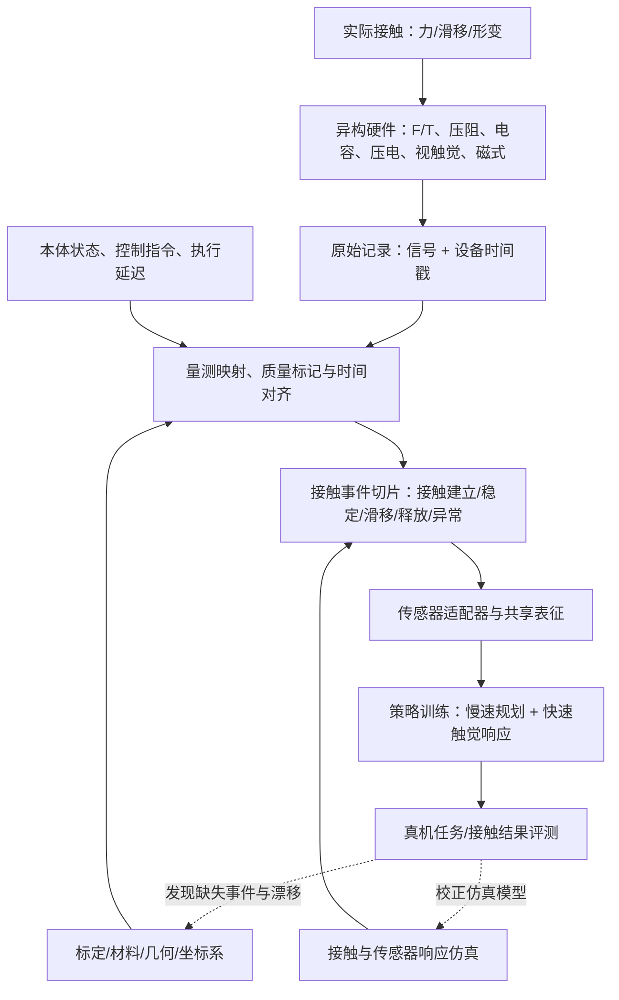

# 触觉的 Scaling 时代：跨硬件接触经验如何复用 / Scaling Tactile Experience Across Sensors

> **定位与核对边界：** 由 Lumina具身智能 2026-11-20 行业文章引出的跨论文对照；文章的用户提供全文已读。下列研究数字依各作者公开项目页、会议论文页及已有独立论文节点核对；**未声称本次重新通读每篇论文/附录、运行代码或复现实机实验**。

## 一句话定义

**触觉 Scaling 的瓶颈不是“把触觉帧数做大”，而是把具体传感器观测连同标定、安装、动作和事件语义保存下来，再学习可迁移的表征，并在足够快的接触控制回路中证明收益。**

## 英文缩写速查

| 缩写 | 英文全称 | 简要说明 |
|---|---|---|
| F/T | Force/Torque | 六维合力与合力矩，不能直接替代接触压力分布 |
| VBTS | Vision-Based Tactile Sensing | 视触觉，摄像头观测接触弹性体形变 |
| MTTS | Morphology-Aware Tactile Token Space | FTP-1 的多形态传感器共享 token 接口 |
| JEPA | Joint-Embedding Predictive Architecture | LingBot-Touch 所用的潜表示预测训练思想 |
| SSL | Self-Supervised Learning | 无需逐帧人工接触标签的表征预训练 |
| Sim2Real | Simulation-to-Reality | 由模拟接触/传感器观测迁移至真实接触场景 |

## 为什么重要

视觉相机大都保留同类光学像素测量，而“触觉”包含**电阻、电容、电荷、磁场、弹性体图像、合力/力矩**等不同物理观测。缺少可比的物理标定、时间戳及动作上下文时，扩大数据量会同时扩大不一致性。成功的跨传感器 encoder **不能保证**还原未被测量的物理状态，触觉基础表征也**不等于**完成了下游策略的接触闭环。

## 核心原理

### 1. 六类测量机理并非六种可互换的数据格式

| 路线 | 原始信号 | 适用接触信息 | 扩展数据时必须记录 |
|---|---|---|---|
| 电阻应变式 F/T | 电桥电压、应变 | 腕/末端整体三轴力+三轴力矩 | 工具坐标、量程、温补、六轴解耦标定 |
| 压阻式 | 电阻/电导阵列 | 压力分布；特殊结构下切向力 | 单元布局、迟滞/蠕变、重复标定 |
| 电容式 | 电容/差分读数 | 压力、接近觉或结构定义的三轴力 | 寄生电容、环境湿度、电极串扰 |
| 压电式 | 电荷/电压 | 变化快的接触、振动、冲击 | 前置电荷放大器、高通特性/泄漏 |
| 视触觉（光学） | RGB/视频、标记位移 | 形貌、切向形变、部分滑移 | 光照/弹性体参数、相机几何、帧延迟 |
| 磁式/霍尔式 | 磁场（单点/阵列） | 多轴局部形变/接触力估计 | 磁体/芯片几何、磁干扰、弹性体刚度 |

**边界：** F/T 传感器读出的是合 wrench；相同合 wrench 可以来自不同的局部接触分布。视触觉图像不是经标定即可在所有物体/材料上直接得到绝对力的“力图”。

### 2. 跨硬件四层不等价

对传感器 \(s\)，可抽象写成 \(y_s(t)=h_s(c(t),\theta_s,g_s,T_s)+\varepsilon_s(t)\)。此式是**文章的概念性测量模型**，并非所有研究共用的可直接辨识方程。

1. **可观测性：** 先定义共同可观测变量（接触发生/滑移趋势/局部几何），再选任务条件；无法凭 encoder 恢复不存在的局部力信息。
2. **标定：** 相同电压/像素位移在不同柔性材料、结构和温度下可对应不同力；记录校准有效期与不确定度。
3. **空间语义：** 记录传感器局部坐标到手指/末端坐标的变换、taxel 位置、法向、曲率与接触表面摩擦。
4. **时间语义：** 原始时间戳、采样率、动作执行时刻与实际总时延必须保存；插值不能还原未记录的快速滑移。

### 3. 从接触物理到可复用操作数据

此图是**数据基础设施的工程综合流程**，不是某一论文已经发布的端到端集成系统。实线表示合理管线依赖，虚线表示应当验证的反馈闭环。

## 表征 / 策略 / 仿真的证据分层

| 层级 | 项目 | 作者公开的规模或证据 | 正确解读 |
|---|---|---|---|
| 视触觉 SSL | [Sparsh](../entities/paper-sparsh.md) | 460k+ 图像（Meta） | 在多种视触觉设备学习共享特征，并非跨电容/磁传感机理的证明 |
| 多设备视觉触觉 | [T3 / FoTa](https://proceedings.mlr.press/v270/zhao25c.html) | 300 万+ 数据点、13 设备、11 任务（PMLR） | 传感器专用 encoder + 共享 trunk；仅部分 sensor-task 配对呈现零样本迁移 |
| 静态/动态触觉 | [AnyTouch](../entities/paper-anytouch.md) | 4 类视触觉传感器的 TacQuad 对齐数据（作者项目页） | 同时编码触觉图片/视频；仍处在视觉触觉族内 |
| 跨传感器策略 | [FTP-1](../entities/paper-ftp-1.md) | 约 3000h，26 数据源、21 传感器；未见传感器三任务平均 46.6 vs 最强基线 15.0 | **+31.6 个百分点**来自该组三任务差值；在**未见设备上仍需训练传感器专用 encoder 并进行下游微调** |
| 异构触觉 encoder | [LingBot-Touch](../entities/paper-lingbot-touch.md) | 4983h，464431 episodes，压阻/磁性/视触觉；26 真机任务 | 冻结共享触觉 encoder，给下游策略后训练；不能理解为零训练跨手直接部署 |
| 触觉反应策略 | [T-Rex](../entities/paper-trex-tactile-reactive-dexterous-manipulation.md) | 约 100h 触觉同步数据；12 项真机 65% vs 35% | 慢动作专家与快触觉精修分频；不是仅拼接触觉到视觉 VLA |
| GPU 视触觉仿真 | [TacSL](../entities/paper-sa-2408-06506-tacsl-a-library-for-visuotactile-sensor-simulati.md) | NVIDIA 公开视触觉仿真与在线 RL/AACD | 仿真算法不能自动提供真实硬件的标定误差 |
| GPU 接触/触觉仿真 | [Taccel](../entities/paper-sa-2504-17614-taccel-scaling-up-vision-based-tactile-robotics.md) | NeurIPS 2025，4096 并行 env 总计 915 FPS | 是**总吞吐、指定配置**，不是单环境 915 FPS |
| 多信号触觉仿真 | [Tactile Genesis](https://arxiv.org/abs/2606.22332) | 统一接触、深度、taxel 力矩、marker 位移、接近觉及漂移/迟滞等 | 接触真值模拟与传感器可读信号模拟必须分开验证 |

不同研究的时间小时、图片/帧数、任务成功率互不构成统一 benchmark。具体评估协议和开源边界以各独立论文页面及一手资料为准。

## 工程实践

### 数据接口的最小可交付字段

| 对象 | 必填建议 | 缺失后的具体风险 |
|---|---|---|
| 原始触觉 | 设备 ID、原始信号、单位、采样率、设备时间戳、有效性掩码 | 不知道是否已丢失接触瞬态，无法重新标定 |
| 机械和标定 | 型号/批次/硬件版本、标定矩阵/日期、安装位置、taxel 几何、法向/局部坐标 | 跨设备力/方向不可比，换皮肤失效 |
| 本体状态 | 关节 q/dq、末端位姿、物体与工具坐标变换、控制器模式 | 触觉无法同动作和本体条件对应 |
| 动作 | 期望命令、实测执行时间、控制频率、时延与丢包记录 | 数据导致策略学到错误因果时间对齐 |
| 事件标签 | 建立/承载/滑移临界/释放/异常接触、任务目标及成功失败 | 采样量大但关键事件覆盖率低 |
| 质量与维护 | 传感器更换时间、温漂、断线/坏点、校准残差和置信度 | 训练集跨批次混叠，性能不可追溯 |

推荐按**物体材料 × 接触模式 × 速度/载荷 × 传感器安装位形**构建覆盖矩阵，报告每类**有效接触时长与关键事件计数**，再报告总帧数。对数据和策略做分离式对照：同传感器不同批次、跨实例传感器、跨手型、跨任务，并固定任务与演示预算。

**软硬件分层建议：** 底层原始记录不可丢；中间层承载标定/坐标与动态事件；上层触觉 token 供策略调用。频率不同的模块保存各自采样时间，不用“统一为更高频”伪造观测。应变腕 F/T 与指尖 taxel 可**互补融合**，不可当作可互换样本。

**关于源码：** 本页是跨研究的技术对照，并非新建项目实体，**不适用统一的源码运行时序图**；各项目运行入口及已开放的训练/推理范围请到对应独立实体和仓库逐一核对。

## 局限与风险

- 用户提供的是完整文章正文，但公众号网页本次独立打开失败，插图（含 Jin et al. 的图 2）和作者信息不能作为第二次网页核验结果。
- 本页一手核对集中于项目首页、会议摘要和仓库已归档的独立实体；**没有**对全部官方论文 PDF 的方法、附录和代码做一次全新逐字精读。
- 图中“真实采集→标定→仿真→训练→验证”属于工程建议，不证明现有公开工具已经互操作。
- 报告的百分比、百分点和“小时/episode/图像/帧”需分开；不能把作者宣称的跨硬件表现当成无条件即插即用保证。
- 触觉仿真的 sensor-to-signal gap 受弹性体、摩擦、接触几何、迟滞和读取噪声影响，应该从真机残差校准，而不是假定有完美地面真值。

## 关联页面

- 感知原理：[触觉感知](../concepts/tactile-sensing.md)、[视触觉融合](../concepts/visuo-tactile-fusion.md)
- 工程任务：[Contact-Rich Manipulation](../concepts/contact-rich-manipulation.md)、[触觉阻抗控制](../methods/tactile-impedance-control.md)
- 模型/实证：[Sparsh](../entities/paper-sparsh.md) → [FTP-1](../entities/paper-ftp-1.md) / [LingBot-Touch](../entities/paper-lingbot-touch.md) → [T-Rex](../entities/paper-trex-tactile-reactive-dexterous-manipulation.md)
- 学习路径：[接触丰富操作纵深路线](../../roadmap/depth-contact-manipulation.md)

## 参考来源

- [Lumina具身智能行业文章全文的结构化归档](../../sources/blogs/wechat_lumina_tactile_scaling_2026-11-20.md)（**用户提供完整文章**，不是官方论文）
- [Sparsh 论文归档](../../sources/papers/sparsh_arxiv_2410_24090.md)
- [FTP-1 论文归档](../../sources/papers/ftp-1_arxiv_2606_13102.md)
- [LingBot-Touch 技术报告归档](../../sources/papers/lingbot-touch-technical-report.md)
- [T-Rex 论文归档](../../sources/papers/trex_arxiv_2606_17055.md)

## 推荐继续阅读

- [Sparsh 官方研究简介](https://ai.meta.com/research/publications/sparsh-self-supervised-touch-representations-for-vision-based-tactile-sensing)
- [T3（CoRL，PMLR）](https://proceedings.mlr.press/v270/zhao25c.html)
- [FTP-1 官方项目页](https://ftp1-policy.github.io/)
- [LingBot-Touch 官方项目页](https://technology.robbyant.com/lingbot-touch)
- [T-Rex 作者成果官方发布](https://news.panasonic.com/global/press/en261105-2)
- [Tactile Genesis 官方项目页](https://neuroagents-lab.github.io/tactile-genesis/)
