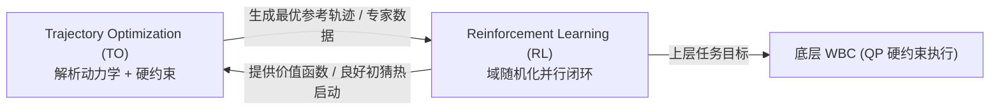

# 轨迹优化 vs 强化学习（Trajectory Optimization vs Reinforcement Learning）

在足式机器人运动控制领域，**轨迹优化 (Trajectory Optimization, TO)** 和 **强化学习 (Reinforcement Learning, RL)** 是两种截然不同但又互补的技术路线。

## 一句话定义

**轨迹优化（TO）** 依靠已知动力学与梯度的非线性规划/iLQR 求解开环或滚动最稳轨迹，而 **强化学习（RL）** 靠大规模并行接触交互学习非参数/神经网络闭环反馈策略。

## 英文缩写速查

| 缩写 | 英文全称 | 简要说明 |
|------|----------|----------|
| RL | Reinforcement Learning | 通过与环境交互最大化长期回报来学习策略的范式 |
| MDP | Markov Decision Process | 状态–动作–奖励–转移的标准序贯决策建模框架 |
| MPC | Model Predictive Control | 滚动时域内优化控制序列的预测控制 |
| DR | Domain Randomization | 训练时随机化仿真参数以提升跨域鲁棒迁移 |
| Reward | Reward Function | 塑造强化学习策略行为的标量反馈 |
| ANYmal | ANYbotics Quadruped | ANYbotics 的四足机器人研究平台 |
| WBC | Whole-Body Control | 协调全身关节满足多任务/约束的控制基础设施 |
| QP | Quadratic Programming | 将 WBC/控制问题写成二次规划的标准求解形式 |

## 为什么重要

- **计算边界互补（MIT Underactuated Robotics Ch. 10 & Wensing T-RO 2024）**：直接配点与 DDP 在精确低/中自由度动力学上可微且可附带硬约束；面对高频非光滑随机接触及多传感器融合，RL 能无梯度跨越接触跳变，而二者结合（如 TO 生成参考 + 残差 RL 跟踪）成为高难动作主流架构。

## 核心原理与对比

| 维度 | Trajectory Optimization (TO) | Reinforcement Learning (RL) |
|------|------------------------------|-----------------------------|
| **理论基础** | 最优控制理论 (Optimal Control) | 马尔可夫决策过程 (MDP) |
| **依赖项** | 精确的解析动力学模型 | 仿真环境或真实交互数据 |
| **计算时机** | 通常在线实时求解 (MPC) 或离线规划 | 离线训练，在线极速推理 |
| **反馈形式** | 依赖外层反馈 (MPC) 或解析梯度 | 天然的闭环神经网络策略 |
| **泛化性** | 依赖模型准确度，对未知扰动敏感 | 通过域随机化 (DR) 具有极强鲁棒性 |
| **物理一致性** | ✅ 严格满足动力学约束 | ⚠️ 依赖奖励函数诱导，可能违反约束 |

## 轨迹优化的优势与局限

- **优势**：
  - 物理意义明确，动作精确可控。
  - 不需要冗长的训练过程，只要模型对，立刻能用。
  - 能够处理极其复杂的硬约束（如避障、接触力限位）。
- **局限**：
  - 容易陷入局部最优，需要良好的初始猜测。
  - 对“模型误差”（如非线性摩擦、电机非线性）非常敏感。

## 强化学习的优势与局限

- **优势**：
  - 能够发现人类难以设计的奇异步态（如通过摔倒恢复平衡）。
  - 在大时延、高噪声环境下表现更鲁棒。
  - 推理速度极快，适合部署在低算力嵌入式端。
- **局限**：
  - “黑盒”特性，安全性难以解释和证明。
  - 奖励函数（Reward Design）的设计非常主观，容易出现薅羊毛行为。

## 融合趋势：Learning to Optimize

现代前沿研究（如 ANYmal, Atlas 的最新版本）正在将两者融合：

1. **RL 辅助 TO**：用 RL 学习一个良好的初始轨迹值或价值函数，作为 TO 的热启动。
2. **TO 引导 RL**：利用 TO 产生的最优轨迹作为模仿学习的专家数据，加速 RL 训练。[SE(3) 切空间 TO](../entities/paper-se3-tangent-to.md) 的社区仓 `go2_flip_TO` 把 Go2 空翻写成 50 Hz AMP txt，就是这条落地。
3. **WBC + RL**：上层用 RL 产生任务目标，下层用 WBC (基于 QP 的 TO) 保证物理安全性。

## 工程实践

- **何时用 TO 热启动/引导 RL**：窄通道避障（如 Unitree G1 钻孔）或长时域多接触翻越宜先用全阶/切空间 TO 生成无碰可行引导，再用残差 RL 吸收真机动力学失配与延迟。

## 关联页面
- [Trajectory Optimization (TO)](../methods/trajectory-optimization.md)
- [SE(3) 切空间浮动基 TO](../entities/paper-se3-tangent-to.md) — 开环空翻计划 → AMP 参考
- [Reinforcement Learning (RL)](../methods/reinforcement-learning.md)
- [Model Predictive Control (MPC)](../methods/model-predictive-control.md)
- [Query：何时用 WBC vs RL？](../queries/when-to-use-wbc-vs-rl.md)

## 参考来源
- [mit_underactuated_robotics.md](../../sources/courses/mit_underactuated_robotics.md) — Tedrake, *Underactuated Robotics* Ch. 10 (Direct Collocation / iLQR / DDP)
- [sources/papers/optimal_control.md](../../sources/papers/optimal_control.md)
- [sources/papers/policy_optimization.md](../../sources/papers/policy_optimization.md)
- Siciliano, B., et al. (2009). *Robotics: Modelling, Planning and Control*.

## 推荐继续阅读

- [Model Predictive Control](../methods/model-predictive-control.md) — TO 在线滚动闭环版本
- [WBC vs RL 选型指南](../queries/when-to-use-wbc-vs-rl.md) — 真机部署成本与鲁棒性实操决策
