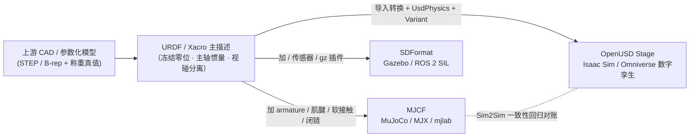

# URDF vs MJCF vs SDFormat vs OpenUSD：机器人描述格式横向对比

## 一句话定义

> **选格式先问用途**：跨栈发布模型结构用 **URDF**；拼接触精度、电枢/肌肉与闭链控制训练用 **MJCF**；在 Gazebo 跑含原生传感器与多模型的完整世界用 **SDFormat**；做多工具非破坏性协作、大规模视觉/产线场景合成与数字孪生底座用 **OpenUSD**（配合 `UsdPhysics`）。

## 英文缩写速查

| 缩写 | 英文全称 | 简要说明 |
|---|---|---|
| URDF | Unified Robot Description Format | ROS 生态单机器人树形描述 XML 格式 |
| MJCF | MuJoCo XML Format | DeepMind MuJoCo 原生建模与物理配置格式 |
| SDF | Simulation Description Format | SDFormat；Gazebo 生态的世界、模型与传感器 XML 规范 |
| USD / OpenUSD | Universal Scene Description | Pixar 开源的层次化 3D 场景描述框架 |
| UsdPhysics | USD Physics Schema | OpenUSD 官方刚体、碰撞与铰接体物理扩展规范 |
| B-rep | Boundary Representation | CAD 精确几何边界表示（如 STEP），需网格化或抽提后入仿真 |
| CoM | Center of Mass | 刚体质心位置，惯性张量必须对应同一点 |

## 为什么重要

- **“文件能导入”不等于“物理含义没丢”**：四种格式对运动闭环、默认坐标轴、角度单位、惯量积符号和执行器模型的表达能力完全不同。直接把 CAD 导成 URDF 再自动导入不同仿真器，往往会悄悄丢掉并联闭链、转子电枢惯量、传感器外参或碰撞过滤规则。
- **决定“单真值源（Single Source of Truth）”放哪**：大型项目若同时维护 Pinocchio 控制器、MuJoCo 策略训练和 Isaac Sim 视觉孪生，必须清楚哪一层信息留在上游主干、哪些引擎专有参数放到下游衍生层。

## 核心原理与四格式全维对比

以下条文均逐项核对自 [ROS URDF XML 规范](../../sources/sites/ros_urdf_xml_spec.md)、[MuJoCo 官方文档](../../sources/papers/mujoco_reading_official_docs_computation_overview.md)、[SDFormat 1.11 规范](../../sources/sites/sdformat_official_spec.md) 与 [OpenUSD `UsdPhysics` 源码规范](../../sources/sites/openusd_usdphysics_spec.md)：

| 维度 | URDF（+ Xacro） | MJCF（MuJoCo XML） | SDFormat（SDF 1.11） | OpenUSD（`UsdPhysics`） |
|---|---|---|---|---|
| **核心定位** | 单台机器人的运动学树交换最小公分母 | 高精度物理计算与执行器/接触求解描述 | 完整仿真世界（环境 + 多机器人 + 传感器） | 跨 DCC/CAD/仿真的可组合场景与数字孪生容器 |
| **运动学拓扑** | **严格单父节点树**；`<mimic>` 仅线性位置跟随，非真实闭链力学 | 嵌套 `<body>` 树 + `<equality>`（weld/connect/joint）与 `<tendon>` 建真实闭链 | **原生图结构**：支持任意环路，可用 `<simbody><must_be_loop_joint>` 指定切割 | `PhysicsJoint` 连任意两刚体；`ArticulationRootAPI` 配合 `excludeFromArticulation` 显式切开闭链 |
| **默认坐标/角度单位** | 长度 m、质量 kg、**角度 rad**；`<joint><axis>` 默认 `(1, 0, 0)` | 默认弧度（可全局改 `angle="degree"`）；推荐直接写四元数 `quat` | 长度 m、质量 kg、默认弧度（`<pose degrees="true">` 可改度）；`<axis>` 默认 `(0, 0, 1)` | 距离/质量由 Stage 元数据决定（`metersPerUnit`/`kilogramsPerUnit`）；**角度/角速度固定为度（degrees）** |
| **质量与惯量约定** | 相对质心系 `C`（允许 `rpy` 旋转）；**负号惯量积**；缺 `<inertial>` 默认零 | 相对 body 质心；`inertiafromgeom` 默认 `auto`（仅缺时由几何体推导） | 负号惯量积；支持 `inertial@auto="true"` 与水下 21 元 `fluid_added_mass` | `PhysicsMassAPI` 拆成 `centerOfMass` + 主轴对角 `diagonalInertia` + `principalAxes`（无惯量积符号争议）；父质量优先于子 |
| **碰撞与几何** | 基本体（`cylinder` 沿 Z）与网格；未内置凸分解指令 | **只支持凸 geom 碰撞**；非凸网格默认取凸包，须先凸分解并入同 body | 11 种几何体 + `<surface>` 物理材质/扭转摩擦/位掩码过滤/DART 软接触 | `UsdPhysicsCollisionAPI` + `MeshCollisionAPI.approximation`（`convexDecomposition` 等 6 档）+ `CollisionGroup`/`FilteredPairsAPI` |
| **执行器与传动** | 无标准力控字段；仅 `<dynamics>` 阻尼/摩擦与外挂 `<transmission>` | 原生 `general` 执行器、**`armature` 转子惯量**、状态滞后激活态、肌肉/延迟缓冲 | 关节弹簧阻尼、限位刚度阻尼，控制通过 `<plugin>` 挂载（如 `gz_ros2_control`） | `PhysicsDriveAPI`（按轴挂载隐式弹簧阻尼 `force`/`acceleration` 驱动）；核心规范无电机 `armature` |
| **原生传感器** | `<sensor>` **已被官方放弃并警示未落地**；须靠 `<gazebo>` 等标签扩展 | 原生 `<sensor>` 写入 `sensordata`，支持 `nsample`/`delay`/`interp` 延迟插值与噪声占位 | **原生 20+ 种**（RGBD/分割/边界框相机、LiDAR、IMU、力矩、接触、GNSS 等） | 核心 `UsdPhysics` **不含传感器模型**；由 Isaac Sim 等平台扩展 schema 提供 |
| **世界与协作组合** | 无 `<world>`；靠 Xacro 宏展开（静态文本拼接） | `<include>` 合并顶层子元素与 `<default>` 类继承；支持 `<replicate>` 阵列 | 原生 `<world>` + 嵌套 `<model>` + `<frame attached_to/relative_to>`；`<include merge>` | **核心强项**：Layer / Reference / Payload / Variant（LIVERPS）非破坏性叠加与 Instancing |
| **典型消费生态** | ROS 2、Pinocchio、MoveIt 2、作为跨引擎初始导入源 | MuJoCo、MJX、MuJoCo Warp、mjlab、Playground | Gazebo（Sim）、ROS 2 `ros_gz` | Isaac Sim、Isaac Lab、Omniverse、Newton、SimReady 资产库 |

### 从 CAD 到多引擎的典型派生流

## 工程实践

1. **优先让质心系对齐主惯量轴**：URDF 与 SDFormat 均采用负号惯量积约定，而部分 CAD 软件默认正号或按零件原点输出；把 `<inertial>` 原点移至 CoM 并旋转至主轴使 `ixy = ixz = iyz = 0`，可同时消除 URDF/SDF 符号错误并无缝对接 OpenUSD 的 `diagonalInertia`。
2. **警惕五个高频跨格式转换坑**：
   - **单位坑**：URDF/SDF/MJCF 默认弧度，OpenUSD `UsdPhysics` 的旋转限位与角速度默认**度**；
   - **关节默认轴**：URDF 默认 `(1, 0, 0)`，SDFormat 默认 `(0, 0, 1)`，导出脚本务必显式写出轴向；
   - **隐式默认值**：URDF 省略 `<inertial>` 为零质量/零惯量（导致求解崩塌），而 OpenUSD 缺失显式质量时会按碰撞体体积乘水密度 `1000 kg/m³` 估算；
   - **闭链与 `mimic`**：URDF 的 `<mimic>` 只是运动学线性跟随，导入 MuJoCo/Isaac 做高负载并联踝或连杆机构时必须替换为真实约束（MJCF `<equality>` 或 USD `excludeFromArticulation` 闭环关节）；
   - **非凸碰撞陷阱**：MuJoCo 会静默把非凸 mesh 裹成凸包（凹槽和夹爪内壁会消失），OpenUSD 则必须显式指定 `convexDecomposition` 或独立 `guide` 碰撞代理。
3. **建立“单真值源 + 下游补丁层”架构**：不要直接人工手改生成出来的多份 XML。保留 CAD 零位表与 Xacro/Python 源，把引擎特有调参（如 MuJoCo `solref`/`armature`、USD `Variant` 传感器层）作为独立叠加文件或构建后补丁，每次改模后自动跑 [URDF 连杆惯量对照真机检查](../queries/urdf-link-inertia-real-robot-check.md) 与 Sim2Sim 回归。

## 局限与风险

- **无万能通用格式**：没有任何单一格式能无损承载全部控制、碰撞、传感器与渲染信息；强制在某一种格式里硬塞所有东西只会导致自定义标签泛滥、解析器互相不认。
- **URDF 解析器静默容错风险**：MuJoCo 文档明确指出载入 URDF 时不作严格 schema 校验，拼错的扩展属性可能被静默忽略；复杂机器人建议转为原生 MJCF 或 OpenUSD 后显式校验。
- **OpenUSD 平台扩展分化**：`UsdPhysics` 是跨引擎最小刚体标准，真实项目常依赖 NVIDIA `PhysxSchema` 等平台扩展来补足传感器、阻尼和 GPU 求解参数，跨非 PhysX 后端时需核对扩展支持情况。

## 关联页面

- [机器人建模与数字孪生纵深路线](../../roadmap/depth-robot-modeling-digital-twin.md) — 本对比页所属的纵深路线（Stage 2 核心选型）
- [URDF（统一机器人描述格式）](../concepts/urdf-robot-description.md) — URDF 语法与运动学树基础
- [轮式双臂人形 URDF 建模与工具链](../queries/wheeled-dual-arm-humanoid-urdf-workflow.md) — 从 CAD 零位到多格式交付的七步实操
- [URDF 连杆惯量对照真机检查](../queries/urdf-link-inertia-real-robot-check.md) — `<inertial>` 符号、物理一致性与真机回归五层检查
- [3D-as-Code、网格与机器人仿真描述](./3d-as-code-to-robot-simulation.md) — 程序化几何代码与 URDF/USDA 的边界
- [机器人描述目录选型](./robot-description-catalogs.md) — 现成开源 URDF/MJCF 模型库去哪找
- [NVIDIA Learn OpenUSD](../entities/nvidia-learn-openusd.md) — OpenUSD Layer/LIVERPS 体系官方课程
- [MuJoCo](../entities/mujoco.md) · [Isaac Sim](../entities/isaac-sim.md) · [Gazebo Sim](../entities/gazebo-sim.md) · [Pinocchio](../entities/pinocchio.md) — 四大格式的主要消费者
- [机器人数字孪生](../concepts/digital-twin.md) — 物理模型如何走向 SIL/HIL 与双向同步闭环

## 参考来源

- [ROS URDF XML 官方规范归档](../../sources/sites/ros_urdf_xml_spec.md)
- [MuJoCo 官方文档通读归档（Overview / Computation / Modeling）](../../sources/papers/mujoco_reading_official_docs_computation_overview.md)
- [SDFormat (SDF 1.11) 官方规范归档](../../sources/sites/sdformat_official_spec.md)
- [OpenUSD `UsdPhysics` 官方规范归档](../../sources/sites/openusd_usdphysics_spec.md)
- [Zane Hub 轮式双臂人形 URDF 建模工作流归档](../../sources/blogs/zane-hub-wheeled-dual-arm-urdf-workflow-2026-11-14.md)

## 推荐继续阅读

- [ROS Wiki: urdf/XML Specification](https://wiki.ros.org/urdf/XML)
- [MuJoCo Documentation: Modeling & XML Reference](https://mujoco.readthedocs.io/en/stable/modeling.html)
- [SDFormat Official Specification](http://sdformat.org/spec)
- [Pixar OpenUSD `UsdPhysics` Documentation & Schema](https://github.com/PixarAnimationStudios/OpenUSD/blob/release/pxr/usd/usdPhysics/overview.dox)
