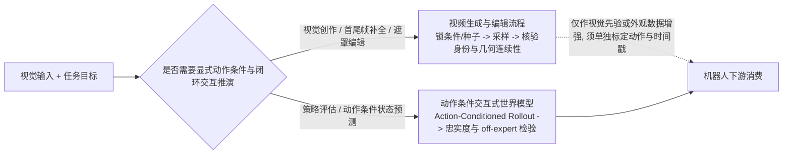

# 视频生成与编辑流程 vs 动作条件交互式世界模型

## 一句话定义

**视频生成与编辑流程**以文本、参考帧或局部遮罩为条件生成高一致性的视觉片段，重在内容创作与数据外观扩增；**交互式世界模型**则以显式机器人动作或控制信号为逐帧条件推演环境状态演进，两者不可混用，生成视频也不能直接当作动作或物理动力学真值。

## 英文缩写速查

| 缩写 | 英文全称 | 简要说明 |
|---|---|---|
| T2V / I2V | Text-to-Video / Image-to-Video | 文本条件生成视频与首图条件续写视频的两种经典任务形态 |
| V2V | Video-to-Video | 基于已有视频和遮罩/参考图的局部编辑或风格迁移流程 |
| FPS | Frames Per Second | 视频帧率，机器人训练使用前须与控制/观测时间戳对齐 |
| WM | World Model | 世界模型，按当前观测与动作条件预测后续未来状态或帧 |
| LfV | Learning from Video | 从无动作标签人类或合成视频中提取先验的策略学习路线 |

## 为什么重要

随着视频扩散与可控编辑模型（如 Wan2.1 + VACE）在视觉质感上大幅逼近实拍，不少团队容易把「外观连续、画面逼真的编辑视频」误当成「可直接用来打分或训练闭环策略的仿真器」，忽视了**动作因果跟随（action fidelity）**、**3D 几何闭合**与**物理接触守恒**的缺失。

## 核心原理

| 比较维度 | 视频生成与编辑流程（[Video Generation Workflow](../methods/video-generation-workflow.md)） | 交互式世界模型（[Generative World Models](../methods/generative-world-models.md)） |
|---|---|---|
| **核心条件输入** | 文本提示、首帧/尾帧参考、时序遮罩与参考图（如 T2V/I2V/VACE） | 历史观测 + **逐帧可执行动作 / 位姿 / 控制指令** |
| **关键一致性目标** | 主体身份稳定、局部编辑融合、镜头连贯与运动自然度 | **动作因果跟随**、物理碰撞合理、长时状态守恒（尤其 off-expert 动作） |
| **典型工程用途** | 影视/演示可视化、视角插值、背景/光照外观扰动扩增 | 想象轨迹规划、策略离线评估器（如 WorldArena / GigaWorld-1）与闭环推演 |
| **用于机器人训练前提** | 必须额外重建/标定动作标签、尺度、时间戳与可达性 | 必须验证动作反演/跟随相关性及未见失败状态的恢复能力 |

## 工程实践

1. **按任务锁定条件与权重配置**：严格区分 T2V、I2V、首尾帧插值与遮罩编辑所需权重与采样参数（固定随机种子、帧数、FPS 与分辨率），避免跨模式混用配置导致漂移。
2. **把视觉编辑流程限定在先验与外观增强层**：利用 [Video Generation and Editing Workflow](../methods/video-generation-workflow.md) 生成补充视觉片段时，须与真实遥操作动作轨迹隔离统计，并在评测中对比「无增强 vs 有增强」的真实真机/仿真成功率增量。
3. **世界模型评估重点看动作忠实而非画质**：参考 [开源世界模型横向对比](./open-source-world-models-11-2026.md) 与 [具身评测基准选型闭环](../overview/hub-embodied-eval-benchmark.md) 第②层，在离线评估策略时优先测试 off-expert 与失败动作下的物理响应一致性。

**一手证据对应：** Wan2.1 的 VACE 推理入口使用参考图、源视频或遮罩安排编辑；GigaWorld-1 则把策略动作作为世界推演输入，并在 WMBench 中以真实执行为参照检查评估能力。比较策略时应先对齐初态、动作语义和终止判据，再检查成功率或排序是否一致；画质高低不能替代这些检验。

## 局限与风险

- **生成视频不等于动力学真值**：像素连贯的视频仍可能出现穿模、物体凭空消失、手-物接触虚浮或重力违背，不能直接作为接触密集型物理验证依据。
- **帧率与控制频率错配**：生成视频的固定采样 FPS 往往与机器人控制周期（如 20–50 Hz 或 500 Hz）不一致，未经时间重采样与状态同步直接喂给策略会破坏时序假设。

## 关联页面

- [视频生成与编辑流程](../methods/video-generation-workflow.md) — T2V/I2V/首尾帧与 VACE 遮罩编辑标准流程
- [生成式世界模型](../methods/generative-world-models.md) — 动作条件交互式世界模型与闭环推演方法
- [生成式视觉预训练](../concepts/generative-vision-pretraining.md) — 视频/图像生成作为视觉与动态先验的概念基础
- [Video-as-Simulation](../concepts/video-as-simulation.md) — 把视频模型用作世界模拟器的边界与失真分析
- [开源世界模型横向对比（2026-11）](./open-source-world-models-11-2026.md) — 主流开源世界模型的动作接口与能力对照
- [具身评测基准选型闭环](../overview/hub-embodied-eval-benchmark.md) — 第②层世界模型预测保真度评测规范

## 参考来源

- [视频生成与编辑流程一手方法归档](../../sources/sites/methods-primary-video-generation-workflow-2026-11-26.md)

- [GigaWorld-1：WMBench、动作接口与评估归档](../../sources/papers/gigaworld_1_arxiv_2607_02642.md)

## 推荐继续阅读

- [Wan2.1 官方项目与推理示例](https://github.com/Wan-Video/Wan2.1)
