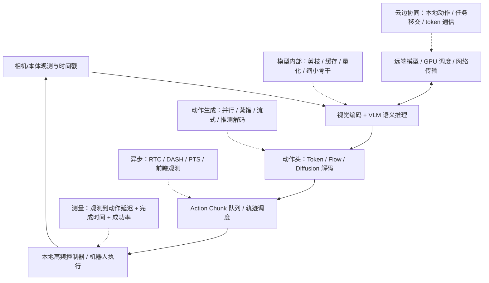

# VLA 加速 25 法：从模型推理到机器人闭环 / 25 Ways to Accelerate VLA Robots

## 一句话定义

**VLA 加速是端到端执行链路的优化问题，不是单纯缩短模型前向时间。** 根据 [Turing Post 2026-11-22 文章](../../sources/blogs/turingpost-vla-25-speedups-2026-11-22.md)，25 项方法按「模型内部 6、异步执行 8、动作生成 6、云边协同 5」划分；本文关注适用条件、可比较指标及工程选型，不为 25 篇论文虚构统一排行榜。

## 英文缩写速查

| 缩写 | 英文全称 | 简要说明 |
|---|---|---|
| VLA | Vision-Language-Action | 由视觉、语言和状态信息生成机器人动作的模型 |
| VLM | Vision-Language Model | VLA 中可能较慢的语义骨干 |
| RTC | Real-Time Chunking | 在执行当前动作块时异步生成并约束下一块 |
| KV | Key-Value Cache | 重用未显著变化 token 的注意力缓存 |
| NFE | Number of Function Evaluations | Flow/Diffusion 动作头去噪函数调用次数 |
| RTT | Round-Trip Time | 机器人与推理服务器的网络往返时延 |
| P95 | 95th Percentile | 关注推理与网络时延的长尾，而不是只看均值 |
| W4A8 | 4-bit Weights, 8-bit Activations | 量化配置，先关注显存和实际 kernel 表现 |

## 为什么重要

- **优化目标不同**：单次推理耗时、动作可用延迟、传感器到可执行动作的响应时间、控制频率、任务完成时间、成功率没有统一换算关系。
- **优化可能相反**：RTC 真机单次调用从 76 ms 变为 97 ms，但由于推理与当前动作执行重叠，仍可缓解 chunk 交界处等待；只看模型毫秒数会误判方案。
- **硬件/模型决定收益**：ActPrune 在 OpenVLA-OFT 与 π₀.₅ 上有显著不同的实际加速；剪去 FLOPs 不代表等比例减小端到端延迟。

## 核心原理

### 全链路瓶颈定位图

图为**文章归纳的工程诊断图**，不是某篇论文中未经证实的源码调用关系。

### A. 模型内部优化（6 种）

| 方法（论文原文） | 改变的计算 | 原文引用的结果与严格口径 |
|---|---|---|
| [APS-VLA](https://arxiv.org/abs/2611.13030) | 学习动作/未来敏感的视觉 token 选择 | 5 项双臂真机平均策略推理 **137.25→93.25 ms**，成功率 60%→61% |
| [ActPrune](https://arxiv.org/abs/2611.08827) | 从已有动作规划剪去不需要编码的 image patch | LIBERO：OpenVLA-OFT 1.61×；π₀.₅ FLOPs −38% 却仅 **1.03×** |
| [EfficientVLA](https://arxiv.org/abs/2506.10100) | 冗余层、视觉 token 剪枝和去噪特征缓存 | SIMPLER / A40，推理 **1.93×**，平均成功率 −0.6 个百分点 |
| [VLA-Cache](https://arxiv.org/abs/2502.02175) | 相邻帧视觉 KV 复用，只更新变化处 | CUDA 推理最高 **1.7×**，控制频率 +15%，两项指标不同 |
| [QuantVLA](https://arxiv.org/abs/2602.20309) | 骨干和动作 Transformer 选定线性层 W4A8 | 对应两个模块的显存 **4.27→1.28 GB**，不直接推出任务加速 |
| [SmolVLA](../entities/paper-smolvla.md) · [论文](https://arxiv.org/abs/2506.01844) | 从架构上限制骨干和视觉 token | 约 450M 参数、每张图 64 token；异步 runner 的收益应单独记账 |

### B. 动作执行期间的延迟处理（8 种）

| 方法（论文原文） | 执行策略 | 原文引用的结果与严格口径 |
|---|---|---|
| [RTC](../entities/paper-real-time-chunking.md) · [论文](https://arxiv.org/abs/2506.07339) | 当前 chunk 执行时预测下一块，冻结已提交前缀并 inpainting | 真机模型调用 **76→97 ms**，但任务推进可受益于无缝交接 |
| [TT-RTC](../entities/paper-training-time-real-time-chunking.md) · [论文](https://arxiv.org/abs/2512.05964) | 训练期学习提交前缀和推理延迟，减少推理期引导成本 | 远程 H100 / π₀.₆，单请求端到端 **135→108 ms** |
| [SR-VLA](https://arxiv.org/abs/2611.22356) | 未来观测预测 + 按需 KV 缓存修补 | LIBERO / π₀.₅，查询后剩余等待 **128→48 ms** |
| [DASH](https://arxiv.org/abs/2611.11854) | 慢 VLM 与快动作头分时钟，动作头读新视觉/旧语义 | RoboTwin 延迟感知仿真：0.8B–8B **20 Hz**；同步 9.7→4.1 Hz |
| [PTS](https://arxiv.org/abs/2611.01390) | 沿原有规划路径加速执行并对齐重规划进度 | LIBERO 异步吞吐：π₀.₅ **+28%**、SmolVLA **+38%** |
| [RAVEL](https://arxiv.org/abs/2609.34170v2) | 不同噪声级 action 在滚动缓冲里逐步成熟 | 4090 同步仿真，观测到首个可用动作中位 **272.86→93.45 ms** |
| [VLASH](https://arxiv.org/abs/2512.01031) | 对预测动作完成时的未来机器人状态条件化 | 指定 500 ms chunk 的**推算最坏反应时延** 546.4→46.4 ms |
| [A2C2](https://arxiv.org/abs/2509.23224) | 在慢策略计划外叠加读最新观测的快速校正 | LIBERO Spatial 注入延迟，成功率 **64.4%→84.2%** |

### C. 动作生成阶段（6 种）

| 方法（论文原文） | 减少的操作 | 原文引用的结果与严格口径 |
|---|---|---|
| [Zora](https://arxiv.org/abs/2611.11098) | 检索历史动作 token、批量验证 | 软件在 Thor 上最高 **3.4×**；**7.6×** 需模拟专用加速器 |
| [VSpark](https://arxiv.org/abs/2611.22666) | 自回归动作的 draft/verify 推测解码 | 四种 AR VLA 的 LIBERO **1.28–2.10× 解码速度** |
| [UAD](https://arxiv.org/abs/2609.37772) | 先释放急需执行的动作，剩余部分继续去噪 | SmolVLA / LIBERO-Plus 动作可用 **21.6→11.4 ms** |
| [OpenVLA-OFT](https://arxiv.org/abs/2502.19645) | 并行连续 action chunk 取代逐 token 解码 | 单图 LIBERO 动作生成吞吐 **26×**，调用 **239.6→72.9 ms** |
| [SnapFlow](https://arxiv.org/abs/2604.05656) | 渐进自蒸馏把 Flow 动作头变为一步 | LIBERO 一步成功率 **98.75%** vs 教师 97.75%；Batch1 模型延迟约 /3.3 |
| [FlashVLA](../entities/paper-flashvla.md) · [论文](https://arxiv.org/abs/2608.27384) | 邻接 chunk 不同噪声阶段交错流式解码 | 真机单 GPU 稳态控制频率 **≥30 Hz**，不含缓冲填充期 |

### D. 云边协同与 GPU 服务（5 种）

| 方法（论文原文） | 端/云分工 | 原文引用的结果与严格口径 |
|---|---|---|
| [VLA-ULAP](https://arxiv.org/abs/2609.18663) | 远程调用间，轻量本地模型继续输出动作 | SO-101 真机成功任务远程调用 **−70%～72%**，不是任务时间 |
| [Robion](https://arxiv.org/abs/2609.12075) | GPU 共享服务按阶段流水线和 deadline 调度 | **4 GPU / 最多 64 模拟机器人**、98% 截止时间满足 |
| [VLA Handover](https://arxiv.org/abs/2611.08987) | 小模型本地优先，预计失败时交给云端 | 三套 LIBERO 减请求 **49%～77%**；LIBERO-Long 成功率 63.6% vs 93.2% |
| [CloudEdgeVLA](https://arxiv.org/abs/2608.00569) | 云端较旧语义特征 + 本地实时视觉/动作生成 | Franka 在人为 RTT 1 s、小样本移动目标任务 **7/10 vs 0/10** |
| [ComVLA](https://arxiv.org/abs/2609.07838) | 视觉编码本地做，按带宽发部分 token | LIBERO 32-token 成功率 **95.4%** vs 512-token OFT **96.9%**；计算时延不含传输 |

**索引边界**：本次 ingest 的一手通读对象是 Turing Post **博客原文**；以上数据为该文对各论文的归纳，已核对 25 个 arXiv 入口，但**未逐篇全文审计实验与源码**。已有 RTC、TT-RTC、FlashVLA、SmolVLA 独立实体直接复用；其他独立论文链接到 arXiv，后续应按一篇一节点、全文读完后再单独 ingest，不在比较页假装完成论文深读。

## 工程实践

### 先记录基线，再选择提速层

1. **切片 profiling**：记录 sensor timestamp → 视觉编码 → VLM → 动作头 → 网络传输/排队 → action queue → 执行器接收时间，拆出设备侧与云端统计。
2. **如果单次 GPU 计算占主导**：先用 [VLA-Triage](https://arxiv.org/abs/2611.06710) 的硬件瓶颈思路诊断，比较图像 token 剪枝、缓存、量化、GPU kernel 复用的实际收益（尤其看 P95）。
3. **如果 chunk 边界卡顿**：先检查 [Action Chunking](../methods/action-chunking.md) 的执行视野、队列触发和时间戳；再对照 RTC/TT-RTC/DASH，检查新旧动作相位、stale semantics 与动作安全约束。
4. **如果动作头多轮去噪或逐 token 过慢**：根据模型是 AR 还是 Flow，选择 OFT/VSpark 或 SnapFlow/UAD/FlashVLA，单独报告 NFE、动作块长度与成功率。
5. **如果网络和多机器人排队占主导**：测 RTT/P95/P99、失败/重试、服务器 deadline，再决定本地快速动作头、远程语义、Handover 或请求调度。

### 速度验收表（建议在同一硬件、同一任务上测）

| 必须上报 | 含义 | 注意 |
|---|---|---|
| 观测→实际执行动作延迟 | 某个观测真正影响到已下发动作的耗时 | 不等于纯模型 forward |
| 任务完成时间 / 成功率 | 机器人实际完成工作的时间与可靠性 | 避免只为速度牺牲成功率 |
| P50 / P95 / P99、deadline miss | 平均值不能隐藏长尾与控制风险 | 远程时分网络、排队、计算 |
| 硬件、batch、chunk/NFE、相机与控制频率 | 保证基线可重复 | 预热/稳态、真机/仿真分开 |

## 局限与风险

- **二手证据**：本页是 Turing Post 文章的主题汇编，不是 25 篇论文技术报告的全文再证明。实验值不应被用于跨模型排行或承诺真机加速倍数。
- **不同分母**：26×（动作生成吞吐）、1.7×（CUDA inference）、20 Hz（控制循环）、70%（远程调用减少）、1.28 GB（显存），不能换算成统一的机器人任务加速。
- **安全与时域一致性**：异步执行可能提高陈旧语义、队列错配及超时下的风险；快动作头不等于完成底层 WBC / PD / 驱动器实时闭环。
- **未进行复现**：没有在本站统一运行 25 种模型、GPU benchmark、LIBERO 或机器人真机；具体部署要在目标机器人评估动作平滑、碰撞限位及异常接管。
- **额外两篇评测工作**：[VLALagBench](https://arxiv.org/abs/2611.03103) 用延迟敏感性测试任务影响；[VLA-Triage](https://arxiv.org/abs/2611.06710) 分析硬件瓶颈和优化交互，它们是**辅助评测工具论文**，不计入上述 25 种方法。

## 关联页面

- [VLA 方法总览](../methods/vla.md)
- [Action Chunking](../methods/action-chunking.md)
- [控制与推理频率解耦](../concepts/control-inference-frequency-decoupling.md)
- [Edge–Cloud Robotics](../concepts/edge-cloud-robotics.md)
- [Real-Time Chunking 论文详情](../entities/paper-real-time-chunking.md)
- [Training-Time RTC 论文详情](../entities/paper-training-time-real-time-chunking.md)
- [FlashVLA 论文详情](../entities/paper-flashvla.md)
- [VLA 纵深路线](../../roadmap/depth-vla.md)

## 参考来源

- [Turing Post 英文原文完整阅读归档：25 种方法及逐项论文入口](../../sources/blogs/turingpost-vla-25-speedups-2026-11-22.md)
- [具身智能之心 2026-11-23 中文解读：用户提供全文归档](../../sources/blogs/wechat-embodied-heart-vla-25-acceleration-20261123.md)

## 推荐继续阅读

- [Turing Post — 25 Ways to Make VLA Robots Faster（2026-11-22）](https://www.turingpost.com/p/ways-to-make-vla-robots-faster)
- [RTC：Real-Time Execution of Action Chunking Flow Policies](https://arxiv.org/abs/2506.07339)
- [DASH：Decoupled Asynchronous System for Humanoids](https://arxiv.org/abs/2611.11854)
- [VLA-Triage：推理瓶颈与优化交互](https://arxiv.org/abs/2611.06710)
