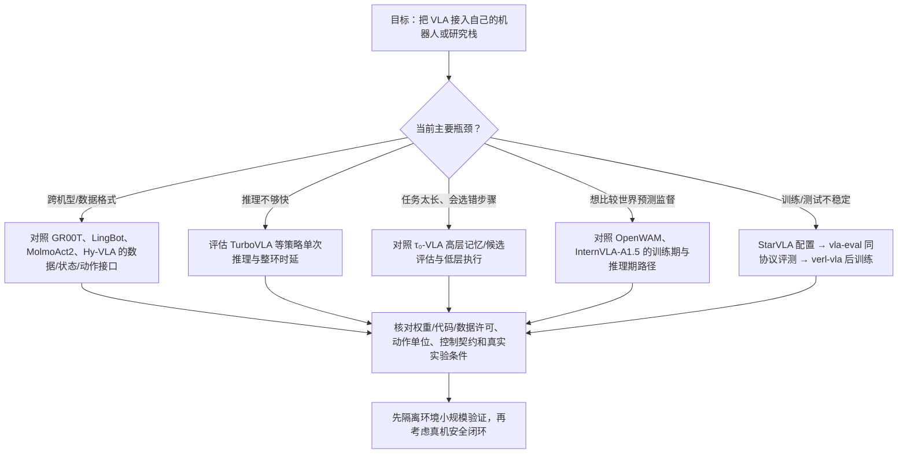

# 2026 年 VLA 开源生态三转变：15 个项目的复现与选型对照 / Three Shifts in the 2026 Open VLA Ecosystem

## 一句话定义

2026 年的 VLA 开源价值不仅在**动作模型能否下载**，也在于能否把异构数据接入目标本体、能否按物理节奏执行，以及能否用公共工具实现**可核验的训练—评测—后训练闭环**；本文按这三种工程问题组织附件列出的 15 个项目，不按 GitHub Star 和异构 benchmark 分数排高低。

## 英文缩写速查

| 缩写 | 英文全称 | 简要说明 |
|---|---|---|
| VLA | Vision-Language-Action | 从视觉与自然语言生成机器人动作的策略 |
| WAM | World–Action Model | 世界预测与动作生成耦合的模型族 |
| UMI | Universal Manipulation Interface | 不绑定特定机器人关节结构的操作示范采集接口 |
| SFT | Supervised Fine-Tuning | 监督微调，用任务数据适配策略 |
| RL | Reinforcement Learning | 基于交互反馈的策略优化 |
| VLM | Vision-Language Model | 视觉语言基础模型，可作为 VLA 骨干 |
| TTC | Test-Time Computation | 推理时投入额外搜索/验证计算 |
| EEF | End Effector | 机械臂或灵巧手的末端执行器 |

## 为什么重要

- **跨本体不是「换一个输出头」：** 摄像机、状态定义、动作维度/单位、底层控制接口、数据动作分布都需要对齐；大型模型并不能绕开机器人身体约束。
- **快推理与长程规划是两条不同轴：** TurboVLA 关注单次策略调用的算力与延迟；τ₀-VLA 用高层记忆/世界模型选择子任务；OpenWAM 将世界–动作联合预训练做成模块化实验栈。
- **可运行 ≠ 可复现 ≠ 可部署：** 有报告、有权重、有训练脚本、有评测配置、有真机接口是不同的开放层次；部署还须单独检查控制频率、安全验证和算力预算。
- **与 [2025 策展](../overview/vla-open-source-repro-landscape-2025.md) 的差别：** 2025 页偏资源入口及复现起步路径，本页强调跨本体、时序与工程工具三种成本，并包含 2026 新发布/迭代项目。

## 15 个项目的三层地图

下表顺序沿用附件归类；已存在的仓库节点**复用既有 wiki 链接**，不另造同项目实体。仅新发现的仓库补充 `sources/repos/` 导航；**没有创建未经通读的论文详情页**。

| 方向 | 项目（详情/源码导航） | 对比时先看什么 | 资料与开放边界 |
|---|---|---|---|
| ① 多本体/全身 | [GR00T N1.7](../entities/paper-gr00t-n1-7.md) | 人类视频、机器人示范融合和多本体数据接口 | [Isaac-GR00T 官方](https://github.com/NVIDIA/Isaac-GR00T)；版本与模型权重另核 |
| ① 多本体/全身 | [Ψ₀ / Psi0](../entities/paper-loco-manip-161-156-psi0.md) | 高层全身动作 vs 底层稳定跟踪的分工 | 依已有论文页与 SIMPLE 平台归档 |
| ① 多本体/全身 | [LingBot-VLA 2.0](../entities/lingbot-vla-v2.md) | 统一动作空间与混合机器人/人类数据 | [官方 V2 代码](https://github.com/Robbyant/lingbot-vla-v2) |
| ① 多本体/全身 | [MolmoAct2](../entities/paper-molmoact2.md) | 训练/后训练/部署与 LeRobot 工作流 | [Ai2 官方代码](https://github.com/allenai/molmoact2) |
| ① 多本体/全身 | [Qwen-VLA](../entities/qwen-vla.md) | 操作、导航与轨迹的共享表示 | [官方 GitHub](https://github.com/QwenLM/Qwen-VLA) 当前以论文、Demo 和结果为主，**未见可运行主代码/权重入口** |
| ① 多本体/全身 | [Xiaomi-Robotics-1](../entities/xiaomi-robotics-1.md) | 大规模动作预训练到目标机器人后训练 | [官方代码](https://github.com/XiaomiRobotics/Xiaomi-Robotics-1) |
| ① 多本体/全身 | [UnifoLM-VLA-0](../entities/unifolm-vla.md) | 单策略在人形操作任务中的真机接口 | [官方代码](https://github.com/unitreerobotics/unifolm-vla) |
| ① 多本体/全身 | [InternVLA-A1.5](../entities/paper-internvla-a15-unified-vla.md) | 训练期未来潜空间监督，推理期去除视频分支 | [官方 A-series](https://github.com/InternRobotics/InternVLA-A-series) |
| ① 多本体/全身 | [Hy-Embodied-0.5-VLA](../../sources/repos/hy-embodied-05-vla.md) | UMI 数据、flow 动作专家与数据到部署链路 | [官方代码/模型/部分数据](https://github.com/Tencent-Hunyuan/Hy-Embodied-0.5-VLA)；10k+ h 训练不等于公开 10k+ h |
| ② 世界/实时/长程 | [OpenWAM](../entities/paper-openwam.md) | 组合式世界–动作模型与预训练消融 | [官方代码](https://github.com/OpenWAM-Official/OpenWAM)，注意 WAM 不等于必然在线生成视频 |
| ② 世界/实时/长程 | [TurboVLA](../../sources/repos/turbovla.md) | 直接视觉+文本→动作，单次推理时延 | [官方代码与权重](https://github.com/H-EmbodVis/TurboVLA)；4090 约 32 Hz **仅策略推理** |
| ② 世界/实时/长程 | [τ₀-VLA](../entities/paper-tau0-vla.md) | 高层计划/世界模型候选评估、低层连续动作 | [官方仓库](https://github.com/sii-research/tau-0-vla)；组件开放情况按版本核对 |
| ③ 训练/评测/后训练 | [StarVLA](../methods/star-vla.md) | 可替换骨干、动作头、数据与基准接口 | [官方框架](https://github.com/starVLA/starVLA)，定位是实验工作台 |
| ③ 训练/评测/后训练 | [vla-evaluation-harness](../../sources/repos/vla-evaluation-harness.md) | 模型 adapter、隔离 benchmark、复现标志 | [Ai2/AllenAI 官方仓库](https://github.com/allenai/vla-evaluation-harness)；集成 ≠ 复现 |
| ③ 训练/评测/后训练 | [verl-vla](../../sources/repos/verl-vla.md) | 人介入采集、SFT/RL 与云边角色编排 | [官方仓库](https://github.com/verl-project/verl-vla)；具体 pipeline 仍需逐一运行验证 |

## 流程总览：复现决策路径

此图是**工程选型决策树**，非任何单个项目的源码流程；箭头不是模型间的运行依赖。

## 关键事实及防误读

| 事实 | 该怎么读 |
|---|---|
| TurboVLA：约 32 Hz / RTX 4090，0.9 GiB | 官方给定硬件和模型下的策略**推理**测量；不等于相机→网络→执行器全环已达 32 Hz |
| Hy-VLA：10k+ h / 2k+ h | 前者是 README 所述收集/训练规模，后者才是公开数据规模 |
| Qwen-VLA：官方有报告与多基准表 | 发布结果 ≠ 发布可运行训练/推理代码和 checkpoint |
| vla-evaluation-harness：✓ / ◇ | 官方区分已复现与集成待复现；不同模型与 benchmark 的结果不能直接拼为全局名次 |
| StarVLA、verl-vla 与 VLA 模型 | 前者是工具框架，不是新的通用机器人动作模型；应按接入接口与工作流评估 |
| 官方仓库的 Star / 论文成功率 | Star 仅为时点热度，成功率必须保留任务、本体、数据、rollout、随机种子和版本 |

## 工程实践：建议记录的验收表

1. **输入**：相机视角/时间戳、语言指令、proprioception、action history；训练和部署的归一化与单位一致。
2. **输出**：动作空间（EEF/关节/底盘/全身）、chunk 长度、策略频率 vs PD/控制器频率；是否有 action interpolation。
3. **算力**：显存、首次加载、P50/P95 推理时间、视频/语言预处理、异步队列、端到端动作延迟。
4. **开源材料**：报告、完整权重、训练/后训练脚本、数据协议、部署/评测配置逐项打勾，不用一个「开源」覆盖。
5. **基准**：版本、任务数、场景随机化、success/score 单位、trial 数、是否官方/第三方复现；对有争议指标记录原文表格。
6. **安全**：先离线检查接口，再 Sim2Sim、有限空间保护、监测/急停；论文真机 Demo 不构成部署安全保证。

## 局限与风险

- **材料属性：** 附件是 2026-11-14 的二手选题综述，不等于 15 项工作的原始论文。此页主要复用站内已有一手资料归档；四个未找到独立详情的项目先补官方仓库导航，不宣称完成论文级通读与源码时序审计。
- **纠错：** 来源将 vla-evaluation-harness 一处标为 MAUM.AI，但后文也写 Ai2；官方代码仓库位于 `allenai`，本页统一归为 Ai2。
- **时效性：** 原文 Star 截止 2026-11-11；开放状态、权重、许可证可能继续变化，具体操作前看最新官方 README。
- **没有横排性能榜：** RoboTwin、LIBERO、真机移动操作和 1,000+ 任务分布差异巨大，不应以最高 success rate 跨论文判胜负。
- **未执行复现：** 本次是资料编目与工程选型，未下载模型权重、运行全部 benchmark，也未进行真实机器人实验。

## 关联页面

- [2025 VLA 开源复现景观](../overview/vla-open-source-repro-landscape-2025.md) — 2025 资源起步视角
- [VLA 方法](../methods/vla.md) — 输入/输出/控制接口
- [StarVLA](../methods/star-vla.md) — 模块化实验台
- [World Action Models](../concepts/world-action-models.md) — WAM 与 VLA 的关系
- [OpenWAM](../entities/paper-openwam.md) — joint WAM 预训练
- [τ₀-VLA](../entities/paper-tau0-vla.md) — 长程分层执行
- [GR00T N1.7](../entities/paper-gr00t-n1-7.md) — 多本体通才

## 参考来源

- [深蓝具身智能 2026-11-14 15 项目原文导读归档](../../sources/blogs/wechat_shenlan_15_vla_open_source_2026-11-14.md)（附件 PDF 全文核对；二手资料）
- [TurboVLA 官方仓库导航](../../sources/repos/turbovla.md)
- [Hy-Embodied-0.5-VLA 官方仓库导航](../../sources/repos/hy-embodied-05-vla.md)
- [vla-evaluation-harness 官方仓库导航](../../sources/repos/vla-evaluation-harness.md)
- [verl-vla 官方仓库导航](../../sources/repos/verl-vla.md)
- [GR00T N1.7 对应源码归档](../../sources/repos/isaac_gr00t.md)
- [MolmoAct2 对应源码归档](../../sources/repos/allenai-molmoact2.md)
- [OpenWAM 对应论文归档](../../sources/papers/openwam_arxiv_2609_07398.md)

## 推荐继续阅读

- [Qwen-VLA 官方仓库](https://github.com/QwenLM/Qwen-VLA)（核对开放状态）
- [Ai2 统一 VLA 评测](https://github.com/allenai/vla-evaluation-harness)
- [verl-vla 官方文档](https://verl-vla.readthedocs.io/en/latest/)
- [TurboVLA 论文](https://arxiv.org/abs/2607.27205)
