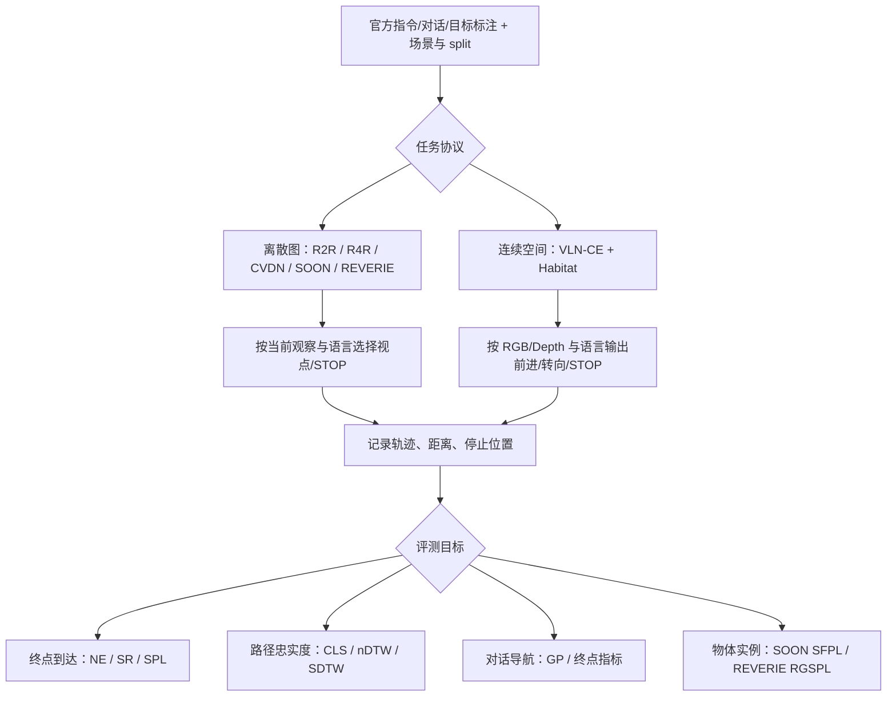

# VLN 七基准、开源框架与评测协议对照（R2R → REVERIE）

## 一句话定义

视觉语言导航（VLN）不是单一数据集：**R2R/R4R 测指令路径跟随，VLN-CE 测连续执行，CVDN/HANNA 测交互信息利用，SOON/REVERIE 测远程物体检索与实例接地**。选择评测基准应先确定输入、动作空间、停止和目标定位判定，再选 SR、SPL 或路径/实例专用指标。

## 英文缩写速查

| 缩写 | 英文全称 | 简要说明 |
|---|---|---|
| VLN | Vision-and-Language Navigation | 根据语言与第一人称视觉执行导航 |
| R2R / R4R | Room-to-Room / Room-for-Room | 短程最短路径 / 拼接的长程非最短路径 |
| VLN-CE | Vision-and-Language Navigation in Continuous Environments | Habitat 中连续物理空间的底层动作导航 |
| CVDN / NDH | Cooperative Vision-and-Dialog Navigation / Navigation from Dialog History | 人类导航对话数据与导航历史任务 |
| HANNA | Help, Anna! | 可以请求语言与视觉辅助的交互式寻物 |
| SOON / FAO | Scenario Oriented Object Navigation / From Anywhere to Object | 任意起点的场景语境目标导航任务及数据 |
| NE / SR / SPL | Navigation Error / Success Rate / Success weighted by Path Length | 终点误差、成功率、路径效率加权成功率 |
| CLS / nDTW / SDTW | Coverage weighted by Length Score / normalized Dynamic Time Warping / Success weighted DTW | 轨迹覆盖及轨迹一致性评估 |
| GP / SFPL / RGSPL | Goal Progress / Success Rate of Finding weighted by Path Length / Remote Grounding Success weighted by Path Length | 对话进展、目标寻找与实例指认 |

## 为什么重要

- **公平复现：** 离散 Matterport3D 图的视点跳转不是 Habitat 的低层移动，不能跨协议直接比较 SR。
- **指标对齐：** 只看终点是否接近目标会掩盖 R4R 的指令路径偏离、SOON 的指向错误和 REVERIE 的目标框指认失败。
- **系统工程：** 官方代码、场景资产、特征文件、数据划分和盲测服务器往往分属不同入口；“GitHub 可见”不代表数据与环境开箱即用。

## 核心原理

### 七项数据集及一手入口

| 基准与年份 | 输入 → 任务输出 | 环境/关键差异 | 原始论文 · 官方资料 |
|---|---|---|---|
| **R2R (2018)** | 逐步自然语言路线 → 停在目标附近 | Matterport3D 离散视点图、短程参考最短路 | [CVPR 论文](https://arxiv.org/abs/1711.07280) · [R2R 官方任务](https://github.com/peteanderson80/Matterport3DSimulator/tree/master/tasks/R2R) · [已有详情](../entities/paper-vln-01-r2r.md) |
| **VLN-CE (2020)** | 路线文本 + RGB/深度观测 → 前进、转向、STOP | Habitat 连续空间；R2R-CE/RxR-CE；原版采用 0.25 m 前进与 15° 转向步长 | [ECCV 论文](https://arxiv.org/abs/2004.02857) · [官方代码/数据说明](https://github.com/jacobkrantz/VLN-CE) · [已有详情](../entities/paper-vln-02-vln-ce.md) |
| **R4R (2019)** | 拼接语言指令 → 忠实走过长程路线 | 两条 R2R 路径拼接；目标距离未必等于指令路线长度 | [ACL 论文](https://aclanthology.org/P19-1181/) · [Google 官方生成器](https://github.com/google-research/google-research/tree/master/r4r) |
| **CVDN (2019)** | 目标物体 + 之前人类问答 → 下一段导航 | 2,050 段对话、7k+ 轨迹、83 栋 Matterport 房屋；NDH 是基于对话历史的派生任务 | [原论文](https://arxiv.org/abs/1907.04957) · [官方数据/基线](https://github.com/mmurray/cvdn) · [已有详情](../entities/dataset-cvdn.md) |
| **HANNA (2019)** | 目标/第一人称观察 + 可主动请求的视觉与语言提示 → 找到物体 | 交互求助决策；不等同于仅消化已有对话的 CVDN/NDH | [EMNLP 论文](https://aclanthology.org/D19-1063/) · [官方主仓](https://github.com/khanhptnk/hanna) |
| **SOON (2021)** | 目标属性、空间关系和房间语境 → 任意起点探索并指向对象 | FAO 数据；终点位置与目标方向需共同核对 | [CVPR 论文](https://arxiv.org/abs/2103.17138) · [官方代码](https://github.com/ZhuFengdaaa/SOON) · [已有详情](../entities/dataset-soon.md) |
| **REVERIE (2020)** | 远程目标的高层指称表达 → 导航并选出正确实例 | 需同时考察导航与可见物体指认；原版和 v2 数据定义须分别处理 | [CVPR 论文](https://arxiv.org/abs/1904.10151) · [官方代码](https://github.com/YuankaiQi/REVERIE) · [已有详情](../entities/paper-vln-03-reverie.md) |

*说明：VLN-CE 是连续环境任务及数据转换基准，不是独立于 R2R/RxR 的另一种语言标注来源；SOON 是方法/任务名称，其配套数据集称 FAO。*

### 评测链路（按任务协议分支）

### 指标、定义与适用范围

| 指标 | 主要含义（↑ 优 / ↓ 优） | 注意事项 |
|---|---|---|
| NE ↓ | 最终停止位置到目标的导航距离（通常沿导航图/可达路径计算） | 不能将欧氏距离和地理测地距离混用 |
| SR ↑ | 达到官方成功阈值的 episode 比例 | R2R 原论文为距离严格小于 3 m；其他任务各自核对 |
| OSR ↑ | 一条预测轨迹途中任意访问点满足到达判据的比例 | 是 oracle 成功，不等于代理真正停止成功 |
| SPL ↑ | 平均每条 episode 的 `S_i · L_i / max(P_i,L_i)`，其中 `S_i` 是成功指示，`L_i` 最短路径长，`P_i` 执行路径长 | 分母与 STOP、零路径边界情况必须遵循对应官方实现 |
| CLS ↑ | 参考路线覆盖情况按预测路径长度一致性加权 | Jain 等 ACL 2019 为 R4R 提出的核心指令忠实度指标 |
| nDTW / SDTW ↑ | 预测路径与参考轨迹的动态时间规整匹配；SDTW 将成功判定纳入 | 来自 [Ilharco 等后续工作](https://arxiv.org/abs/1907.05446)，并非原始 R2R 论文提出 |
| GP ↑ | 从初始到最终位置，目标剩余距离缩短的平均量 | CVDN/NDH 主要强调 Goal Progress；还需区分验证集与路径监督设定 |
| SFPL ↑ | SOON 的目标“寻找成功”及路径效率加权，导航到区域但未指中对象不能视为寻找成功 | 不可只用普通 SR 代替 |
| RGS / RGSPL ↑ | REVERIE 的远程物体 grounding 成功及路径长度加权 | 需先区分导航完成与正确实例定位；不同榜单版本须注明 |

**对照原则：** 任何跨论文结果表至少带上数据版本、seen/unseen split、动作/观测空间、是否使用 beam search 或 oracle、路径长度、STOP/阈值、目标定位判据和测试集/验证集。未核对完整评测协议时，宁可只列入口、不列互不兼容的数值。

## 工程实践

### 开源工具的职责边界

| 框架 | 官方仓库 | 最直接的用途 / 已核对入口 |
|---|---|---|
| Matterport3D Simulator | [peteanderson80/Matterport3DSimulator](https://github.com/peteanderson80/Matterport3DSimulator) | R2R 离散全景视点图，`tasks/R2R/train.py`、`eval.py` |
| Habitat-Sim / Habitat-Lab | [habitat-sim](https://github.com/facebookresearch/habitat-sim) · [habitat-lab](https://github.com/facebookresearch/habitat-lab) | 三维场景载入、agent 仿真、连续动作及任务测量 |
| VLN-CE | [jacobkrantz/VLN-CE](https://github.com/jacobkrantz/VLN-CE) | R2R/RxR 转换数据、连续导航基线和评测；原版需注意旧 Habitat 0.1.7 环境 |
| NaviLLM | [zd11024/NaviLLM](https://github.com/zd11024/NaviLLM) | 单模型多任务：R2R、CVDN、SOON、REVERIE；适于多基准统一实验，不是数据集官方定义 |
| DUET | [cshizhe/VLN-DUET](https://github.com/cshizhe/VLN-DUET) | 带拓扑图的离散 VLN 基线与跨数据集对照 |
| R4R 生成器 | [google-research/r4r](https://github.com/google-research/google-research/tree/master/r4r) | 用 R2R 路径和 `connectivity` 运行 `r4r_generate_data.py` 生成拼接数据 |
| CVDN / NDH 基线 | [mmurray/cvdn](https://github.com/mmurray/cvdn) | `tasks/CVDN/data/download.sh`、`tasks/NDH/train.py`、`tasks/NDH/eval.py` |
| SOON 基线 | [ZhuFengdaaa/SOON](https://github.com/ZhuFengdaaa/SOON) | `r2r_src/train.py --dataset SOON`、`run/eval.sh` |

### 推荐复现实验的顺序

1. **离散标准：** 下载合规 Matterport3D 场景与 R2R 数据，运行官方 `train.py` / `eval.py`，保存 `val_seen`、`val_unseen`、NE/SR/SPL。
2. **路径一致性：** 用官方 R4R 生成器和固定参数生成长路径；引入 CLS 及后续 nDTW/SDTW，与 SR 同时报。
3. **连续基线：** 在兼容版本的 Habitat + VLN-CE 上跑 R2R-CE，复现动作空间和 STOP 判据，单独对照连续导航结果。
4. **任务能力扩展：** CVDN/NDH 记录 GP；SOON/REVERIE 同时记录导航和实例定位；HANNA 额外检查求助接口与数据入口的可访问性。
5. **多任务模型：** 再使用 NaviLLM / DUET 比较不同任务数据混训的影响，不能将它们的默认预处理直接当作所有原始 benchmark 协议。

## 局限与风险

- **资产许可：** GitHub 代码许可与 Matterport3D 扫描场景许可分离，真实扫描通常需要独立申请；不要在公开 PR 中上传受限场景或特征包。
- **HANNA 复现状态：** 官方主仓可见，但其 README 的数据与实验链接指向 `hanna-private` 路径，本文不保证外链可直接获取。
- **历史依赖：** SOON 等基线要求旧 Python；VLN-CE 原始仓依赖早期 Habitat，部署到新发行版本需逐个验证，不能视为已完成兼容性迁移。
- **评估版次：** REVERIE 仓库明列原版/v2 与 2026 新的 leaderboard 通知；提交结果时要核对当期规则。
- **机器人落地：** 离散节点的成功率不覆盖局部避障、轮足动力学、感知延迟、场景变化、恢复策略及真机安全。

## 关联页面

- [视觉–语言导航（VLN）任务总览](../tasks/vision-language-navigation.md)
- [VLN 10 篇技术地图](../overview/vln-10-papers-technology-map.md)
- [VLN 四范式开源复现](../overview/vln-open-source-repro-paradigms.md)
- [R2R](../entities/paper-vln-01-r2r.md) · [VLN-CE](../entities/paper-vln-02-vln-ce.md) · [REVERIE](../entities/paper-vln-03-reverie.md)
- [CVDN](../entities/dataset-cvdn.md) · [SOON/FAO](../entities/dataset-soon.md)
- [导航纵深 Stage 4](../../roadmap/depth-navigation.md)

## 参考来源

- [七类任务与开源工具官方 README 核对归档（2026-11-20）](../../sources/repos/vln-benchmarks-official-readmes-2026-11-20.md) — 本页主要官方代码/数据/度量入口依据，逐项记录核对范围。
- [R2R 原文通读（CVPR 2018）](../../sources/papers/vln_task_reading_arxiv_1711_07280_reading_vlntask.md) — R2R 原始阈值、导航图与语言指令。
- [SOON / FAO 原文通读（CVPR 2021）](../../sources/papers/soon_arxiv_2103_17138.md) — 任意起点与目标指向判定。
- [R4R 原论文（ACL 2019）](https://aclanthology.org/P19-1181/) · [HANNA 原论文（EMNLP 2019）](https://aclanthology.org/D19-1063/) · [CVDN 原论文](https://arxiv.org/abs/1907.04957) · [REVERIE 原论文](https://arxiv.org/abs/1904.10151)

## 推荐继续阅读

- [R2R 作者任务 README](https://github.com/peteanderson80/Matterport3DSimulator/blob/master/tasks/R2R/README.md)：先跑通离散基准。
- [R4R 作者生成 README](https://github.com/google-research/google-research/blob/master/r4r/README.md)：对照长程路径合成设定。
- [VLN-CE 官方数据与基线](https://github.com/jacobkrantz/VLN-CE)：阅读连续空间版本、再进入 Habitat。
- [nDTW 原始论文](https://arxiv.org/abs/1907.05446)：理解轨迹相似性与最终目标成功率的不同。
