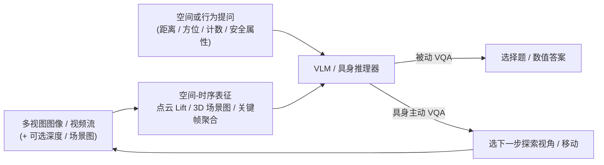

# 3D 空间 VQA（3D Spatial Visual Question Answering）

## 一句话定义

> **3D 空间 VQA** 要求视觉–语言模型基于三维场景的多视角图像或 egocentric 视频流，回答涉及物体间几何距离、相对方位、计数、尺度及行为/路径关系的问答任务，是连接被动语义识别与具身空间决策的核心评测枢纽。

## 英文缩写速查

| 缩写 | 英文全称 | 简要说明 |
|------|----------|----------|
| RGB | Red-Green-Blue | 彩色图像通道，常与深度 (RGB-D) 配合 |
| VLM | Vision-Language Model | 视觉-语言多模态理解模型，VLA 的上游 |
| VLA | Vision-Language-Action | 视觉-语言-动作多模态基础策略方向 |
| LLM | Large Language Model | 大语言模型，常作高层任务/语言接口 |
| LoRA | Low-Rank Adaptation | 低秩增量微调，低成本适配大模型 |
| SFT | Supervised Fine-Tuning | 用监督数据将通用模型适配到特定任务分布 |

## 为什么重要

- **与传统 2D VQA 的差异**：单张 RGB 缺乏可靠尺度与遮挡背后的几何；3D 空间 VQA 逼迫模型利用 **多视图一致性**、**深度/几何先验** 或显式 **场景图**，更接近机器人「在房间里弄明白方位」的需求。
- **与 VLM / VLA 的关系**：网页图文训练的 VLM 擅长语义与外观，但对「左转后哪个物体更近」类 **度量空间关系** 往往偏弱；需要 3D 监督数据（自动或人工）补足。
- **具身主动探测 vs 被动多视角**：**VSI-Bench** 将 egocentric 室内扫描转为被动多类空间 QA；**ESI-Bench**（[实体页](../entities/esi-bench.md)）进一步要求智能体在 OmniGibson 中 **主动探索** 以闭合感知–行动环——其四协议对照表明 **随机额外视角（30 张）的被动多视角协议常因视点杂乱而加噪**，不等价于主动选视角或有序多视角融合（v2 §4）。
- **向动态与人本行为延伸**：在驾驶与共享人类空间中，[MMHU](../entities/paper-mmhu.md)（1.73M 帧 / 57k 人体实例）把街景行人行为写为 13 类闭式 Behavior VQA（如 Qwen2.5-VL 经 LoRA 微调后准确率从 35.31% 提至 67.77%），揭示通用 VLM 对领域安全属性仍高度依赖域内对齐。

## 核心机制与流程总览

1. **场景与时序表示**：点云/网格、多视图帧序列或基于 SMPL 姿态重建的分层描述（如 MMHU 将关节文本与视频关键帧聚合）。
2. **命题生成与校验**：由模板、LLM/VLM 或人机协同管线生成 QA 对（覆盖计数、相对距离、朝向、房间大小或行为判断），并通过正反问（如 MMHU direct vs counter question）过滤格式与随机猜测误差。
3. **模型微调与主动闭环**：被动 QA 在 VLM 上作 LoRA/SFT（保持视觉干路、低秩微调投影与语言层）；具身 VQA 则串联导航/探索动作选视角再推理。

## 工程实践

- **区分“多视图帧数多”与“视角有效”：** 如 ESI-Bench 四协议所示，盲目堆入随机多视角图片反而降低部分模型表现；部署 3D 空间 VQA 前应先做视角去重、位姿索引或主动下一视点筛选。
- **控制数据域差与正负采样均衡：** 自动构造的互联网重建 QA 与实扫数据集在物体密度、尺度与轨迹分布上差异明显；如 MMHU 所示，对长尾类别（如轮椅、踏板车）采用均衡重采样 + 正反双问核验能显著减少微调偏置。
- **切勿直接把 VQA 准确率等价于导航 SR：** 空间 VQA 只评测到“答对问题”，不包含底盘碰撞、末 3 米遮挡或长程记忆管理；落到移动机器人仍需接 [VLN](../tasks/vision-language-navigation.md) 与物理闭环评测。

## 常见误区或局限

- **误区**：「接了深度估计就等于会做 3D VQA。」深度网络给出像素级距离，但 **跨帧组合关系推理**（遮挡重建、相对方位转换、计数）仍是独立难点。
- **误区**：「只在 ScanNet 等标注扫描上训练就足够泛化。」真实部署会遇到家具分布、户型与相机轨迹差异；互联网规模数据与领域视频（如 MMHU 的驾驶行人片段）各自补足不同分布。
- **局限**：封闭选项 QA 容易引入语言先验猜测偏置；若缺乏主动交互、双问一致性核验或真实几何测量对照，高分数可能高估模型真正的 3D 理解力。

## 参考来源

- [SceneVerse++ 原始资料归档](../../sources/repos/sceneverse-pp.md)
- [ESI-Bench 论文通读（arXiv:2605.18746）](../../sources/papers/esi_bench_arxiv_2605_18746.md) — 主动探索 vs 被动多视角的具身空间智能基准
- [MMHU 论文通读（arXiv:2507.12463）](../../sources/papers/mmhu_arxiv_2507_12463.md) — 驾驶人本 13 类 Behavior VQA 与人机协同标注
- Chen et al., *Lifting Unlabeled Internet-level Data for 3D Scene Understanding* (arXiv:2604.01907) — 3D spatial VQA 数据生成与 VSI-Bench 实验设定

## 关联页面

- [SceneVerse++](../entities/sceneverse-pp.md) — 从网页视频构建大规模 3D 空间 VQA 数据
- [ESI-Bench（具身空间智能基准）](../entities/esi-bench.md) — OmniGibson 上的主动探索空间智能评测
- [MMHU](../entities/paper-mmhu.md) — 驾驶场景人体行为 VQA / 运动基准
- [视觉–语言导航（VLN）](../tasks/vision-language-navigation.md) — 从空间问答迈向动作序列导航
- [VLA](../methods/vla.md) — 视觉-语言-动作策略上游表征
- [具身大模型分类学选型闭环（知识链枢纽）](../overview/hub-embodied-foundation-model.md) — 3D 空间 VQA 属五层闭环的 VLM 感知理解层

## 推荐继续阅读

- VSI-Bench 原文与数据卡片（SceneVerse++ 论文中作为主要 3D 空间 VQA 评测之一）
- Hong et al., [ESI-Bench](https://arxiv.org/abs/2605.18746) — 闭合感知–行动环的具身空间智能基准
- Li et al., [MMHU](https://arxiv.org/abs/2507.12463) — 57k 行人实例与 13 类安全行为 VQA
