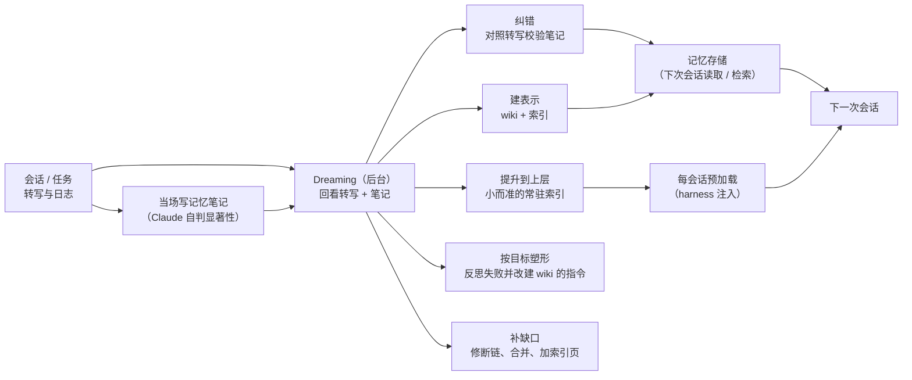

# Agent 记忆与 dreaming（Anthropic：记忆的组成）

## 一句话定义

**Agent 记忆**是 Claude 从经验（与用户的交互、被指派的任务）中获得、在会话之间保留、并以上下文形式存放以供之后读取的知识；**dreaming** 是在空闲时回看过往转写与笔记、用事后信息改进记忆的后台整理过程（Anthropic 博客《The components of agent memory》，2026-11-06，作者表述）。它**不包括**权重更新、上下文内学习与压缩（compaction）。

## 英文缩写速查

| 缩写 / 术语 | 英文全称 | 简要说明 |
|-------------|----------|----------|
| Dreaming | — | 后台回看转写与笔记、整理记忆（类比睡眠时的海马体重放） |
| Sleep-time compute | Sleep-time Compute | 利用交互间隙的空闲算力预先整理上下文（Letta 与 UC Berkeley，arXiv:2504.13171） |
| CL-Bench | Continual Learning Bench | 衡量 agent 用记忆完成长程任务的基准（博文用 1.0 版的数据库问答任务） |
| Harvey LAB | — | 给一批文档、要求生成法律简报并按清单评分的基准（博文自述） |
| Wiki（记忆表示） | — | Claude 自己维护的、相互链接的页面集合，当作记忆的「地图」 |
| Compaction | — | 用摘要替换旧对话轮次以继续工作（不算记忆） |

## 为什么重要

- 当场写笔记需要在「还不知道接下来会发生什么」时判断什么值得记；博文的核心观点是：**记忆有时就是一次预测**——写下规则就是预测该模式会再次相关，而强模型越来越会做这种预测。
- 笔记会写错或随环境漂移，而后来的会话会信任它；dreaming 提供用原始转写这一「事实依据」回头校验的机会。
- 记忆越长越难检索；dreaming 可以建立导航用的表示（wiki、索引），并把最该常驻的内容提升到上层。
- 对具身 / 机器人 agent 的启发是我的推断（博文没有写机器人）：长期运行的机器人同样要在会话间保留「游戏没明说的东西」（环境规律、失败教训、验证过的规则），并防止过时地图类记录污染决策。

## 核心原理

### 当场写笔记：显著性由模型判断

- **CL-Bench 1.0 数据库任务**（每题新会话，仅有持久记忆目录）：Sonnet 4.6 只到提出未检验的猜测；Opus 4.7 合并成单一参考文档并标注已验证 / 未确认；Sonnet 5 在评分后标注确认并写更正；**Opus 5 首次闭环**（规则 + 验证依据 + 先前答案 + 陷阱警告）；Opus 5.5 与 Sonnet 5.5 同样闭环（作者表述）。
- **Pokémon Red**（约 10,000 步）：Sonnet 3.7 写 413 个文件、1 枚徽章，记录迅速过时；Fable 5 写 9 个文件加 `global.md`（目标 / 计划 / 规则）、4 枚徽章；Opus 5.5 同样用小文件夹并通关。要点：存屏幕上读不到的东西（策略、计划、验证过的规则）。
- **引导：** 告诉模型记忆是干什么的，不教它怎么用；规则「只记录失败」让 Opus 5 / 4.7 丢掉大部分记忆收益；引导对较旧模型帮助最大。

### Dreaming 的五种用法

| 用法 | 例子与结果（作者表述） |
|------|------------------------|
| 纠错 | Mt. Moon：笔记误记宠物中心位置；未纠正的运行三次掉回原路线且未到下一城，dreaming 纠正后直接回洞并抵达 Cerulean City |
| 建 wiki 表示 | Stainless 约 35 万文件 / 约 4.2 亿 token，25 题；128 个会话建 wiki，得分 13% → 48%；wiki + 检索 54% → 61%（仅检索 53%，仅 wiki 48%），每题省约 2 万 token；Harvey LAB 并购题（需跨文档综合）wiki 87% 对检索 73%；单文档任务 wiki 无明显增益；另一任务 wiki 比原文还大 |
| 提升到顶层 | harness 在每会话开头预加载；顶层须很小（Claude Code auto memory 只加载 `MEMORY.md` 前 200 行或 25 KB，作索引） |
| 按目标塑形 | 合同事实：多代理共写一张表只保住 41/57（72%）；改为每份合同一页、逐字引条款，57/57（100%） |
| 补缺口 | 第二轮把 9 个指向缺失页的链接改指现有页，新增 3 页（含索引） |

## 工程实践

- **只告诉模型记忆是干什么的**；对前沿模型把「何时写笔记」交给模型自己（有人要求时、或显然值得记时）。
- **让 dreaming 在后台跑：** 可用更强的模型、按易变信息聚焦、按访问频率调节节奏（博文建议方向，未给统一配方）。
- **保持上层小：** 预加载的记忆占 token、错误会带进每个会话；细节下沉并留链接。
- **wiki 与检索搭配：** wiki 对需跨文档综合的问题最有用，与检索工具一起最好；要警惕 wiki 膨胀到比原文还大。
- 动手实现见 [Claude Cookbook：用动态工作流做 dreaming](../entities/claude-cookbook-dreaming-dynamic-workflow.md)（读取已结束会话 → analyzer 蒸馏 → organizer 整理 → 只读挂载 → cron 每晚运行）。

## 局限

- 来源是公司工程博客，评测由作者自己跑、数字多来自文中图表（**图片本身我没读，只读正文与图注**），Pokémon 与 CL-Bench 的比较都是单次运行或少量任务，不是严格统计；模型名与基准版本按原文转述，未独立核实。
- 作者自述的开放问题：何时创建记忆（当场写会分散主任务注意力，dreaming 产物不一定立刻可用）；如何保持更新（dreaming 要算力，持续检查所有记忆不现实）；表示需要维护算力并防止累积错误或幻觉；以转写检索为基础是否足够。
- 文章没有涉及机器人或具身场景，对机器人的含义是本页的推断。

## 关联页面

- [Claude Cookbook：用动态工作流做 dreaming](../entities/claude-cookbook-dreaming-dynamic-workflow.md)
- [LLM Wiki（Karpathy）](../references/llm-wiki-karpathy.md) — 本库自身的 wiki 模式，与「wiki 作为记忆表示」同构
- [Robot In-Context Learning](./robot-in-context-learning.md)
- [AI Agent 评测](./ai-agent-evaluation.md)
- [JitRL：免梯度的测试时经验检索与 logit 修正](../entities/paper-jitrl-just-in-time-rl.md)（经验库 + 推理时修正，论文实验在 WebArena / Jericho）
- [Agentic Coding 软件基础](./agentic-coding-software-fundamentals.md)
- [MemForest（agent 记忆论文节点）](../entities/paper-memforest.md)
- [RoboCasa-Mem（长程移动操作中的环境与过程记忆基准）](../entities/paper-robocasa-mem.md)

## 参考来源

- [Anthropic：The components of agent memory（归档）](../../sources/blogs/anthropic_components_of_agent_memory_2026-11-06.md)
- [Claude Cookbook：Dreaming with a dynamic workflow（归档）](../../sources/sites/claude_cookbook_dreaming_dynamic_workflow_2026-11-02.md)
- [Sleep-time Compute（arXiv:2504.13171）](https://arxiv.org/abs/2504.13171)

## 推荐继续阅读

- [Anthropic 博客原文](https://www.anthropic.com/research/components-of-agent-memory)
- [Cookbook 页面](https://platform.claude.com/cookbook/managed-agents-cma-dreaming-with-a-dynamic-workflow)
