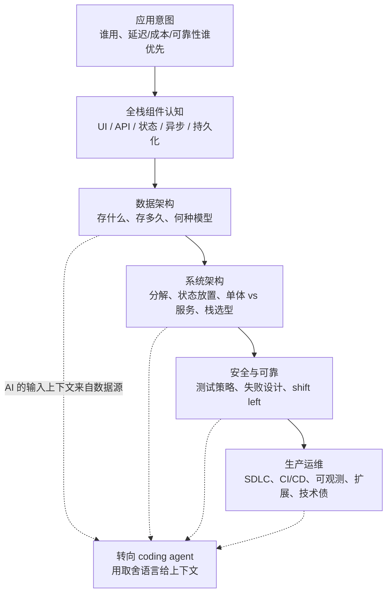

# Agentic Coding 时代的软件工程基础

**AI Engineering Skills Map: Software Engineering Fundamentals**

## 一句话定义

即便 coding agent 写完全部代码，软件工程基础仍是 **转向（steer）取舍** 的前提：不会用延迟 / 可用 / 一致 / 可靠 / 可维护 / 简洁 / 成本这些语言给上下文，agent 就会替你做坏选择。

## 英文缩写速查

| 缩写 | 英文全称 | 简要说明 |
|------|----------|----------|
| SE | Software Engineering | 本页五项基础技能的总称；不是「会写语法」 |
| SDLC | Software Development Lifecycle | 构建/测试之外还含部署环境、发布策略、CI/CD、IaaS |
| CI/CD | Continuous Integration / Continuous Delivery | 生产运维技能里的部署自动化 |
| IaaS | Infrastructure as a Service | 把运行环境当可配置基础设施，而不是本机脚本 |
| API | Application Programming Interface | 全栈技能中的接口选择与设计，决定前后端边界 |

## 为什么重要（对本知识库读者）

- **把代码生成接到可执行体验评估。** [Recursive Game Creator](../entities/paper-recursive-game-creator.md) 用复用策略收集游戏轨迹，再让 Reviewer 据此推进下一轮修改；它展示了 agent 交付后的评估闭环，也清楚限定在游戏软件场景。
- **本库已有「agent 怎么干活」的页，缺「人还该懂什么」。** [mattpocock/skills](../entities/mattpocock-skills.md) 与 [Superpowers](../entities/superpowers-obra.md) 给的是 **技能文件与流程契约**；[Open Code Review](../entities/open-code-review.md) 把 **diff 级评审** 工程化为可审计 CLI；本页给的是 **判断框架**：没有取舍语言，那些 skill 只会加快产出坏架构。
- **真机 / 仿真闭环同构。** [ENPIRE](../methods/enpire.md) 与 [autoresearch harness](../queries/real-robot-policy-autoresearch-harness.md) 反复强调：有 coding agent **不能**跳过环境工程。吴恩达把同一句话写到通用软件：有 agent **不能**跳过对 latency、可靠性、数据生命周期的理解。
- **数据是难改的地基，也是模型的上下文。** 机器人侧的轨迹集、回放缓冲、[数据飞轮](./data-flywheel.md) 一旦 schema 选错，后续策略与评测都在错误上下文上训练——对应原文「AI doesn’t know what it doesn’t know」。
- **语法记忆正在过时，原理没有。** 过时的是背 API 签名；没过时的是知道原型架构、首版生产架构、规模化架构是三个不同目标。

## 核心原理

吴恩达团队把 AI 工程技能图拆成四支柱：**构建与部署 AI 应用 / 软件工程基础 / 使用 coding agents / 塑造构建（shaping the build）**。本页对应第二支柱（2026-08-28 长文）。主张可以压成一句：

> Agent 改变 **如何写** 软件（包括不含 AI 的软件）；人仍要决定 **哪些取舍存在、当前该选哪一边**。

五项技能不是并列课程清单，而是一条从「能改全栈」到「能上生产」的能力链：

| 技能 | 人必须保留的判断 | Agent 容易代劳、却容易代劳错的部分 |
|------|------------------|--------------------------------------|
| **全栈** | 前后端边界、认证与会话、缓存该不该有 | 补你不熟的那一层样板代码 |
| **数据** | 访问模式、保留策略、一致性/新鲜度、治理 | schema 迁移脚本、CRUD |
| **架构** | 当前阶段（原型 / 首版生产 / 规模）该多复杂 | 框架脚手架、微服务拆分冲动 |
| **安全可靠** | 测什么、失败时降级到哪、爆炸半径 | 扫漏洞、补测试文件 |
| **生产运维** | 发布策略、告警阈值、真实负载、技术债优先级 | CI YAML、扩容模板 |

关键机制：**转向语言**。不会说「这里要牺牲一点延迟换一致性」的人，无法给 agent 正确上下文；agent 默认优化的是「看起来能跑」，不是你的约束。

## 工程实践（映射到机器人栈）

不要把五项读成 Web 课表。对训练 / 仿真 / 真机栈，对应关系大致是：

| 技能 | 机器人研究与工程里的读法 |
|------|--------------------------|
| **全栈** | 训练脚本、日志/可视化、评测面板、机器人 API、异步采集与回放是同一系统；只会写 `train.py` 或只会改前端 dashboard，都无法转向 agent 改另一层。 |
| **数据** | 轨迹格式、保留多久、train/eval 泄漏、sim 日志 vs 真机日志、谁有权看相机流。schema 选错会污染整个 [数据飞轮](./data-flywheel.md)。面向 agent 的数据基础设施（让 agent 自己读 trace / 写评测）仍在快速变。 |
| **架构** | 单机 Isaac 实验 ≠ 机队采集服务 ≠ 云端训练 + 边缘推理。原型用单体 notebook 没问题；把同一结构直接「agent 拆成微服务」通常是错阶段。 |
| **安全可靠** | 单测脚本 + 集成 sim rollout；真机失败要 **优雅停机 / 缩小爆炸半径**（坏策略不要扩散到整机队）。「先写策略再补安全」等于没做 shift left。 |
| **生产运维** | 策略发布、checkpoint 版本、CI（本库是 `make ci-preflight`）、机队可观测与事故。技术债是训练配方与数据管道的老化，不只是代码风格。 |

落地时优先做三件事：

1. **先写约束，再让 agent 写代码。** 延迟预算、失败时允许的行为、数据保留与隐私，写进 prompt / `CONTEXT.md` / 评测，而不是事后抱怨 agent「乱选」。
2. **用评测闭环代替语感。** 与 [autoresearch harness](../queries/real-robot-policy-autoresearch-harness.md) 一致：没有自动 verify，agent 只能 vibe。软件侧对应单测/集成/负载；真机侧对应 reset + 自动判分。
3. **架构按阶段换，不按潮流换。** 原型简单、生产加可观测与降级、规模化再动数据分片与服务边界。让 agent 「按大厂模板生成」往往跳阶段。

### Agent 吞吐上升后，开发基础设施会成为瓶颈

Anthropic 的 Scion 案例把上述「生产运维」判断推到极端：该公司报告每日合并量在 2026 年 5 月至 9 月从约 2,500 增至超过 30,000，主分支历史接近 100 GB、CI 每天约 2,500 万次 checkout。团队发现瓶颈逐渐从写代码转向源码控制、构建和 CI。

其内部版本控制系统 Scion 将服务器设为权威端，以增量 changeset 和内容寻址对象保存变更，另建 blame、路径历史等派生索引；客户端按需取稀疏文件，缓存分层提供对象，并通过 API 回答 diff、merge base 等元数据问题。Anthropic 报告 checkout 快约两个数量级、镜像基础设施 CPU 与内存需求下降 200 倍、CI 释放约 25% CPU 容量。数据属于单家公司内部工作负载报告，不能直接外推到普通团队。

对机器人团队更可迁移的做法是先量化 coding agent 带来的提交频率、全量/稀疏 checkout 成本、CI 排队时间和评审吞吐，再决定优化点。Scion 本身未开源，Anthropic 也明确不建议把它视为通用 Git 替代品；它依赖定制的代码评审、代码搜索和 CI 配套系统。详细设计与边界见 [Anthropic 的 Scion 工程文章](../../sources/blogs/anthropic_redesigning_source_control_2026-10-13.md)。[Jujutsu（jj）](../entities/jujutsu.md) 则是公开可用、面向 Git 互通的版本控制工具，重点在更容易恢复的操作模型与无暂存区工作流；它解决的是日常版本控制交互，不是 Scion 面向超大规模基础设施的源码存储问题。

### Agent 吞吐上升后，代码评审也要分层

Anthropic 的 Claude Code 团队把审查目标定义为：降低每项变更消耗的人工时间，同时不提高回滚或事故率。其流程将检查分布在 PR 前后：作者先让 agent 运行测试、构建或界面核验，并请独立上下文检查 diff；PR 上再进行 AI 缺陷审查、安全检查和常规 CI。重复出现的问题沉淀为仓库评审说明或 lint 规则。

人工审批随变更风险调整：低风险文档改动在自动检查通过后可不要求额外审批；普通改动由一人审批；高风险代码由两人审批，CI 等敏感路径始终保留人工把关。合并队列会针对合入 main 后的状态重跑检查，功能开关和分阶段发布则缩小问题影响范围。事故和回滚案例进入 reviewer 评测集；审查轮次设上限，后续聚焦新增 diff，以减少重复发现旧问题造成的返工。

团队报告称，2026 年 6 月至 9 月合并 PR 数量超过翻倍，需要回滚的 PR 占比下降超过 40%。这些数据来自 Anthropic 自身代码库，不能直接外推；尤其涉及真机安全或高风险基础设施时，审批和验证门槛应由实际失效成本决定。方法细节见 [Claude Code 团队的代码评审文章](../../sources/blogs/anthropic_claude_code_review_2026-10-15.md)。

- **经验数据补充：** [Agent-Friendly by Design](../entities/paper-agent-friendly-by-design.md) 用相同规格与隐藏测试比较 Claude Opus 5.5 写 MoonBit 和 Rust：成本接近、MoonBit 输出源码 token 少约 12%，但编译失败率更高。小样本结果说明语言熟悉度、primer 和测试反馈都应纳入 agent 编程评测；不能据此给编程语言作普遍排名。

### Agent 维护遗留代码与实验：先找证据，再交给人审

OpenAI Core Experimentation 报告了另一类 coding-agent 工作流：GPT-6 Astra 可从代码、历史 PR、配置、讨论记录与生产 profile 汇总证据，协助清理死代码和过期实验；后续用 GPT-6.1 Sol 比较发现数与 API 成本。其内部案例还包括用 CI 历史排序优化机会、修复 flaky tests。细节与原始数据见 [OpenAI 工程博客归档](../../sources/blogs/openai_gpt6_software_maintenance_2026-10-14.md)。

对机器人仓库可迁移的部分是**候选发现 + 证据审查 + 小 PR + 回归**：检查旧实验开关、过期 checkpoint / launch 参数或慢测试时，要求 agent 列出所有引用、配置状态、运行证据、预期收益与不确定项；再由维护者确认仿真/部署行为未变。急停、降级、回滚与事故恢复逻辑可能是刻意少触发的保护路径，不能按普通死代码处理。此机器人映射是基于文章的工程推论；OpenAI 原文讲的是其软件服务。

文中的量化数据属于特定内部仓库和工作负载：GPT-6.1 Sol Ultra 在该次实验里以约 14% API 成本得到 Astra Ultra 92% 的发现数；约 30 个 CI 优化 PR 后，中位耗时由约 10 分钟降至 4.5 分钟。它们适合作为「对照发现率、成本和回归质量」的例子，不构成其他团队可直接复现的收益承诺。文章建议从单个小维护任务开始，review 结果后再逐步扩大范围。

## 局限与风险

- **误区：会用 Cursor / Claude Code = 具备软件工程基础。** 工具降低的是击键成本；取舍识别仍是人的技能。吴恩达原文把「语法记忆」标为过时，把「软件如何工作」标为拉开差距的部分。
- **误区：本页五项可以替代「用 coding agent」与「塑造构建」。** 它们是四支柱里的一根；后两篇站内暂未收录。不要把本页读成完整 AI 工程课表。
- **误区：SWE 基础 = 能做机器人科研。** [AI Auto-Research](./ai-auto-research.md) 已区分 SWE-bench 高分与研究级实验；本页解决的是 **应用/栈层的取舍**，不是假设质量或论文论证。
- **商业语境。** 技能图来自职位与招聘访谈，也服务 DeepLearning.AI 的教育叙事。当学习清单用，不要当中立劳动力市场论文。
- **无代码可复现。** 步骤 2.5：**不适用**（论述文，无项目仓）。

## 关联页面

- [Astra Games / Awesome GPT-6 Astra](../entities/astra-games.md) — 从可演示作品观察参数交互、暂停和测试边界；目录归因不构成模型基准。

- [Spec-Driven Development（DeepLearning.AI 短课）](../entities/course-spec-driven-development-coding-agents.md) — constitution + feature spec 的 plan-implement-verify 可跟做模板
- [Skills For Real Engineers（mattpocock）](../entities/mattpocock-skills.md) — 用 grill / TDD / 架构卫生对抗 vibe coding 的可安装技能
- [Archify](../entities/archify.md) — 把已决定的服务边界 / 数据流画成可校验 HTML；不替代本页的架构取舍
- [Birdview](../entities/birdview.md) — 改码前先 map 仓库模块与计划 scope；不替代 diff 或架构判断本身
- [Superpowers（obra）](../entities/superpowers-obra.md) — brainstorm → worktree → TDD → 评审的代理交付管线
- [Agentic Design Patterns](../entities/agentic-design-patterns.md) — 通用 agent 模式目录及 coding agents 附录；不是软件工程验证的替代品
- [Tidy Design](../entities/tidy-design.md) — 将可编辑设计画布接入 coding agent 的 MCP 工作流
- [NVIDIA OpenShell](../entities/nvidia-openshell.md) — 带外沙箱与 YAML 策略；与 prompt 级「安全可靠」互补
- [CodeGraph](../entities/codegraph.md) — 通过本地代码关系图向 coding agent 提供符号上下文与变更影响线索；静态图不能替代测试与运行时核验
- [真机策略 autoresearch 闭环](../queries/real-robot-policy-autoresearch-harness.md) — 有 agent 仍要先做 reset/verify 环境工程
- [ENPIRE](../methods/enpire.md) — coding agent 真机策略自改进；核心贡献是环境接口不是模型
- [AI Auto-Research](./ai-auto-research.md) — 研究全生命周期自动化；SWE 能力与科研能力不等价
- [Data Flywheel](./data-flywheel.md) — 数据生命周期与回流；对应本页「Managing data」
- [LLM Wiki（Karpathy 模式）](../references/llm-wiki-karpathy.md) — 把判断编译进持久 wiki，而不是每次让 agent 从零 vibe

## 参考来源

- [Andrew Ng，AI Engineering Skills Map: Software engineering fundamentals（本站归档）](../../sources/blogs/andrew_ng_ai_engineering_skills_se_fundamentals.md)
- [Anthropic，Redesigning source control at Anthropic（本站归档）](../../sources/blogs/anthropic_redesigning_source_control_2026-10-13.md)
- [Anthropic，How the Claude Code team does code review（本站归档）](../../sources/blogs/anthropic_claude_code_review_2026-10-15.md)
- [OpenAI，Maintaining software with the GPT-6 family（本站归档）](../../sources/blogs/openai_gpt6_software_maintenance_2026-10-14.md)
- 触发推文：<https://x.com/andrewyng/status/2093388974194872781>
- X Article：<https://x.com/i/article/2093384274372419585>
- *The Batch* 同文：<https://www.deeplearning.ai/the-batch/the-ai-engineering-skills-map-in-detail-software-engineering-fundamentals>

## 推荐继续阅读

- Andrew Ng，[The AI Engineering Skills Map](https://www.linkedin.com/pulse/ai-engineering-skills-map-andrew-ng-m479c) — 四支柱总图（职位/访谈依据）
- Andrew Ng，[AI Engineering Skills Map: Building and deploying AI applications](https://www.linkedin.com/pulse/ai-engineering-skills-map-building-deploying-ai-applications-andrew-ng-gyn5e) — 同系列上一篇（LLM、grounding、agentic systems、eval-driven、生产、ML 基础）
- [mattpocock/skills](https://github.com/mattpocock/skills) — 把「不要 vibe coding」落成可安装工程习惯
