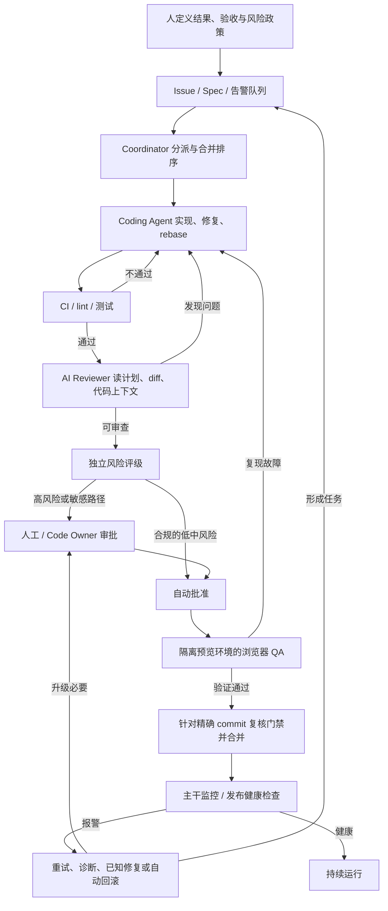

# Agent-first 软件工厂与 Harness Engineering

**Agent-first Software Factory & Harness Engineering — 从生成代码走向可验证交付**

## 一句话定义

软件工厂不是“让 agent 多写代码”，而是把 **需求、变更、CI、评审、风险审批、端到端 QA、主干故障恢复和任务协调** 变成持续运行、可观察且可回退的交付流水线；Harness Engineering 则为这条线提供 agent 可理解的仓库、可操作环境、机械门禁及反馈回路。

## 英文缩写速查

| 缩写 | 英文全称 | 简要说明 |
|------|----------|----------|
| CI | Continuous Integration | 编译、lint、测试和合并前的自动验证 |
| PR | Pull Request | 变更及审查、批准、合并的协作单元 |
| QA | Quality Assurance | 端到端产品体验与功能验证 |
| CDP | Chrome DevTools Protocol | Agent 操作页面并采集 DOM、截图等证据的接口 |
| SLO | Service Level Objective | 交付或运行时可量化的目标阈值 |

## 为什么重要

- **瓶颈会迁移。** Runway 先遇到 agent 大量编写代码后的 PR 评审与审批积压，再遇到 QA、主干修复和任务调度瓶颈；仅提高代码生成速度不能解决整条流水线。
- **Agent 的上下文应可操作。** OpenAI 的实验把 worktree、浏览器、日志、指标、trace、仓库文档和检查脚本暴露给 Codex；“给 agent 一句万能提示词”无法替代验证环境。
- **目标抽象先于流程自动化。** Felix Rieseberg 把雄心区分为 Speed / Altitude / Depth / Range，要求从完成任务走向真正的业务结果，用专业方法和外部判据验收。软件工厂是这种“高度”在软件交付中的一个实例，而不是 Felix 的具体实现。

## 核心原理

### 两类经验的分工

| 维度 | Runway：交付工位 | OpenAI：Harness 基础设施 | Felix：问题设定 |
|------|------------------|-------------------------|----------------|
| 任务入口 | issue / spec / 告警送入协调器 | 明确意图、接受条件、可执行计划 | 把单项任务升为结果目标 |
| 生成与修复 | agent 维护 PR 到 CI 绿灯 | 可查询仓库知识，隔离 worktree 启动应用 | 使用真正的工具与原始数据 |
| 验证与审批 | 上下文 AI review、风险分级、人工 owner 门禁 | 代码/架构 lint、浏览器/可观测性闭环 | 用独立评判而非模型自评 |
| 长期维护 | main 告警诊断、发布回滚、任务调度 | golden principles、doc-gardening、反漂移 | 用跨领域方法寻找瓶颈 |

### 可核实的主干流程图

下图抽象自 **Runway 的七工位与协调器**；OpenAI 的 repo knowledge/可观测性是给工位提供证据的基础设施，而非另一个必定共享代码的模块。

### 数字证据与口径

- **Runway：** 2026 年 10 月，云 agent 可归因的合并 PR 份额为 **38%**（6 月 **0.1%**）；可比六仓库周均合并数从 9 月 **929** 到 10 月中旬后 **2,235**（约 **2.4×**）；核心 API 仓库首次审批中位等待由约 **2.3 小时** 降至约 **5 分钟**。这是前后观察，无法单凭数字归因到某一工位。
- **Runway QA：** 首四天识别 **86** 个确认 bug，其中 **74** 个在该四天修复、**67** 个经重跑核验。不同统计窗口不能混用。
- **Runway 风险：** 2026 年 10–11 月 AI-only approval 回滚率约 **0.10%**，人工审批组约 **0.5%**；两组变更风险构成不同，**不得当成 AI 审批优越性因果证据**。
- **OpenAI：** 内部实验约五个月由三名工程师推动约 **1,500** 个合并 PR、约百万行 agent 生成代码；“人工开发用时的 1/10”是作者估计，并非对外统一的效能基准。

## 工程实践

可以先在纯软件 / 仿真环境用以下顺序建立流水线，而非立即授权真机自治：

1. **目标与判据：** 需求明确成功条件、失败回退、可受理的风险等级；让 agent 读真实 issue、环境和已有规则。
2. **能力前置：** 把启动、构建、lint、可复位测试环境、观测数据、日志指标统一成工具接口；仓库 AGENTS.md 做索引，细节放在可版本化文档。
3. **关闭反馈回路：** agent 自行跑 CI，独立审查 diff，按风险交给自动或人工审批；高风险路径保持不可跳过的人工门禁。
4. **验证真实行为：** 在隔离 preview 或仿真中执行 E2E 测试，保留失败复现、变更 commit 和重新验证的证据。
5. **保护发布：** 合并前对**当前 commit** 再查门禁，主干红时暂停合并；警报诊断、幂等重试、回滚与人工升级都有明文策略。
6. **长期维护：** 度量返工率、审查意见再现、审批等待、回滚率、验证覆盖；把重复故障变成 lint/测试/文档规则，定期清理漂移。

### 对机器人栈的映射（工程推论，非三篇文章的实机试验）

| 软件工厂 | 机器人研究 / 交付环境 |
|----------|-----------------------|
| preview environment / browser QA | 可复位 Isaac Lab 或 MuJoCo 场景、固定扰动种子与回放 |
| CI + review | 代码检查、策略 I/O 契约、rollout 成功率与回归、独立 review |
| main / deploy watchdog | 版本化 checkpoint、部署门禁、机队监控与可回退版本 |
| risk-based human owner | 电机限幅、碰撞、急停、密钥与真机控制路径始终人工审核 |

与 [真机策略 autoresearch 指南](../queries/real-robot-policy-autoresearch-harness.md) 的 **自动 reset + 自动 verification** 前提一致。真实机器人无法像软件服务一样随意回滚物理后果，因此仿真验证通过也不意味着可无人监管执行危险动作。

## 局限与风险

- **证据类型：** 三篇均为作者/组织的实践与论述，非机器人 benchmark 或跨团队随机试验；Runway/OpenAI 的内部吞吐、回滚率不能直接外推。
- **发布边界：** 两篇工程文章没有公开完整内部产品/工厂可运行仓库；**源码运行时序图不适用**，以上仅是由原文描述核实的工作流图，不能当作源码调用栈。
- **模型自审并非充分验证：** 需要真实 CI/预览/回归数据，且对认证、密钥、数据库迁移与物理控制保留额外审查。
- **流程开销：** 仓库太小、低风险原型或缺可复位环境时，复杂协调器会提高维护成本；先记录瓶颈，再决定要自动化哪一工位。

## 关联页面

- [Uber 的 Agent 技能分发与评测](../entities/uber-agent-skills-platform.md)：用调用遥测、隔离评测和故障回流治理共享技能。

- [Agentic Coding 时代的软件工程基础](./agentic-coding-software-fundamentals.md) — 工程师必须保留的系统设计与可靠性取舍
- [多 Agent 编码管理与认知把关](./coding-agent-orchestration-and-cognitive-oversight.md) — 工作分解、认知风险与角色划分
- [Coding Agent 验证与代码评审分工](../comparisons/coding-agent-verification-vs-code-review.md) — 测试证据与审批职责不混淆
- [LLM Wiki（Karpathy 模式）](./llm-wiki-karpathy.md) — 仓库知识作为持久、可导航上下文
- [真机策略 autoresearch 闭环](../queries/real-robot-policy-autoresearch-harness.md) — robot-side 自动复位/评分前提
- [ENPIRE](../methods/enpire.md) — 真机策略自改进的环境边界

## 参考来源

- [Runway：Building a Software Factory（原文归档）](../../sources/blogs/runway_building_a_software_factory_2026-11-20.md)
- [OpenAI：Harness Engineering（原文归档）](../../sources/blogs/openai_harness_engineering_2026-02-11.md)
- [Felix Rieseberg：How to be more ambitious（原文归档）](../../sources/blogs/felix_rieseberg_how_to_be_more_ambitious_2026-10-13.md)

## 推荐继续阅读

- [Runway 官方工程文章](https://runway.com/news/engineering/building-a-software-factory) — 按工位观察流量和风险闸门
- [OpenAI Harness Engineering](https://openai.com/index/harness-engineering/) — 仓库知识、工具环境、机械约束与自治的基础设施
- [Felix Rieseberg 原文](https://felixrieseberg.com/how-to-be-more-ambitious-a-tutorial-for-humans-with-models/) — Speed / Altitude / Depth / Range 目标设计法
