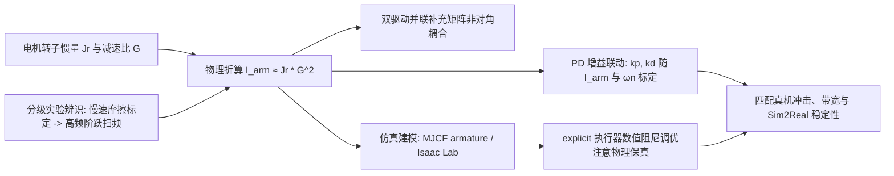

# Armature Modeling（电枢惯量建模）

## 一句话定义

**电枢惯量（Armature Inertia / Reflected Rotor Inertia）** 是电机转子转动惯量经减速比平方（$G^2$）反射到关节输出侧的等效转动惯量；准确建模并辨识该项，是高减速比关节在仿真器中匹配真机冲击、带宽与 PD 稳定性的物理基础。

## 英文缩写速查

| 缩写 | 英文全称 | 简要说明 |
|------|----------|----------|
| Sim2Real | Simulation to Real | 把仿真中学到的策略迁移落地真机的工程主线 |
| PD | Proportional–Derivative | 关节位置/阻抗底层控制，策略输出常为其 setpoint |
| MuJoCo | Multi-Joint dynamics with Contact | 接触丰富的刚体物理仿真引擎 |
| MJCF | MuJoCo XML Format | MuJoCo 的模型与场景描述格式 |
| Isaac Gym | NVIDIA Isaac Gym | GPU 并行刚体仿真训练环境 |
| Isaac Lab | NVIDIA Isaac Lab | 基于 Omniverse 的机器人学习训练框架 |
| URDF | Unified Robot Description Format | 统一机器人描述格式 |

## 为什么重要

在传统的刚体动力学（如 Pinocchio, Drake 默认配置）中，往往只考虑连杆的质量 and 惯量。但在使用高减速比（如 1:10 以上）的机器人中，电机的转子惯量在关节侧会被放大 **$G^2$** 倍（$G$ 为减速比），甚至可能超过连杆自身的惯量。

- **动态响应**：忽略 Armature 会导致仿真中的关节比现实中表现得更“轻”、响应更“脆”。
- **控制稳定性**：如果仿真中没有建模 Armature，但现实中存在巨大的反射惯量，训练出的策略在真机上容易产生高频振荡。
- **PD 增益设计**：合理的 PD 增益应与关节的总惯量（连杆惯量 + Armature）成比例。

## 核心原理：物理定义与计算

对于一个典型的执行器系统：
- $J_r$：电机转子的转动惯量。
- $g_1, g_2, \dots$：各级减速比。
- $J_1, J_2, \dots$：中间各级齿轮的转动惯量。

### 单驱动关节
反射到关节端的总等效惯量（Armature）计算公式：

$$
I_{arm} = J_r \cdot (\prod g_i)^2 + \sum (J_k \cdot (\prod_{i>k} g_i)^2)
$$

在大多数工程实践中，简化为：
$$
I_{arm} \approx J_r \cdot G^2
$$

### 双驱动关节（如交叉轴或并联机构）
如果一个自由度由两个完全相同的执行器共同驱动：
$$
I_{arm, total} = 2 \cdot I_{arm, single}
$$

## 在仿真器中的实现

### MuJoCo
在 MJCF 文件中，可以通过 `armature` 属性直接设置：
```xml
<joint name="knee_joint" armature="0.012" ... />
```
它加在质量矩阵对角线上，顺带让接触求解更稳，因而常被当成数值旋钮。但随便改 `armature` 等于改 $J_{\mathrm{eff}}$，关节响应时间尺度会全错。并联机构的有效惯量是矩阵，两个对角 `armature` **装不下非对角耦合**——耦合显著时要上显式并联模型，见 [关节动力学辨识实验设计](../methods/sim2real-joint-sysid-experiment-design.md) 与 [人形并联关节解算](./humanoid-parallel-joint-kinematics.md)。

### Isaac Gym / Isaac Lab
在 `ArticulatedView` 或机器人描述配置中，可以手动计算并补偿到关节的动态参数中，或者在 `SimConfig` 中通过 `armature` 属性全局或局部设置。Isaac Lab 文档指出：使用 **explicit** 执行器（用户侧算力矩）时若数值不稳定，可 **增大 `armature`** 阻尼关节响应；这与 [Implicit / Explicit 执行器建模](./implicit-explicit-actuator-modeling.md) 中的稳定性建议一致。

## 工程实践（BeyondMimic 与分级辨识）

### 1. BeyondMimic 参数化实践

[BeyondMimic](../methods/beyondmimic.md) 强调精确建模 Armature 是减少 Sim2Real 差距的核心手段：
1. **精确计算**：不再将 `armature` 视为仿真调参的旋钮，而是依据电机手册转子惯量与减速比计算 $I_{\mathrm{arm}} = J_{\mathrm{rotor}} G^2$（对应 *Modern Robotics* Sec. 8.9.2–8.9.3 的表观惯量）并实测校验。
2. **PD 增益关联**：
   - 设定自然频率 $\omega = 2\pi \times 10$ Hz，阻尼比 $\zeta = 2.0$；
   - 则 $k_p = I_{\mathrm{arm}} \cdot \omega^2$，$k_d = 2 \cdot I_{\mathrm{arm}} \cdot \zeta \cdot \omega$。

### 2. 分级实验辨识（FreeDof Sim2Real 路径）

- 不可直接拿闭环阶跃曲线同时拟合 `armature`、延迟、阻尼与摩擦（结构不可辨识会导致错误互相掩盖）；应先做无外载慢速标定摩擦、再用高频力矩阶跃/扫频分离折算惯量与通信延迟。

## 机制与关系图



## 常见误区或局限

- **把 `armature` 当万能数值稳定旋钮**：虽然显式执行器积分时加大 `armature` 能抑制震荡，但过度偏离物理值会扭曲碰撞冲量、步态回弹频率与电机反驱特性。
- **忽略减速比与并联交叉耦合**：高减速比下 $G^2 I_{\mathrm{rotor}}$ 可大于连杆自身惯量；双驱动并联或差速机构（如脚踝）的对角 `armature` 项无法表达非对角惯量耦合，需从闭合链路动力学矩阵导出或通过独立辨识核对。

## 关联页面

- [仿真物理保真度链路选型指南](../queries/simulation-physics-fidelity.md) — 本页所述物理/仿真要素在保真度链路（建模 ① → 数值 ② → 接触 ③ → 随机化 ④）中的定位
- [连杆惯量与转子惯量](./robot-link-and-rotor-inertia.md) — URDF link 惯量 vs 关节 `armature` 的分工与一手来源索引
- [BeyondMimic](../methods/beyondmimic.md) — 强调 armature 精确建模的代表性模仿学习框架。
- [Implicit / Explicit 执行器建模](./implicit-explicit-actuator-modeling.md) — explicit 执行器不稳定时的 `armature` 调参语境。
- [Actuator Network (执行器网络)](../methods/actuator-network.md) — 更复杂的执行器建模方式（如神经网络模拟）。
- [System Identification (系统辨识)](./system-identification.md) — Armature 是系统辨识中的关键物理参数。
- [关节执行器参数辨识](../methods/joint-actuator-parameter-identification.md) — 手册 $J_r G^2$ 只是初值；数据怎么估 $I_a$
- [关节动力学辨识实验设计](../methods/sim2real-joint-sysid-experiment-design.md) — 不要把 `armature` 当旋钮；并联时对角项装不下耦合
- [人形机器人并联关节解算](./humanoid-parallel-joint-kinematics.md) — 双驱动并联路径上的几何/力映射与惯量建模分工
- [执行器驱动链选型闭环知识链](../queries/actuator-drive-chain-selection-loop.md) — armature（转子等效惯量）是③层执行器建模写回仿真的关键参数
- [阻尼系统（ζ, ωₙ）](../formalizations/damped-systems.md) — $I_{\mathrm{arm}}$ 进入 $\omega_n=\sqrt{K_p/J_{\mathrm{eff}}}$ 的时间尺度

## 参考来源

- [自由度FreeDof：Sim2Real 动力学辨识](../../sources/blogs/wechat_freedof_sim2real_dynamics_identification.md) — `armature` 是物理量；$G^2$ 折算与并联矩阵容量
- [Modern Robotics Ch. 8.9 Actuators](../../sources/papers/modern_robotics_ch8_actuators.md) — Sec. 8.9.2–8.9.3 转子表观/反射惯量 $G^2 I_{\text{rotor}}$ 教材推导
- [Isaac Lab Implicit / Explicit Actuators](../../sources/courses/isaac_lab_implicit_explicit_actuators.md) — 执行器反射惯量配置与数值稳定性
- [机器人连杆惯量与转子惯量（一手资料索引）](../../sources/papers/robot_link_rotor_inertia_primary_refs.md) — MuJoCo `armature` / 反射惯量 $G^2$ 官方定义
- [sources/papers/motion_control_projects.md](../../sources/papers/motion_control_projects.md) — 飞书公开文档《开源运动控制项目》总结。
- BeyondMimic 技术报告关于物理建模的部分。

## 推荐继续阅读

- [robot-link-and-rotor-inertia](./robot-link-and-rotor-inertia.md) — 区分 URDF `<inertial>` 与关节 `armature`
- [sim2real-joint-sysid-experiment-design](../methods/sim2real-joint-sysid-experiment-design.md) — 解耦惯量、延迟、摩擦与阻尼的分级实验设计
