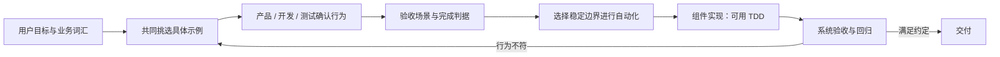

# 行为驱动与验收测试驱动开发（BDD / ATDD）

**行为驱动开发（Behavior-Driven Development, BDD）** 通过共享领域语言和具体例子，让业务、产品与技术团队对系统行为形成共同理解；**验收测试驱动开发（Acceptance Test-Driven Development, ATDD）** 则突出在实现前由客户、开发者和测试人员协作写出验收测试。两者历史与实践高度重叠，但不应简化成“某一种 Gherkin 语法”。

## 英文缩写速查

| 缩写 | 英文全称 | 简要说明 |
|------|----------|----------|
| BDD | Behavior-Driven Development | 以共享行为示例促进协作与自动化反馈 |
| ATDD | Acceptance Test-Driven Development | 先由多角色协作定义验收测试 |
| GWT | Given–When–Then | 表达前置条件、事件和预期结果的常见场景格式 |
| Ubiquitous Language | Domain language shared by stakeholders and code | 团队与代码共用的领域词汇 |
| E2E | End-to-End | 从外部观察完整产品流程的测试层级 |

## 先例子，再自动化

1. **挑具体例子：** 说明谁在什么条件下做了什么，系统应该产生什么可观察结果。
2. **检查分歧：** 产品/客户、开发和测试人员对同一个例子能否给出相同判定？如不能，继续澄清规则与例外。
3. **转为验收条件：** 选取少量有代表性的正常、边界与失败场景，作为“什么算完成”的共同依据。
4. **自动化值得稳定的例子：** 可用 API/服务层行为测试或较少量 UI/E2E 检查，避免所有规则都压到脆弱的浏览器步骤。
5. **实现与反馈：** 由 TDD 或其他短反馈循环实现；验收场景失败时回到需求协作，判断是规格、实现还是测试假设有问题。

## BDD 和 ATDD 的区别与重叠

| 维度 | BDD 常见强调 | ATDD 常见强调 |
|---|---|---|
| 核心问题 | 系统在特定上下文下应呈现什么行为？ | 客户/团队如何判断这一需求已完成？ |
| 参与焦点 | 用领域语言、故事和例子建立共享理解 | 客户、测试、开发等不同视角共写验收测试 |
| 常见产物 | 场景、行为规格、可执行示例 | 实现前达成一致的验收条件/测试 |
| 自动化 | 可以自动化，不是必需语法或工具 | 验收测试可自动执行，也可有人工检查 |
| 关系 | 一种分析/协作方法，也能驱动自动化 | 围绕验收测试组织的 test-first 实践；常与 BDD 重叠 |

不同社区与团队对两个词的范围有不同解释。落地时应说明**参与者、先写什么、验证在哪层运行**，比争论标签更有用。

## 工程实践与常见失效模式

- **好的 GWT：** Given-When-Then 描述业务可观察状态，例如“当机器人收到无效目标点时，应拒绝本次动作并保持安全状态”，不写按钮 CSS 或内部方法名称。
- **避免功能文件即 UI 脚本：** 将每个场景绑定像素位置、点击顺序，会导致业务说明和测试都难维护；优先选稳定 API / 服务边界。
- **避免重复同一句话：** 若场景只是重述实现或断言固定常量，不能提供有价值的需求检查。
- **优先选代表性例子：** 穷举所有组合会产生庞大且脆弱的验收套件；边界组合由更低层的参数化测试覆盖。
- **明确验收证据：** 仿真、硬件在环或真机测试要记录版本、环境、测量指标和失败判据。

## 结论

**BDD / ATDD 主要改善团队对需求行为和“完成”的共识；它们不会取代开发者的快速测试循环，场景自动化也需按成本和稳定性分层。**

1. 先让不同角色对示例达成一致，再决定哪些场景值得自动化。
2. 用业务可观察结果描述场景，避免将步骤写成 UI 实现脚本。
3. 用少量高价值验收场景锁定系统外部行为，低层组合边界交给 TDD 测试。
4. 不把 Gherkin、Cucumber 或 Given-When-Then 本身当作 BDD。
5. 对机器人功能，把仿真/HIL/真机验收与单元测试区分开，并把安全边界写入规格。

## 关联页面

- [规格驱动开发（SDD）](./specification-driven-development.md)
- [测试驱动开发（TDD）](./test-driven-development.md)
- [SDD / TDD / BDD / ATDD 对照](../comparisons/sdd-tdd-bdd-development-methods.md)
- [Spec-Driven Development with Coding Agents 短课](../entities/course-spec-driven-development-coding-agents.md)

## 参考来源

- [Dan North, Introducing BDD](../../sources/blogs/dan-north-introducing-bdd.md)
- [Cucumber 官方 BDD 文档](../../sources/sites/cucumber-bdd-docs.md)
- [Agile Alliance ATDD 词条](../../sources/sites/agile-alliance-atdd.md)

## 推荐继续阅读

- [Cucumber BDD documentation](https://cucumber.io/docs/bdd/)
- [Agile Alliance: Acceptance Testing / ATDD](https://agilealliance.org/agile101/agile-glossary/)
