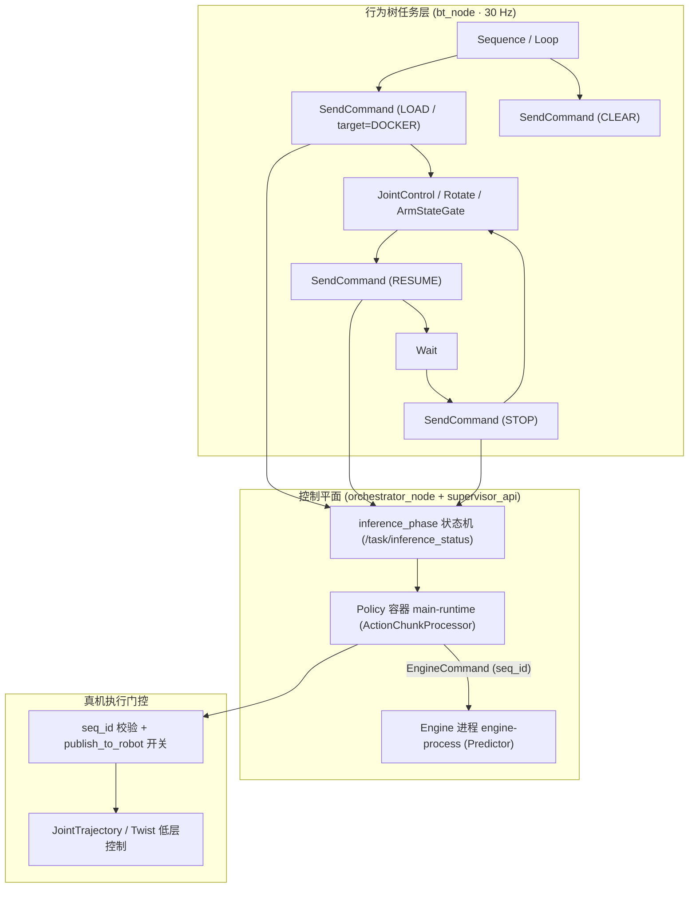

# 行为树 × VLA 编排

## 一句话定义

**行为树（BT）× VLA 编排** 将 **宏任务控制流**（容器启动、策略加载/暂停/恢复/卸载、位姿复位与循环）交给**可组合、可恢复**的行为树节点，将**语言条件下的连续精细操作**交给 **VLA / 模仿学习策略** 以 action chunk 异步输出；二者通过显式生命周期状态机解耦，而非在 BT 节点内部直接运行模型前向推理。

## 英文缩写速查

| 缩写 | 英文全称 | 简要说明 |
|------|----------|----------|
| BT | Behaviour Tree | 行为树，组合控制/动作节点并带恢复语义的任务编排结构 |
| VLA | Vision-Language-Action | 视觉-语言-动作多模态策略，常以自然语言为任务接口 |
| IL | Imitation Learning | 模仿学习，Cyclo 栈中 LeRobot ACT/π₀ 等后端的数据来源 |
| ROS 2 | Robot Operating System 2 | 机器人中间件，BT 与推理控制平面间经 srv/topic 解耦通信 |
| TRT | TensorRT | Cyclo `SendCommand` 显式支持的 `tensorrt_dit` / `tensorrt_full_pipeline` 加速模式 |

## 为什么重要

- **VLA 单独端到端难以覆盖长程任务**：多步搬运、间歇复位、底盘转向与操作窗口交替，需要**确定性编排**与**可编辑任务图**（XML 与可视化 BT Manager），而非全靠语言模型逐步规划。
- **分层直觉明确，但实现不必依赖外部导航文档**：概念上「BT 调度高层流程、技能策略执行连续段」与 SayCan 等分层规划同构；工程上 [Cyclo Intelligence](../entities/cyclo-intelligence.md) 将**已训练 VLA checkpoint** 封装为可 `LOAD / RESUME / STOP / CLEAR` 的任务原语。
- **部署侧痛点对准**：VLA 推理耗时高、依赖 chunk 缓冲；BT 可在 `STOP` 后插入 `JointControl` 复位与 `ArmStateGate` 门控，在 `Loop` 中重复「推理几秒 → 暂停 → 回初始位」，避免 chunk 边界与场景阶段错位。

## 核心原理

以开源锚点 [Cyclo Intelligence](../entities/cyclo-intelligence.md)（`orchestrator` + `cyclo_brain`）为例，整个编排链路跨越三层独立进程边界：

### 1. 非阻塞多阶段生命周期而非「一次推理」

`orchestrator/orchestrator/bt/actions/send_command.py` 中，`SendCommand` 是一个非阻塞多状态机（`_STATE_INIT → _STATE_WAITING_BACKEND → _STATE_BEGIN_STAGE → _STATE_WAIT_PHASE → _STATE_DONE`），完全复用 UI 使用的 `SendCommand.srv` 枚举与 `/task/inference_status`：

| BT `command` | 目标范围 | 执行阶段与目标 `inference_phase` | 工程目的 |
|--------------|----------|----------------------------------|----------|
| **LOAD** | `target=INFERENCE` | 先确认 Docker 后端就绪，再顺序发 `START_INFERENCE`（等 `INFERENCING`）与 `STOP_INFERENCE`（等 `PAUSED`） | 把权重预加载到内存并立刻暂停，留出前置复位窗口 |
| **RESUME** | `target=INFERENCE` | `RESUME_INFERENCE` → 等 `INFERENCING`（附 `task_instruction`） | 按指定语言指令持续消费观测并下发 action chunk |
| **STOP** | `target=INFERENCE` | `STOP_INFERENCE` → 等 `PAUSED` | 暂停而不卸载权重，便于插入复位或换轨动作 |
| **CLEAR** | `target=INFERENCE` | `FINISH` → 等 `READY` | 结束推理会话并释放后端模型资源 |
| **START / STOP / RESTART** | `target=DOCKER` | 在独立工作线程调本地 `supervisor_api`（默认端口 `7100`）启停 `groot` / `lerobot` 容器 | 避免首次拉镜像或构建 Compose 阻塞 `bt_node` 30 Hz tick；取消时通过 generation 锁做补偿 `STOP` |

### 2. 参数化策略切换与动作门控节点

- **策略后端与加速选项：** `SendCommand` 经 `model` 端口映射到两大容器后端——`groot`（`groot:n17`）与 `lerobot`（`act`、`diffusion`、`smolvla`、`xvla`、`pi0`、`pi05`、`molmoact2`、`vla_jepa`、`fastwam`），并支持 `inference_mode`（`robot` 真机下发 vs `simulation` 仅发布 `/inference/trajectory_preview` 预览）、`action_request_mode`（`async` / `sync`）、`acceleration_mode`（`pytorch` / `tensorrt_dit` / `tensorrt_full_pipeline`）及 `inference_hz` / `control_hz` / `chunk_align_window_s`。
- **确定性辅助与状态门控：** 宏运动由 `JointControl`（头/臂/升降台轨迹）和 `Rotate`（底盘转向）完成；接触丰富操作交由 VLA chunk；`ArmStateGate`（`arm_state_gate.py`）则只订阅 `/joint_states` 并检测关节阈值与夹爪「闭合再张开」序列，不直接发控制指令，确保状态就绪后才放行后续 BT 节点。

### 3. 与纯 LLM 规划的对比

| 维度 | LLM / VLM planner（如 SayCan、Vesta） | BT + VLA |
|------|----------------------------------------|----------|
| 技能来源 | 语言生成子任务 + affordance 过滤 | **预训练 checkpoint** 作为节点参数 |
| 可预测性 | 依赖模型采样与 grounding | BT 结构 **显式、可回放、可单步调试** |
| 长程组合 | 适合开放词汇推理 | 适合 **产线式重复流程**（循环、超时、复位） |
| 失败恢复 | 需额外监控与重规划 | BT `Sequence/Loop + STOP` 天然插入恢复支路 |

若节点只需在离散标签间路由（escalate / auto / 选技能 ID），[TypeSafe Jev](../entities/typesafe-jev.md)、[Laya](../entities/laya.md)、[Valen（万澜）](../entities/valen.md) 等 **System One** 决策面可在 BT 外提供 **typed probability**（Valen 另支持图像/视频 state），避免 LLM 字符串 parse；**VLA 仍负责连续操作 chunk**。

## 工程实践

- **严格的进程与包边界隔离：** 在 `cyclo_intelligence` 中，`bt_node`（`orchestrator_bt_node`，默认 `tick_rate: 30.0 Hz`）由 `supervisor_api` 按需拉起，与控制面 `orchestrator_node` **不共享 Python 导入**（由 `tests/bt/test_package_boundary.py` 强制校验），仅通过 `/send_command`、`LoadAndRunTree`（`/bt/load_and_run`）、`/bt/set_running`、`/bt/nodes/catalog` 等 ROS 2 接口通信。
- **异步 chunk 防陈旧与安全清空：** `cyclo_brain` 容器拆分为 `main-runtime`（持有 `SessionState`、`ActionChunkProcessor`、`ControlLoop` 与 `RobotClient`）和 `engine-process`（持有 `PolicyLoader`、`Predictor`）。`EngineCommand` 携带单调 `seq_id`，一旦 BT 触发暂停、停止、卸载或切换 `publish_to_robot`，`main-runtime` 立刻丢弃过时 `seq_id` 回包并清空 `ActionChunkProcessor` 缓冲（队空返回 `None` 而不重复上一帧），杜绝模式切换瞬间的关节跳变。
- **导航与 BT 的现行集成方式：** Cyclo 当前并未把 Nav2 直接写进 `bt_node` 动作节点，而是在前端 **Autonomy Studio**（`useMissionRunner.js`）中按航点编排——先调用 `supervisor_api` 触发 `ai_worker` 容器中的 Nav2 目标导航，到达后通过 rosbridge 调 `/bt/load_and_run` 与 `/bt/set_running` 执行对应操作行为树。

## 局限与风险

- **BT 支持机型仍高度收敛：** `shared/shared/robot_configs/schema.py` 的 `BT_SUPPORTED_ROBOT_TYPES` 当前仅显式开放 **`('ffw_sg2_rev1',)`**，其他未登记型号会被 `bt_node` 启动校验拒绝。
- **误区：BT 可以替代 VLA 的语义泛化** — BT 只编排**已选定的模型与指令**；换物体、换夹具或改表述仍需 VLA 泛化或微调。
- **误区：LOAD 后应立即 RESUME** — Cyclo 示例树 `ffw_sg2_rev1_example.xml` 故意在 `LOAD`（加载即 `PAUSED`）之后插入 `JointControl` 与 `Rotate`，对齐视角与工作姿态后再 `RESUME`，否则首块动作容易在错位姿态下起跳。
- **任务树维护与状态机超时依赖：** `SendCommand` `LOAD` 阶段默认超时高达 `600s`、容器启停 HTTP 超时默认 `7260s`，且技能库增长时依赖 XML 节点目录刷新（`/bt/nodes/catalog`）与外部 `CYCLO_BT_TREES_DIR` 版本管理。
- **参照文档不可达声明：** 对移动机器人 Nav2 行为树参照文档（`docs.nav2.org/behavior_trees/index.html`、`concepts/index.html`、`nav2_specific_nodes.html`）于 `2026-11-14` 进行核查时均返回 **HTTP 404**，故本页关于 BT×VLA 的工程机制与状态机细节完全以 `ROBOTIS-GIT/cyclo_intelligence` 源码为准，不基于不可达外链补全 Nav2 规范细节。

## 关联页面

- [VLA（方法）](../methods/vla.md) — 策略层定义与工程瓶颈
- [Cyclo Intelligence（实体）](../entities/cyclo-intelligence.md) — ROBOTIS 全栈实现细节
- [LeTools（实体）](../entities/letools.md) — Kuavo 侧行为树调度的是 **SDK 原子技能**，而非 VLA `LOAD/RESUME` 生命周期
- [Navigation2（实体）](../entities/navigation2.md) — 移动机器人域导航与任务调度参照
- [SayCan（方法）](../methods/saycan.md) — LLM 高层规划 + 低层技能的分层对照
- [VLA 真机部署指南（Query）](../queries/vla-deployment-guide.md) — chunk 与推理延迟优化
- [VLA 与低级控制器融合（Query）](../queries/vla-with-low-level-controller.md) — 执行层接口
- [Action Chunking（方法）](../methods/action-chunking.md) — `RESUME` 阶段的动作块语义
- [Harness VLA（论文实体）](../entities/paper-harness-vla.md) — agentic JSON 原语 + 记忆；与 BT 确定性编排对照
- [RoboHarness（论文实体）](../entities/paper-robo-harness.md) — 异构策略路由 + Memory Bridge；相对 BT 更偏能力边界感知
- [具身大模型分类学选型闭环（知识链枢纽）](../overview/hub-embodied-foundation-model.md) — 行为树编排对应五层闭环的 VLX 一体化扩展层

## 参考来源

- [Cyclo Intelligence 仓库归档](../../sources/repos/cyclo_intelligence.md) — 核对 `cyclo_intelligence`（commit `11800ba4`）`orchestrator/orchestrator/bt/`、`cyclo_brain/README.md`、`docs/ARCHITECTURE.md` 与 `schema.py`；并记录 `docs.nav2.org` 行为树文档 HTTP 404 状态
- [ROBOTIS-GIT/cyclo_intelligence](https://github.com/ROBOTIS-GIT/cyclo_intelligence) — `send_command.py`、`arm_state_gate.py`、`bt_node.py`、`ffw_sg2_rev1_example.xml`
- [Cyclo Intelligence（实体页）](../entities/cyclo-intelligence.md)

## 推荐继续阅读

- [ROBOTIS AI Worker Imitation Learning 文档](https://docs.robotis.com/docs/systems/aiworker/imitation_learning/)
- [ROBOTIS AI Worker 官方介绍](https://ai.robotis.com/ai_worker/introduction_ai_worker.html)
- [Navigation2（站内实体页）](../entities/navigation2.md) — 移动机器人行为树编排对照（注：原外链 `docs.nav2.org/behavior_trees/index.html` 于 2026-11-14 实测返回 HTTP 404，待上游修复或迁移）
