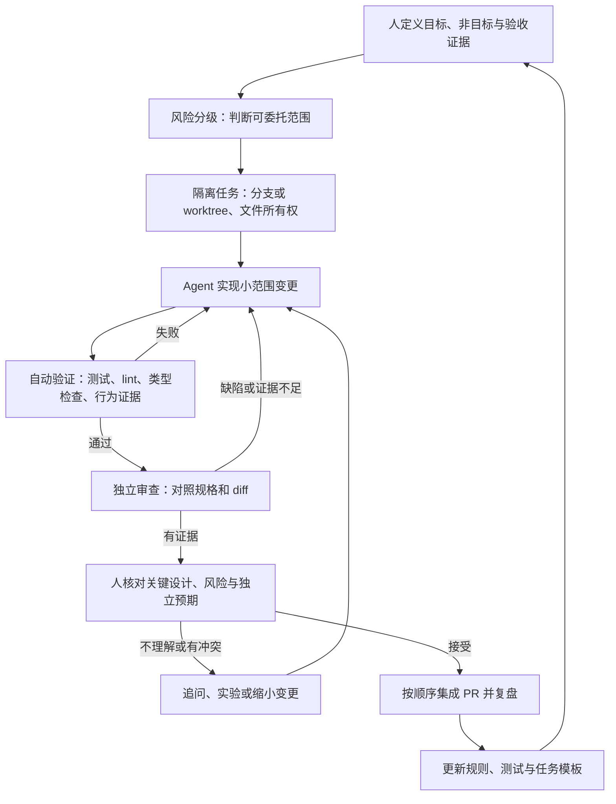
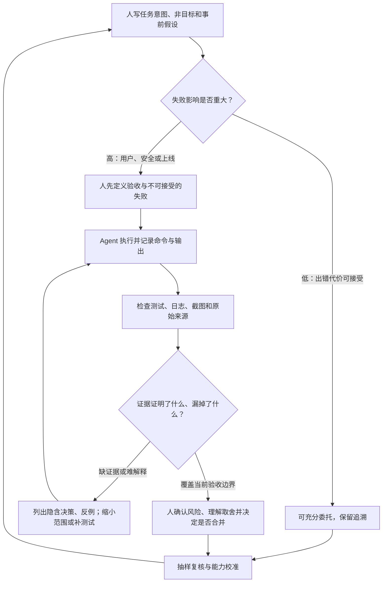

# 多 Agent 编码管理与认知把关 / Managing Coding Agents without Cognitive Surrender

## 一句话定义

**多 Agent 编码管理**不是同时打开更多自动编程会话，而是由人负责目标与风险判断，让不同 agent 在独立边界内交付可验证的变更，同时保留足够的独立理解，避免把 AI 输出未经判断地当成自己的结论。

## 英文缩写速查

| 缩写 | 英文全称 | 简要说明 |
| --- | --- | --- |
| AI | Artificial Intelligence | 本页负责辅助编码、审查的模型系统 |
| PR | Pull Request | 一次可审阅的变更单元；建议一 agent 负责一 PR |
| WIP | Work in Progress | 同时进行的任务数；受人工审查吞吐约束 |
| CI | Continuous Integration | 运行测试、lint 与其他可执行质量门禁 |
| TDD | Test-Driven Development | 使用先失败再通过的测试反馈降低实现偏差 |
| HIL | Human-in-the-Loop | 人对架构、需求、安全与合并决策保留介入和签署 |

## 为什么重要

Addy Osmani 在 [管理多编码 Agent 的文章](../../sources/blogs/addyosmani_coding_agents_manager_2026-01-08.md)指出，代理并行后「产出代码」不再是唯一瓶颈，**任务拆分、审查精力和集成判断**也会限制效率。在 [Cognitive Surrender](../../sources/blogs/addyosmani_cognitive_surrender_2026-05-05.md) 中，他进一步强调：当开发者未形成自己的判断就接受 AI 结论，会积累对系统的**理解债**。

二者不是矛盾的观点：前者解决「怎么组织更多执行」，后者防止「执行越快、负责判断的人越不了解系统」。Anthropic 的 [Claude Code 官方指南](../../sources/sites/anthropic_claude_code_best_practices_2026.md) 则把其中一些抽象原则落为可配置的 skills、hooks、权限和检查机制。

作者在 2026-11-03 的 [《Critical thinking when agents do the work》](../../sources/blogs/addyosmani_critical_thinking_agents_2026-11-03.md) 进一步将**认知卸载 → 判断推迟（deferral）→ 认知投降**放在同一连续谱上：模型越常交付大致正确的答案，越要主动配置独立验证和反思，而不是凭输出流畅程度决定相信多少。这篇 X 长文经两份英文全文镜像交叉核对，X 原站未能直接读取。

## 核心原理：双重闭环

第一重是**交付闭环**：目标和验收 → 隔离委托 → 实现 → 可执行检查 → 独立审查 → 人类合并。第二重是**认知闭环**：人先形成预期 → 对照 agent 的实现与证据 → 对不一致处追问或实验 → 更新系统理解。只满足前者不保证后者。

### 1. 管理：把想法写成可以验收的任务

任务简报至少说明：**目标、涉及文件或参考实现、约束、非目标、验收判据、验证命令、交付产物和风险检查点**。判断空间大、涉及架构/安全/产品意图的任务要求人紧密参与；局部文档、测试或已有模式下的机械迁移更适合异步交付。

| 管理选择 | 建议做法 | 反例 |
| --- | --- | --- |
| 工作边界 | 小 PR、明确文件所有权、worktree/分支隔离 | 多代理抢改同一共享模块 |
| 调度 | 按人的审查容量限制 WIP | 只追求同时跑最多 agent |
| 检查点 | 定期报告「已改、待办、风险、阻塞」 | 只报完成百分比 |
| 接口冲突 | 先决定共享接口，再并行实现其余切片 | 两个 agent 各自改同一 API |
| 终止条件 | 预先约定何时停掉价值不足的实验 | 自动生成后不再问该不该做 |

### 2. 认知：卸载执行，不交出判断

**认知卸载（cognitive offloading）**：把代码草稿、检索和重复劳动交给 AI，但人仍能解释为何选择这个设计、失败会在哪里出现。

**认知投降（cognitive surrender）**：在人尚未形成独立判断时接受答案。常见信号是「测试全绿就批 PR」「修复报错但说不清根因」「解释不出架构取舍，只能复述模型说法」。Addy Osmani 把这与 *comprehension debt*（理解债）相连；这属于文章提出的工程分析框架，不是本库已独立量化的因果结论。

可对照执行三件事：

1. **生成前**：写下预期行为、怀疑的根因或两种方案的取舍。
2. **审查中**：像审查陌生同事的代码一样逐段看 diff；要求测试输出、trace、截图等能复核的证据，并对反例做独立判断。
3. **合并前**：回答「为什么是这个实现？哪些条件下会失败？出问题如何回滚？」答不上来就缩小 PR 或补证据，不能只看 agent 的自我评价。

### 3. 工具：把建议与强制约束分开

[Claude Code 官方最佳实践](../../sources/sites/anthropic_claude_code_best_practices_2026.md)区分两类机制：

| 要解决的问题 | 建议层（模型可能选择执行） | 强制层（由工具/系统执行） |
| --- | --- | --- |
| 补充团队背景 | 具体提示、精简 `CLAUDE.md`、路径规则、按需 skills | 不适用；知识本身不等于门禁 |
| 保证检查发生 | 提示运行测试、审查规格、请求 `/verify` | CI、可执行 Stop hook、分支保护 |
| 限制访问 | 告知不读私密配置 | deny 权限、sandbox、管理策略 |
| 控制开销和风险 | 选择轻重适当的 agent 与任务 | 最大轮数/预算、工作区隔离、审批边界 |

**注意：** prompt/skills 不是确定性安全机制；使用另一个模型判断的 hook 也不等同于 command/http hook。自动审查不应无限纠缠风格或无关边界，重点是规格是否兑现。具体 Claude Code 命令和默认配置会更新，应以对应版本官方文档为准。

### 4. 批判性思维：先有自己的假设，再验 agent 的证据

[Addy Osmani 2026-11-03 长文](../../sources/blogs/addyosmani_critical_thinking_agents_2026-11-03.md) 进一步区分了三个层次：

| 状态 | 发生了什么 | 用什么动作拉回独立判断 |
| --- | --- | --- |
| 认知卸载（offloading） | AI 执行工作，人理解目标并愿意负责 | 说明预期、关键取舍及剩余风险 |
| 判断推迟（deferral） | AI 上一轮输出直接成为下一轮的未经核验输入 | 回到原始资料，写下自己的可证伪假设 |
| 认知投降（surrender） | 人认为无需核查，无法解释重要设计 | 暂停合并，重建局部系统理解并补证据 |

**审查习惯的最小闭环**：以下流程是依据原文整理的工程实践，不是模型内部执行链，也不是研究实验的因果验证。

作者提出的可操作检查，并非要求逐行阅读每份 AI 产物：

1. **提问之前**：写出猜想，并注明受众、非目标及完成定义；若连目的都说不清，先让 agent 访谈澄清而非连改十轮提示词。这是在减少 *intent debt*（意图债）。
2. **结果出现之后**：问“怎样才能证明它错了？”；可请不同模型提出反方论证，但优先相信**实际可执行的测试和原始资料**，而非模型自评置信度。
3. **检查全绿之后**：分清“这个检查证明了什么”和“没有证明什么”。先查看执行的命令、实际输出、trace 或截图，再阅读 agent 的成功总结；同源错误写进实现与测试时，两者也可能一起通过。
4. **审查 PR 时**：让 agent 列出它替人决定的默认值、范围和需求冲突处理；对关键 diff 随机抽问，能否向后续维护者说明理由。对批量文档分析抽查原文和关键数字。
5. **多 agent 堆积时**：作者用 *orchestration tax*（协调税）描述“产物数量”和“本人敢署名负责的成果”之间的差额；先改善验证或减少并发，不是继续开会话。
6. **长期能力**：每周手工练习一项不愿丢掉的技能，每月回顾哪些判断已让渡；这些是作者建议的校准练习，不是经随机对照试验验证的固定最佳频率。

关键不是人必须记住全部代码，而是**知道自己缺少哪部分知识，并能按需重建**。自动化可以替代执行及部分审核，不能替代由人作出的“做什么、影响谁、可否发布”的最后决定。

## 工程实践：映射到机器人研发仓库

例如让两个 agent 分别修改 **ROS 2 控制接口**和 **仿真评测脚本**：

1. 人先定义接口消息类型、频率、失败时的安全状态和实际测量口径；共享接口先通过单独 PR 固定。
2. 代理 A 负责驱动侧代码与接口测试，代理 B 负责仿真回放/回归评测，各在独立分支；**不并行改同一接口定义**。
3. 驱动和仿真分别执行适用的构建、lint、测试；对控制时序、超时和故障恢复附真实日志或 trace。仿真通过不能替代真机安全验证。
4. 独立审查检查需求覆盖、边界和回滚，工程负责人解释为何这些验证足以支持**当前测试阶段**；后续真机测试仍按安全审批执行。

对本知识库自身的 ingest，则把一手原文、来源归档、Mermaid、入链、健康度、`make ci-preflight` 和 PR 证据分开记录；**「写完 wiki」不等于「完成验证」**。

### 4. 验证：必须让 Agent 交出可复核证据

[Claude Code 团队验证实践](../methods/coding-agent-verification-loops.md)补上交付闭环的具体测试手段：E2E 验证真实操作路径、属性测试自动寻找不变量反例、差分测试对比迁移前后行为；并要求评审锁定 commit、检查规则不随被审 PR 自改。官方团队报告了按 diff 触发的 39 项可靠性清单和失败三轮转人工机制，但这些数字不应直接当作本库已验证的指标。

在机器人软件变更中，还应单独补齐 ROS 2、仿真及真机分层验收；这是对编码 agent 管理机制的**验证方法补充**，不是用新页面替代管理与人类责任。

## 局限与风险

- 文章反映作者的工程经验及其对研究的解读，不证明「更多 agent 必然提高总体产能」，也不能据此断言最佳 WIP 数量。2026-11-03 长文所述“协调税、意图债、认知投降连续谱”属于作者的思辨性模型，不是本仓库复现的量化结论。
- AI 审查可能与实现存在相同盲点；必须用真实测试与人类独立判断补足，特别是机器人安全相关变更。
- 测试能证明给定输入下的部分行为，不能自动证明产品意图正确、系统可维护或部署安全。
- Claude Code 官方指南是可变的产品文档，本文不把某时点的默认模型、命令或权限当作永久事实。
- 此处整理的是**编码与工程治理知识**，三份材料均不是可运行的独立机器人项目，因此不存在需要解析的官方训练/推理源码运行时序图。

## 关联页面

- [Orca：多 Agent 工作区组织工具](../entities/stablyai-orca.md) — worktree 与会话用于并行拆分，合并及真机验收仍需独立门禁。

- [Coding Agent 验证闭环](../methods/coding-agent-verification-loops.md) — 把 E2E / 属性 / 差分测试、独立门禁与故障复盘落实到可执行验证。

- [具身评测基准选型闭环](../overview/hub-embodied-eval-benchmark.md) — 机器人研发还需区分代码验收与策略、仿真和真机评测；编码 Agent 的测试通过不能代替后几层验证。
- [Agentic Coding 时代的软件工程基础](./agentic-coding-software-fundamentals.md) — 管理前先具备架构与取舍语言。
- [AI Agent 评测](./ai-agent-evaluation.md) — 将运行结果而非自述作为验收基础。
- [规格驱动开发](./specification-driven-development.md) — 如何明确需求与验收条件。
- [Agent Skills（Addy Osmani）](../entities/agent-skills-addyosmani.md) — 将工程纪律编为可复用的流程技能。
- [Open Code Review](../entities/open-code-review.md) — 用独立评审检查 diff。
- [OpenBot（CopilotKit）](../entities/copilotkit-openbot.md) — 用统一 Agent 工作空间实施角色授权、执行审批与审计。

## 参考来源

- [Claude Code 团队验证方法（官方博客原文归档）](../../sources/blogs/claude_dev_verification_addy_osmani_2026-11-16.md)

- [Addy Osmani — Your AI coding agents need a manager（原文归档）](../../sources/blogs/addyosmani_coding_agents_manager_2026-01-08.md)
- [Addy Osmani — Cognitive Surrender（原文归档）](../../sources/blogs/addyosmani_cognitive_surrender_2026-05-05.md)
- [Addy Osmani — Critical thinking when agents do the work（2026-11-03 全文核对归档）](../../sources/blogs/addyosmani_critical_thinking_agents_2026-11-03.md)
- [Anthropic — Best practices for Claude Code（官方文档归档）](../../sources/sites/anthropic_claude_code_best_practices_2026.md)

## 推荐继续阅读

- [Your AI coding agents need a manager](https://addyosmani.com/blog/coding-agents-manager/)
- [Cognitive Surrender](https://addyosmani.com/blog/cognitive-surrender/)
- [Critical thinking when agents do the work（X 文章）](https://x.com/i/article/2116367635365695488)
- [Best practices for Claude Code（官方文档，持续更新）](https://code.claude.com/docs/en/best-practices)
