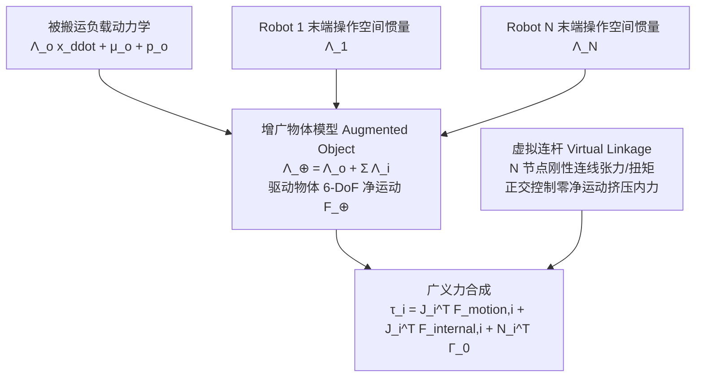

# 协同物体搬运（Collaborative Object Transport）

**协同物体搬运**是指两台或多台移动操作臂、人形机器人或空中飞行机械臂共同抓取、支撑或托举同一刚体/可变形负载完成拾取、长距离移载、转向、上下台阶与交接的紧耦合 [Loco-Manipulation](../tasks/loco-manipulation.md) 过程。

## 一句话定义

**多机协同物体搬运的本质是在移动底座/双足连续步态切换的同时，对闭合运动链上的物体净外力偶与各机间内力张力进行时空协调分配。**

## 英文缩写速查

| 缩写 | 英文全称 | 简要说明 |
|------|----------|----------|
| CoM | Center of Mass | 负载质心；质心偏置或实时滑动是多机共载的关键动态扰动 |
| ESO | Extended State Observer | 扩展状态观测器；如 CALM 中单机实时估计未知风扰与耦合拉力 |
| WBC | Whole-Body Control | 全身控制；统一协调双足/底盘地面支撑反力与上肢操作内力 |
| IPPO | Independent Proximal Policy Optimization | 独立 PPO 训练；常配合局部物体附着坐标系用于无通信共搬策略 |

## 为什么重要

- **纯位置同步必然产生破坏性内力：** 若两台机器人各自仅以高刚度位置跟踪参考轨迹搬运同一刚体长杆，微小定位误差（数毫米级）或时间异步就会通过闭链刚度急剧放大为互相拉扯或挤压的结构内力，导致物体滑脱、打滑甚至双足倾覆。
- **底座行进与负载力学强耦合：** 移动底座惯量远大于轻型手臂（Khatib 1996 指出车–臂之间显著动力学非对称），而在双足人形（如 Digit / Unitree G1）与空中共载 UAV（[CALM](../entities/paper-calm-decentralized-aerial-manipulation.md)）中，负载偏心惯量直接挤压足底 ZMP/摩擦锥稳定边界或飞行器倾转推力裕度。
- **典型工业与生活落地场景：** 大型板材/箱体搬运、双人铺展床单与桌布（可变形体张力耦合）、双机穿越门洞与台阶交接等单机臂展与峰值力矩无法覆盖的工作场景。

## 核心原理

### 1) 经典力学分解：增广物体与虚拟连杆

在连续控制理论层面，多机共载的核心框架由 Khatib (1996) 等确立为两个正交层次：

- **运动控制分支：** 利用各机加载比例 $\alpha_i$（$\sum \alpha_i = 1$）分担增广惯量与重力/惯性补偿，形成期望净外力偶。
- **去中心化合作改造（Khatib 1996 §4）：** 当机间无高频全状态广播总线时，主控机负责主导期望轨迹，从机以本地腕力传感+零运动约束刚度跟随负载实际运动并输出比例 $\alpha_i$ 助力，无需跨机实时传输关节角阵列。
- **闭链与支撑切换扩展：** 在双足人形牵手与多足支撑切换中，[RoboCompiler-Humanoids](../entities/paper-robocompiler-humanoids-composable-dynamics.md) 进一步将单机内部约简与多机手部闭链/地面支撑选择矩阵分作两级约简，实现 3.5 ms 级耦合动力学求值与 35 µs 局部负载更新，并显式约束足底法向力与摩擦锥边界。

### 2) 物理特性分型与控制/学习应对策略

| 负载类别 | 核心物理挑战 | 经典模型派代表思路 | 现代学习派代表思路 |
|------|------|------|------|
| **刚性大体积箱体 / 板材** | 抓持多点过约束、转弯内外圈线速度差、质心未知偏置 | 增广物体 + Virtual Linkage + 阻抗/导纳顺应 | 局部物体附着坐标系策略（[decMHT](../entities/paper-decentralized-multi-humanoid-pickup.md)）+ 隐式载荷分担 |
| **高动态晃动 / 偏心摆动载荷** | 空中悬吊/末端刚臂耦合横滚–偏航滞后、气动干扰 | 几何控制 + Wrench 分配（如 RotorTM） | 共享 MAPPO + 单机 ESO 估计 + 偏航前馈（[CALM](../entities/paper-calm-decentralized-aerial-manipulation.md)） |
| **可变形柔体（床单/桌布/布袋）** | 无固定刚体几何、张力分布随大变形剧变、易脱手 | 有限元/准静态应变估计 + 低刚度阻抗 | 非对称序贯模仿课程 + 伙伴让步等待机制（[SAI](../entities/paper-sai-sequential-asymmetric-imitation.md)） |
| **接力/交接（Relay Handover）** | 负载重量在 $t_{switch}$ 前后从全额到零或反方向阶跃转移 | 接触力平滑混合权重切换 | 模式标志 `m(r)∈{idle,track}` + 跨台阶交接课程（`decMHT` / `CHORUS`） |

## 工程实践

- **必选局部力柔顺或低刚度接触层：** 无论上层使用集中 MPC 还是去中心化 VLA/RL，底层切忌裸跑纯高增益位置 PD，必须借助 [阻抗控制](./impedance-control.md) 或显式力矩分配把机间微米/毫米级跟踪差转化为可控的柔顺吸能。
- **转弯几何预分配避免滑脱：** 双机抬长物体共同转弯时，前机与后机、内侧与外侧抓持点的期望平面线速度截然不同；在指令层统一由**物体中心速度 `(vx, vy, ωz)`** 经刚体旋量映射（$v_i = v_o + \omega_o \times r_i$）产生各机参考速度，可大幅消除误拉伸内力。
- **可观测载荷与交接状态估计：** 实机上难以在无标定前预知所有包裹重量，可通过悬停/静止阶段垂向臂力积分估算质量（如 CALM 在 `[0.5, 2.0] kg` 滤波）、或用成员局部秩-6 惯量更新快速刷新控制器内部惯量张量。

## 局限与风险

- **无传感器闭链碰撞风险：** 缺乏六维力矩传感器或电流力估算反馈时，学习策略在遇到队友卡滞（一侧轮子/脚绊住）时容易继续猛拉引发硬件过载；因此需要在策略输入中加入时序历史与“等待/让步（yield/wait）”监督（见 [SAI](../entities/paper-sai-sequential-asymmetric-imitation.md)）。
- **外部定位假设脆弱：** 多项人形真机协同搬运验证仍依靠动作捕捉广播负载相对躯干的位姿；室外非结构化环境缺少全局动捕时，搬运遮挡胸前视野使得单目纯机载定位极易丢失目标。
- **多足重心约束严苛：** 相比稳态全向轮式底盘，双足人形在抬起重物瞬间 CoM 前移及脚踝力矩上限会迅速收缩可行落脚区域，单机独立 WBC 若忽略另一台机器人的推拉力往往导致第一步就失去平衡。

## 关联页面

- [多机器人协作（Multi-Robot Collaboration）](./multi-robot-collaboration.md) — 概念枢纽总览
- [多机器人协同架构对比](../comparisons/multi-robot-coordination-architectures.md) — 集中式 / CTDE / 去中心化工程架构取舍
- [Loco-Manipulation](../tasks/loco-manipulation.md) — 行进间操作的控制与规划核心
- [阻抗控制（Impedance Control）](./impedance-control.md) & [力位混合控制](./hybrid-force-position-control.md) — 消除闭链内力冲突的底层力控规律
- [接触动力学（Contact Dynamics）](./contact-dynamics.md) & [Whole-Body Control](./whole-body-control.md) — 摩擦锥与多支撑动力学底座
- [decMHT](../entities/paper-decentralized-multi-humanoid-pickup.md) · [RoboCompiler-Humanoids](../entities/paper-robocompiler-humanoids-composable-dynamics.md) · [SAI](../entities/paper-sai-sequential-asymmetric-imitation.md) · [CALM](../entities/paper-calm-decentralized-aerial-manipulation.md)
- [多机器人协作纵深路线](../../roadmap/depth-multi-robot-collaboration.md) — 收录于 Stage 1–3 核心主干

## 参考来源

- Khatib et al., *Coordination and Decentralized Cooperation of Multiple Mobile Manipulators*, JRS 1996 — [`khatib_1996_multiple_mobile_manipulators.md`](../../sources/papers/khatib_1996_multiple_mobile_manipulators.md)
- Duan et al., *Learning Multi-Humanoid Pickup and Transport via Decentralized Object-Centric Control*, arXiv:2609.17824 — [`decentralized-multi-humanoid-pickup_arxiv_2609_17824.md`](../../sources/papers/decentralized-multi-humanoid-pickup_arxiv_2609_17824.md)
- Chen et al., *Robots that Collaborate: Sequential Asymmetric Imitation*, arXiv:2606.16490 — [`sai_sequential_asymmetric_imitation_arxiv_2606_16490.md`](../../sources/papers/sai_sequential_asymmetric_imitation_arxiv_2606_16490.md)
- Heydari Shahna & Mattila, *Composable Dynamics for Cooperative Humanoids*, arXiv:2610.14237 — [`robocompiler_humanoids_composable_dynamics_arxiv_2610_14237.md`](../../sources/papers/robocompiler_humanoids_composable_dynamics_arxiv_2610_14237.md)
- Huo et al., *CALM: Decentralized Control of Cooperative Aerial Manipulation with MARL*, arXiv:2610.18425 — [`calm_arxiv_2610_18425.md`](../../sources/papers/calm_arxiv_2610_18425.md)

## 推荐继续阅读

- [多机器人协作纵深路线](../../roadmap/depth-multi-robot-collaboration.md) — 完整学习阶段与文献列表
- [多机器人协同架构对比](../comparisons/multi-robot-coordination-architectures.md) — 确定你的搬运任务是否需要集中优化
- [decMHT（去中心化多人形搬运）](../entities/paper-decentralized-multi-humanoid-pickup.md) — 从 1 机零样本扩展到 10 机共搬 50 kg 案例
