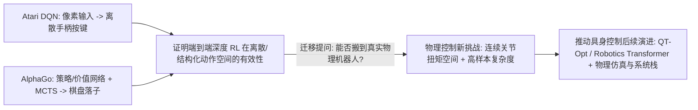

# 深度强化学习游戏里程碑（DQN / AlphaGo）

## 一句话定义

**深度强化学习游戏里程碑**：以 Atari DQN 与围棋 AlphaGo 为代表的一系列工作，用端到端神经网络从像素或棋盘状态映射到动作，证明了规模化数据驱动方法在**离散或结构化动作空间**任务上的可行性与上限。

## 英文缩写速查

| 缩写 | 英文全称 | 简要说明 |
|------|----------|----------|
| DQN | Deep Q-Network | 深度 Q 网络，深度强化学习里程碑算法 |

## 为什么重要

机器人领域常借用这段历史回答两个问题：（1）表征学习与价值 / 策略迭代能否纯数据驱动；（2）从「手柄按键」「落子」到「连续关节扭矩」时，动作空间与样本复杂度会发生什么变化。它与 [QT-Opt](../methods/qt-opt.md)、[Robotics Transformer](../methods/robotics-transformer-rt-series.md) 等工作的叙事常被并列讨论，但**物理连续控制需要额外算法与系统栈**，不能直接类比 Atari。

## 核心一手资料

| 工作 | 引用 |
|------|------|
| DQN | Mnih et al., *Playing Atari with Deep Reinforcement Learning*, https://arxiv.org/abs/1312.5602 |
| AlphaGo（2016） | [AlphaGo 实体页](../entities/paper-alphago.md)：策略/价值网络 + MCTS；[Nature 原文](https://doi.org/10.1038/nature16961) |

## 机制与关系图

## 关联页面

- [Reinforcement Learning](../methods/reinforcement-learning.md)
- [QT-Opt](../methods/qt-opt.md)
- [AlphaGo（2016）](../entities/paper-alphago.md) — 原始围棋系统的论文、方法、结果与官方开源边界

## 参考来源

- [ted_xiao_embodied_three_eras_primary_refs.md](../../sources/blogs/ted_xiao_embodied_three_eras_primary_refs.md)
