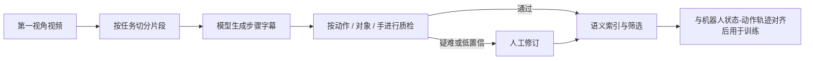

# 面向机器人的密集视频字幕

## 一句话定义

**密集视频字幕（dense captioning）** 将连续第一视角操作视频分解为按时间排序的短动作步骤，并为每步标注动作、作用对象与执行手，形成可检索、可质检的任务语义标签；它是视频语义监督，不自动等价于机器人可执行的状态—动作轨迹。

## 英文缩写速查

| 缩写 | 英文全称 | 简要说明 |
|------|----------|----------|
| Ego | Egocentric | 采集者自身视角的第一人称视频 |
| VLM | Vision-Language Model | 输入图像/视频并生成语言描述的模型 |
| SAM | Segment Anything Model | 按提示分割并追踪图像/视频对象的模型族 |
| fps | Frames per second | 每秒采样帧数；更高采样率不必然改善步骤判断 |
| BC | Behavior Cloning | 从观测—动作对学习策略；字幕本身通常不含控制动作 |

## 为什么它有用，也为什么难

机器人基础模型需要大规模物理交互经验，但现实操作不像网页文本那样天然可抓取。第一视角视频提供人手与物体交互的丰富场景，可用密集字幕把长视频整理成短步骤，支持任务检索、语义分析和训练数据筛选。

核心困难在于步骤短、动作边界细、遮挡和杂乱背景常见，运动模糊及低照度又会损害视觉证据。尤其是动作识别必须比较跨帧的手部运动；静态帧中对象看得清，不代表模型知道刚才发生了“拿起”“递交”还是“放下”。

## 标注结构与评测口径

一个可用的步骤标签至少需要：

| 字段 | 要回答的问题 | 常见错误 |
|------|--------------|----------|
| 时间/顺序 | 动作何时发生、先后如何？ | 漏步骤、顺序颠倒 |
| 动作 | 手做了什么？ | 错动词、凭空添加或漏掉动作 |
| 对象 | 动作作用于什么？ | 将工具、目标物或背景物混淆 |
| 执行手 | 左手还是右手？ | 左右手互换或忽略双手协作 |

Concept 与 Mecka 的报告以 200 段、总计约 13.5 分钟的片段作比较：全正确率要求动作、对象、手与文字精度全部无误；“正确或仅有轻微问题”则允许复数、命名或动作精度等 minor error，但不允许错、漏、多报动作或错对象/手。两种口径不可混用，且单一数据提供方的小样本结果不代表跨任务泛化。

## 经验结论：先查动作，不要只堆帧

该评测中 GPT-6 Astra（Max）是表现最好的通用模型，全正确率 43.5%；动作错误仍出现在 28.0%–39.5% 的片段中。Mecka 报告其专用标注模型达到 79.5%，并通过人机协作向 95% 目标精度推进。由于评审口径并非完全对称，这组数字适合说明差距，不适合当作严格同口径排行榜。

更高帧率不是通用解法：从 4 fps 增至 16 fps 在整组视频上未提升 Astra 全正确率，成本却随图像 token 增长。对象分割/追踪可以提出候选物体，但 SAM 3.1 的真实对象虽有 89.4% 能出现在接触候选里，只有 27.3% 排名第一；这类工具不提供动作动词或步骤边界。因而优先改进跨帧动作证据、标注口径与人工复核，比盲目增加帧数更合理。

## 面向数据管线的做法

- 将“可见的人类动作语义”与“机器人可执行动作”分开存储。只有视频字幕时，它可用于语义检索、任务归类或表征学习；若要用于 [行为克隆](../methods/behavior-cloning.md)，还需要时间对齐的机器人状态、动作接口和可行性映射。
- 评测需同时报告全正确率、仅 major-error-free 比率和分项错误率，明确片段来源、数量、人工审核方式与模型成本；避免只给一个总分掩盖动作标签风险。
- 对低置信动作边界与手/对象歧义做人工复核；自动分割、追踪和更密帧采样应视作候选证据，而非真值。
- 把人工修订回流为错误类别与困难样本，持续复测标注器；标签质量只有能改变数据筛选或训练决策，才会进入有效的[具身数据飞轮](./embodied-data-flywheel-minimal-closed-loop.md)。

## 开源与复现边界

截至 2026-10-13，原文未提供评测数据集、标注、提示词、完整实验代码或 Mecka 模型权重的公开链接，因此无法独立重跑其模型对照。文章提到在隔离环境中使用 ffmpeg、Python 等工具，以及 SAM 3.1 / Grounding DINO 的辅助实验；这些描述不构成可运行的官方源码发布。

## 关联页面

- [机器人数据：监督信号类型分流](./robot-data-supervision-signal-types.md) — 语义字幕与动作监督各自回答的问题不同。
- [具身数据采集四层术语地图](./embodied-data-collection-four-layers-taxonomy.md) — 区分原始视频、标注与可训练轨迹。
- [EgoVerse](../entities/paper-egoverse.md) — 第一视角人类数据资源与机器人学习语境。
- [模仿学习](../methods/imitation-learning.md) — 语义标签转化为策略监督还需动作对齐。

## 参考来源

- [Frontier models can’t yet label robot training data accurately（Concept × Mecka，2026-10-12）](../../sources/blogs/concept_mecka_dense_captioning_2026-10-12.md)

## 推荐继续阅读

- [Concept 原文：Dense captioning evaluation](https://concept.dev/blog/dense-captioning)
- [Scale Labs：The Path to Large Scale Dense Video Captioning](https://labs.scale.com/blog/path-to-large-scale-dense-video-captioning)
