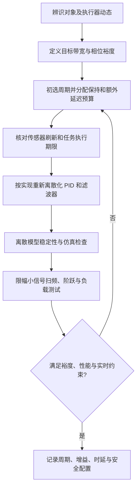

# 数字控制采样周期与伺服带宽（Digital Control Sampling Period and Servo Bandwidth）

## 一句话定义

采样周期 $T$ 是数字控制器定时更新的间隔；选周期要同时满足目标闭环动态、相位裕度、传感器有效更新与实时执行预算，而非仅追求高频。

## 英文缩写速查

| 缩写 | 英文全称 | 简要说明 |
|---|---|---|
| PID | Proportional–Integral–Derivative | 比例、积分、微分控制 |
| ZOH | Zero-Order Hold | 采样间保持上次控制输出 |
| PM | Phase Margin | 开环增益交越处的相位裕度 |
| BW | Bandwidth | 按指定闭环响应定义的带宽 |
| PLC | Programmable Logic Controller | 可编程逻辑控制器 |
| WCET | Worst-Case Execution Time | 最坏执行时间 |

## 为什么重要

底层关节伺服的更新频率与高层策略输出频率不是同一件事。即使高层动作每 10 ms 更新一次，底层位置/力矩环也可以每 1 ms 更新；通信、数据年龄、执行器动态与保持方式共同决定实际性能。采样过慢会消耗相位预算，过快则可能引入截止期限违约、重复观测和微分噪声。

## 核心原理

### 频率单位与经验初选

$f_s=1/T$，$f_b=\omega_b/(2\pi)$；$\omega_b$ 表示指定闭环带宽（如低通跟踪响应的 −3 dB 点），$\omega_{gc}$ 表示开环增益交越角频率，两者不能无条件等同。

原文的经验初选 $T\approx 1/(10\omega_b)$，其中 $\omega_b$ 用 rad/s；等价于 $f_s/f_b\approx20\pi\approx62.8$，并非每个带宽周期采样十次。若采用 $f_s\approx10f_b$，则 $T\approx2\pi/(10\omega_b)$。Nyquist 条件也只给出频谱约束，并不保证数字闭环稳定。

以 $\omega_b=80$ rad/s（12.73 Hz）为例，原文规则得到 1.25 ms，可初选 1 ms；十倍 Hz 规则则得到 7.85 ms，二者不是同一规则。最终依据实际离散模型与实测裕度选择。

### ZOH 与相位预算

理想保持器归一化频率响应：

$$
H_{\mathrm{ZOH}}(j\omega)=\frac{1-e^{-j\omega T}}{j\omega T}
=e^{-j\omega T/2}\frac{\sin(\omega T/2)}{\omega T/2}
$$

在首个正幅频段，相位为 $-\omega T/2$，还存在 sinc 幅值衰减；它不等价于完整采集到执行延迟。若另有固定延迟 $\tau_d$，低频近似相位损失为 $\omega_{gc}(T/2+\tau_d)$；滤波器的相位需另计，不能把同一段延迟重复预算。给定无这些额外环节的相位裕度 $PM_0$ 和目标 $PM_{\min}$，在交越近似不变、滤波损失 $\phi_f$ 已知的条件下，可初筛：

$$
\omega_{gc}(T/2+\tau_d)+\phi_f\le PM_0-PM_{\min}
$$

全部角度用 rad。若固定延迟已经耗尽裕度，缩短周期也未必够用；实际须重新计算离散开环交越点及稳定性。

| 周期 | 更新频率 | 在 80 rad/s 的 ZOH 相位损失 | 假定原裕度 60° 且交越不变时剩余 |
|---|---:|---:|---:|
| 10 ms | 100 Hz | 22.92° | 37.08° |
| 5 ms | 200 Hz | 11.46° | 48.54° |
| 2 ms | 500 Hz | 4.58° | 55.42° |
| 1 ms | 1 kHz | 2.29° | 57.71° |

表为数学计算，非实测；实际裕度与超调不是一一对应关系。

### 改周期时区分连续增益与离散系数

采用矩形积分和后向差分的并联位置式 PID（不含饱和和滤波）：

$$
I_k=I_{k-1}+T e_k,\qquad
u_k=K_pe_k+K_i I_k+K_d(e_k-e_{k-1})/T
$$

若代码直接累计误差样本并对样本做差，则系数 $a_i=K_iT$、$a_d=K_d/T$。保持连续增益时，10 ms → 1 ms 的 $a_i$ 变为原来的 1/10，$a_d$ 变为原来的 10 倍。若代码已经显式使用 $T$，不能机械地把 $K_i$ 和 $K_d$ 同时除十；若固定旧离散系数，等效连续增益反而发生变化。不同厂商的 PID 参数可能用积分时间、微分时间或内部离散系数，必须核实 API 定义。

差分对测量噪声敏感：相邻独立噪声标准差为 $\sigma$ 时，差分速度噪声标准差为 $\sqrt{2}\sigma/T$；真实噪声可能相关。100 mm/s、1 μm 分辨率时，1 ms 内 100 个计数间隔，10 ms 内 1000 个；慢速场景更应检查量化、时间戳及估计器。滤波可抑制噪声，但会消耗相位预算。

## 流程总览

## 工程实践

### 原文电液压机案例（作者报告，非独立复现）

| 指标 | 1 kHz / 1 ms | 100 Hz / 10 ms |
|---|---:|---:|
| 位置环带宽（rad/s） | 约 80 | 约 10 |
| 超调 | 8% | 25% |
| 上升时间 | 30 ms | 80 ms |
| 稳态误差 | 0.02 mm | 0.05 mm |

作者另报告 5 ms、2 ms 超调分别为 15%、10%。没有原始曲线、增益单位、载荷、带宽测量协议及控制器内部离散方式；以上只能作为现场经验线索，不可迁移为通用性能承诺。原文将液压固有角频率的 1/3–1/2 作为初选带宽的经验，不能当作所有对象的物理上限。

### 在机器人上验证

- 先分清内电流/力矩环、关节位置环与上层策略频率；记录实际传感时间戳、总线往返、输出刷新和任务周期。
- 检查最坏执行时间、抖动、丢周期和传感数据年龄；分位数不等于硬实时保证，超时应有安全降级。
- 用同一工作点、限幅和一致的连续控制律比较不同周期，在离散域校验闭环极点及开环裕度，再测上升、超调、调节时间、稳态误差和扰动响应。
- 在线改周期必须在安全状态同步修改离散系数、滤波、调度与状态处理，防止输出突变；不可用失稳试验代替安全验证。

## 局限与常见误区

- 采样更快不等于闭环带宽必然按比例提高；对象共振、执行器饱和、数据延迟与未建模动态仍约束性能。
- ZOH 阶梯信号本身不必然使阀或电机振荡；输出低通也不是无代价的通用修复。
- 原文末尾 5.7°/57° 相位案例缺少频率与完整延迟条件，不能与 80 rad/s 的 ZOH 计算直接混用。磨床案例的 0.02 mm 误差未证明满足 0.01 mm 目标。
- 原文无可运行源码或原始测量数据；流程图是根据文章归纳的工程验证流程，不是源码运行时序图。

## 关联页面

- [PID 控制](../methods/pid-control.md) — 增益与误差动力学
- [Bode 图](./bode-plots.md) — 交越频率与闭环带宽
- [控制环路延迟建模](../formalizations/control-loop-latency-modeling.md) — 总线、调度和计算延迟
- [接触力环带宽](./contact-force-loop-bandwidth.md) — 接触刚度与采样耦合
- [力矩控制电机设计纵深](../../roadmap/depth-torque-motor-design.md) — 底层控制与台架验证

## 推荐继续阅读

- [Modern Robotics](https://modernrobotics.org/) — 第 11 章机器人控制与数字实现；本仓库已有[通读归档](../../sources/books/modern_robotics_ch11_robot_control_reading.md)。

## 参考来源

- [《采样周期怎么选：1 kHz 和 100 Hz 差在哪儿》来源归档](../../sources/blogs/wechat_servo_sampling_period_2026-11-24.md) — 用户提供全文；数值勘误和 ZOH/PID 推导为本页独立数学核算。
