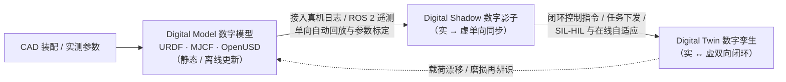

# 机器人数字孪生（Robot Digital Twin）

**机器人数字孪生（Robot Digital Twin）** 是面向具体一台物理机器人或机器人工作站的**虚实映射工程体系**：它以准确描述本体几何、运动副、惯量与执行器的物理模型为底座，通过传感器遥测、参数辨识与实时桥接与真机保持状态与参数同步，用于控制验证、故障复现、离线强化学习与寿命/安全预测。

## 一句话定义

> **不是「能看懂的 3D 模型」就是数字孪生——只有当按实造个体标定过的物理仿真模型，能通过传感回流与参数更新跟真实机器人形成闭环，才算数字孪生。**

## 英文缩写速查

| 缩写 | 英文全称 | 简要说明 |
|---|---|---|
| DT | Digital Twin | 数字孪生：物理实体与数字体之间具备双向自动数据与状态闭环 |
| DM | Digital Model | 数字模型：仅有手工或离线导出，无自动实时数据流 |
| DS | Digital Shadow | 数字影子：物理向数字单向自动流（遥测回放、日志复现） |
| IVHM | Integrated Vehicle Health Management | NASA 数字孪生范式中的机载健康管理与传感更新子系统 |
| SIL | Software-in-the-Loop | 软件在环：真实软件栈接入仿真虚拟机器人与环境 |
| HIL | Hardware-in-the-Loop | 硬件在环：真实控制器/计算板接入实时仿真闭环 |
| SysID | System Identification | 系统辨识：用实机输入输出数据反推惯量、摩擦等模型参数 |
| V&V | Verification and Validation | 验证与确认：核查方程求解正确且模型符合真实物理系统 |

## 为什么重要

- **区别于名义 CAD 与纯离线仿真**：Glaessgen & Stargel（2012）在 NASA/USAF 范式中指出，数字孪生绑定的是**按实造（as-built）的单个个体**而非通用名义图纸，且需要机载传感更新、维护记录与概率推理持续伴随其全生命周期。
- **工程防坑**：许多团队把“SolidWorks 导进渲染器加一个机械臂运动滑块”称为数字孪生，结果既没有经过动力学标定，也不能回放真机总线日志或驱动硬件在环，在控制开发和现场排障中无法信任。
- **打通硬件、仿真与真机运行**：向上承接 CAD 与标定结果，向下直接支撑 [SIL](./software-in-the-loop.md)、[HIL](./hardware-in-the-loop.md) 与 [Sim2Real](./sim2real.md)，让“研发期虚拟调试”和“运行期遥测回放与重标定”使用同一份资产真值。

## 核心原理

### 1. 数据集成度三级划分（Model → Shadow → Twin）

Kritzinger 等（2018）在制造业综述中按物理实体与数字对象之间数据流是否自动及是否双向，将三类常见形态严格区分；落到机器人工程上对应如下演进阶梯：

| 层级 | 数据流方向 | 机器人工程典型产物 | 能解决的问题 | 解决不了的问题 |
|---|---|---|---|---|
| **Digital Model** | 人工/离线单次同步 | 参数化 CAD 导出的 URDF/MJCF/OpenUSD + 物理属性 | 离线轨迹规划、RL 策略预训练、算法原型验证 | 无法反映单机装配个体差与运行磨损 |
| **Digital Shadow** | 物理机器人 → 数字体（单向） | 真机关节/IMU/力传感器日志实时驱动或回放仿真；离线/定期 SysID 回写 | 真机故障复现、执行器间隙对比、热/磨耗漂移审计 | 不在运行时反控或主动调整真实任务剖面 |
| **Digital Twin** | 物理机器人 ↔ 数字体（双向） | 双向状态同步工作站、SIL/HIL 虚拟调试闭环、在线预警与任务重规划 | 上机前 90%+ 软硬件联调、多机产线调度与安全边界护航 | 仍无法仅凭参数在线微调消除未建模的结构柔性 |

### 2. 正向工程数字孪生 vs 逆向感知 Real2Sim

机器人建模与孪生存在两条起点截然相反、但在场景层面汇合的流水线：

- **正向工程建模（CAD-to-Sim / 本概念主线）**：以已知工程图纸、CAD 装配体、电机选型与硬件台架参数为真值，构建**机器人本体及受控工装**的高精度动力学与执行器孪生（完整学习路径见 [机器人建模与数字孪生纵深路线](../../roadmap/depth-robot-modeling-digital-twin.md)）。
- **逆向感知重建（[Real2Sim](../../roadmap/depth-real2sim.md)）**：以真实世界的相机视频、深度点云、3DGS 为输入，重构**未知或非标外部环境与交互物体**（家具、杂乱桌面、地形）的可碰撞/可关节化资产。
- **汇合点**：在 [NVIDIA Omniverse](../entities/nvidia-omniverse.md) / OpenUSD 等场景底座上，用正向工程产出的**标定机器人孪生体**放进 Real2Sim 重建或 SimReady 拼装的**环境孪生体**，组成可供视觉与接触策略交互的完整闭环。

### 3. 机器人数字孪生的五层构成

结合 [仿真物理保真度链路](../queries/simulation-physics-fidelity.md) 与 [动力学仿真与动力学标定](./robot-dynamics-simulation-vs-calibration.md)，一套可工程验收的机器人数字孪生包含五层：

1. **几何与运动树/闭链层**：视觉网格与凸分解碰撞体分离，串联树之外的并联腿/连杆闭链显式建模。
2. **质量与惯量层**：区分连杆刚体 10 参数（满足正定与三角不等式）与电机转子折算惯量（`armature`），并按实机称重核对漏件（线束、电池、外壳）。
3. **执行器与接触层**：电机转矩-转速包络、电流环延迟、Stribeck/库仑摩擦、背隙与足底/指尖接触刚度。
4. **传感器与中间件层**：相机/LiDAR/IMU 外参、光学坐标约定、ROS 2 / EtherCAT 时钟同步与丢包延迟模型。
5. **V&V 与生命周期更新层**：对照 [物理保真度 ↔ sim2real gap](./physics-fidelity-sim2real-gap.md)，用台秤、静态重力矩 $g(q)$、激励轨迹动力学回归验证模型可信度，并将标定参数与机身序列号绑定版本化。

## 工程实践

1. **先走完 Digital Model 验收再谈 Twin**：确认零位冻结、惯量物理一致性、跨引擎 Sim2Sim（如 Isaac ↔ MuJoCo）轨迹对齐，再接入真机 ROS 2 topic 做实时回放（Digital Shadow）。
2. **严格区分仿真时钟与墙上时间**：SIL/HIL 联调时固定物理步长与控制周期比例（RTF），同步标定真机传感时间戳漂移，否则双向同步会把网络抖动误判为接触振荡。
3. **单真值源 + 衍生格式管理**：以工程参数与装配体为上游真值，导出并回归验证 [URDF vs MJCF vs SDF vs OpenUSD](../comparisons/urdf-vs-mjcf-vs-sdf-vs-openusd.md) 中的目标格式，避免多人手动改 XML 造成“仿真模型和真机图纸分叉”。
4. **记录不确定度而非只留均值**：从 NASA 范式的“概率仿真”与动力学标定经验出发，给质量/摩擦/延迟保留可信置信区间，供上游策略训练做有依据的域随机化。

## 局限与风险

- **渲染逼真度 ≠ 物理保真度**：高分辨率 PBR 材质和光追视觉对感知孪生重要，但接触打滑、冲击能量和关节带宽决定控制层是否可用。
- **参数辨识不能替代结构建模**：如果真机存在显着结构柔性、谐波柔轮非线性扭转或未建的闭链间隙，只做刚体惯量辨识会把结构性误差强行塞进错误参数里。
- **实时双向同步的通信与安全边界**：双向孪生若把仿真预测或远程控制直接反馈至物理机器人，必须设置独立硬件急停（STO）与安全状态机监控，避免网络断开或仿真发散危及真机。
- **本页证据边界**：NASA Glaessgen & Stargel (2012) 与 NVIDIA SIL 文档已通读全文；Kritzinger 等 (2018) 三级集成度分类因出版商访问限制未读取全文，仅基于公开书目与摘要作概念分级参考。

## 关联页面

- [机器人建模与数字孪生纵深路线](../../roadmap/depth-robot-modeling-digital-twin.md) — 本概念对应的 CAD → 仿真 → 数字孪生完整学习路径
- [URDF（统一机器人描述格式）](./urdf-robot-description.md) — 数字模型层的常用运动树入口
- [URDF vs MJCF vs SDF vs OpenUSD](../comparisons/urdf-vs-mjcf-vs-sdf-vs-openusd.md) — 描述格式与物理能力选型
- [机器人仿真三层分工](./robot-simulation-three-layers.md) — 物理引擎 / 仿真平台 / 学习框架的分层关系
- [动力学仿真与动力学标定](./robot-dynamics-simulation-vs-calibration.md) — 正向仿真与反向标定的四个接口
- [仿真物理保真度链路选型指南](../queries/simulation-physics-fidelity.md) 与 [物理保真度 ↔ sim2real gap](./physics-fidelity-sim2real-gap.md) — 四层保真度投入决策枢纽
- [Software-in-the-Loop（SIL）](./software-in-the-loop.md) · [Hardware-in-the-Loop（HIL）](./hardware-in-the-loop.md) — 从纯仿真验证迈向实物在环的阶梯
- [System Identification](./system-identification.md) · [Sim2Real](./sim2real.md) — 参数反推与真机迁移出口
- [Real2Sim 纵深路线](../../roadmap/depth-real2sim.md) — 面向外部真实场景的逆向重建互补路线
- [NVIDIA Omniverse](../entities/nvidia-omniverse.md) — 工业与机器人 OpenUSD 数字孪生协作平台

## 参考来源

- [Glaessgen & Stargel (2012) NASA/USAF Digital Twin 原文归档](../../sources/papers/glaessgen_stargel_2012_nasa_digital_twin.md)
- [Isaac Sim Software-in-the-Loop (SIL) 官方教程归档](../../sources/sites/nvidia-isaac-sim-sil-tutorial.md)
- [Isaac Sim Hardware-in-the-Loop (HIL) 官方教程归档](../../sources/sites/nvidia-isaac-sim-hil-tutorial.md)
- [Kritzinger et al. (2018) Digital Twin 分类元数据归档（未读全文）](../../sources/papers/kritzinger_2018_digital_twin_classification.md)
- [动力学仿真与动力学标定来源归档](../../sources/blogs/wechat_zanehub_dynamics_simulation_vs_calibration_2026-11-10.md)

## 推荐继续阅读

- [Glaessgen & Stargel (2012), *The Digital Twin Paradigm for Future NASA and U.S. Air Force Vehicles* (NASA NTRS)](https://ntrs.nasa.gov/citations/20120008178)
- [NVIDIA Getting Started With Isaac Sim — SIL & HIL Modules](https://docs.nvidia.com/learning/physical-ai/)
- [OpenUSD Physics Schema Overview (Pixar OpenUSD)](https://github.com/PixarAnimationStudios/OpenUSD/blob/release/pxr/usd/usdPhysics/overview.dox)
