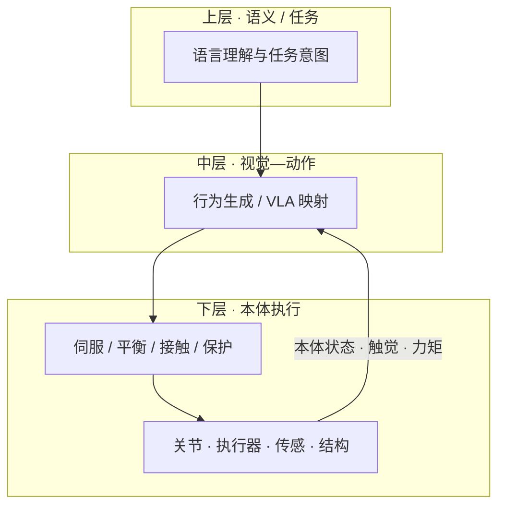

# 具身大模型与本体协同设计

> **证据范围**：已通读 Figure 于 2025-02-20 发布的 Helix 初代官方技术说明。下文以它核对策略接口与异步控制；采购、自研和量产部分是工程选型判断，不是该案例验证的行业定律。微信归档仅作历史背景，未完成原文通读。

## 一句话定义

**具身大模型与本体协同设计**指：具身智能的「通用」首先是 **在特定本体边界内扩大可执行任务覆盖面**，而非脱离硬件的万能模型；工程上需共同定义 **动作接口、观测与标定、控制时序及安全边界**；自研或外购应按这些约束能否验证来选，而不能单凭模型泛化能力决定。

## 英文缩写速查

| 缩写 | 英文全称 | 简要说明 |
|------|----------|----------|
| EFM | Embodied Foundation Model | 具身基础/大模型，跨任务策略或 VLA 族 |
| DoF | Degrees of Freedom | 自由度，定义可达动作空间 |
| VLA | Vision-Language-Action | 视觉-语言-动作统一策略 |
| VLM | Vision-Language Model | 视觉语言模型，在 Helix S2 中生成语义条件 |
| Sim2Real | Simulation to Reality | 仿真到真机迁移，依赖本体参数一致性 |
| DFM | Design for Manufacturing | 面向制造的设计，软硬件量产的共同语言 |

## 为什么重要

- **澄清「通用」两层含义**：模型层任务泛化（今天的主战场）与硬件层形态泛化（远未成熟）常被混谈，导致误判「自研本体 = 放弃通用」。
- **明确案例能说明什么**：Helix 将语义模型接到具体本体的状态与动作接口，说明任务泛化仍需闭环执行；它不单独证明自研优于外购。
- **给研发分阶段判据**：算法验证期可用成熟平台；产品交付期则本体、控制器、传感与售后须统一设计——见 [人形整机硬件设计路线](../../roadmap/depth-humanoid-hardware-design.md)。

## 核心原理

### 有效通用性的工程分解

文内常用近似（任一因子偏弱都会把能力压回 demo 级）：

```
有效通用性 ≈ 模型泛化能力 × 本体可达动作空间 × 传感闭环质量 × 安全边界
```

- **动作空间**：关节能否到位、力矩是否够用、回差与热管理是否稳定（见 [机械布局设计](./humanoid-mechanical-layout-design.md)）。
- **传感闭环**：触觉/视觉/本体感知是否可信、标定是否可重复。
- **安全边界**：协作场景下受力、停止与故障降级是否可验证；具体标准的适用范围和合规结论需另行核对。

### 案例：分层频率与本体绑定

[Helix 初代官方说明](https://www.figure.ai/news/helix)明确区分 **S2：7B VLM，7–9 Hz** 与 **S1：80M 视觉运动 Transformer，200 Hz**。S2 将语言、图像与状态压缩为连续 latent；S1 结合最新观测和 latent，输出 **35-DoF 上半身** 的腕部位姿、手指及头/躯干目标，另有任务完成百分比。这里的 200 Hz 是策略动作更新频率，不是电机电流环频率。

训练时给 S1/S2 输入加入与部署推理时延匹配的时间偏移；部署时两颗嵌入式 GPU 分别运行异步 S2 与高频 S1。这是已公开的时序协同证据，并非完整底层伺服或安全控制器说明。下图为接口层概括，非未公开源码的运行时序。



与 [人形策略网络架构](./humanoid-policy-network-architecture.md)、[具身大模型分类学选型闭环](../overview/hub-embodied-foundation-model.md) 中的「大模型高层 + 实时低层」叙事同向。

### 工程选型：需要掌握哪些本体约束

| 约束 | 机制 | 选型时应核对 |
|------|------|----------------|
| **数据资产** | 高质量示教数据带本体烙印（腕刚度、摩擦、编码器分辨率） | 外购平台能否提供状态、标定及数据接口 |
| **控制分层** | 上层定意图，下层定捏/托/推抓与接触力 | 动作语义、时间戳及延迟能否对齐 |
| **仿真—量产** | 质量/惯量/接触/延迟须与实机对齐 | 批次一致性及参数辨识是否可验证 |
| **安全责任** | 任务风险评估要求明确停止与感知边界 | 自研和外购均需独立验证保护机制 |

下图是工程组织建议，不是 Helix 官方披露的完整训练管线：


### 模型通用 ≠ 硬件形态通用

- **模型层**：在固定本体上扩展未见物体、新指令、多机协同等任务覆盖——[Foundation Policy](./foundation-policy.md) 与 Open X-Embodiment 等路线的主战场。
- **硬件层**：Helix 的同平台双机同权重演示不能推出「一套策略无差别驱动所有人形/臂/足」；[跨具身迁移](../overview/hub-cross-embodiment.md) 研究的是 **有限接口下的迁移**，不是否认本体定义权。

## 工程实践

### 分阶段是否自研本体

| 阶段 | 目标 | 建议平台 |
|------|------|----------|
| 算法验证 | 感知、任务拆解、多模态交互 | 成熟机械臂、移动底盘、现成夹爪 |
| 产品交付 | 可重复作业、良率、售后、安全认证 | 统一本体 + 控制器 + 传感 + 工艺（见 [量产工程](./humanoid-mass-production-engineering.md)） |

### 自研本体的真实含义

- **不是** 从零制造每一颗螺丝。
- **是** 掌握系统级定义权：哪些外购、哪些定制、哪些参数与接口必须统一——与 [Hardware 101 技术地图](../overview/humanoid-hardware-101-technology-map.md) 中的执行器/传感链选型衔接。

### 选型自检（读后可用）

1. 本体的 **DoF 与力矩包络** 是否覆盖目标任务，而非只看模型参数量？
2. 数据采集—训练—部署是否 **同一套标定与维护口径**？
3. 仿真器中的 **接触与延迟** 是否与实机批次一致？
4. 若走协作部署，停止、接触保护和故障降级能否按任务风险单独验收？

## 局限与风险

- **证据来自官方技术博客**：Helix 约 500 小时遥操作数据和新物体/双机协作演示是厂商披露；该文没有完整逐任务重复试验成功率、安全认证及任意本体迁移的证据。
- **复现边界**：本次检查官方页面未见完整 Helix 训练/部署代码、权重和训练数据下载；公开骨干模型不等于完整系统开源。
- **标准边界**：未通读 ISO 标准全文，不在本页给出认证或合规结论。
- **过度自研**：早期全栈自研会拖慢算法迭代；应匹配阶段目标。
- **过度外购**：产品化阶段关键模组批次不一致会导致数据与仿真双失效。
- **概念偷换**：把「跨具身数据集」误解为「无需固定本体即可交付」，会低估 [重定向与接口对齐](../overview/hub-cross-embodiment.md) 成本。

## 关联页面

- [具身大模型分类学选型闭环（知识链枢纽）](../overview/hub-embodied-foundation-model.md)
- [Foundation Policy（基础策略模型）](./foundation-policy.md)
- [人形策略网络架构](./humanoid-policy-network-architecture.md)
- [人形机器人量产工程能力](./humanoid-mass-production-engineering.md)
- [跨具身迁移（知识链汇总）](../overview/hub-cross-embodiment.md)
- [人形机械布局设计](./humanoid-mechanical-layout-design.md)

- [NVIDIA Deepu Talla 访谈：机器人 ChatGPT 时刻](../entities/nvidia-robotics-chatgpt-moment-deepu-talla-2026.md)：人形在既有人类环境中的优势与分层部署边界，属嘉宾观点而非量产实测。

## 参考来源

- [Figure Helix 官方原文通读复核](../../sources/papers/rcl_awesome_wam_ref_cb61c489d1333f433fc4_helix-a-vision-language-action-model-for.md) — 技术事实主来源；官方原文：<https://www.figure.ai/news/helix>（2025-02-20）。

- [wechat_zanehub_embodied_fm_why_self_develop_robot_body.md](../../sources/blogs/wechat_zanehub_embodied_fm_why_self_develop_robot_body.md) — Zane Hub 公众号：<https://mp.weixin.qq.com/s/Ao24KF_9mIt5qOwE7W92QA>

## 推荐继续阅读

- [Figure Helix 官方技术说明](https://www.figure.ai/news/helix) — 模型、训练、流式推理与演示边界
- [具身大模型分类学选型闭环](../overview/hub-embodied-foundation-model.md) — 模型族 I/O 边界与实时性取舍
