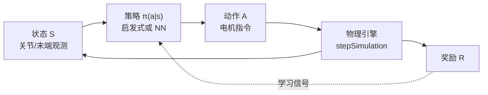

# 具身 RL 最小闭环（Embodied RL Minimal Closed Loop）

在具身智能里，**最小闭环**指：智能体与仿真（或真机）环境之间，每一步都能完成 **观测 → 决策 → 执行 → 物理推进 → 奖励反馈** 的完整回合，且各变量与 [MDP](../formalizations/mdp.md) 五元组一一对应。

## 一句话定义

先让「环境会动、奖励会算、动作能写进去」跑通，再谈 PPO 调参——否则 RL 只是在空转梯度。

## 英文缩写速查

| 缩写 | 英文全称 | 简要说明 |
|------|----------|----------|
| MDP | Markov Decision Process | $S,A,P,R,\gamma$ 五元组形式化 |
| POMDP | Partially Observable MDP | 真机部署时观测不完整的标准建模 |
| RL | Reinforcement Learning | 通过闭环交互优化策略 |
| PPO | Proximal Policy Optimization | 具身 loco 最常用的 on-policy 算法 |
| SAC | Soft Actor-Critic | 精细连续控制常用的最大熵 off-policy 算法 |
| HER | Hindsight Experience Replay | 稀疏奖励操作任务常用技巧 |

## 为什么重要

不先跑通闭环就调 PPO，等于在一个不知道哪里坏了的环境上调参：奖励恒为 0、动作没写进电机、`reset` 之后状态没重置，都会表现成「不收敛」。最小闭环把这些接口问题隔离出来先验证。教材（Sutton & Barto）对 RL 问题的看法正好支持这一点：智能体—环境之间只传三种信号——动作、状态、奖励；其中奖励的计算属于环境一侧。

## 核心原理

### 强化学习的三个核心特质

按 Sutton & Barto 第 1 章的表述：

1. **没有「正确动作」的标注** — 反馈来自环境给出的奖励，而非教师给出的目标输出（与监督学习相对）。
2. **延迟因果** — 动作影响的不只是即时奖励，还有后继状态与以后的奖励，所以需要在即时与延迟奖励之间权衡。
3. **探索与利用** — 要获得高奖励必须偏好试过有效的动作，但要发现有效动作又必须尝试没选过的动作，二者不能偏废；教材称这是 RL 特有、监督 / 无监督学习里不出现的难题。

PPO 的 clip 限制的是**每次更新的策略变化幅度**；SAC 的熵项鼓励随机性以促进探索并提高稳定性（见 [SAC 论文归档](../../sources/papers/sac_reading_arxiv_1801_01290.md)）——二者作用机制不同，不应都说成「约束别一次改太猛」（此前旧版这样写，已更正）。

**策略** $\pi(a|s)$ 即「路牌」：输入状态，输出动作；工程上多为神经网络，用 PPO/SAC 等更新参数。

## 五元组与仿真循环的映射

教材第 3 章的约定：时间步 $t$ 上，智能体收到状态 $S_t$，选动作 $A_t$，下一步收到奖励 $R_{t+1}$ 与新状态 $S_{t+1}$，形成轨迹 $S_0,A_0,R_1,S_1,A_1,R_2,\dots$；马尔可夫性要求状态包含过去交互里一切影响未来的信息。

以 [PyBullet](../entities/pybullet.md) KUKA 臂 **定点到达** 教学任务为例：

| MDP 要素 | 仿真实现 |
|----------|----------|
| $S$ | `getLinkState` 得末端位置、关节角 |
| $A$ | `setJointMotorControl2` 速度/位置/力矩指令（注意默认每个关节带速度电机，力矩控制须先把它的 `force` 置 0） |
| $R$ | 如 $R=-\|p_{ee}-p_{target}\|$（越近越高） |
| $P$ | `stepSimulation()` 后 Bullet 积分重力与碰撞（默认步长 1/240 s） |
| $\gamma$ | 训练算法侧对多步回报加权（手写 demo 可单步） |

进阶时把 $\pi$ 从手写规则换成 **PPO/SAC 输出的神经网络**，其余闭环结构不变。

## 离散 vs 连续动作

| 类型 | 例子 | 具身相关性 |
|------|------|------------|
| 离散 | 围棋落子、网格移动 | 教学用；真机 loco 较少 |
| 连续 | 关节力矩、目标位置偏移 | **具身主流** — 状态维高、动作维高 |

## PPO 与 SAC 的具身分工（速查）

| 算法 | 何时优先 | 原因 |
|------|----------|------|
| **PPO** | 四足/人形行走、大规模并行仿真 | on-policy 与 Isaac 类环境契合；Clip 保稳定 |
| **SAC** | 灵巧手、精细抓取、摩擦/位姿扰动大 | 最大熵探索更充分、样本复用 |

详见 [PPO vs SAC](../comparisons/ppo-vs-sac.md)。稀疏奖励操作可叠 [HER](../methods/her.md)。

## 工程实践

### 推荐最小实验路径

1. **PyBullet 手写闭环** — 验证 $S,A,R,P$ 接口（见 [PyBullet](../entities/pybullet.md)）。
2. **Gymnasium 玩具环境** — [CartPole](./cartpole.md) 等跑通 PPO API；同一倒立摆在 Isaac Lab 上是 `Isaac-Cartpole-v0`，数字不能照搬。
3. **Isaac Lab 人形** — 并行环境与 domain randomization（见 [运动控制路线 L5.2](../../roadmap/motion-control.md#l52-rl-在人形运动控制里的应用)）。

真机训练前必须在仿真完成闭环；试错成本与设备安全是硬约束。

### 接口检查清单

1. `reset()` 后状态确实回到初始分布（Gymnasium CartPole 的初始四维各在 $(-0.05,0.05)$ 均匀采样）；
2. `step()` 返回的 `terminated`（失败 / 成功）与 `truncated`（超时）分开——超时应 bootstrap，真终止不应（CartPole 源码即如此区分）；
3. 动作真的写进了执行器，并核对控制模式（PyBullet 默认速度电机会吞掉力矩指令）；
4. 奖励尺度合理、非恒定；
5. 手写策略（如直接朝目标走）能拿到明显高于随机策略的回报，再换成 PPO / SAC。

## 部署时的 POMDP

标准 MDP 假设 $s$ 完全可观测。真机通常只有 IMU、编码器、噪声视觉 → 建模为 [POMDP](../formalizations/pomdp.md)：用历史观测、RNN 或 Transformer 编码隐状态，再输出动作。

## 局限与风险

- **教学闭环不等于可训练闭环：** KUKA 定点到达这类任务的奖励 $-\|p_{ee}-p_{target}\|$ 是教学用例，页面没有给出训练收敛实验；实际任务还要处理接触、关节限位与奖励尺度。
- **玩具环境的数字不能照搬：** 同名 Cartpole 在 Gymnasium 与 Isaac Lab 里的动作类型、终止与奖励都不同（见 [Cartpole](./cartpole.md)）。
- **仿真器本身有默认设置：** 如 PyBullet 的线 / 角阻尼与 100 的速度钳制会影响动力学，见 [PyBullet](../entities/pybullet.md)。
- **部分可观测会破坏马尔可夫假设：** 真机部署需 POMDP 视角。
- **本页的 KUKA 映射表与「PPO/SAC 分工」** 来自博客与策展，教材与官方文档只核对了 MDP 记号、PyBullet API 与 CartPole 接口，没有逐项核对 KUKA 脚本。

## 关联趋势（扩展阅读）

- [仿真物理保真度链路选型指南](../queries/simulation-physics-fidelity.md) — 本页所述物理/仿真要素在保真度链路（建模 ① → 数值 ② → 接触 ③ → 随机化 ④）中的定位
- **LLM + RL**：语义规划 + 底层 RL 执行。
- **多任务统一策略**：单网络覆盖 loco / 操作。
- **内在奖励探索**：[Intrinsic reward 预训练](../overview/bfm-category-03-intrinsic-reward-pretraining.md) — 无手工奖励时的自驱动探索。

## 关联页面

- [MDP](../formalizations/mdp.md) · [POMDP](../formalizations/pomdp.md)
- [Reinforcement Learning](../methods/reinforcement-learning.md)
- [RL Runner（训练循环编排）](./rl-runner.md) — 最小闭环外包的采集–更新–评测调度；本页只保证环境会转
- [人形 RL 策略训练五模块](../overview/humanoid-rl-policy-training-five-modules.md) — 从 MDP 扩到 Actor-Critic / PPO / 奖励 / 蒸馏的完整训练闭环
- [RL 运动控制完整管线](../overview/robot-rl-motion-control-pipeline.md) — 专栏 06：在最小闭环上叠 PD / PPO / 蒸馏 / DR
- [主路线：运动控制 L5](../../roadmap/motion-control.md#l5-强化学习与模仿学习)
- [Cartpole 问题](./cartpole.md) — L5.1 玩具环境的独立对照节点（Gym vs Isaac-Cartpole-v0）
- [深蓝《具身智能基础》专栏地图](../overview/shenlan-embodied-ai-fundamentals-series.md)

## 参考来源

- [Sutton & Barto 教材归档（第 1、3 章，§17.3）](../../sources/books/sutton_barto_rl_intro_2nd_ed.md) — 智能体—环境接口、探索与利用、马尔可夫性
- [PyBullet Quickstart Guide 归档](../../sources/sites/pybullet-quickstart-guide.md) — `stepSimulation`、电机控制、`getLinkState`
- [Gymnasium CartPole 归档](../../sources/sites/gymnasium-cartpole.md) — `terminated` / `truncated` 与重置约定

- [深蓝具身智能：跑通具身控制最小闭环](../../sources/blogs/wechat_shenlan_rl_embodied_minimal_closed_loop.md) — <https://mp.weixin.qq.com/s/hHkQqLfIOTn0CoAZNuLWJA>
- [深蓝具身智能：人形 RL 策略训练体系](../../sources/blogs/wechat_shenlan_humanoid_rl_policy_training_system.md) — <https://mp.weixin.qq.com/s/mxesB0pGI_NLSkSf-cZYug>

## 推荐继续阅读

- [Sutton & Barto 教材第 3 章](http://incompleteideas.net/book/RLbook2020.pdf)
- [PyBullet Quickstart Guide](https://docs.google.com/document/d/10sXEhzFRSnvFcl3XxNGhnD4N2SedqwdAvK3dsihxVUA/edit)
- [Gymnasium CartPole 文档](https://gymnasium.farama.org/environments/classic_control/cart_pole/)
