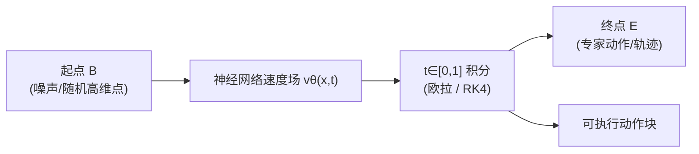

# 流匹配与具身策略（Flow Matching for Embodied Policy）

> **来源说明：** 2026-11-07 起，本页的数学与系统陈述改以原论文核实：[Lipman et al., Flow Matching for Generative Modeling](../../sources/papers/lipman_flow_matching_arxiv_2210_02747.md)、[π₀](../../sources/papers/pi0_arxiv_2410_24164.md)、[GR00T N1](../../sources/papers/gr00t_n1_arxiv_2503_14734.md)、[SmolVLA](../../sources/papers/smolvla_arxiv_2506_01844.md)；[深蓝具身智能专栏第 14 篇](https://mp.weixin.qq.com/s/Reqadr6Jpp6a1CP9TlCTUw)只作科普口径，下文标“专栏”处未经原文验证。与 [概率流形式化](../formalizations/probability-flow.md) 对齐；**不替代**单篇论文实体页。

## 一句话定义

**流匹配把「生成一条动作或轨迹」写成在高维状态空间里学习速度场 \(v_\theta(x,t)\)，再在 \(t\in[0,1]\) 上积分——输出的是瞬时速度规则，累积后才得到可执行的离散动作块。**

## 英文缩写速查

| 缩写 | 英文全称 | 简要说明 |
|------|----------|----------|
| FM | Flow Matching | 直接回归速度场的生成式训练 |
| CFM | Conditional Flow Matching | 逐样本的条件目标，与 FM 梯度相同 |
| CNF | Continuous Normalizing Flow | 由神经网络向量场定义的连续流 |
| OT | Optimal Transport | 线性插值路径对应的直线等速条件流 |
| NFE | Number of Function Evaluations | 求解 ODE 的网络调用次数 |
| ODE | Ordinary Differential Equation | 确定性积分；部署时常用欧拉/ RK4 离散化 |
| VLA | Vision-Language-Action | 视觉-语言-动作策略；动作头常用 FM |
| DP | Diffusion Policy | 扩散式动作生成对照基线 |
| CFG | Classifier-Free Guidance | 条件生成（专栏对比「条件流匹配」） |

## 为什么重要

- **动作「顿一下」的工程解释：** 离散分步采样/去噪会在步间积累误差；FM 强调 **连续速度场 + 少步积分**，与 VLA 低延迟叙事一致（见 [VLA](../methods/vla.md) 中 flow 系条目）。
- **与 Diffusion 的关系：** 专栏口径——扩散可视为 **带随机扰动、路径受限** 的 FM 特例；数学统一见 [Probability Flow](../formalizations/probability-flow.md) 与 [MIT 6.S184](../overview/mit-flow-matching-diffusion-2026.md)。
- **具身输入–输出分工（专栏）：** 输入 = **设备状态 + 环境观测** + **目标状态分布**；网络输出 = **速度场**，须经积分才得轨迹/动作块——不是一步出关节角。
- **原论文给出的理由：** Lipman 等在同一 U-Net 上对比 FM-OT 与 DDPM：ImageNet-32 的 FID 5.02 vs 6.99、NFE 122 vs 262；达到相同数值误差约只需 60% 的 NFE。π₀ 论文称 flow matching 带来“高精度与多模态建模能力”，适合 50 Hz 的灵巧操作，并作为自回归离散化 VLA（如 OpenVLA）不支持动作块的对照。

## 核心原理

### 原论文数学（Lipman et al., 2023）

约定 $t=0$ 为噪声、$t=1$ 为数据。FM 目标 $\mathcal L_{FM}=\mathbb E\|v_t(x)-u_t(x)\|^2$ 的 $u_t$ 不可得；论文证明（Theorem 1–2）对每个数据点 $x_1$ 定义条件路径 $p_t(x|x_1)$ 与条件场 $u_t(x|x_1)$，则条件目标 $\mathcal L_{CFM}=\mathbb E\|v_t(x)-u_t(x|x_1)\|^2$ 与 $\mathcal L_{FM}$ 的梯度一致。取高斯路径 $\mathcal N(\mu_t(x_1),\sigma_t^2 I)$ 时唯一对应场为 $u_t=\frac{\sigma_t'}{\sigma_t}(x-\mu_t)+\mu_t'$（Theorem 3）；线性取 $\mu_t=tx_1$、$\sigma_t=1-(1-\sigma_{min})t$ 即 OT 路径：粒子沿直线、等速运动，回归目标 $x_1-(1-\sigma_{min})x_0$。VE/VP 扩散路径是同一高斯族的特例。注意：条件流是 OT 并不代表边缘场是 OT 解。采样即对学习到的 $v_t$ 做 ODE 积分。

### 专栏「小纸船」模型

### 训练（线性插值监督，一种常见写法）

对一对 \((B,E)\)，采样 \(t_n\in[0,1]\)，中间点 \(s_n=(1-t_n)B+t_n E\)；专栏用相邻采样差分作 **标签速度**。按原论文，线性路径的标签是解析的常量 $E-B$（噪声到数据的差），π₀ 即写作：$A^\tau=\tau A+(1-\tau)\epsilon$，目标 $A-\epsilon$，$\tau$ 取偏向低值（更噪）的 Beta 分布；这是 **确定性向量标签**，与扩散 **加噪随机步** 对比。

### 具身系统里的写法（原文核实）

| 项 | π₀ | GR00T N1 | SmolVLA |
|----|----|----------|---------|
| 动作头结构 | 与 VLM 共享注意力的 ~300M 动作专家（第二套权重，MoE 式），非 DiT | DiT 变体：自适应层归一化注入去噪步，交替交叉/自注意力，交叉关注 VLM 输出 | ~100M 动作专家，交叉注意力与因果自注意力交错 |
| 时间步注入 | 噪声动作与 $\phi(\tau)$ 拼接后过 MLP 作输入 | adaLN | 论文未单独说明时间步嵌入方式（$\tau$ 取 Beta 分布采样） |
| 注意力 | 3 块分块因果（图文 / 状态 / 动作），动作块内双向 | 交叉注意力 | 动作 token 因果自注意力（双向更差：67.5 vs 74.5） |
| 动作块 / 步数 | H=50；10 步欧拉（$\delta=0.1$） | 16 动作块；K=4 步欧拉 | n=50；10 步 |
| 延迟 | 4090 上板载 73 ms（观测前向 32 ms + 10 步动作前向 27 ms + 图像编码 14 ms） | L40 bf16 采样 16 个动作 63.9 ms | — |

前向欧拉：$A^{\tau+\delta}=A^\tau+\delta v_\theta(A^\tau,o_t)$。注意时间约定：Lipman、π₀、GR00T N1 均是 $\tau=0$ 噪声、$\tau=1$ 数据；SmolVLA 论文把目标写成 $\epsilon-A$，与其插值式求导的符号相反（原文不一致），π₀ 来源归档还提示官方 openpi 源码采用相反的时间方向（本次未核对源码），复现前先对齐约定。

### 与 Diffusion 的对照轴

| 轴 | 流匹配（专栏口径） | 扩散 |
|----|-------------------|------|
| 每步指引 | 确定速度向量 | 常含随机噪声 |
| 路径 | 可灵活匹配两分布 | 常固定噪声↔数据线性路径 |
| 部署积分 | 少步即可（曲率小假设） | 多步去噪，易「磕磕绊绊」 |
| 理论位置 | 通用框架 | FM 框架下的特例 |

## 具身智能中的实例（已有 wiki 节点）

| 系统 | 角色 | 本库入口 |
|------|------|----------|
| π₀ / π₀.5 | PaliGemma（3B）+ **约 300M flow matching 动作专家**，共 3.3B 参数（π₀ 论文） | [π₀ 方法](../methods/π0-policy.md)、[π₀.7](../methods/pi07-policy.md) |
| GR00T N1 | DiT **flow-matching** 动作模块（System 1，论文称 120 Hz 闭环出动作；VLM 约 10 Hz） | [GR00T N1 实体](../entities/paper-hrl-stack-34-gr00t_n1.md) |
| SmolVLA | 0.45B，**Action Expert 用 FM**（LIBERO 平均 87.3，与 π₀ 的 86.0 相当） | 底座 [2506.01844](https://arxiv.org/abs/2506.01844)；[ROS2SmolVLA](../entities/paper-ros2smolvla.md) 部署例 |

更多 flow VLA 索引见 [VLA 方法页](../methods/vla.md)「π₀ / SmolVLA / Green-VLA …」段；**World Action Model** 侧的 joint flow 见 [Rolling-WAM](../entities/paper-rolling-wam.md) 等，与「动作头 FM」问题域不同。

## 工程实践

- **去噪步数是延迟预算的主旋钮：** 论文取值 π₀ 10 步、GR00T N1 4 步、SmolVLA 10 步、RTC 论文里 π₀.₅ 用 n=5 步（[RTC](../entities/paper-real-time-chunking.md)）。π₀ 推理可缓存图像/语言/状态前缀的 KV，只对动作后缀重复前向。
- **与动作块执行的衔接：** flow 策略一次出一块动作，执行与下一次推理的重叠由 [Action Chunking](../methods/action-chunking.md)、[Real-Time Chunking](../entities/paper-real-time-chunking.md) 与 SmolVLA 的异步队列处理；RTC 在推理期对去噪过程做 inpainting 引导，并不改训练。
- **条件建模：** 观测、语言经 VLM 编码；动作 DiT 与 Transformer 骨干的关系见 [Diffusion Transformer](./diffusion-transformer.md)、[Transformer](./transformer.md)。

### 专栏补充（未经原文验证）

- **四环节：** 中间状态采样 → 速度场拟合 → 误差统计 → 参数优化；结构随状态维度而变，要求 **速度场平滑** 以利积分。
- **硬件：** 算法不绑定设备；低维任务 CPU 可训可推；高维多机协同依赖 **GPU 并行**；压缩模型可上嵌入式。

## 局限与风险

- **原论文是图像实验：** Lipman 等只在 CIFAR-10/ImageNet 与超分上验证 FM-OT 的收敛与采样效率优势；“少步即可”迁移到动作空间是具身论文各自的经验选择（4–10 步），并非该论文的结论。
- **证据口径不同：** π₀ 的对照是任务进度分数（允许部分得分），GR00T N1、SmolVLA 的基准不同，三者数字不能横向直接比较；SmolVLA 的结果还受其社区数据与 SO100 小臂设定限制。
- **π₀ 论文自述：** 不同预训练数据的配比如何选、多机器人混合的正迁移能否推广到驾驶/导航/腿足，仍是开放问题。
- **π₀ 与 SmolVLA 在动作 token 注意力上结论相反：** π₀ 的动作专家全双向，SmolVLA 的消融里双向反而更差，说明注意力掩码设计依赖具体架构与数据。

## 常见误区

- 把 **速度场输出** 当成可直接下发的关节指令（缺积分步）。
- 将专栏「FM 取代 Diffusion」读成 **所有机器人栈已切换**——实际多为 **动作头/短 horizon 生成**，感知与其它模块仍多样。
- 忽略 **条件流匹配**（语言/子任务/控制模态）与 π₀.7 **steering** 的关系（见 [π₀.7 方法页](../methods/pi07-policy.md)）。

## 关联页面

- [Diffusion Transformer](./diffusion-transformer.md)
- [Real-Time Chunking](../entities/paper-real-time-chunking.md)
- [Probability Flow（形式化）](../formalizations/probability-flow.md)
- [Diffusion Policy](../methods/diffusion-policy.md)
- [MIT Flow Matching & Diffusion 2026](../overview/mit-flow-matching-diffusion-2026.md)
- [VLA](../methods/vla.md)
- [具身大模型分类学选型闭环](../queries/embodied-fm-taxonomy-loop.md) — flow-matching 动作头所在的 VLA 执行层与其上下游 VLM / VLN / WM 的选型边界

## 参考来源

- [Lipman et al. Flow Matching（原文归档）](../../sources/papers/lipman_flow_matching_arxiv_2210_02747.md)
- [π₀ 论文归档](../../sources/papers/pi0_arxiv_2410_24164.md)
- [GR00T N1 论文归档](../../sources/papers/gr00t_n1_arxiv_2503_14734.md)
- [SmolVLA 论文归档](../../sources/papers/smolvla_arxiv_2506_01844.md)
- [专栏第 14 篇归档](../../sources/blogs/wechat_shenlan_flow_matching_embodied_column14_2026-09-26.md)
- [probability-flow 形式化](../formalizations/probability-flow.md)（数学侧）

## 推荐继续阅读

- [Flow Matching for Generative Modeling（arXiv:2210.02747）](https://arxiv.org/abs/2210.02747)
- [MIT 6.S184 讲义 An Introduction to Flow Matching and Diffusion Models（arXiv:2506.02070）](https://arxiv.org/abs/2506.02070)
- [π₀ (Pi-zero) 策略模型](../methods/π0-policy.md)
- [GR00T N1](../entities/paper-hrl-stack-34-gr00t_n1.md)
- [arXiv:2506.01844 SmolVLA](https://arxiv.org/abs/2506.01844)
