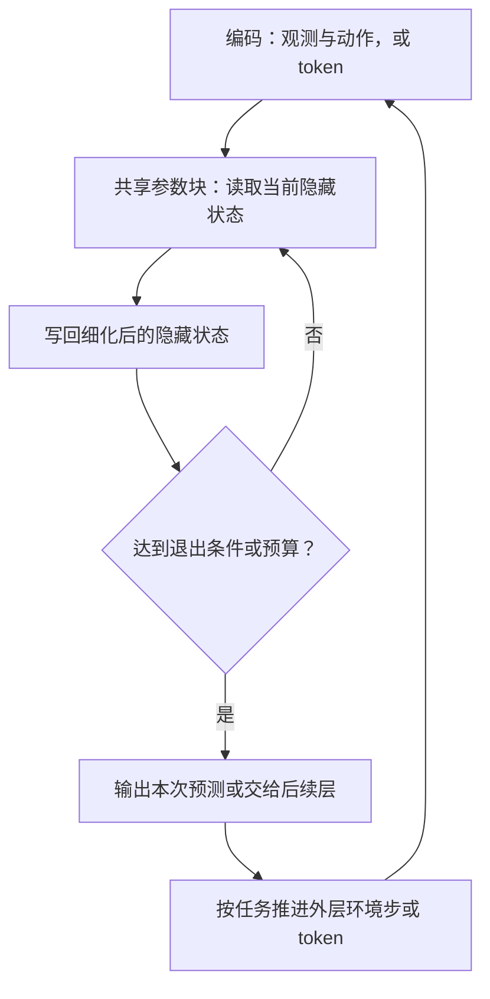
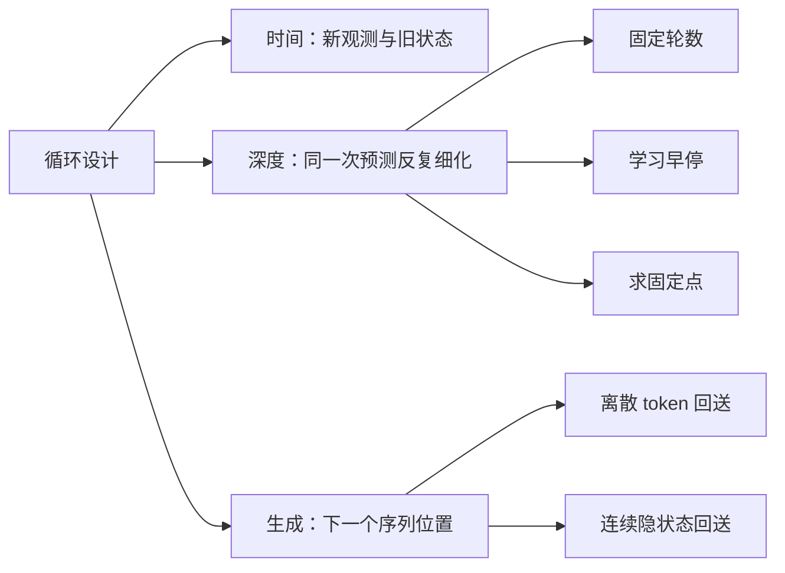

# General Looped Model（通用循环模型）：循环深度与一手证据

## 一句话定义

**循环深度**让同一组权重在一次预测内多次更新隐藏状态，以额外计算换更深的处理，而不为每一轮另存一整组层权重。本页把 **General Looped Model（通用循环模型）** 作为检索入口，不将它标为已核实的单独论文、模型版本或产品，也不把它和智谱的 GLM 品牌画等号。

## 英文缩写速查

| 缩写 | 英文 | 本页含义 |
| --- | --- | --- |
| ACT | Adaptive Computation Time | 学习每个输入或位置的停机深度 |
| DEQ | Deep Equilibrium Model | 以满足固定点条件的状态定义网络输出 |
| RNN | Recurrent Neural Network | 沿输入序列时间递推隐藏状态 |
| LoopWM | Looped World Models | FaceMind Research Asia 公开的循环世界模型论文 |
| KV | Key–Value | 注意力机制复用的键和值缓存 |
| GLM-5.4 | Z.ai GLM-5.4 | 智谱的模型名称，本文的独立语言模型对照 |

## 为什么重要

权重规模决定模型存储的一部分，实际执行轮次则影响算力、延迟和激活/缓存占用。对机器人规划有价值的问题不是「参数省多少」，而是在相同决策时限内，多做一次潜状态细化是否比多试一条候选轨迹更有效。

## 核心机制与流程

图中内圈是**循环深度**，外圈才推进环境步或生成下一个 token。扩散采样的多轮去噪推进的是采样步，不能仅凭多次前向就推断每个去噪步内部也有共享深度循环。

| 一手来源 | 循环处理什么 | 退出或状态管理 | 证据边界 |
| --- | --- | --- | --- |
| FaceMind Research Asia 的 LoopWM | 同一环境步的动作条件潜状态 | 论文描述可变循环深度、门控早退；多步潜推演可延迟到末端解码 | ScienceWorld 和 ALFWorld 文本交互预测，不是真机验证 |
| Z.ai 的 GLM-5.4 | 自回归模型中间 28 层的 token 隐状态 | 两轮；逐 token 门控调节更新强度，第二轮共享部分 KV 并保留局部滑窗 KV | 30B 消融等参数但训练计算约多 10%；不是推理开销，也不是真机结果 |

## 循环简史：先问在哪条轴上复用

[alphaXiv《The History of Looping》](../../sources/blogs/alphaxiv-history-of-looping.md) 用视觉皮层反馈作引子，从联想记忆追踪到循环 Transformer，再到跨位置的潜状态反馈。下面区分架构机制；历史导读不是跨模型性能评测。

| 轴或机制 | 上一步传来的是什么 | 典型例子与停止条件 |
| --- | --- | --- |
| 联想记忆 | 同一个模式的当前状态 | [Hopfield（1982）](https://doi.org/10.1073/pnas.79.8.2554) 以相互连接的单元更新状态直到稳定，能量下降到局部极小，不保证找到想要的记忆 |
| 序列时间 | 先前输入的隐藏状态，同时读新输入 | RNN 逐步更新，LSTM 以门控保留或覆盖记忆；通常随输入序列结束 |
| 网络深度 | 同一次预测内的中间隐藏状态 | [Universal Transformer（2018/2019）](https://arxiv.org/abs/1807.03819) 重复共享块，可固定轮数或逐位置用 ACT 早退；[DEQ（2019）](https://arxiv.org/abs/1909.01377) 则定义并数值求解固定点 |
| 自回归 token | 采样得到的离散 token | 文字思维链通过生成更多位置增加串行计算，通常由停止 token 或生成预算结束；历史 KV 仍可参与注意力 |
| 跨位置潜状态 | 前一位置的顶层连续向量 | [Coconut（2024）](https://arxiv.org/abs/2412.06769) 在潜思考步用向量替代词嵌入；[Full-bandwidth Transformer（2026）](https://arxiv.org/abs/2608.08888) 将该向量与已采样 token 的嵌入融合；不必重复同一位置的共享层 |

同是循环深度，[Ouro（2025）](https://arxiv.org/abs/2510.25741) 从 token 嵌入开始循环整栈，[Huginn（2025）](https://arxiv.org/abs/2502.05171) 只循环中段并每轮再注入前置编码。固定轮数可估算执行预算；[ACT](https://arxiv.org/abs/1603.08983) 学习停止决策并以计算代价约束使用的轮数；DEQ 则以迭代残差、求解容差和预算判断是否已近似找到固定点。输入每轮注入与提前停止是独立设计，均不自动保证第 N 轮比第 N−1 轮好。

[Loop Behind](../entities/paper-loop-behind.md) 对应一个相关但不同的解码调度问题：把位置较早的 token 的额外循环移到读出后，更新后续位置读取的 KV；不是把上一位置顶层状态当作下一位置的输入嵌入。该论文也报告把方法直接用于 Ouro 不成立，不能以「共享循环」一个标签概括两类骨干。

针对具身系统，先确认是在固定观测下细化一次动作预测，还是把动作送向外部并得到新观测，或仅在模型中展开多步虚拟状态。三者的时间与安全语义不同。

## 工程实践

比较时分别记录参数数、每次预测的循环数、外层 rollout 长度、解码次数、成功率、P50/P95 延迟和峰值显存。机器人场景先测固定墙钟预算下的 rollout 质量，再比较固定循环、难度早退和候选动作批量大小；不要拿文本精确匹配率替代闭环成功率。

## 局限与核验边界

- 公开报道把「General Looped Model」用于串联 FaceMind 的 LoopWM 与内部的 Looped Diffusion。可核对的 FaceMind 一手材料是 LoopWM 论文；[FaceMind 官网世界模型预览](https://faceminda.com/world-model)也没有把该英文术语确认为正式模型名。
- 截至 2026-11-25，未找到可独立核对的 Looped Diffusion 官方全文、训练数据、代码或权重；不录入报道所列规模或性能数字。对 LoopWM 与 GLM-5.4 也不以流程图充当已验证的源码运行时序。
- 共享参数并不自动节省推理 FLOPs；少输出一些 token 也不保证更低端到端延迟。门控控制更新幅度，与早退减少循环次数是两件事。

## 关联页面

- [Looped World Models（循环世界模型）](../entities/paper-sa-2606-18208-looped-world-models.md)
- [Loop Behind：循环语言模型的后置循环解码](../entities/paper-loop-behind.md)：对 Huginn 式架构分别干预当前读出深度和历史 KV 深度；用于对比文本解码与世界模型内循环，不是同一个项目。
- [生成式世界模型](../methods/generative-world-models.md)
- [循环神经网络](./recurrent-neural-network.md) · [模型架构纵深：Stage 1](../../roadmap/depth-model-architecture.md)
- [世界动作模型纵深路线](../../roadmap/depth-wam.md)

## 推荐继续阅读

先读 LoopWM 的 §3.2–3.5，弄清内循环、动作序列和末端解码；再看 Z.ai 博客的 Loop Architecture，比较固定双循环、门控更新与缓存共享三项设计各自解决的问题。

## 参考来源

- FaceMind Research Asia：[论文 HTML v1](https://arxiv.org/html/2606.18208v1) · [PDF v1](https://arxiv.org/pdf/2606.18208v1) · [一手通读归档](../../sources/papers/looped_world_models_2606_18208.md)
- Z.ai：[GLM-5.4 官方研究博客](https://z.ai/blog/glm-5.4) · [一手通读归档](../../sources/sites/zai-glm-5-4-loop-transformer.md)
- alphaXiv：[The History of Looping](https://www.alphaxiv.org/guides/history-of-looping) · [通读归档及原始论文](../../sources/blogs/alphaxiv-history-of-looping.md)（历史导读）。
- [报道中的命名线索](https://t.cj.sina.com.cn/articles/view/3996876140/ee3b7d6c0010186hc)（二手，仅供追溯词名，不作机制或性能证据）。
