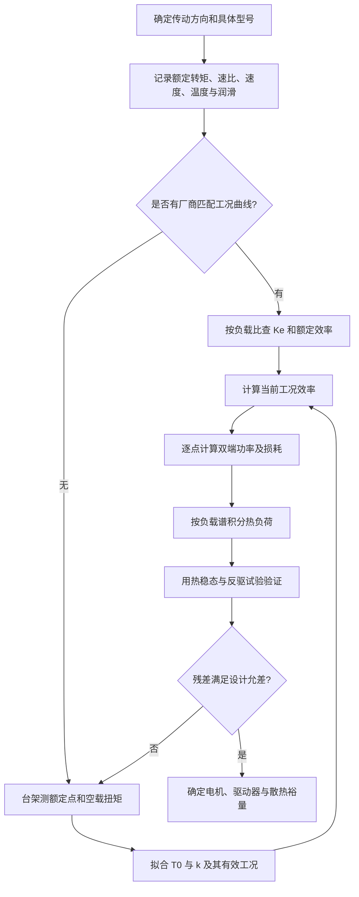

# 谐波减速器效率计算：额定点、轻载折算与发热（Harmonic Reducer Efficiency）

> 基于 Zane Hub 2026-11-19 文章编译，并交叉核验厂商曲线与标准信息。原文属于工程解读，不是具体机型的测试报告。

## 一句话定义

**谐波减速器效率 η 是指定方向、转速、负载、温度、润滑与封装条件下的输出机械功率/输入机械功率；额定效率只是一个工况点，不能代替关节负载谱。**

## 英文缩写速查

| 缩写 | 英文全称 | 简要说明 |
|------|----------|----------|
| HD | Harmonic Drive / strain-wave gearing | 谐波（应变波）传动 |
| RPM | Revolutions Per Minute | 转速 r/min |
| WG | Wave Generator | 波发生器，含椭圆凸轮和柔性轴承 |
| CS | Circular Spline | 刚轮 |
| FS | Flexspline | 柔轮 |
| Ke | Efficiency Compensation Coefficient | 厂商针对负载转矩比的效率修正系数 |

## 为什么重要

- 电机扭矩、电流、驱动器容量与关节温升必须按**实际转矩—转速—温度**评估，样本的额定效率不能覆盖轻载、低温和长时运行。
- 关节反驱、拖动示教、力控和安全回退关心**反驱起动转矩与反向效率**，不能由正向额定效率倒推。
- 减速器损耗是两端的**机械功率差**，不应与电机铜耗及驱动器电耗混为一谈。

## 核心原理

### 定义式：先明确功率方向

正向减速传动、功率从输入轴流向输出轴时：

\[
\eta_f=\frac{P_{out}}{P_{in}}=\frac{T_{out}\omega_{out}}{T_{in}\omega_{in}}
=\frac{T_{out}}{iT_{in}},\qquad i=\left|\frac{\omega_{in}}{\omega_{out}}\right|
\]

使用一致的扭矩/转速正功率方向和速比**幅值**，则 \(T_{out}=i\eta_fT_{in}\)。输出/输入转矩比不是效率本身。常见双波、刚轮固定、柔轮输出时，\(i=z_f/(z_r-z_f)\)：\(z_f=200,z_r=202\) 时 \(i=100\)。实际固定件改变时需重新核实旋向与符号。

实测效率可以直接采用**同步双端测量**的 \(T,n\)，即 \(\eta=(T_{out}n_{out})/(T_{in}n_{in})\)；齿数速比是运动学约束和一致性校验。原文「实测转速比必把编码器误差放大百倍」不构成普适误差传播结论。

### 输入端损耗转矩：便于工程拟合

将正向稳态的总阻力折算到输入轴：

\[
T_{in}=\frac{T_{out}}{i}+T_L,\qquad
\eta_f=\frac{T_{out}}{T_{out}+iT_L}
\]

原文在固定速度、温度和润滑状态下以 \(T_L\approx T_0+kT_{out}\) 近似，其中 \(T_0\) 是**无外载稳态运行**阻力，不等于冷态启动峰值转矩：

\[
\eta_f(T)=\frac{T}{(1+ik)T+iT_0}
\]

当 \(T_0>0,k\geq0\)，该简化模型在轻载时效率下降、载荷升高时渐近 \(1/(1+ik)\)。**这是给定模型的性质**，不代表真实产品全工况效率一定单调上升。

基准点反标定：

\[
T_{L,ref}=\frac{T_{ref}}{i}\left(\frac1{\eta_{ref}}-1\right),
\qquad
k=\frac{T_{L,ref}-T_0}{T_{ref}}
\]

单个额定点只能识别 \(T_{L,ref}\)，不能独立辨识 \(T_0\) 和 \(k\)；须补充同工况的空载损耗或多档负载测量。

### 四种损耗来源：位置与诊断

| 损耗源 | 主要来源 | 工程关注 |
|------|------|------|
| 齿面啮合 | 局部滑动、接触压力与润滑摩擦 | 载荷扫描、齿形与润滑状态 |
| 波发生器柔性轴承 | 滚动/滑动、预紧与润滑阻力 | 高转速、装配与润滑量 |
| 柔轮弹性变形 | 周期弯曲与材料迟滞内耗 | 柔轮结构、疲劳和热 |
| 密封、润滑脂剪切 | 密封接触、脂剪切和搅动 | 空载扭矩曲线、低温起动 |

原文给出的损耗占比百分数属于**未匹配具体产品试验的经验量级**，不可直接作为设计输入。

### 厂商补偿：优先使用产品自己的曲线

先按**具体型号、减速比、规定输入转速、温度、润滑剂与封装**查出额定效率 \(\eta_R\)，再查负载比 \(\alpha=T_{out}/T_{ref}\) 对应的 \(K_e\)：

\[
\eta(\alpha;n,\theta)=K_e(\alpha)\cdot \eta_R(n,\theta)
\]

[Harmonic Drive CSG/CSF 官方目录](https://www.harmonicdrive.net/_hd/content/documents1/reducer%20catalog_US.pdf) 使用上述系数。其 **CSF-20-80-2A-GR 示例**：1000 r/min、19.6 N·m、20℃、指定脂润滑；额定 34 N·m，\(\alpha\approx0.58,K_e\approx0.93,\eta_R=78\%\)，所以 \(\eta\approx73\%\)。**该数仅适用于目录实例**，不能跨机型套用。

温度与转速修正应查对应型号曲线；如果 \(\eta_R\) 已含温度影响，不可重复乘额外系数。

## 流程总览

## 工程实践

### 100:1 假设算例（非具体产品）

设 \(i=100,T_{ref}=56\,\mathrm{N\cdot m},\eta_{ref}=0.85,T_0=0.05\,\mathrm{N\cdot m}\)（输入轴稳态），则：

\[
T_{L,ref}=0.09882\,\mathrm{N\cdot m},\quad k=0.00087185,\quad
\eta(T)\simeq\frac{T}{1.087185T+5}
\]

| 输出转矩（N·m） | 额定比例 | 模型效率 |
|---:|---:|---:|
| 56 | 100% | 85.0% |
| 40 | 71% | 82.5% |
| 25 | 45% | 77.7% |
| 10 | 18% | 63.0% |
| 5 | 9% | 47.9% |
| 1 | 2% | 16.4% |

输出 25 N·m、30 r/min 时，\(P_{out}=T\cdot2\pi n/60\approx78.54\,\mathrm W\)、\(P_{in}\approx101.10\,\mathrm W\)、**减速器损耗** \(P_{loss}\approx22.56\,\mathrm W\)。这**不是电机/驱动器总发热**；是否温升几十 K 取决于热阻和散热条件，不能仅凭此值断言。

### 台架验收步骤

1. **双端同步测量**：驱动电机 → 输入扭矩/转速传感器 → 减速器 → 输出扭矩/转速传感器 → 伺服加载设备；记录壳体温度或规定测温点。
2. **跑合和热稳态**：用可复现的测试程序采集多档负载、速度、温度；输入端小量程传感器先校零漂，核对联轴器/附加支承损耗。
3. **空载曲线**：记录 \(T_0(n,\theta)\)；区分运行阻力与启动阻力。N·cm 与 N·m 相差 **100 倍**。
4. **方向区分**：正/反旋向与正向/反向传动是两个维度；反向传动另测静态反驱门槛和动态效率。
5. **负载谱热预算**：以 \(P_{loss}(t)=P_{in}(t)-P_{out}(t)\) 积分，而不是以平均转矩直接乘一个额定效率。
6. **标准边界**：查 [GB/T 30819-2024 官方信息](https://openstd.samr.gov.cn/bzgk/std/newGbInfo?hcno=6C1BD23EF10E2BEFCAA04FAD1535EA00)，具体试验程序需以**标准正文和产品规格**为准。

## 局限与风险

- 原文「反驱效率常为 30%–50%」「损耗分项占比」「T0 占额定损耗的 30%–50%」「低温黏度增长倍数」和另一 160:1 机型的补偿示例，缺少可独立匹配的型号与原始测试数据；本页**不当作普适事实**。
- 低负载**效率**下降不等于低负载**绝对损耗/电流**必大于高负载；需要同时看扭矩、转速、持续时间。
- \(T_0+kT\) 只用于已标定的正向稳态局部范围，不能代替冷态静摩擦、反驱、超额定、剧烈换向或全寿命损耗模型。
- 该文章来源为公众号工程讲解，非代码项目，**源码运行时序图不适用**；原微信页面配图未单独核实。

## 关联页面

- [关节模组减速器难度拆解](./joint-module-reducer-difficulty.md)：柔轮、柔性轴承、加工和寿命
- [空载：速度环与力矩环](./joint-module-no-load-velocity-vs-torque-loop.md)：空载阻力和电流分析
- [关节摩擦模型](./joint-friction-models.md)：摩擦拟合和补偿
- [关节模组自研流程](./joint-module-self-development-workflow.md)：模组选型与试验闭环
- [Actuator 102：热与控制](../overview/humanoid-actuator-102-thermal-and-control.md)：热设计
- [人形整机硬件设计纵深](../../roadmap/depth-humanoid-hardware-design.md)：关节损耗与整机功率预算

## 参考来源

- [Zane Hub《谐波减速器的效率如何计算？》来源归档](../../sources/blogs/wechat_zanehub_harmonic_reducer_efficiency_2026-11-19.md) — 用户提供原文全文文字
- [Harmonic Drive CSG/CSF 产品手册（PDF）](https://www.harmonicdrive.net/_hd/content/documents1/reducer%20catalog_US.pdf) — 负载比修正与型号示例
- [国家标准平台：GB/T 30819-2024](https://openstd.samr.gov.cn/bzgk/std/newGbInfo?hcno=6C1BD23EF10E2BEFCAA04FAD1535EA00) — 现行、2024-09-29 发布、2025-04-01 实施；未核对标准完整条文

## 推荐继续阅读

- [Harmonic Drive 官方产品目录](https://www.harmonicdrive.net/_hd/content/documents1/reducer%20catalog_US.pdf) — 优先查目标型号的转矩比、速度、温度和润滑条件。
