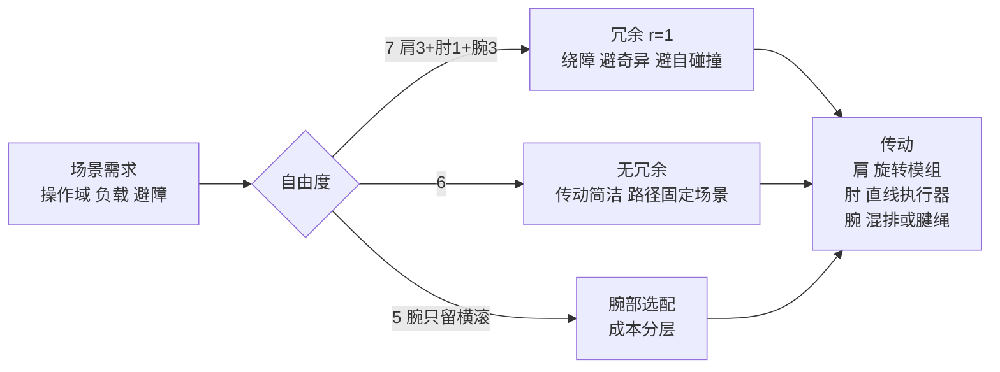

# 人形机械臂构型（自由度、轴线布置与传动）

## 一句话定义

**机械臂构型**指关节数量与类型、每根轴的驱动方式、各轴线的空间布置三件事；人形机械臂是工业「垂直串联」（全转动 6R / 7R）臂按人体比例压缩后的后代，常见布置是每臂「肩三轴、肘一轴、腕三轴」七自由度，也有六、五自由度的减法版本（Zane Hub #386，2026-11-08，第三方工程解读）。

## 英文缩写速查

| 缩写 | 英文全称 | 简要说明 |
|------|----------|----------|
| DoF | Degrees of Freedom | 自由度 |
| 6R / 7R | six / seven revolute joints | 全转动串联臂 |
| SRS | Spherical-Revolute-Spherical | 球肩-直肘-球腕，肩三轴交于一点、腕三轴交于一点 |
| SCARA | Selective Compliance Assembly Robot Arm | 两水平转动 + 一垂直移动，3C 装配常用 |
| J(q) / κ(J) | Jacobian / condition number | 雅可比矩阵与条件数，衡量速度与力传递的各向同性 |
| IK | Inverse Kinematics | 逆运动学 |
| FSA | — | 傅利叶旋转执行器系列名（GR-2 手册） |

## 为什么重要

- 构型直接圈定工作空间形状、负载上限和成本下限；参数表上的「自由度」一行背后是轴线怎么摆。
- 把 [人形机械布局](./humanoid-mechanical-layout-design.md) 里的肩 / 肘 / 腕落到可比的分类与选型权衡上，并与 [关节方案选型](./robot-joint-scheme-selection.md)、[行星滚柱丝杠](./planetary-roller-screw-humanoid-leg-actuation.md)、[灵巧手负载指标](./dexterous-hand-payload-core-metrics.md) 相接。
- 七自由度的冗余是 [零空间控制](./null-space-control.md) 与 [全身协调](./whole-body-coordination.md) 的几何前提。

## 核心原理

**工业分类（文章表）：** 直角坐标（三移动）、圆柱坐标、球坐标（Unimate）、SCARA、垂直串联；人形臂属于最后一类。

**冗余度：** 末端位姿 6 维，r = n − 6。n = 6 时每个位姿有限组关节解；n = 7 时有一维零空间运动 J(q)·q̇₀ = 0，肘可绕「肩-腕连线」摆动而手端不动。SRS 布置使逆解可解耦为「给定肘角 + 其余六关节解析解」。

**评价四尺度（文章）：** 工作空间 / 灵巧工作空间；负载自重比；奇异位形分布；传动链长度与走线复杂度。

**传动三套：** ① 旋转关节模组（无框力矩电机 + 谐波 + 力矩传感器 + 双编码器 + 交叉滚子轴承，肩髋用大力矩档）；② 直线执行器（行星滚柱丝杠电缸，肘部可借连杆放大力臂；近乎不可反向驱动，需力传感器）；③ 腱绳（把手指质量甩回前臂，腕部成为腱绳路由器）。静力矩估算 τ_max ≈ (m₁l₁ + m₂l₂)g，腕部每增重 1 kg，肩部力矩随前臂长度上浮。

**腕部瓶颈：** 包络最小、力臂最长、过路最密；完整三轴串联腕在产品中少见，研究出路是并联腕与腱绳 / 差动腕（文章举 KIT、MIT CSAIL DexWrist，本库未核原始论文）。

## 工程实践

**宇树 G1（官方核对）：** 官网规格页单臂 5 自由度（肩 3 + 肘 1 + 腕横滚 1，这个分解是文章与第二手说法，官网只给总数），G1 与 G1 EDU 的臂最大载荷分别约 2 kg / 3 kg，并注明载荷随伸展姿态变化很大；手部一栏写可选 +2 个腕自由度。[unitree.com/g1](https://www.unitree.com/g1)、[G1+](https://www.unitree.com/G1plus)。关节角度范围（肘 −60°~+120°、腕横滚 ±113°、腕俯仰 / 偏航 ±92°）文章给出，本库没找到官方来源。

**傅利叶 GR-2（官方核对）：** 手册规格：全身最多 53 自由度，单臂 7、腰 1，单手负载 ≈ 3 kg；最大力矩 436 N·m，FSA 2.0 另写「峰值力矩超过 380 N·m」。文章写「单臂未逐轴公开」与「380 N·m」都不完整。[GR-2 手册](https://www.fftai.com/pdf/en/gr2.pdf)。

**负载口径三问：** 持续还是峰值、全伸展还是收臂、单臂还是双臂合力；峰值关节力矩不等于持续负载（GR-2 峰值数百 N·m 而单臂标称 3 kg）。

**选型五权衡（文章）：** 操作域形状、冗余性价比、腕部截面约束、传动随力矩档位走、成本与商业形态（G1 把腕自由度做成选配）。

## 局限

- 来源是第三方工程解读；Figure 02、Apollo（每臂 6 自由度、整机双臂 25 kg）、1X、Optimus V3 腱绳与自由度拆解、优必选 Walker 的数字本库**未核到一手来源**，文章自己标「报道」。检索到的第三方站对 Apollo 单臂自由度说法相反（7），Apptronik 官方未核。
- Optimus 的 20 / 110 / 180 N·m 与 500 / 3 900 / 8 000 N 三档来自 2022 年 AI Day 原型的二手汇总；14 旋转 + 14 直线（肘 2、腕 4、腿 8）只见博客与供应商文章；文章把它与 Gen 2 / V3 混讲，不可直接当当前机型规格。
- 「谐波额定寿命 1~3 万小时」「马斯克称手部与前臂占整机六成」均为文章口径，未核。
- 趋势判断（收敛到「肩3+肘1+腕3」）是作者观点，不是统计。

## 关联页面

- [人形机械布局](./humanoid-mechanical-layout-design.md) · [关节方案选型](./robot-joint-scheme-selection.md) · [行星滚柱丝杠](./planetary-roller-screw-humanoid-leg-actuation.md)
- [灵巧手负载指标](./dexterous-hand-payload-core-metrics.md) · [灵巧运动学](./dexterous-kinematics.md) · [零空间控制](./null-space-control.md) · [全身协调](./whole-body-coordination.md)
- [Unitree G1](../entities/unitree-g1.md) · [Tesla Optimus](../entities/tesla-optimus.md) · [Figure AI](../entities/figure-ai.md) · [1X](../entities/1x-technologies.md) · [Franka Research 3](../entities/franka-research-3.md)

## 参考来源

- [Zane Hub #386 来源归档（含本库核对表）](../../sources/blogs/wechat_zanehub_humanoid_arm_configurations_2026-11-08.md)
- 宇树官网 G1 规格页：https://www.unitree.com/g1；G1+：https://www.unitree.com/G1plus
- 傅利叶 GR-2 手册：https://www.fftai.com/pdf/en/gr2.pdf

## 继续阅读

- 标准：ISO 8373（机器人词汇）、GB/T 12643（文章引用，本库未读原文）。
- 并联腕：KIT 高扭矩密度紧凑腕、MIT CSAIL DexWrist（原始论文未读）。
