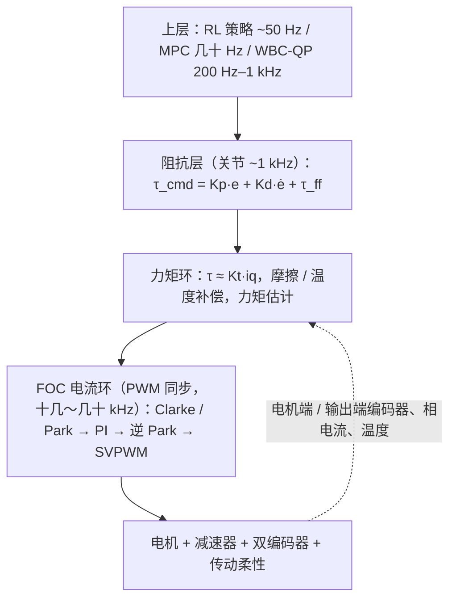

# 人形关节驱控三层框架（FOC → 力矩环 → 阻抗层）

## 一句话定义

人形机器人关节模组（无框力矩电机 + 减速器 + 双编码器 + 驱控板）的驱控，是一套**以 FOC 电流环为底座、以力矩为中间语言、以阻抗控制为对外表达**的分层实时系统；每层带宽逐级留 5–10 倍裕量（文章表述，来自 Zane Hub 第 383 篇）。

## 英文缩写速查

| 缩写 | 英文全称 | 简要说明 |
|------|----------|----------|
| FOC | Field-Oriented Control | 磁场定向控制：Clarke / Park 变换到 dq 系，解耦转矩与磁场电流 |
| PMSM | Permanent Magnet Synchronous Motor | 永磁同步电机 |
| MTPA | Maximum Torque Per Ampere | 最大转矩电流比（内置式电机） |
| QDD | Quasi-Direct Drive | 准直驱：低减速比、可反驱 |
| SEA | Series Elastic Actuator | 串联弹性执行器 |
| TSA | Torque-Sensor-based Actuator | 带力矩传感器的刚性执行器（文章用语） |
| WBC | Whole-Body Control | 全身控制 |
| DC | Distributed Clocks | EtherCAT 分布式时钟 |

## 为什么重要

- 执行器是人形整机成本占比最高的部件之一（文章称「五成上下」，口径来自供应链调研，**未核实**）；同样的电机与减速器，走路稳不稳、摔了坏不坏、交互硬不硬，差距常出在驱控框架与调校（文章观点）。
- 文章给的选型三问：**电流环带宽、输出端实测谐振频率、持续 / 峰值扭矩比**——比框架图更能预测实机表现。
- 库内已有分散的专题页（电机基础、摩擦、编码器、力矩传感器、阻抗控制）；本页把它们串成一条从电流到阻抗的链路。

## 核心原理

### 三层结构

| 层 | 管什么 | 文章给的带宽量级（作者表述） |
|----|--------|------------------------------|
| 电流环 | 电流 → 转矩 | 通用伺服 500–2000 Hz，高性能 2–5 kHz；PWM 十几～几十 kHz |
| 速度环 | PI + 前馈 | 50–200 Hz（高性能 200–500 Hz） |
| 位置环 | PI + 前馈 | 10–50 Hz（高性能 50–100 Hz） |
| 力矩环 / 阻抗层 | 关节对外「说力矩」 | 关节层 ~1 kHz，配 EtherCAT 0.25–1 ms 周期 |

### FOC 与力矩环

- 表贴式永磁电机取 i_d = 0，只留交轴电流，τ_e ≈ K_t·i_q，K_t = (3/2)·p·ψ_f（教科书公式，文章转述）。
- 电流环内部的必要工程项（文章列出）：逆变桥**死区补偿**（按电流极性前馈）、**弱磁**（超基速注入负 i_d）、内置式电机 **MTPA**。
- 力矩环的误差来源：减速器摩擦（高比谐波可占电机输出力矩的两三成，作者表述）、齿槽转矩、**K_t 随温度下降**、电流采样偏置与增益误差。
- 与 [力矩源抽象缺口](./torque-source-abstraction-gap.md)、[空载速度环 vs 力矩环](./joint-module-no-load-velocity-vs-torque-loop.md) 互补。

### 阻抗层

- τ_cmd = K_p·(θ_d − θ) + K_d·(θ̇_d − θ̇) + τ_ff；步态中着地相位刚度收高、摆动相位放软（文章）。成本不在阻抗律本身，而在前馈项 τ_ff 依赖的整机动力学模型或学习策略；模型不准则全靠反馈刚度硬扛，关节又硬又费电。
- 理论背景见 [阻抗控制](./impedance-control.md)、[Whole-Body Control](./whole-body-control.md)。

### 力矩从哪来（三条路）

| 方式 | 说明 | 取舍 |
|------|------|------|
| 电流估计 | τ̂ = K_t·i_q + 摩擦模型 | 零硬件成本；低速 / 轻载受摩擦污染，QDD 标准做法 |
| 双编码器差分 | τ̂ ≈ k_s·(θ_in/N − θ_out)，传动柔性当传感器 | 谐波柔性大时尤其顺（见 [编码器选型](./joint-encoder-selection.md)） |
| 输出端应变片 | 最准 | 温漂、标定、过载保护，成本与可靠性压力（见 [力矩传感器选型](./joint-torque-sensor-selection.md)） |

另有不加传感器的广义动量观测器 / 电流残差做碰撞检测（文章称为人形的安全底线）。

### 1 kHz 关节循环（作者给的时间轴）

EtherCAT 帧到达并锁存（DC）→ 读双编码器 → 接收 θ_d / θ̇_d / τ_ff → 阻抗律 + 限幅 → 摩擦前馈折算 i_q_ref → SVPWM 更新占空比 → PWM 中点采相电流、FOC 电流环迭代 → 双编码器差分 + 观测器 → 状态包回传。**电流环不按 1 kHz 跑**，与 PWM 同步。（时间点是文章示意，非实测。）

## 三件脏活

| 问题 | 要点 | 常见对策（文章） |
|------|------|------------------|
| 摩擦 / 齿隙 | Stribeck 形状、低速力矩精度天花板 | 前馈 + 观测器 + 双编码器兜底；LuGre 动态模型要辨识且随温度漂移；电子消隙（见 [关节摩擦模型](./joint-friction-models.md)、[摩擦补偿](./friction-compensation.md)） |
| 柔性谐振 | 两质量系统 ω_r ≈ √(k_s/J_l)；谐波柔性比行星大一个量级 | 陷波 / 自适应陷波 / 加速度反馈；选型时扭矩密度与谐振频率一起看 |
| 热 | 铜损 ∝ I²；R(T) 测绕组温度 | 降额、液冷；峰值 / 持续扭矩 3–5 倍是在花热容（见 [额定电流与过载](./joint-motor-rated-current-overload.md)） |

## 执行器路线

| 方案 | 传动 | 力矩来源 | 取舍（文章） |
|------|------|----------|--------------|
| TSA | 高比谐波 | 双编码器 + 力矩传感器 | 精度高、保位强；抗冲击差 |
| SEA | 高比谐波 + 弹性体 | 编码器差分 | 抗冲击、可储能；带宽窄、整定难 |
| QDD | 低比行星 | 电流估计 | 结构简、响应快；持续扭矩受热限制 |

文章的共识性判断：下肢主关节偏 QDD（反驱、抗冲击），上肢与腕部偏高比谐波（精度、保位），二者在同一台机器人上长期共存。相关展开见 [关节方案选型](./robot-joint-scheme-selection.md)、[膝关节为何不用谐波](./humanoid-knee-harmonic-drive-limits.md)。

## 核对结果（与一手资料对照）

- **MIT Cheetah**（[论文笔记](../entities/paper-notebook-proprioceptive-actuator-design-in-the-mit-cheeta.md)，论文 PDF 已读）：5.8:1 单级行星 ✓；整腿开环力带宽 103.7 Hz ✓；电机电流控制频率 **20 kHz**。**文章写的「电流环闭环带宽约 400 Hz」没有找到依据**（400 Hz 只在片段里作为「完整控制 400 Hz 带宽需 4 kHz 控制频率」出现），可能是误读（推测）。
- **Berkeley Humanoid**（[论文笔记](../entities/paper-notebook-berkeley-humanoid-a-research-platform-for-learni.md)）：论文执行器表四类型号齿轮比均为 9:1 ✓，最大一类峰值 81.1 N·m ✓；是否即膝关节未逐项核对。
- **Mini Cheetah**（[节点](../entities/mit-mini-cheetah.md)）：6:1 行星与库内一致；「单模块峰值 17 N·m」未核实。
- **Optimus 14+14 执行器与各档扭矩 / 推力**（[Tesla Optimus](../entities/tesla-optimus.md)）、宇树膝关节峰值、产品目录参数、磁钢耐温等：均为文章引用的公开口径，**未核实**。

## 局限

- 来源是单篇工程科普，部分数字为二手公开口径；本页只做结构化整理与有限核对，不是实测。
- 1 kHz 时间轴、带宽表是经验量级，不同厂商差异大。
- FOC 公式与 Stribeck / 两质量谐振是教科书内容，本次没有逐条回教材原文。

## 关联页面

- [电机基础](./electric-motor-fundamentals.md)
- [阻抗控制](./impedance-control.md)
- [关节摩擦模型](./joint-friction-models.md)
- [摩擦补偿](./friction-compensation.md)
- [编码器选型](./joint-encoder-selection.md)
- [力矩传感器选型](./joint-torque-sensor-selection.md)
- [额定电流与过载](./joint-motor-rated-current-overload.md)
- [空载速度环 vs 力矩环](./joint-module-no-load-velocity-vs-torque-loop.md)
- [关节方案选型](./robot-joint-scheme-selection.md)
- [力矩源抽象缺口](./torque-source-abstraction-gap.md)
- [Whole-Body Control](./whole-body-control.md)
- [Query：执行器驱动链选型闭环](../queries/actuator-drive-chain-selection-loop.md)
- [电机驱动固件与总线协议](../overview/motor-drive-firmware-bus-protocols.md)

## 参考来源

- [Zane Hub 第 383 篇（微信归档）](../../sources/blogs/wechat_zane_hub_humanoid_joint_drive_control_framework_2026-11-05.md)
- [MIT Cheetah 执行器论文归档](../../sources/papers/humanoid_pnb_proprioceptive-actuator-design-in-the-mit-cheeta.md)
