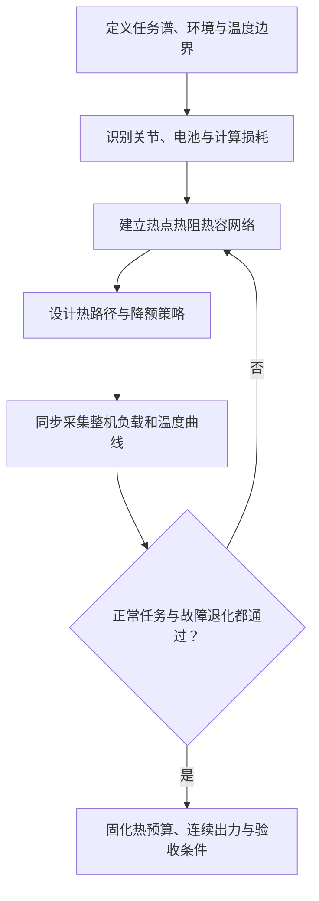

# 人形机器人整机热管理 / Whole-body Thermal Management for Humanoid Robots

## 一句话定义

整机热管理是在给定环境、任务节拍和结构约束下，让关节、电池、计算与人体可触及表面的温度都守住各自边界，同时保留足够的连续出力。它既是散热设计，也是运行时保护设计。

## 英文缩写速查

| 缩写 | 英文全称 | 含义 |
|---|---|---|
| RMS | Root Mean Square | 电流的均方根值，对应同电阻下的等效铜损 |
| TIM | Thermal Interface Material | 导热界面材料，用于降低接触热阻 |
| PCM | Phase Change Material | 相变材料；储热型 PCM 只补有限的瞬态热容量 |
| BMS | Battery Management System | 电池管理系统 |
| CFD | Computational Fluid Dynamics | 计算流体力学，可用于校核风路和液路 |

## 为什么重要

半蹲持载时，关节机械输出功率约为转矩乘角速度，速度很低并不意味着电机损耗低。反过来，跑跳中的大峰值未必决定稳态温度：任务占空比、热点热容和两个动作之间能否冷却同样重要。单关节台架的连续转矩额定值也不能直接移植到封闭整机，要重新核对其安装、邻近热源、散热条件和环境温度。

## 核心原理与方法

| 对象 | 损耗或风险 | 设计与量测 |
|---|---|---|
| 电机、驱动器 | 电机铜损/铁损、驱动器导通/开关损耗；绕组、功率器件和磁体受限 | 关节电流、速度、转矩、绕组估计及壳体/驱动测温；不同电流口径不可混用 |
| 减速器和轴承 | 啮合、密封和润滑损耗；升温会影响配合和摩擦 | 联合记录负载与速度，测传动壳温；考虑向同壳驱动器和电机耦合的热 |
| 电池和计算 | 电芯/母排发热及温差、芯片热点与热降频 | 充电与运行分别建模，电池看热点、温差与异常保护，计算看芯片温度、频率和端到端延迟 |
| 传感器和外壳 | 传感器温漂及可触及表面过热 | 记录安装处温度与外表热点；芯片与外壳的允许温度不是一个阈值 |

### 从任务谱到温升

按站立、持载、重复起蹲、行走和充电分段记录任务。平衡三相且以每相 RMS 电流和每相电阻计时，铜损近似为 `3 × I_phase,rms² × R_phase(T)`；若用母线电流、线间电阻或 FOC 峰值口径，不能直接代入。简化单热节点的稳态温升为 `P_loss × R_th`；从环境温度起步并施加恒定损耗时，瞬态温升为 `P_loss × R_th × (1 − exp(−t / τ))`，其中 `τ = R_th × C_th`。紧凑关节宜分别拟合绕组、壳体、PCB 与冷却边界；不要用一条指数曲线覆盖全部任务。

**算例（示意，不是产品参数或保护阈值）：** 假定每相 RMS 8 A、每相电阻 0.30 Ω 且不随温度变，铜损约 57.6 W。若等效热阻 2 K/W、时间常数 180 s，从冷态持载 60 s 的简化温升约 32.7 K，连续稳态却约 115 K。它只说明短台架通过不能代表闭环节拍通过；高温电阻变化、其他损耗和邻近发热需另计。

### 热路径与方案取舍

| 方案 | 何时有用 | 要验证什么 |
|---|---|---|
| 壳体导热、散热片、风冷 | 热源靠近壳体或能设计有效贯通风路 | 全封/过滤条件下真实气流、噪声和积尘；封闭腔中风扇不能消除末端瓶颈 |
| 冷板和循环液冷 | 分散热点难以直接排热，需将热汇集中到躯干或背部 | 压降与流量分配、末端换热器、泵失效、泄漏、管线弯折寿命及远端附加惯量 |
| 热管、均热板或储热型 PCM | 扩散/转移热点热量，或在有限时间缓冲热峰 | 冷凝端仍要排热；储热 PCM 到容量后需冷却复位；相变 TIM 是降接触热阻，不是热电池 |

## 工程实践：整机验证流程

1. **同步采样**：统一记录关节电流/速度/力矩，环境、外壳与可用的绕组/驱动温度，泵或风扇工况，计算负载与降频事件。温度测点位置、初始状态、姿态和持续时间随试验留档。
2. **标定热网络而不只拟合终温**：用一组冷起和热起负载检验预测偏差；铜阻法估的是绕组平均温度，壳温也不是槽内热点。把估算误差纳入降额裕量。
3. **保护与控制协同**：向上层暴露可用扭矩、计算能力与故障，而不是让下层悄悄剪力矩。先验证受控降载、停止或安全落位，再定义温度恢复迟滞；对承重关节，保护跳变可能导致失稳。泵/风扇异常、传感器故障等场景只在具备保护的台架和受控整机验证，不在用户现场注入。
4. **交付可复测的记录**：针对任务谱交付热点温升曲线、持续输出与降额条件、降频下延迟、安全退化结果，以及液路/风路更换和清洁边界。不要拿单个试验样机的泵标称参数代替整机验收。

## 常见误区或局限

- **忽略热量最终去向。** 主动液冷没有取消对环境的换热；全机散热端饱和时，提高泵速不必然有效。
- **把文章经验值变成通用阈值。** 机器人内部的热损耗占比随任务、边界和回馈变化；散热密度也不能脱离温差、面积、流量、风噪和所带质量比较。
- **把示范当资格验证。** 荣耀 D1 长跑能说明特定液冷架构具备实践价值；Figure 03 则是压铸件内集成冷却和主动风冷快充的不同问题。两者都不能推出其他机器人或任务的安全边界。

## 结论

先把损耗、热点、时间尺度、末端换热和故障退化写成整机可测条件，再选风冷、液冷或局部热缓冲。最终交付的是已知任务谱下的持续执行能力，不是峰值力矩或单次降温数字。

## 关联页面与推荐继续阅读

- [关节额定电流与过载](./joint-motor-rated-current-overload.md) 与 [转矩—转速曲线](./motor-torque-speed-curve.md)：从关节热边界判断连续工况。
- [关节执行器参数辨识](../methods/joint-actuator-parameter-identification.md) 和 [运动任务](../tasks/locomotion.md)：把负载谱和机电参数放进同一套测试。
- [执行器热学与力矩控制](../overview/humanoid-actuator-102-thermal-and-control.md) 与 [人形机器人电池与热管理指南](../queries/humanoid-battery-thermal-management.md)：分别深挖执行器控制侧和电池侧。
- [人形硬件设计纵深](../../roadmap/depth-humanoid-hardware-design.md)：从电气与配电到整机验收。

## 参考来源

- [Zane Hub 原文归档与证据分层](../../sources/blogs/wechat_zane_hub_humanoid_whole_body_thermal_management_2026-11-26.md)
