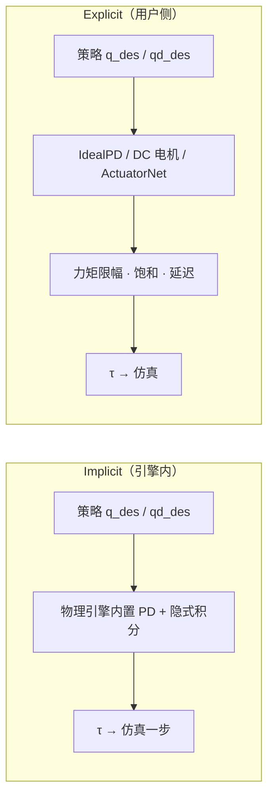

# Implicit / Explicit 执行器建模

在机器人强化学习里，**implicit** 与 **explicit** 通常指 **仿真执行器（actuator）模型** 如何把策略的高层指令变成关节力矩，而不是指「策略隐式学电机」或「显式地形表示」等其它语境下的同名概念。

## 一句话定义

> **Implicit**：物理引擎在积分循环 **内部** 完成 PD 并施加力矩；**Explicit**：用户代码 **先** 算期望力矩（再限幅等），再作为 actuation effort 写入仿真。

## 英文缩写速查

| 缩写 | 英文全称 | 简要说明 |
|------|----------|----------|
| PD | Proportional–Derivative | 位置/速度目标常经 PD 转为关节力矩 |
| RL | Reinforcement Learning | 策略多输出关节目标，底层仍依赖执行器模型 |
| Sim2Real | Simulation to Real | implicit↔explicit 切换可导致策略不迁移 |
| PhysX | NVIDIA PhysX | Isaac Lab 默认物理后端，提供 implicit actuator |
| MuJoCo | Multi-Joint dynamics with Contact | mjlab built-in actuator 走引擎隐式积分 |
| SEA | Series Elastic Actuator | explicit 模型可建模串联弹性等非理想特性 |
| DC | Direct Current | Isaac Lab `DCMotor` / mjlab `DcMotorActuator`：在 PD 力矩上加转矩–转速包络 |
| BAM | Better Actuator Models | Isaac Lab 新增 `BamActuatorCfg`（仅 Newton），按电压域伺服模型建模 |
| MLP | Multi-Layer Perceptron | `ActuatorNetMLP` / `LearnedMlpActuator` 的网络类型 |

## 为什么重要

腿足与人形 RL 的常见控制栈是：

```text
RL 策略 → 关节目标（位置/速度/力矩）→ 执行器模型 → τ → 物理仿真
```

同一套策略输出，若仿真里用 **implicit** 还是 **explicit** 执行器，会改变：

1. **有效关节带宽与接触冲量** — PD 是否在积分器内隐式处理阻尼
2. **训练收敛** — explicit 在大步长或高增益下更易数值振荡
3. **Sim2Real** — Isaac Lab 现行文档写道：用 implicit 执行器训练的策略换到 explicit 时「可能需要调整」（旧版文档措辞为不一定能直接迁移）

因此这是「仿真电机有多真实」与「训练是否好训」之间的核心开关，与 [Armature 建模](./armature-modeling.md)、[Actuator Network](../methods/actuator-network.md)、[关节摩擦](./joint-friction-models.md) 同属执行器对齐链路。

## 核心机制

### Implicit（隐式执行器）

- **谁算力矩**：物理引擎。Isaac Lab 的 `ImplicitActuator` 把位置 / 速度增益写给后端，由求解器的离散驱动执行 PD；mjlab 的 `BuiltinPositionActuator` 等在 MjSpec 里创建原生 MuJoCo actuator，引擎对速度相关阻尼力做隐式积分（默认 `implicitfast` 积分器）。
- **优点**：低开销；高增益或大步长时通常更稳（mjlab 文档："built-in actuators are more forgiving"）。Isaac Lab 同时提醒：接触、mimic 关节、关节限位、目标大跳变、求解器收敛不足仍可能使 implicit 驱动不稳。
- **局限**：偏「理想电机」；饱和、延迟、齿轮与学习到的电机行为需用 explicit。
- **遥测只是近似**：implicit 关节的 `computed_effort / applied_effort` 是为奖励与遥测估算的近似力矩，不是求解器真实施加的力。

### Explicit（显式执行器）

- **谁算力矩**：执行器模型在 Python / 框架侧运行：算出关节力、按电机能力限幅、再提交。
- **Isaac Lab 模型**（现行 main 文档）：`IdealPDActuator`（$\tau=k_p(q_{des}-q)+k_d(\dot q_{des}-\dot q)+\tau_{ff}$，对称限幅 $\pm\tau_{max}$）；`DCMotor`（同样的 PD 力矩，再按线性四象限转矩–转速包络限幅，`saturation_effort` 为堵转力矩、`actuator_velocity_limit` 为空载转速）；`DelayedPDActuator`（指令经循环缓冲延迟）；`RemotizedPDActuator`（延迟 + 随关节角变化的力矩上限）；`ActuatorNetMLP / ActuatorNetLSTM`（用关节历史预测力矩，输出再被 DC 电机包络截断，需要 TorchScript 检查点）；`BamActuatorCfg`（仅 Newton 后端，电压域伺服模型）。
- **mjlab 模型**：`IdealPdActuator`、`DcMotorActuator`（线性转矩–转速曲线）、`LearnedMlpActuator`（MLP 预测，继承 DC 电机限幅）；在用户代码算力矩，经 `<motor>` 透传，积分器看不到其速度导数，因此数值上不如内置执行器鲁棒。
- **增益归属**：explicit 组的 Kp/Kd 在执行器模型里，求解器自己的 PD 增益被置零，所以读 `data.joint_stiffness / joint_damping` 得到 0。
- **双重限幅**：explicit 模型限幅后，求解器仍保留 `joint_effort_limit` 再截一次；想让模型成为唯一限幅，应把 `joint_effort_limit` 配得不小于 `actuator_effort_limit`。
- **局限**：数值鲁棒性通常弱于 implicit；发散时先检查质量与惯量、目标缩放与更新率、力矩限幅、增益、时间步和求解器收敛，armature 按电机与传动模型选取。

### 与 RL 动作语义的关系

[SCA 2017 动作空间对比](../entities/paper-deeprl-locomotion-action-space-sca2017.md) 表明：locomotion 里 **目标关节角 + 局部 PD 反馈** 往往比直出扭矩更易学。implicit/explicit 讨论的是 **仿真里这层 PD 由引擎算还是用户算**，不改变「策略输出的是 setpoint 还是 torque」这一上层语义选择。Kp/Kd 与分频见 [Legged / Humanoid RL 中 Kp/Kd 设置](../queries/legged-humanoid-rl-pd-gain-setting.md)。

## 流程总览



## 栈内命名对照

| 框架 | 隐式（≈ implicit） | 显式（≈ explicit） |
|------|-------------------|-------------------|
| Isaac Lab | `ImplicitActuator` | `IdealPDActuator`, `DCMotor`, `DelayedPDActuator`, `RemotizedPDActuator`, `ActuatorNetMLP / ActuatorNetLSTM`, `BamActuatorCfg` |
| mjlab | `BuiltinPositionActuator`, `BuiltinPdActuator`, `BuiltinDcMotorActuator` 等 built-in | `IdealPdActuator`, `DcMotorActuator`, `LearnedMlpActuator` |
| MuJoCo 原生 | `<position>` / 原生 actuator + `implicitfast` | 用户算 τ 再经 `<motor>` passthrough |

## 工程实践：选型与稳定性


| 场景 | 建议 |
|------|------|
| 早期验证 reward / 算法 | 常用 **implicit**，收敛快 |
| 准备上真机、对齐电机包络 | 逐步切 **explicit**（DC 电机、摩擦、限幅）或 [Actuator Network](../methods/actuator-network.md) |
| implicit 能训、explicit 不收敛 | 按上节清单排查：惯量与 `armature`（按电机与传动选取）、目标缩放与更新率、力矩限幅、Kp/Kd、时间步、求解器收敛；增益可用 `randomize_actuator_gains` 事件做域随机化 |
| 需要指令延迟 | Isaac Lab `DelayedPDActuator`（reset 时从 [min_delay, max_delay] 物理步均匀采样；原生执行路径下 delay 固定、`min_delay` 被忽略）；mjlab 在任意执行器配置上加 `delay_min_lag / delay_max_lag`，并与观测延迟区分 |
| 由电机规格估 Kp/Kd | mjlab 示例：$K_p=J_{arm}\omega_n^2$、$K_d=2\zeta J_{arm}\omega_n$（取 10 Hz 带宽、$\zeta=2$ 过阻尼，因只算了电机反射惯量、低估总惯量）；反射惯量 $J=J_{motor}(N_1N_2)^2+J_{carrier}N_2^2+J_{output}$ |
| 量化仿真–真机执行器 gap | [SAGE](../entities/sage-sim2real-actuator-gap-estimator.md)、[BAM](../entities/paper-bam-extended-friction-servo-actuators.md) 等 |

## 常见误区与局限

1. **≠「隐式学习 vs 显式学习」** — 本概念特指 **仿真执行器建模**；论文里另有 implicit-explicit 表征、隐式地形等用法，需看上下文。
2. **≠「策略出力矩就是 explicit」** — 即便动作空间是扭矩，仍可能走 implicit 或 explicit 执行器路径，取决于仿真配置。
3. **Isaac Lab 里的名字别和 mjlab 混用** — `LearnedMlpActuator` / `DcMotorActuator` 是 mjlab 的类名；Isaac Lab 对应的是 `ActuatorNetMLP` 与 `DCMotor`。
4. **Implicit 不等于真机行为** — 真机有电流环、总线延迟与饱和；零样本 Sim2Real 往往要在 explicit 或数据驱动执行器上再对齐。

## 关联页面

- [执行器驱动链选型闭环知识链](../queries/actuator-drive-chain-selection-loop.md) — 本页是其③「执行器建模与摩擦辨识」层写回仿真的仿真侧对接
- [力矩源抽象 Gap（理想力矩源 ↔ 真实执行器）](./torque-source-abstraction-gap.md) — implicit 默认理想力矩源、explicit 才建这条 gap
- [物理保真度 ↔ Sim2Real Gap](./physics-fidelity-sim2real-gap.md) — 本页是其保真度链路中「执行器层」的具体开关
- [Sim2Real](./sim2real.md) — 执行器对齐是高保真迁移子链路
- [Armature 建模](./armature-modeling.md) — explicit 不稳定时常用的稳定性旋钮
- [Actuator Network](../methods/actuator-network.md) — explicit 路线的数据驱动进阶
- [关节摩擦模型](./joint-friction-models.md) — 常与 explicit 解析模型一并标定
- [Isaac Lab](../entities/isaac-lab.md) — 默认训练栈与执行器 API 入口
- [NVIDIA Getting Started With Isaac Lab](../entities/nvidia-getting-started-isaac-lab.md) — UR10 reach 课用 `ImplicitActuatorCfg`；模块 4 再讲 Actuator Network 替换 PID
- [Cartpole 问题](./cartpole.md) — Lab 教学资产用 implicit 阻尼近似轨道摩擦，不是 Gym 无摩擦解析车

## 参考来源

- [Isaac Lab / mjlab Implicit vs Explicit Actuator 一手资料索引](../../sources/courses/isaac_lab_implicit_explicit_actuators.md)
- [Getting Started With Isaac Lab 课程归档](../../sources/courses/nvidia_getting_started_isaac_lab.md)
- [Isaac Lab — Actuators（现行页面）](https://isaac-sim.github.io/IsaacLab/main/source/concepts/actuators.html)
- [mjlab — Actuators](https://mujocolab.github.io/mjlab/main/source/actuators.html)

## 推荐继续阅读

- [Isaac Lab `isaaclab.actuators` API](https://isaac-sim.github.io/IsaacLab/main/source/api/lab/isaaclab.actuators.html)（本次未读）
- [Learning Locomotion Skills Using DeepRL: Does the Choice of Action Space Matter?](https://arxiv.org/abs/1611.01055) — PD 目标空间为何常用
- [mjlab Actuators](https://mujocolab.github.io/mjlab/main/source/actuators.html) — built-in 与 explicit 的稳定性取舍、由电机规格推导增益的示例
