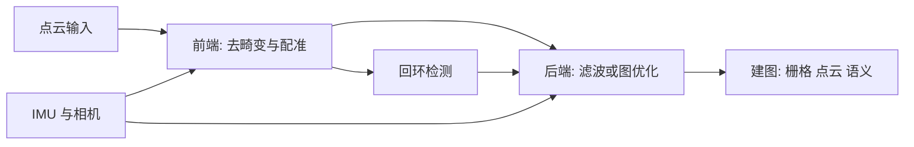

# 激光雷达 SLAM 综述（2026 转载文）整理

**一句话：** 综述按「前端 → 后端 → 回环 → 建图」拆框架，再按 2D、3D 里程计、多传感器融合、深度学习分类列出主流算法；本页把文中点名的算法映射到本库节点，并汇总逐算法核对中发现的偏差。综述本身不含新实验。

## 为什么重要

- 作为入口地图：从一篇文章进入 20 余个独立算法节点，而不是读一份无出处的清单。
- 综述的措辞有若干处与原论文不一致，直接引用会带入错误（见下表）。

## 框架

- 前端配准：ICP 及其变体（PP / PL / NICP / IMLS / GICP / VGICP）、NDT，以及学习型方法（FCGF、SpinNet、Lepard、REGTR）；本库未为这些单独建节点（见「未建节点」）。
- 后端：滤波（KF / EKF / UKF / ESKF / PF）与图优化（[GTSAM](../entities/gtsam.md)、[Ceres](../entities/ceres-solver.md) 等）。
- 方法总览与选型见 [激光里程计融合](../methods/lidar-odometry-fusion.md)、[LIO / VIO 选型](../comparisons/lidar-slam-lio-vio-selection.md)。

## 算法 → 节点

| 类别 | 综述点名 | 节点 | 状态 |
|------|----------|------|------|
| 2D | GMapping | [paper-gmapping](../entities/paper-gmapping.md) | 新建 |
| 2D | Hector-SLAM | [paper-hector-slam](../entities/paper-hector-slam.md) | 新建 |
| 2D | Cartographer | [cartographer](../entities/cartographer.md) | 复用 |
| 3D 里程计 | LOAM | [paper-loam-lidar-odometry-and-mapping](../entities/paper-loam-lidar-odometry-and-mapping.md) | 新建 |
| 3D 里程计 | A-LOAM | [paper-a-loam](../entities/paper-a-loam.md) | 新建 |
| 3D 里程计 | LeGO-LOAM | [lego-loam](../entities/lego-loam.md) | 复用 |
| 3D 里程计 | loam_livox | [paper-loam-livox](../entities/paper-loam-livox.md) | 新建 |
| 3D 里程计 | DLO | [paper-dlo-direct-lidar-odometry](../entities/paper-dlo-direct-lidar-odometry.md) | 新建 |
| 3D 里程计 | CT-ICP（文中写作 CP-ICP） | [paper-ct-icp](../entities/paper-ct-icp.md) | 新建 |
| 融合 | LIO-SAM | [lio-sam](../entities/lio-sam.md) | 复用 |
| 融合 | LVI-SAM | [paper-lvi-sam](../entities/paper-lvi-sam.md) | 复用 |
| 融合 | R2LIVE | [paper-r2live](../entities/paper-r2live.md) | 新建 |
| 融合 | R3LIVE | [paper-r3live](../entities/paper-r3live.md) | 新建 |
| 融合 | R3LIVE++ | [paper-r3live-plus-plus](../entities/paper-r3live-plus-plus.md) | 新建 |
| 融合 | FAST-LIO / FAST-LIO2 | [fast-lio](../entities/fast-lio.md) | 复用 |
| 融合 | Faster-LIO | [paper-faster-lio](../entities/paper-faster-lio.md) | 新建 |
| 融合 | FAST-LIVO | [paper-fast-livo](../entities/paper-fast-livo.md) | 新建 |
| 融合 | Point-LIO | [point-lio-unilidar](../entities/point-lio-unilidar.md) | 复用 |
| 回环 | Scan Context | [paper-scan-context](../entities/paper-scan-context.md) | 新建 |
| 回环 | Scan Context++ | [paper-scan-context-plus-plus](../entities/paper-scan-context-plus-plus.md) | 新建 |
| 深度学习 | OverlapNet | [paper-overlapnet](../entities/paper-overlapnet.md) | 新建 |
| 深度学习 | OverlapTransformer | [paper-overlaptransformer](../entities/paper-overlaptransformer.md) | 新建 |
| 深度学习 | SuMa++ | [paper-suma-plus-plus](../entities/paper-suma-plus-plus.md) | 新建 |
| 深度学习 | SA-LOAM | [paper-sa-loam](../entities/paper-sa-loam.md) | 新建 |
| 深度学习 | EfficientLO-Net | [paper-efficientlo-net](../entities/paper-efficientlo-net.md) | 新建 |

## 综述说法 vs 一手资料（节选）

以下各条由对应节点逐句核对得出，详细出处见各节点。

| 算法 | 综述说法 | 核对结果 |
|------|----------|----------|
| GMapping | 无法在室外构建大环境地图；无回环检测；按权重排序重采样 | 论文中有 Freiburg 校园（约 250 m × 250 m）和 MIT 1.9 km 的建图；回环靠粒子多假设隐式处理；重采样判据是 Neff < N/2 |
| Hector-SLAM | scan-to-map 需低速 | 与论文相矛盾；论文有 EKF 6DOF / IMU / 多分辨率，按设计无回环 |
| LOAM | 缺少后端；大场景漂移 | 建图本身是对地图的批优化；漂移结论不出自 LOAM 论文（行程约 1%–2.5%，KITTI 0.88%） |
| A-LOAM | 根据 LOAM 论文复现 | README 称改自 LOAM 与 LOAM_NOTED；运动畸变补偿默认关闭（`DISTORTION 0`） |
| DLO | 高速条件下实时处理 | 论文无高速机动实验；基线数字取自 LOCUS 论文 |
| R2LIVE | 时间开销大；非结构化环境易失效 | 论文中视觉里程计 7.84–20.16 ms；论文未展示 R2LIVE 整体失效 |
| R3LIVE++ | 提高定位与建图精度 | 建图有对照（光度误差 23.58→18.01）；定位无 R3LIVE 对照 |
| Faster-LIO | 1.5~2 倍 | 是 FPS 之比（对 FAST-LIO2 默认参数），表 I 为 1.52–3.49 倍；含 TBB 并行等，不全归 iVox |
| FAST-LIVO | 光线剧变等场景优势 | 超出论文证据 |
| EfficientLO-Net | 第一个完全端到端；优于 LOAM | 论文原话是首个「高效」3D 深度激光里程计；只在 KITTI 多数序列上优于 LOAM，且 07–10 均值仅领先 0.033 个百分点；PWCLO-Net 是同一篇 v1 的名字 |
| Scan Context++ | 任意方向不变 | 论文是横向（lateral）不变，且有两种描述子 |
| OverlapTransformer | Transformer 带来旋转不变 | 旋转不变来自等变卷积加 NetVLAD，无 Transformer 消融 |
| SuMa++ | 删除动态物体 | 语义一致性用作 ICP 权重，不是删除全部可动物体 |
| OverlapNet | 环境突变下仍有效 | 该说法不在论文中 |
| R3LIVE | 最先进 | 论文未这样说 |

综述把「CP-ICP」写作 CT-ICP 的变体名，属笔误（我的判断：对照 CT-ICP 论文标题）。

## 未建节点（本次不展开）

综述还提到下列算法 / 概念，本次未建独立节点：FastSLAM、Karto、ICP / NDT / GICP / VGICP 等配准变体、FCGF / SpinNet / Lepard / REGTR、FPFH、OctoMap、SLAMesh、ASL-SLAM、基于强度的 SLAM、DOOR-SLAM、Kimera-Multi（库里有 [kimera](../entities/kimera.md) 但未核对多机版本）、D2SLAM、Swarm-LIO、g2o / iSAM / SE-Sync，以及 KITTI、SemanticKITTI 等数据集。表 1–5 在抓取文本中缺失，未核对。

## 参考来源

- [综述转载文归档](../../sources/blogs/wechat_xinjiqishijue_lidar_slam_survey_2026-11-11.md)
- 各算法的一手资料见对应节点的 `sources/papers/` 归档。
